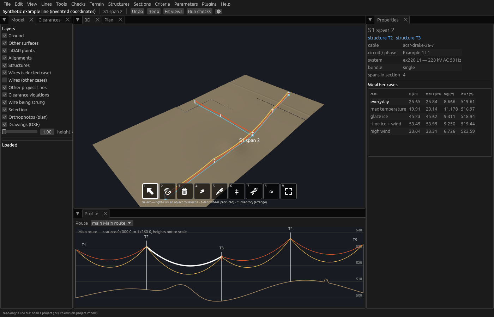

# OpenOHL

An open-source, modular set of desktop applications and engines for designing and analysing overhead power lines (OHL = overhead lines).

[](LICENSE)
[](Cargo.toml)
[](ROADMAP.md)



**Names:** OpenOHL is the project; **OHL-Design** is the line application (sag-tension, clearances, line layout), **OHL-Structure** the structure application (pylons and their loading) and `ohl` the command line. The project was formerly called "OLS CAD": the old program names `ols-cad`, `ols-structure` and `ols` still work for a while (they say so and run the new ones), and the launchers are now `Start OHL-Design.command` and `Start OHL-Structure.command`. File extensions and format ids changed from ols to ohl on 2026-10-18 (`.ohl`, `.ohls`, `.ohlw`…, `ohl-structure`…); older files still open.

OpenOHL covers terrain and LiDAR, conductor sag-tension, finite-element wire systems, loads and structure checks, clearances, thermal rating, spotting and drawings. Use it from the desktop applications OHL-Design and OHL-Structure, the `ohl` command-line tool or Python, alone or with several people on one project. Every calculation is open and documented in a theory manual; validation cases with reference results check them (72 cases so far).

> **Pre-alpha.** Phases 0 to 3 of the [roadmap](ROADMAP.md) are built and Phases 4 and 5 are built as a base, all in active development (nothing is approved yet). A qualified engineer must check every engineering result.

## What it does

- **Sag-tension**: exact catenary, change of state, tension sections (ruling span and exact equal-H), non-linear stress-strain and creep, tension criteria, point and distributed loads.
- **Finite-element wire systems**: exact catenary elements, suspension, V- and strain strings, bundles, jumpers, 3D blowout, broken spans.
- **Line model**: routes, structure and insulator libraries, sections, jumpers, electrical systems, incremental re-solving.
- **Terrain and LiDAR**: survey points and TINs, LAS/LAZ and COPC, point clouds stored in the project with levels of detail, ground classification, vegetation encroachment, as-built wire fitting.
- **Clearances**: vertical and radial, to the ground, LiDAR classes, other lines and the line's own wires, by voltage; envelopes over weather cases; galloping ellipses and blowout against the right of way.
- **Loads and structures**: load cases, design-code plugins (EN 50341, IEC 60826, NESC, CSA C22.3, ASCE MOP 74, GO 95; the code parameters are your own data), structure loads, capacity checks, frame/truss finite elements and pole checks.
- **More engineering**: thermal rating (IEEE 738, CIGRE TB 601 / 207, clearance-limited temperature), optimum structure spotting, bill of materials and cost estimate.
- **Drawings and exchange**: plan and profile sheets (SVG, DXF, PDF, PNG); OHL XML, LandXML, GeoJSON, Shapefile, GeoPackage, IFC, KML/KMZ, CSV, XLSX; file-format and project plugins.
- **Projects and collaboration**: a SQLite project file with an operation log and per-user undo, git-like versions (branches, merges, reviews, edit grants), a server mode for several users and a browser client.
- **OHL-Design** (`ohl-design`), the line application: 3D, plan and profile views, editing tools, tables, library and pylon editors, a Python console and a plugin manager.
- **OHL-Structure** (`ohl-structure`), the structure application: one structure file from stick figure to full design, its load cases and analysis.

## Quick start

You need a Rust toolchain from [rustup](https://rustup.rs) (stable, at least 1.96). Run these commands from the top of the repository.

Start OHL-Design with the synthetic example line, its survey and its weather cases:

```bash
cargo run --release -p ohl-app -- examples/synthetic-line/synthetic-line.ohl.json \
    --terrain examples/synthetic-line/synthetic-survey.csv \
    --weather examples/synthetic-line/weather-cases.ohlwc
```

With no file, `cargo run --release -p ohl-app` opens the start page (File › New project, Open). On macOS you can also double-click `Start OHL-Design.command`. The binary is called `ohl-design`. `ohl-design --help` lists its options.

The `ohl` command-line tool runs every calculation without a window:

```bash
cargo run -p ohl-cli -- info                                           # version information
cargo run -p ohl-cli -- sagtension examples/sagtension/drake-section.toml
cargo run -p ohl-cli -- validate                                       # all validation cases in benchmarks/
```

Python bindings: `pip install ./crates/ohl-py`, then `import ohl`. See [Getting started](docs/user-guide/getting-started.md) for every CLI command and the Python module.

## Documentation

The documentation is an [mdBook](https://rust-lang.github.io/mdBook/) in [`docs/`](docs/SUMMARY.md). It holds the user guide, the theory manual, the design documents, the development guide and the validation report.

```bash
cargo install mdbook
mdbook serve --open      # live preview in the browser
mdbook build             # static site in target/book/
```

On macOS, double-clicking `Open the manual.command` does the same and installs mdBook the first time. `cargo doc --workspace --no-deps --open` builds the API reference of the crates.

Key pages:

| Page | For |
|---|---|
| [Getting started](docs/user-guide/getting-started.md) | building, the desktop applications, the `ohl` CLI, Python |
| [OHL-Design, the line application](docs/user-guide/desktop-app.md) | views, menus, editing tools, tables |
| [Line files](docs/user-guide/line-file.md) and [project files](docs/user-guide/project.md) | the file formats |
| [Theory: sag-tension](docs/theory/sagtension.md) and [conventions and units](docs/theory/conventions.md) | the engineering behind the results |
| [Data model map](docs/development/data-model.md) | plugin builders: the model, its files and what a plugin sees |
| [Writing plugins](docs/development/plugins.md) | WebAssembly and Python plugins |
| [Architecture](docs/ARCHITECTURE.md) and [design goals](docs/DESIGN_GOALS.md) | modules, performance targets, decisions ([ADRs](docs/adr/README.md)) |
| [Validation report](docs/validation/report.md) | results against published references |

## Workspace layout

One Rust crate per module, in [`crates/`](crates/) (the structure application's crates are apart, in [`apps/structure/`](apps/structure/): see [Structure application crates](docs/development/structure-app.md)):

| Crate | What it holds |
|---|---|
| `ohl-core` | Units, geometry, project grid, time budgets (exit clauses) |
| `ohl-cables` | Cable library (`.ohlw`), stress-strain and creep models |
| `ohl-weather` | Weather cases (`.ohlwc`) and the loads they put on wires |
| `ohl-wireloads` | Point and distributed loads on wires |
| `ohl-sagtension` | Catenary, change of state, tension sections, criteria |
| `ohl-wirefe` | Finite-element wire systems: catenary elements, insulator strings, 3D Newton solver |
| `ohl-line` | Line model (`.ohl.json`): structures, attachments, sections; 3D solving |
| `ohl-structures` | Structure types (`.ohls`) and insulator assemblies (`.ohli`) |
| `ohl-structures-fe` | Structure analysis: frame/truss/cable finite elements, poles (`.ohlp`) |
| `ohl-sections` | Section library: standard profiles, cross-section properties (`.ohlsec`) |
| `ohl-loads` | Load cases (`.ohllc`), structure loads, capacity checks |
| `ohl-terrain` | Survey points, TIN, ground heights and profiles |
| `ohl-lidar` | LAS/LAZ reading, class schemes (`.ohlc`), ground classification |
| `ohl-pointcloud` | Point clouds in the project file: chunked, compressed, levels of detail |
| `ohl-clearance` | Clearance rules (`.ohlr`), envelopes, galloping, blowout, vegetation, wire fits |
| `ohl-thermal` | Thermal rating: IEEE 738, CIGRE, clearance-limited temperature (`.ohlta`) |
| `ohl-spotting` | Optimum structure spotting along a route profile |
| `ohl-bom` | Bill of materials and cost estimate (`.ohlcost`) |
| `ohl-drawing` | Plan and profile drawings (SVG, DXF, PDF, PNG) and profile exports |
| `ohl-background` | Orthophotos and DXF drawings kept in the project file |
| `ohl-crs` | Coordinate reference systems: EPSG codes, projections |
| `ohl-io` | Import/export formats and their registry |
| `ohl-session` | Project file (`.ohl`), commands, operation log, undo, versions, permissions |
| `ohl-server` | Server mode (QUIC) and the web client |
| `ohl-render` | wgpu renderer with levels of detail |
| `ohl-plugins` | Plugin manifests, discovery and the WebAssembly host (WIT interfaces) |
| `ohl-validation` | Validation framework: reference cases, runner, reports |
| `ohl-app` | OHL-Design, the line application `ohl-design` (egui) |
| `ohl-cli` | Command-line tool `ohl` |
| `ohl-py` | Python bindings (`import ohl`) |

Other folders: [`plugins/`](plugins/) (design codes, examples, tests), [`libraries/`](libraries/) (shipped example libraries: cables, insulators, objects, pylon templates, sections; LiDAR class schemes), [`benchmarks/`](benchmarks/) (validation cases with reference results), [`examples/`](examples/) (synthetic lines and job files), [`docs/`](docs/) (the book).

## Plugins

Anyone can add a design code, a file format, a report or a check without forking the core. There are three tiers ([ADR-0003](docs/adr/0003-plugin-mechanism.md)):

- **WebAssembly** components: a stable WIT interface ([`crates/ohl-plugins/wit/`](crates/ohl-plugins/wit/)), sandboxed, written in any language. Permissions are denied by default, and every call has time and memory limits.
- **Python** scripts for reports, imports and exports, and automation.
- **Native Rust** modules inside this repository.

Start with [Writing plugins](docs/development/plugins.md), the [data model map](docs/development/data-model.md) and the examples in [`plugins/examples/`](plugins/examples/) (`hello-wasm`, `hello-python`, `geojson`, `esri-grid`, `project-bundle`). The design codes in [`plugins/codes/`](plugins/codes/README.md) are WebAssembly plugins too. They ship no code tables: every value comes from your parameter file.

## Contributing

Contributions are welcome, especially validation cases with known reference results and reviews of the theory manual. Read [CONTRIBUTING.md](CONTRIBUTING.md) first. It has the development setup, the checks to run before a pull request (`cargo fmt`, `cargo clippy`, `cargo test`) and the **clean-room policy**: implementations are based only on public sources, never on commercial software.

See also [GOVERNANCE.md](GOVERNANCE.md) and the [Code of Conduct](CODE_OF_CONDUCT.md).

## Roadmap

[ROADMAP.md](ROADMAP.md) lists the phases, what is built and what is next: pylons in three levels of detail, structure–line interaction, foundations, more server and version-control features, and a stable plugin SDK for 1.0.

## Licence

[Mozilla Public License 2.0](LICENSE) ([ADR-0001](docs/adr/0001-license.md)). Plugins distributed as separate files may use any licence.

OpenOHL is an independent project. It is not affiliated with, endorsed by, or derived from any commercial software. All product names are trademarks of their respective owners. A qualified engineer must always verify engineering results.
