# Member capacities by ASCE 10-97

Implemented in the plugin **`asce10`, bundled with OpenOHL**
(`plugins/codes/asce10`: `asce10.rs` — `capacity`,
`effective_slenderness`, `local_buckling_stress`, `column_stress`,
`torsional_radius`, `torsional_flexural_radius`, `torsional_slenderness`,
`bolt_minimums` —, `check.rs` the member's usage, `joints.rs` the plates;
owner 2026-11-17, moved out of the core on 2026-11-18 with the same
formulas and words, after SIA 263:2013). OpenOHL sends it every checked
member with everything its check reads through the plugin interface
`member-check-full` — the conditions of the member ends as the core works
them out (`crates/ohl-structures-fe/src/member_ends.rs`,
`end_conditions`), the section properties
(`crates/ohl-sections/src/lib.rs`, `Section::properties`,
`Shape::symmetry`) —, its joints through `joint-check-moments` (2026-11-18; with what acts on a part beside its force), and the bolt
tools ask it through `bolt-distances-full` (with the bolts, its own bolt capacity)
([Plugins](../development/plugins.md#member-checks)). The usage that
follows from the capacities is on the
[structure analysis](structures-fe.md#member-usage) page. Built, in active
development (not approved yet); pre-alpha: results must be verified by a
qualified engineer.

**Source.** ASCE 10-97, *Design of Latticed Steel Transmission
Structures*, American Society of Civil Engineers (1998), Section 3
(members) and Section 4 (connections). Clause and equation numbers below
are the standard's. The standard gives its formulas in US units with a
factor Ψ for metric use (Ψ = 1 for ksi, 2.62 for MPa); the program
computes in SI with \\( f_y \\) in MPa where Ψ appears.

**Where it is used.** `[analysis] capacity = "asce10-97"`, the default —
no `capacity` given is the same (owner: "for the tower the ASCE 10-97
should be an option in the core, if safer even the default"; since
2026-11-18 the name is an alias of the bundled plugin's method, no file
changes). The method takes **no parameters** (its design strengths carry
no resistance factor to set): a parameter file `Plugins/asce10.toml` with a
value in it is refused, named. Every checked truss or
frame member whose material has a yield strength gets a compression and a
tension capacity from this page; the usage is the force over the capacity
times the load case's strength factor \\( \phi \\). A member without a
yield strength falls back to the simple check (said: "no yield strength:
simple check"). A member's own `capacity_tension` / `capacity_compression`,
and a cross-section's allowable tension, replace the computed values.
Cables, and tension-only members in compression, are not checked by
this method ([structure analysis](structures-fe.md#member-usage)).

## Inputs

| Input | From | Used for |
|---|---|---|
| \\( A, I_y, I_z, I_v \\) (minor principal) | the cross-section (library profile or `[[section]]` table) | radii of gyration \\( r = \sqrt{I/A} \\) |
| \\( E, f_y, f_u \\) | the material | column curve, local buckling, net section, bearing |
| shape and dimensions | the library profile | \\( w/t \\), shear centre, \\( C_w \\), \\( J \\), symmetry |
| \\( L \\) | the member's `lk` when given, else its length between its joints | slenderness |
| length ratios \\( \rho_y, \rho_z, \rho_v \\) | `[member.design] length_ratios`, else the member's `k` (or `lk`) on all three; none of them given: **worked out from what braces the member** ([below](#buckling-lengths-from-what-braces-the-member)) | \\( L/r \\) per axis |
| class | `class`: leg, bracing, redundant, crossing | slenderness limit, crossing rule |
| ends' eccentricity and restraint | each end's `[[connection]]`, else `end_eccentricity`, `end_restraint` ([below](#end-conditions)) | effective slenderness |
| \\( w/t \\) | `width_thickness`, else from the angle profile | local buckling |
| bolts, holes, thickness, plies, connected leg | `bolts`, `thickness`, `plies`, `connected_leg`, or each end's `[[connection]]` | bolt shear, bearing, net section |
| end distance, pitch, edge distance, gauges | `end_distance`, `spacing`, `edge_distance`, or the connection's `end_distance`, `pitch`, `edge_distance`, `gauges` | block shear |

Every input that is missing is assumed on the safe side and named per
member in what governs (`[assumed: …]`); the list is
[at the end](#assumptions-said-per-member).

## Compression

The compression capacity is \\( N_c = F_a A \\) (3.6), not above the
connection's bolt shear and bearing (Section 4). Step by step:

### 1. Slenderness \\( L/r \\)

\\[ \frac{L}{r} = \max\left( \frac{\rho_y L}{r_y},\ \frac{\rho_z L}{r_z},\ \frac{\rho_v L}{r_v} \right) \\]

\\( r_y, r_z \\) are about the section's geometric axes, \\( r_v \\) about
its minor principal axis (for an angle, the standard's z axis, 3.5). The
length ratios say where the member is braced: 0.5 about an axis for a
member held at mid-length in that plane. Section properties are those of
the gross cross-section (3.5).

**Crossing diagonals with their lengths given** (Appendix B, Example 7 —
an example of the standard, "to illustrate many of the requirements").
A member of class `crossing` with a `crossing` partner is taken as braced
at the crossing (its length ratios as given) only while its partner is
in tension of **at least 20 % of the member's compression** in the load
case (Example 7: "If the member in tension has a force of not less than
20% of the force in the compression member, the crossover point provides
support resisting out-of-plane buckling"; before 2026-11-19 any tension).
Otherwise its \\( L/r \\) is at least its whole length over the smaller
geometric radius \\( \min(r_y, r_z) \\): it may buckle out of its plane
over its full length. **Conservative:** a partner compressed less than
the member would still hold it partly; the standard's 3.7.4.4
(\\( K' \\) for forces varying over the length) is not used.

### Buckling lengths from what braces the member

*2026-11-19, stage 4.3 of the [joint details](../development/joint-details.md);
built, in active development, not approved yet.* A member giving none of
`lk`, a `k` other than 1 or `length_ratios` has its \\( L \\) about each
axis **worked out from what braces it** — its result says "from the
bracing", its notes the three lengths and between which joints; one
giving them keeps them ("buckling lengths given"); where OpenOHL sends no
bracing for it, ratios 1 ("assumed: no bracing found"). Where the bracing
gives the member its own length between its joints about every axis — the
lengths the default took — the check, its numbers and its words are those
before (`[assumed: length ratios 1, …]`); its notes say the lengths were
worked out. (`k = 1` is the default and cannot be told from one not
written: it counts as not given.)

**What OpenOHL sends** (`crates/ohl-structures-fe/src/bracing.rs`, no
code's rule): the member's **run** — the members continuing it in line
through its joints (two design-checked members whose directions from the
joint are opposite within 10°, each the other's most nearly opposite: a
leg split at every panel joint, a diagonal split at its crossing) — and
the run's **bracing points**: each of its joints, its two ends included,
with every other member ending or passing there (design-checked, not a
cable, more than 10° off the run's line; a tension-only member only
passing through) and the direction it holds the joint in (its own,
square to the run, in the member's local y and z: its axial stiffness);
a support fixed in all three translations holds a joint every way, one
fixed along some axes along each of them (springs not counted); a
`crossing` partner crossing the run away from a joint (the two lines
within 5 % of the shorter length) gives a point there, held along it.

**What the plugin takes** (`plugins/codes/asce10/src/lengths.rs`,
`bracing.rs`):

- \\( L \\) about each axis is the longest stretch of the run **between
  the points that hold that axis** overlapping the member (3.6: "L =
  unbraced length"; C3.7.4: "from working point to working point").
- **A single angle's v axis** (the standard's z, \\( r_z \\)) is held at
  every point some member holds, whatever its direction: Figure 3.2 (a)
  takes a leg's (2/3 L)/\\( r_z \\) between the points of either face,
  Appendix B's Example 5 a strut's 0.5 L/\\( r_z \\) at a support in its
  plane and Example 7 a crossing diagonal's \\( L_1/r_z \\) at a crossover
  that does not hold it out of the plane. Its geometric axes
  (\\( r_x, r_y \\)), and every axis of another section (3.9), only where a
  member holds the joint along that axis's buckling (within 20°,
  **assumption**) or the joint is held every way (two directions at least
  20° apart, **assumption**; a support).
- **Legs with staggered bracing** (3.7.4.1, Figure 3.2): an angle leg
  whose v stretch is shorter than the stretch between the points held
  every way takes its geometric axes' \\( L \\) **× 1.2** (Figure 3.2 (b),
  (c): (1.2 L)/\\( r_{xx} \\)), said. Where the points held every way are
  more than four panels apart (Figure 3.2: "supported in both faces at
  the same elevation every four panels"; a panel is the figure's L, the
  stretch between the points of one face — the longer of the geometric
  axes' stretches) the figure does not apply: v between the points held
  every way (the longer length), said. (Measured first with a panel taken
  as a stretch between any two bracing points: on three detailed towers
  legs braced in the figure's pattern lost it and took L/r up to 351.) Figure 3.2 is drawn for equal legs without a change of load
  between panels: taken for every angle leg (**assumption**, said for an
  unequal angle).
- **Crossings** (Appendix B, Example 7): a crossing — a point inside the
  run of a member that is not a leg, where another member passes through
  — holds the member out of its plane only while the other diagonal —
  each of its pieces at the crossing — is in tension of at least 20 % of
  the member's compression in that load case; otherwise only in its plane
  (as any member: v of an
  angle, and the axis whose buckling lies in the plane). An unequal angle
  bolted by its long leg is never held out of the plane at a crossing
  (Example 7's note: \\( (L_1 + 0.5 L_2)/r_{yy} \\); the whole length, longer,
  taken).
- **A bracing member strong enough** (C3.7.4: "The L/r limitations
  specified in Section 3.7.4.3 normally ensure that the redundant support
  is adequate"): a member holding a point inside the run counts only while
  its own KL/r is within its class's limit (leg 150, bracing 200,
  redundant 250 — the program's limits —; without a class 250, as a
  redundant member, the role 1.0 defines); worked out again until none
  more drops out; those not counted are said.
- **A run's ends** at a joint other members frame into are **working
  points** (C3.7.4: "from working point to working point"), held every
  way as the member's own ends always were (in whichever directions the
  members there lie; the joint's hold out of their plane is the
  structure's). **A free end** — a run end nothing frames into and not
  supported — makes the stretch to it a **cantilever: twice its length**
  (K = 2, **assumption**). A run nothing holds in a direction: twice its
  length, said **not on the safe side** (a mechanism unless the joints'
  bending holds it).
- **The curves' ends** (3.7.4.2: the ends "of the unsupported panel"):
  each end of the governing stretch takes that member end's eccentricity
  and restraint ([below](#end-conditions)); a point inside the run (the
  member continuous through it) concentric and not restrained (Example 7
  takes the crossover concentric, Eq. 3.7-6; Examples 8 and 9: "No end
  restraint is assumed in segment between crossover point and
  intermediate redundant support point"); a free end eccentric and not
  restrained. Each axis gets its own \\( KL/r \\); the largest governs.
- **Not taken** (the lengths longer, on the safe side): 3.7.4.4's
  \\( K' \\) for a force varying along a panel, 3.7.4.6's tests.

Worked example (the plugin's test `a_crossing_diagonal_pair`): an L
100×10 crossing diagonal of 5 m, eccentric at both ends, crossed at its
middle. Its partner pulling 30 % of its compression: every axis over
2.5 m. Pulling 10 %: \\( KL/r = \max(30 + 0.75 \cdot 2.5/r_v,\ 60 + 0.5
\cdot 5/r_y) \\) — Example 7's case 2 (Eqs. 3.7-6 and 3.7-7).

### 2. Torsional and torsional-flexural buckling

A cross-section may buckle by twisting, or by bending and twisting
together, at a lower load than by bending alone. The standard checks this
by an equivalent radius of gyration used in place of \\( r \\) in the
same column formulas (3.8.3, 3.9.4–3.9.6). The program works out that
slenderness by the profile's symmetry (`torsional_slenderness`,
`Shape::symmetry`) and takes it as \\( L/r \\) when it is larger than the
flexural one; the steps below then apply to it unchanged (as the
standard's Example 16 does, Appendix B).

| Profile | Clause | Slenderness |
|---|---|---|
| single angle, equal or unequal legs | 3.7, C3.7 | none beyond step 1: flexural buckling and the legs' local buckling (step 4) |
| I or H section (doubly symmetric) | 3.9.4 | \\( L / r_t \\) |
| channel; two angles back to back (singly symmetric) | 3.9.5 | \\( L / r_{tf} \\) |
| star or cross of angles (point-symmetric) | 3.9.6 | \\( L / r_t \\) |
| tube, hollow section, round bar (closed or solid) | 3.9.7 | none: flexural only |
| `general` profile | 3.9.8 (tests or analysis) | not checked, said ("torsional buckling not checked (general profile)") |
| `[[section]]` table without a library profile | — | not checked: no shape is known |

**Why single angles have no torsional check.** The commentary (C3.7)
explains that a single angle in compression can fail by torsional-flexural
buckling, by flexural buckling about its minor axis, or by local buckling
of its legs; for an equal-leg angle free to warp, purely torsional
buckling *is* the legs' local buckling, and torsional-flexural buckling is
only slightly below it. Angles are therefore checked for flexural and local
buckling only, and the standard's curves agree with tests on that basis.
Unequal-leg angles follow the same procedure with the long leg's \\( w/t \\)
(C3.7.3).

**The radii** (Eqs. 3.8-2 and 3.8-1, `torsional_radius`,
`torsional_flexural_radius`). With \\( C_w \\) the warping constant, \\( J \\)
the St. Venant torsion constant, \\( u_0 \\) the distance from the centroid
to the shear centre (along the axis of symmetry u), \\( I_{ps} = I_u + I_z +
A u_0^2 \\) the polar second moment about the shear centre, \\( r_{ps} =
\sqrt{I_{ps}/A} \\) and \\( r_u \\) the radius of gyration about the axis of
symmetry:

\\[ r_t = \sqrt{\frac{C_w + 0.04\,J\,(K_t L)^2}{I_{ps}}} \qquad (3.8\text{-}2) \\]

\\[ \frac{2}{r_{tf}^2} = \frac{1}{r_t^2} + \frac{1}{r_u^2} + \sqrt{\left(\frac{1}{r_t^2} - \frac{1}{r_u^2}\right)^2 + 4\left(\frac{u_0}{r_t\,r_u\,r_{ps}}\right)^2} \qquad (3.8\text{-}1) \\]

The factor 0.04 is the standard's (it corresponds to \\( G/(\pi^2 E) \\)
of steel, about 0.039). Where the ends differ for twisting and for bending about u, the
commentary (C3.8) replaces \\( r_t \\) and \\( r_u \\) by \\( r_t/K_t \\) and
\\( r_u/K_u \\); the result is then \\( r_{tf}/K' \\). The program passes
\\( r_u/\rho_u \\), \\( \rho_u \\) the member's length ratio about the axis
of symmetry (`length_ratios`' y for a channel, z for two angles back to
back), and \\( K_t = 1 \\).

**Conservative:** \\( K_t = 1 \\): the member is taken as free to warp over
its whole length (said when the mode governs: "free to warp (K_t 1)").
3.9.4's condition — check torsional buckling of an I section only when
its length free to twist is longer than its weak-axis buckling length —
is not tested: an I section is always checked.

**The section properties** come from the cross-section library, the same
for any design code (`Section::properties`: `shear_centre`, `warping`,
`it`). They are worked out from the plates' midlines (thin-walled theory,
the fillets left out), as in Timoshenko & Gere, *Theory of Elastic
Stability* (2nd ed., 1961), which the standard's commentary names for
them (C3.5):

| Shape | Shear centre | Warping constant \\( C_w \\) |
|---|---|---|
| angle, legs \\( b', h' \\) along their midlines | where the legs' midlines cross | \\( t^3 (b'^3 + h'^3)/36 \\) |
| I or H, \\( h_0 = h - t_f \\) | the centroid | \\( t_f b^3 h_0^2 / 24 \\) |
| channel, \\( b_0 = b - t_w/2 \\), \\( h_0 = h - t_f \\) | \\( e_0 = 3 b_0^2 t_f / (6 b_0 t_f + h_0 t_w) \\) behind the web's midline | \\( \dfrac{t_f b_0^3 h_0^2}{12} \cdot \dfrac{3 b_0 t_f + 2 h_0 t_w}{6 b_0 t_f + h_0 t_w} \\) |
| two angles back to back | on the axis of symmetry, at the outstanding legs' midline | 0 |
| star, cross of angles; closed and solid shapes | the centroid | 0 |

\\( J \\) is \\( \sum b t^3/3 \\) over the plates of an open shape (the
fillets left out), and the sum of the angles' own for a built-up shape
(joined only at the stitch bolts). **Conservative:** built-up shapes take
\\( C_w = 0 \\), their angles' own warping left out (said: "warping of the
angles left out"): a smaller \\( r_t \\), a lower capacity.

### 3. Effective slenderness \\( KL/r \\)

The member's end connections change how it buckles: an eccentric
connection (an angle bolted by one leg) bends it from the start, which
matters most for stocky members; a joint that holds the end against
turning helps slender ones. The standard expresses both as an effective
slenderness (3.7.4.2, 3.7.4.3; `effective_slenderness`):

| Slenderness \\( L/r \\) | Ends | Effective slenderness \\( KL/r \\) | Eq. |
|---|---|---|---|
| ≤ 120 | concentric at both ends | \\( L/r \\) | 3.7-5 |
| ≤ 120 | eccentric at one end | \\( 30 + 0.75\,L/r \\) | 3.7-6 |
| ≤ 120 | eccentric at both ends | \\( 60 + 0.5\,L/r \\) | 3.7-7 |
| > 120 | not restrained | \\( L/r \\) | 3.7-8, 3.7-12 |
| > 120 | partly restrained at one end | \\( 28.6 + 0.762\,L/r \\) | 3.7-9, 3.7-13 |
| > 120 | partly restrained at both ends | \\( 46.2 + 0.615\,L/r \\) | 3.7-10, 3.7-14 |

Up to 120 the eccentricity decides, above it the restraint (C3.7.4: "the
breakpoint is taken as L/r = 120"). Redundant members (3.7.4.3) use the
same formulas over wider ranges. Leg members bolted in both faces
(3.7.4.1, Eq. 3.7-4: \\( KL/r = L/r \\)) are the concentric case: give
their ends as concentric. The program applies these curves to every
profile, as the standard's Example 16 does for a 60° angle. How each end
is decided: [End conditions](#end-conditions).

**Slenderness limits** (3.4; `class_limit`): leg 150, other members 200,
redundant 250, compared with \\( KL/r \\) and said, not refused (`KL/r 210
above 200 (bracing)`). **Conservative:** the standard limits a leg's
\\( L/r \\), not its \\( KL/r \\); comparing \\( KL/r \\) (never below
\\( L/r \\)) may flag a leg the standard accepts. The limits of
tension-only members (3.4: \\( L/r \\) from 300 to 500) are not checked.

### 4. Local buckling of the legs

A wide thin leg buckles locally before the member reaches yield. For an
angle (3.7.3; `local_buckling_stress`) the flat width \\( w \\) is from the
edge of the root fillet to the leg's tip (Figure 3.1(a)): \\( w = b - t - r \\)
of the longer leg (C3.7.3), or `width_thickness` when given. With Ψ = 2.62
(MPa):

\\[ \left(\frac{w}{t}\right)_{lim} = \frac{80\,\Psi}{\sqrt{f_y}} \quad (3.7\text{-}1) \\]

\\[ F_{cr} = \begin{cases} f_y & w/t \le (w/t)_{lim} \\ \left[1.677 - 0.677\,\dfrac{w/t}{(w/t)_{lim}}\right] f_y & (w/t)_{lim} < w/t \le 144\,\Psi/\sqrt{f_y} \quad (3.7\text{-}2) \\ \dfrac{0.0332\,\pi^2 E}{(w/t)^2} & w/t > 144\,\Psi/\sqrt{f_y} \quad (3.7\text{-}3) \end{cases} \\]

For \\( f_y \\) = 355 MPa: \\( (w/t)_{lim} \\) = 11.12, the elastic range
above 20.02. \\( F_{cr} \\) replaces \\( f_y \\) in the column curve. A
cross-section's allowable compression, when given, is taken as
\\( A F_{cr} \\). For other profiles \\( F_{cr} = f_y \\), unless a
`width_thickness` is given (then the angle's formulas above).

**Maximum \\( w/t \\)** (3.7.1): an angle's leg may not exceed
\\( w/t = 25 \\). A leg above it gets the elastic \\( F_{cr} \\) and is said
beside the slenderness limits (`w/t 31.0 above 25 (3.7.1)`), not refused.
A root radius missing from the profile makes \\( w \\) larger (said: "w/t
without a root radius"), on the safe side.

**Not on the safe side** where they govern: the effective widths of other
profiles' elements (3.9.2, 3.9.3: a reduced area for slender plates of
tubes, channels, I sections) are not applied.

### 5. Column curve

\\[ C_c = \pi \sqrt{\frac{2E}{F_{cr}}} \quad (3.6\text{-}3), \qquad F_a = \begin{cases} \left[1 - \dfrac12\left(\dfrac{KL/r}{C_c}\right)^2\right] F_{cr} & KL/r \le C_c \quad (3.6\text{-}1) \\ \dfrac{\pi^2 E}{(KL/r)^2} & KL/r > C_c \quad (3.6\text{-}2) \end{cases} \\]

(`column_stress`). The parabola is the Structural Stability Research
Council's inelastic column curve, the second branch Euler's elastic one
(C3.6). \\( N_c = F_a A \\) on the gross area.

### 6. The connection

The compression capacity is not above the bolts' shear and bearing at
either end ([Connections](#connections)): a short member may be limited
by its bolts, not by buckling. What governs names it (`bolt shear at
N2`).

## Tension

The tension capacity is the least, at the weaker end, of:

- **net section** (3.10.1, 3.10.2): \\( (A' - n_h\,d_h\,t)\,f_y \\), times
  0.9 for an angle bolted by one leg (3.10.2). \\( n_h \\) is the number of
  holes in one cross-section (`holes`, or from the connection's gauge
  lines or bolt points, not more than its bolts; both legs bolted, since
  2026-11-05: the lines or points of each leg, both legs' holes in the
  same cross-section); \\( t \\) the thickness
  of the connected leg; \\( A' \\) the gross area, for an unequal angle
  bolted by its short leg less \\( (b_{long} - b_{short})\,t \\) (3.10.2:
  its unconnected leg counted no larger than the connected one).
  Angles bolted in both legs are concentric (3.10.1): no 0.9;
- **block shear** of an angle bolted by one leg (3.10.2, Eq. 3.10-1,
  Figure 3.5): \\( P = 0.60\,A_v f_u + A_t f_y \\), with
  \\( A_v = t\,(e + (n-1)\,s - (n - \tfrac12)\,d_h) \\) the net area in shear
  along the bolt line (the clear distances from the end to the first hole
  and between holes: the figure's \\( a + 2b \\) for three bolts) and
  \\( A_t = t\,(c - \tfrac12 d_h) \\) the net area in tension from the hole to
  the toe. \\( e \\) is the end distance (`end_distance`), \\( s \\) the pitch
  (the connection's `pitch`, else the member's `spacing`), \\( n \\) the
  bolts of one line (the bolts shared out over the gauge lines),
  \\( c \\) the distance from the line nearest the toe to the toe: the
  connected leg's width less the largest gauge, else the `edge_distance`
  (taken to the toe). **Conservative:** the standard asks for it when the
  bolt pattern's centroid lies outside the angle's centre of gravity; the
  program checks it always. **Several gauge lines** (up to three): with
  their gauges known (the connection's `gauges`), the lower of the outer
  line's block times the number of lines (the bolts sharing the force
  equally, 4.1) and the block of all lines (shear along the inner line,
  \\( A_t = t\,(c_{inner} - (k - \tfrac12)\,d_h) \\) from the inner line to
  the toe across the \\( k \\) lines' holes); without them (only a number of
  holes in a section, as an import gives), **conservative**: the outer
  line's block alone carries the whole force (said: "block shear: the
  outer gauge line alone"). Without an end distance, pitch, edge distance or \\( f_u \\) it
  is not checked, said ("block shear not checked (no end distance)");
- **bolt shear** and **bearing** ([Connections](#connections)).

**The hole** \\( d_h \\): the given `hole`, else a standard hole, the bolt +
1.6 mm (4.1: "holes nominally 1/16 in. (1.6 mm) larger than the bolt
diameter"); and, since a punched hole counts 1.6 mm larger than its
nominal diameter (3.10.1, 3.10.2), every hole is taken as punched: + 1.6
mm (said: "holes punched (+ 1.6 mm)"). **Conservative** for drilled or
reamed holes, which the standard lets count at their nominal diameter
(the data do not say how a hole was made).

**Without bolts or holes in the data** (2026-11-24, the owner's answer
of 2026-11-23, O19 stage 5; built, in active development): the
connection is not checked (said **not on the safe side**: "no bolts
given: connection not checked (bolt shear, bearing and block shear left
out; the net section on an assumed hole in each leg, which larger or
more holes lower)"), and the tension is on the **net section with a bolt
hole in each leg** of an angle — a single angle 2 holes in the section,
two angles back to back or in a star 4, four in a cross 8 — until the
bolts are known, as a tower program takes it (it took the gross section
before, about 20 % higher on the members compared). The hole is the
member's typical bolt's (an end whose `[[connection]]` gives bolts: their
hole, else their standard hole), else a **20 mm bolt's standard hole,
21.6 mm — the program's default, not the code's** (said: "no bolts or
holes given: a 21.6 mm hole in each leg (2 in the section; a 20 mm bolt,
the program's default (not the code's), and its standard hole (4.1))
until the bolts are known"); punched (+ 1.6 mm) and one leg bolted
(× 0.9; an unequal angle's short leg) as for any missing data. What it
leaves out: the real bolts — a larger bolt or more holes in one section
lower the net section further, and the bolts' shear, bearing and block
shear can govern; give the member's `bolts` (or its ends' connections)
to check them. A section that is not an angle (no leg to put a hole in)
keeps the gross section, said the same way. An end that is continuous,
welded or seated takes no hole. With bolts counted 0 (the holes only,
the connection elsewhere) only the net section is checked.

**Conservative:** with two gauge lines, or both legs bolted, all holes
are taken in one cross-section; the standard's chain rule (3.10.1: deduct the holes of a
zigzag chain and add \\( s^2/4g \\) per gauge space) can only give a larger
net width.

## Connections

> **When the connections are taken (2026-11-11).** The check reads a member end's `[[connection]]` only when the structure file asks for it (`joint_details = true`) **and** is level 4 (every checked member end with its joint detail). Otherwise — the default — the members are checked in the simple form: the member's own design data only, the ends assumed eccentric and not restrained where nothing is given. That simple form does not check a connection's bolt shear, bearing and net section nor the moment of a shifted end, which can govern: it is **not on the safe side for those**, and the results say which form was used. Everything below that names a connection applies when they are taken.

Per end, the bolts the end's `[[connection]]` gives, else the member's
`bolts` (a hole or shear capacity of the member's only for bolts of the
same diameter). The standard assumes the bolts of a connection share its
force equally (4.1).

- **Bolt shear** (4.3.2): \\( n \cdot n_s \cdot V \\), \\( n \\) bolts,
  \\( n_s \\) shear planes, \\( V \\) per bolt and plane: the tabulated
  shear strength (the bolt's `shear_capacity`, or a library bolt's:
  `shear_capacity` with the threads in the shear plane,
  `shear_capacity_shank` with them out when `threads_in_shear = false`);
  for a bolt with only its tensile strength \\( f_{ub} \\) given,
  \\( V = 0.62 f_{ub} A_e \\), \\( A_e \\) the root area with the threads in
  the shear plane, the gross area with them out (4.3.2).
- **Bearing** (4.4): the bearing stress on the bolt's diameter times the
  connected thickness may not exceed 1.5 times \\( f_u \\) "of the
  connected part or the bolt" — the lower of the two:
  \\( n \cdot 1.5\,\min(f_u, f_{ub})\,d\,t \cdot n_p \\), \\( n_p \\) the plies
  (profiles side by side). Without the bolt's \\( f_{ub} \\) the member's
  \\( f_u \\) alone, said ("bearing on the member's f_u (the bolt's not
  given)").

**The root area** with the threads in the shear plane, when the bolt
gives no shear capacity: **conservative**, 0.6 of the gross area
(`ROOT_AREA`). The root diameter of a 60° thread is \\( d_3 = d - 1.2269\,P \\)
(the basic profile's height \\( H = \tfrac{\sqrt3}{2} P \\); \\( d_3 = d -
\tfrac{17}{12} H \\)); 0.6 of the gross area is \\( d_3 = 0.775\,d \\), a pitch of
\\( d/5.4 \\) — coarser than the threads of the bolts in towers, so the
real root area is larger and the bolt shear higher. A bolt's own
`shear_capacity` (or a library bolt's) gives the real value. Threads
given out of the shear plane with only \\( f_{ub} \\), or with no capacity
for it, are taken as in the plane (said: "bolt shear as with the threads
in the shear plane").

**Not on the safe side** where they govern:

- the minimum end, edge and hole spacing distances (4.5) are not part of
  the member check: OHL-Structure's bolt tools apply them where bolts are
  placed, and mark the bolts that break them ([below](#minimum-distances-of-bolts));
  attachment holes (4.6) and bolts in tension (4.3.3, 4.3.4) are not
  checked. The gusset plates' own bearing, block shear, net section and
  distances are checked per case ([below](#plates-and-welds)).

### Minimum distances of bolts

`asce10::bolt_minimums` (the plugin's `bolt-distances`), asked through
`ohl_member_check::joints::bolt_rules` by the bolt layout form and the
Add / Move bolt tools, with \\( d \\) the
bolt diameter, \\( t \\) the connected thickness, \\( f_u \\) its tensile
strength and \\( P \\) the force one bolt transmits:

| Distance | Minimum | Clause |
|---|---|---|
| end (hole centre to the steel's end) | \\( \max(1.2P/(f_u t),\ 1.3d,\ t + d/2) \\); redundant members \\( \max(t + d/2,\ 1.2d) \\) | 4.5.1, Eqs. 4.5-1 to 4.5-4 |
| spacing between holes | \\( 1.2P/(f_u t) + 0.6d \\) | 4.5.2, Eq. 4.5-5 |
| edge (hole centre to the leg's free edge) | rolled \\( 0.85\,e_{min} \\); sheared or flame-cut \\( 0.85\,e_{min} + 1.6 \\) mm (1/16 in.) | 4.5.3, Eqs. 4.5-6, 4.5-7 |

\\( P \\) is the member's largest axial force over the last analysis
divided by its bolts at that end; without an analysis the bolt's design
shear capacity (**conservative**: no bolt carries more) — 4.3.2: the
capacity given for the bolt (through the shank when the threads are said
to be out of the shear plane), else \\( F_v = 0.62 f_u \\) of the bolt on
the root area, taken as 0.6 of the gross area (the threads in the shear
plane, **conservative**), times its shear planes. Since 2026-11-18 (third
round) the plugin works this out itself (`asce10::bolt_shear`, its
`bolt-distances-full`; before, OpenOHL's core did, for every code — the
same numbers bit for bit on the shipped examples and the real towers
compared, 4 013 640 member-end rows). Without either the force terms
are left out (said). **Conservative:** the edge is taken as
sheared unless the connection says `rolled_edge = true`; holes as punched
(Eq. 4.5-3 applies; it does not for drilled holes); the spacing is
checked between any two bolts, also on different gauge lines (the
standard's is along a line of force). A new gauge line is kept clear of
the root fillet (\\( t + r + d/2 \\) from the heel: geometry, not a code
rule).

## End conditions

> **When the connections are taken (2026-11-11).** The check reads a member end's `[[connection]]` only when the structure file asks for it (`joint_details = true`) **and** is level 4 (every checked member end with its joint detail). Otherwise — the default — the members are checked in the simple form: the member's own design data only, the ends assumed eccentric and not restrained where nothing is given. That simple form does not check a connection's bolt shear, bearing and net section nor the moment of a shifted end, which can govern: it is **not on the safe side for those**, and the results say which form was used. Everything below that names a connection applies when they are taken.

Each end of a member is **eccentric** or not and **restrained** against
turning or not (`member_ends::end_conditions`); the two ends together give
the curves' none / one end / both ends. Decided per end in this order:

1. **given** at the end's `[[connection]]` (`eccentric`, `restrained`);
2. **the member's** design data (`end_eccentricity`, `end_restraint`:
   none, one end or both ends; for *one end*, the end not given takes the
   opposite of the other end's given value);
3. **worked out**, only at an end with a `[[connection]]`, from what it
   gives (or the member's `connected_leg` and `bolts`):
   - one leg bolted → eccentric, both legs → concentric. Basis: C3.7.4,
     "normal framing eccentricity" of an angle bolted by one leg; 3.10.1,
     angles bolted in both legs are concentrically loaded;
   - one bolt → not restrained (3.7.4.5: "a single bolt connection …
     shall not be considered as furnishing restraint");
   - two bolts or more onto a **gusset plate** only → not restrained
     (3.7.4.5: a multiple-bolt connection made only on a gusset plate,
     without also being framed to the restraining member, does not
     restrain; C3.7.4 (c));
   - two bolts or more onto a **member** → restrained when that member is
     stiff enough (C3.7.4 (a), (b); `member_ends::restrains`): its
     stiffness \\( I/L \\) at least the sum of the \\( I/L \\) of the members it
     restrains at that joint — every member whose end bolts onto it there
     (given, or worked out as below), not counting its own continuation in
     line (a leg's other panel). \\( I \\) is each member's minor principal
     second moment (for the restraining member its least, on the safe
     side), \\( L \\) its length. What governs gives the ratio: `restrained
     (worked out: 2 bolts onto L2 (I/L 5.00 of those it holds))`.
     The member it bolts onto: as given, else the joint's leg (the members
     of class leg, else those within 30° of vertical; the largest, or for
     a leg the one in line);
4. **assumed** otherwise: eccentric, not restrained (said per end:
   `eccentric at N4`, `not restrained at N4`; both ends: `both ends
   eccentric`, `no end restraint`).

**Conservative:** an end with no `[[connection]]` is never worked out: a
tower without connection data keeps its members' design data and the
assumptions. Eccentric and not restrained give the
largest \\( KL/r \\).

**Not on the safe side** where they govern:

- C3.7.4 notes that a joint whose members can all buckle at the same time
  restrains none of them; the program does not compare the members'
  critical load cases (the restraint is decided once per model, not per
  load case);
- \\( I/L \\) is taken with each member's minor principal \\( I \\), not in the
  plane of the stress, which the data do not say;
- a gusset plate that is also framed to the restraining member (3.7.4.5's
  exception) is not recognised: give `restrained = true` at the end;
- the eccentricity's size (the gauge) is shown, not used: the curves only
  know eccentric or not, and C3.7.4's condition that the bolt pattern's
  centroid lie between the heel and the connected leg's centreline is not
  checked.

**Said where it applies** (2026-11-08): an end restrained by the I/L
rule (worked out, not given) on a member with \\( L/r > 120 \\) is marked
`[not on the safe side: restraint at J by the I/L rule (C3.7.4): the
restraining members buckling in the same case and the plane of the
stress not checked]`; an end worked out concentric from its bolting,
`[not on the safe side: concentric at J worked out: the bolts' centroid
condition (C3.7.4) not checked]`. Given or design-data restraint and
eccentricity are the user's.

## Assumptions said per member

Where design data are missing, the least favourable case is assumed and
said in what governs (`[assumed: …]`):

| Missing | Assumed |
|---|---|
| length ratios | worked out from what braces the member ([above](#buckling-lengths-from-what-braces-the-member), 2026-11-19); without its bracing: 1 (or the member's `k`) |
| end eccentricity | both ends eccentric |
| end restraint | none |
| crossing partner (lengths given) | unbraced out of plane |
| root radius of an angle | 0 (w larger) |
| connected leg | one leg (× 0.9); an unequal angle's short leg |
| hole | a standard hole, bolt + 1.6 mm (4.1) |
| how holes are made | punched: + 1.6 mm in the net section and block shear (3.10.1) |
| bolt's tensile strength | bearing on the member's \\( f_u \\) |
| block shear data | not checked, said |
| holes per section | 1 |
| bolt threads | in the shear plane |
| twisting | free to warp (K_t 1); built-ups' warping left out |
| bolts | connection not checked — **not on the safe side**: the member is marked `[not on the safe side: no bolts given: connection not checked (…)]` and never shown as passing (2026-11-08); the tension on the net section with a hole in each leg of an angle (the member's typical bolt's, else a 20 mm bolt's standard hole, the program's default), another section the gross section (2026-11-24) |

## Plates and welds

Since 2026-11-19 the joint's bolt groups too — a plate's bolts onto the leg holding it and every bolt onto a member at a joint under the members' forces together — each bolt by 4.3.2, 4.4, 4.5.1 (along its force), 4.5.2 and 4.5.3 ([Joint bolt groups and the leg's bearing](joint-groups.md)).

The gusset plates are checked per case with the analysis'
member forces ([Gusset plates and their welds](joint-plates.md)): per
member bolting onto a plate its bearing on the plate (4.4), the plate's
block shear by Eq. 3.10-1 (stated for angles: applied to the plate's
block, said), its net section in tension (3.10.1) and its end and edge
distances (4.5.1, 4.5.3). **ASCE 10-97 gives no weld resistance** (5.2.5
leaves welding procedures to AWS D1.1): welds are not checked under it,
said. A plate in compression: no rule in the standard — checked as a
strut of Whitmore's width by the column curve of 3.6, an assumption on
the safe side ([joint plates](joint-plates.md#a-plate-in-compression-an-assumption);
2026-11-18).

## Not covered by the program

Unsafe where one of them governs; the standard's clause is the reference.

**Said where it applies** (2026-11-08, `check::uncovered_clauses`): a
member to which one of these applies is marked `[not on the safe side:
… — its usage can be higher than shown; give what is missing, or check it
by hand]` with the clause, and never shown as passing:

- a compressed tube, channel or I section (or two channels): *effective
  widths of its elements not applied (ASCE 10-97 3.9.3)*;
- a compressed built-up member (two angles, a star or cross of angles,
  two channels): *stitch bolts of the built-up member not checked (ASCE
  10-97 3.11)*;
- a frame checked with its moments, in compression, whose moments add
  1 % or more: *compression with bending by the linear sum, without the
  amplification and C_m (ASCE 10-97 3.12, 3.13)*; an I section, channel
  or two channels whose major-axis moment adds 1 % or more:
  *lateral-torsional buckling not checked (ASCE 10-97 3.14)*;
- a frame whose shear reaches 1 % of \\( A f_y/\sqrt3 \\): *shear … and
  torsion … not checked (ASCE 10-97 3.15)* (the torsion is given with the
  shear, not screened alone).

A compression resistance given on the member (`capacity_compression`)
covers the compression clauses; capacities from a design-code plugin are
the plugin's. The others below (staggered bracing, \\( K' \\), lipped
angles, rods and guys, bolts in tension, \\( f_y \\) by thickness) cannot
be told from the model's data and stay said here only.

- 3.7.4.1 Figure 3.2: legs with staggered bracing — taken where the
  lengths are worked out from the bracing (2026-11-19, above); with
  length ratios given, the user's. 3.7.4.4: \\( K' \\) for forces varying
  along the member (not taken: longer lengths).
- 3.8: lipped angles (no lipped profile in the library).
- 3.9.2, 3.9.3: effective widths of other profiles' elements.
- 3.10.4, 3.10.5: threaded rods, anchor bolts, guys.
- 3.11: stitch bolts of built-up members (each angle buckling between
  them).
- 3.12, 3.13: axial force and bending. The program checks frames that are
  not lattice members by a linear sum \\( |N|/N_c + M_y/(W_y f_y) +
  M_z/(W_z f_y) \\) with the largest end moments
  ([structure analysis](structures-fe.md#member-usage)), without the
  standard's amplification and \\( C_m \\); single angles and lattice
  members are axial only (their eccentricity is in the curves of step 3).
  A truss whose forces carry end moments — the moment of a shift where
  only bars meet, which OpenOHL puts into the member's own check
  (2026-11-18, [structure analysis](structures-fe.md#eccentric-member-ends-rigid-end-offsets))
  — is checked by the same linear sum as a frame (the shift is an
  eccentricity beyond the one the curves take).
- 3.14, 3.15: beams (lateral-torsional buckling) and shear.
- 4.3.3–4.6: bolts in tension, end and edge distances, spacing,
  attachment holes.
- \\( f_y \\) by thickness: the material's one value is used whatever the
  thickness.

## Validation

**The move (2026-11-18): the same numbers bit for bit.** Before the core's
copy was removed, the members of the shipped example towers, of the
lattice towers of two conversions of a real line (72 towers each, 579 to
3 030 members) and of three of those towers made level 4 with a joint
detail at every member end (bolts, legs, gauge lines, distances, onto
members and plates, library bolts, given conditions) were checked by the
core and by the plugin in four load cases and up to five variants (as
given, with the redundant-force check, with single angles' moments, with
tension-only members carrying no compression, with the joint details):
4 487 212 member results, every usage identical to the last bit and every
"what governs" identical word for word; the joints' plate checks of the
three level-4 towers (9 452 part results in four cases) likewise; the
validation cases' values identical to all 17 digits the report prints. A
test keeps the shipped examples' 2 256 results (their hash) against the
plugin (`crates/ohl-member-check/tests/sia263.rs`,
`the_examples_keep_the_cores_asce10_numbers`).

- `benchmarks/structures-fe/asce10.toml`: the curves, local buckling, the
  column curve, tension by net section, bolt shear and bearing against
  values computed by hand from the formulas above
  ([list](../validation/textbook.md#member-capacities-by-asce-10-97-benchmarksstructures-feasce10toml)),
  run through the bundled plugin.
- Unit tests (the plugin's, `cargo test` in `plugins/codes/asce10`, moved
  with the code: `tests::connection_rules_by_hand`): holes, the short-leg
  rule, block shear, bearing on the bolt's f_u, the root area and the w/t
  limit on an invented unequal angle by hand; (the core's tests moved to
  `crates/ohl-member-check/tests/member_ends.rs`,
  `restraint_by_plate_and_by_stiffness`) a plate alone and the I/L rule.
- Unit tests (the plugin's `tests`): the standard's own Examples 15 and 16
  (Appendix B: \\( r_t \\), \\( r_{tf} \\), \\( KL/r \\), \\( F_a \\)); which
  profile takes which clause; the crossing diagonal; the bolt minimums;
  the end conditions through the plugin
  (`crates/ohl-member-check/tests/member_ends.rs`); the clauses not
  covered and single angles' axial check
  (`crates/ohl-member-check/tests/asce10.rs`); the section properties
  against hand values (`ohl_sections` tests).
- Compared privately with a tower design program's capacities on a real
  line's 73 towers: compression within 0.5 % on 95.5 % of the
  members, tension within 0.5 % on 95.3 %; the differences were the
  program's assumptions on the safe side
  ([structure analysis](structures-fe.md#member-capacity-methods)).
