# Galloping ellipses and blowout

Implemented in `crates/ohl-clearance` (`galloping`, `blowout`, and the
`same_line` rules of `rules`/`checks`). The window that runs the
galloping check, setting by setting, every field of its parameter file
and what is not on the safe side: [user guide › Galloping
ellipses](../user-guide/galloping.md).

## Galloping ellipses

Galloping is a low-frequency, large-amplitude oscillation of iced wires in
wind; the wire moves on a roughly elliptical path in the plane square to the
span, with one or more loops (standing half-waves) between the supports.
Design practice draws the **galloping ellipse** — the envelope of that
motion — around each wire and requires the ellipses of different phases,
circuits and earth wires not to touch, or to keep a small clearance.

The published methods are empirical. A. E. Davison ("Dancing conductors",
*AIEE Transactions* 58, 1939) proposed a single-loop ellipse sized from the
sag; the US Rural Utilities Service design manual (RUS Bulletin 1724E-200)
draws single- and two-loop ellipses from the sag following that line of
work; CIGRE Technical Brochure 322 (*State of the art of conductor
galloping*, 2007) collects amplitude formulas from field data, among them
expressions in the conductor diameter, the number of loops and the sag.
They differ in coefficients, in how the ellipse sits on the wire and in how
it is tilted. **OpenOHL ships none of their coefficients**: every number
comes from a parameter file written by the user from the method they design
to (`*.ohlg`, [user guide](../user-guide/analyses.md)); the shipped example's
numbers are invented.

### The ellipse

For a span of horizontal length \\( L \\), sag \\( D \\) (in the weather case
checked: the largest vertical distance below the chord, as solved), conductor
diameter \\( d \\) (the bare diameter of the section's wire type in the
library — a subconductor's for a bundle, never iced) and \\( n \\) loops,
each axis is a sum of terms with user coefficients:

*The sag the ellipse is sized from (schematic).*

\\[ A = k_D D + k_L L + k_{\sqrt D} \sqrt D + k_d d + k_{\ln}\\, n d \ln\frac{s D}{n^2 d} + k_0, \qquad
    B = (\text{the same terms}) + k_A A \\]

\\( A \\) is the major axis, \\( B \\) the minor axis (full lengths). The
major axis is tilted by \\( \theta \\) from the vertical (positive: its top
to the right, looking from the span's first structure to its last), and the
ellipse's centre lies on it a distance \\( c\\,A \\) above the wire at rest
(`centre_above_rest = c`; 0.5 puts the wire at the lower end of the major
axis).

*The galloping ellipse, looking from the span's first structure to its last (schematic).*

Along the span the ellipse is swept with the loop shape: at the fraction
\\( t \\) of the span its size (axes and centre offset) is scaled by
\\( |\sin(n\pi t)| \\) — each loop largest in its middle, nothing at the
supports — or kept the same (`along = "constant"`, as some methods draw one
ellipse at mid-span for the whole span).

*The ellipse along a span of two loops, its size scaled by \\( |\sin(n\pi t)| \\) (schematic).*

### Clearance between ellipses

Wires hanging between the same two structures are paired (phases of one
circuit, circuits on one structure, phases and earth wires). At `stations − 1`
inner points of the span (default 19) both ellipses are drawn in the plane
square to the first wire's chord, each around its own wire at rest there,
and their distance is found: zero when they overlap (a vertex of one inside
the other, or crossing edges), else the shortest vertex-to-edge distance.
The ellipses are those of the wires' axes (centre lines); the clearance is
to the wires' surfaces: the distance between the ellipses less each wire's
outer radius — its bundle radius, its conductor's radius (iced in a case
with ice) and its polyline's bound ([Clearance](../user-guide/terrain.md#clearance))
— and zero when that is not above zero.
The smallest over the stations is reported per pair and method, with the
required clearance (a distance, or by voltage as in rule files, with the pair's
voltage taken as the higher, sum or difference of the two systems').

Accuracy: the ellipses are 72-sided circumscribed polygons — the regular
72-gon about the unit circle (vertices at radius \\( 1/\cos 2.5° \\))
stretched onto the ellipse, so each holds its ellipse and touches it from
outside; the wires of a span are taken as parallel (one cross-section
plane).

*The clearance between two ellipses: the distance between their circumscribed polygons less each wire's outer radius.*

**Conservative:** the circumscribed polygons hold the ellipses, so the gap
found is never more than between the true ellipses; it is low by at most
about \\( A(1/\cos 2.5° - 1) \\), 0.1 % of the major axis (2 × 2.4 mm for
two 5.12 m minor axes side by side). Exact: the distance between the true
ellipses.

**Conservative:** for a bundle, the ellipse of its centre line widened by
the bundle's outer envelope (bundle radius plus a subconductor's radius):
each subconductor's own ellipse lies inside. Exact: the ellipses of each
subconductor.

**Simplification:** both ellipses in the plane square to the first wire's
chord, the wires taken as parallel there. Wires that are not parallel (a
line angle between their spans, different attachment heights) are compared
at slightly different places along the span (either way). Exact: the
ellipses swept along each wire and their distance in 3D.

**Simplification:** only wires between the same two structures are paired
(a wire's two structure points; a clamp on the span that a jumper hangs
on does not change its pair — before 2026-11-15 such a span was left out,
not said). Galloping of a span next to another line's span, or of
adjacent spans near a structure, is not compared. Exact: pairs of every
wire within reach.

**Simplification, NOT ON THE SAFE SIDE between the stations:** the
ellipses are compared at the stations only. Where two wires are not
alike (different sags or heights) the smallest gap may lie between two
stations and be a little smaller than the one found. Exact: the smallest
gap over the span, found by refining around the smallest station.

**NOT ON THE SAFE SIDE, said in the results: a loop's middle between two
stations.** With `along = "sine"` loop \\( k \\) of \\( n \\) is largest at
\\( t = (2k+1)/(2n) \\). With \\( s \\) stations at \\( t = j/s \\), that
point is a station only when \\( s \\) is a multiple of \\( 2n \\); else the
largest ellipse compared is \\( \max_j |\sin(n\pi j/s)| \\) of its full size
in that loop — with 20 stations \\( \sin 0.45\pi = 98.8\,\% \\) for 3 loops,
\\( \sin 0.4\pi = 95.1\,\% \\) for 4 — and the gap found is larger than at
the loop's middle. The results say it per method, with the share and the
fix (`stations` a multiple of \\( 2n \\)); `galloping::largest_share`.
Exact: the loops' middles added to the stations (an open question to the
owner, 2026-11-15).

**NOT ON THE SAFE SIDE, said in the results: a wire without a diameter.**
A section whose wire type is not in the library has \\( d = 0 \\): the
`diameter` and logarithmic terms vanish for it.

**NOT ON THE SAFE SIDE where the method means another sag, said in the
results: a case with wind.** In a case with wind the wires are swung,
and \\( D \\) is the vertical sag of the swung wire, the sag in its plane
times the cosine of the swing angle: smaller. A method that sizes the
ellipse from the sag in the wire's plane, or from the sag of the iced
wire without wind, gets smaller ellipses than it means. Which sag a
method takes is the method's: choose the weather case accordingly.

### The requirement

`required` is read at the pair's voltage (`pair_voltage`): the higher of
the two wires' nominal voltages (default), their sum, or the voltage
between the two conductors (`difference`, as in the
[rule files](../user-guide/terrain.md#clearance)). Two earth wires are
read at 0 kV; a phase and an earth wire at the phase's nominal voltage
(higher, sum) or its voltage to earth (difference).

**NOT ON THE SAFE SIDE, said in the results:** a pair whose voltage is
above the last row of a table by voltage takes the last row's distance.
Exact: the distance for that voltage, which the table does not give.

Cost: stations × 72² distances per pair and method, about 0.1 ms; one step
of the exit clause (`Budget`) per pair and method.

*Validation:* `galloping-001…004` (axes from the sag, the ellipse along the
span, gaps between ellipses side by side, tilted and one above the other)
against hand calculations and an independent evaluation through the
difference body (`benchmarks/clearance/reference_clearance.py`).

## Blowout

The wind swings each span's wire plane, and the suspension strings with it;
the solved shapes of a windy weather case are the blown-out wires. Two
checks use them:

- **Objects and other wires**: the radial clearances of the clearance rules
  in that case — LiDAR points of the chosen classes (buildings, trees),
  other wires, the ground.
- **Right of way**: each wire point is projected onto the centreline of its
  route (the route holding both structures of its span; the nearest route
  otherwise): the signed offset, right positive, plus the bundle radius.
  The largest offsets to the right and to the left are compared with the
  right-of-way widths each side; **encroachment** is how far the wire goes
  beyond the edge (negative: the margin inside).

  The offset is to the conductor's outer surface: the wire's axis plus
  the bundle radius, the conductor's radius (iced in a case with ice) and
  the polyline's bound ([Clearance](../user-guide/terrain.md#clearance)).

  **Conservative:** the bundle's outer envelope (bundle radius plus a
  subconductor's radius) all round, also where no subconductor stands at
  that side of the bundle. Exact: the outer subconductor's surface on
  each side.

## Phase to phase and circuit to circuit

`same_line` rules check every pair of wires of the line (wires sharing an
end point within 1 cm, such as adjacent spans and a jumper and its
sections, excepted; wires of the same circuit and phase too, unless
`include_same_phase = true`). `circuits = "same"` keeps pairs of
the same circuit (phase to phase), `"different"` pairs of different circuits
(circuit to circuit). With `case_pairs` the first wire is taken in one
weather case and the second in another — one circuit at maximum sag and the
other with ice dropped off, an iced upper phase over a bare lower one.
