# Ice shedding: the conductor jump

*Built 2026-11-02, in active development (not approved yet); roadmap
O13.* When the ice falls off a span at once, the wire loses weight
suddenly, jumps upwards past its bare position and may come close to
the wire above it (phase to phase, phase to earth wire). Checks › Ice
shedding… in OHL-Design and `ohl ice-shedding` (`crates/ohl-clearance`:
`ice_shedding`). How to use it: [Ice
shedding](../user-guide/analyses.md#ice-shedding-the-conductor-jump-when-the-ice-drops).

The method built is the **simplified** one. A **dynamic time-domain solve** of the
section with the ice removed (in one span or several) is not built; the
rule's `method` field leaves room for it as a second method beside this
one.

## The jump

*The jumped wire: its iced position raised by k times the static rise (schematic).*

At each point \\( x \\) of the span (each point of the solved iced
polyline) the **static rise** \\( \Delta(x) \\) is the bare wire's position
at rest less the iced wire's. The jumped position is

\\[ p_{\text{jump}}(x) = p_{\text{iced}}(x) + k\,\Delta(x) \\]

with \\( k \\) the rule's **rebound factor**: \\( k = 1 \\) is the bare
wire at rest, \\( k > 1 \\) its overshoot. The jump reported is the
largest \\( k\,\Delta \\) over the span.

**The default factor: 2**. When a load is removed at once from an undamped elastic
system, it swings about its new rest position with the amplitude of the
change: its farthest point is twice the static displacement. A wire is
damped (by the air, its strands, its supports) and its spans exchange
length, so it rises less: **2 is an upper bound from mechanics, a
conservative assumption, not a published factor.** A rule may give its
own `factor`; a published one must be read with its own definition
(what it multiplies — here the static rise between the iced and the
bare position at rest, both with the same supports) before it is typed
in. The repository's examples use the default.

### Sources

No ice-shedding method with its coefficients was found in the reference
documents at hand for this work (CIGRE TB 324, *Sag-tension calculation
methods for overhead lines*, 2007, which covers the static sag-tension
states used here but not the jump; the Swiss ESTI directives 235 and
240, whose ice-throw clause concerns wind turbines). The factor is
therefore the user's. Published studies of the jump, which give factors
or methods to derive them, are among others:

- V. T. Morgan and D. A. Swift, "Jump height of overhead-line conductors
  after the sudden release of ice loads", *Proceedings of the IEE*, 1964
  — measurements and a method for the jump height after the ice is
  released;
- L. E. Kollár and M. Farzaneh, studies of the dynamic response of
  conductors to ice shedding (IEEE Transactions on Power Delivery and
  related journals, from 2007) — numerical (finite-element, time-domain)
  analyses, the basis of a dynamic method.

They are named here so the user can look them up; their numbers are not
reproduced and were not checked against the documents (not in the local
reference set).

## The static rise

The rule says which spans shed (`shedding`):

**One span alone** (`one`, the default). The span sheds, its neighbours
keep their ice. Its horizontal tension is taken as **held** at its iced
value \\( H \\): the neighbouring iced spans hold it through the
suspension strings, which swing towards them. The iced span is fitted
with a catenary through its end points (horizontal length \\( l \\),
height difference \\( h \\)) of parameter \\( c_i \\) having its solved
sag; the bare wire hangs on the catenary of parameter

\\[ c_b = c_i \, \frac{w_i}{w_b} \\]

\\( w_i \\) and \\( w_b \\) the wire's vertical load per metre iced (in
the iced case) and bare (in the bare case). With the catenary's
deflection below its chord

\\[ \delta(x) = \frac{h\,x}{l} - c\left[\cosh\frac{x-m}{c} - \cosh\frac{m}{c}\right],
\qquad m = \frac{l}{2} - c\,\operatorname{asinh}\frac{h}{2c\,\sinh(l/2c)} \\]

the rise is vertical, \\( \Delta(x) = \delta_{c_i}(x) - \delta_{c_b}(x) \\)
(for a level parabolic span at mid-span
\\( \Delta \approx D_i (1 - w_b/w_i) \\), \\( D_i \\) the iced sag).

**Conservative assumption:** the tension held at its iced value is the
limit of a long section of freely swinging strings. Anything that lets
the tension drop — strings that do not swing freely, a short section, a
dead-ended span, the neighbours shedding too — makes the bare sag
larger and the rise smaller. Exact: the section re-balanced with the one
span bare (the strings' swing and the wire's elasticity), then the
dynamic jump.

**Simplification:** in an iced case with wind, the rise is taken in the
vertical from the vertical loads; the wire's sideways swing is kept as
iced (said in the notes). The iced cases of ice shedding are usually in
still air.

**All spans** (`all`). Every span of the wire sheds at once: the line is
solved in the bare case as well (each section's tension re-balanced, the
strings swung, the wire's elasticity — the line's own calculation, or
the rule's `calculation`), and \\( \Delta(x) \\) is the bare point less
the iced one at the same fraction of the span in plan (a 3D vector). The
tension drops, so the rise is smaller than with one span alone.

The **bare case** is the rule's `bare` (a weather case of the model or
file), else the iced case without its ice (the same temperature and
wind).

## The clearance

Each span that jumps is paired with every **other wire hanging between
the same two structures** (other phases, other circuits, earth wires).
The other wires **keep their ice**: they stay where the iced case puts
them.

**Conservative assumption:** a wire above that sheds as well would rise
too; kept iced, it stays lowest and closest.

The clearance is the shortest distance between the jumped wire's
polyline and the other wire's, segment against segment (exact for the
polylines), less both wires' outer radii: the bundle radius, the
conductor's radius — the jumped wire's **bare**, the other's iced — and
each polyline's bound ([Clearance](../user-guide/terrain.md#clearance)).
It is compared with the rule's distance, fixed or by the pair's voltage
(the higher, the sum or the difference of the two systems'). The
clearance with both wires iced is listed beside it ("before").

**Conservative:** for a bundle, its outer envelope (bundle radius plus a
subconductor's radius) all round. Exact: each subconductor's surface.

**Simplification:** the jumped polyline is the iced one moved point by
point; between its points it is straight, as the iced wire's (its
polyline bound is the iced wire's).

**Simplification:** only wires between the same two structures are
paired; a jump towards a wire of the next span near a structure, or of
another line, is not checked.

Cost: per span and other wire, the segment pairs of the two polylines
(boxes leave out those farther than the closest found); one step of the
exit clause (`Budget`) per pair.

## Validation

`ice_shedding::tests` (`crates/ohl-clearance`), with invented lines and
numbers:

- `catenary_by_hand`: the deflection and sag of a level 400 m span of
  \\( c = 1000 \\) m, \\( c (\cosh 0.2 - 1) = 20.067 \\) m; a sloped
  span's sag at the point of the chord's slope against a fine search;
  the parameter fitted back from the sag.
- `rise_of_one_span_by_hand`: the iced load twice the bare one, the
  tension held: the rise at mid-span
  \\( 1000(\cosh 0.2 - 1) - 2000(\cosh 0.1 - 1) = 10.059 \\) m (the
  parabola's 10.033 m), none at the ends.
- `jump_against_the_wire_above_by_hand`: two wires of one span 6 m apart
  vertically, a 4 m rise and \\( k = 1.25 \\): the clearance after the
  jump \\( 6 - 5 = 1 \\) m at mid-span; before, \\( 6/\sqrt{1 + 0.0975^2} \\)
  (the parabolas closest where steepest); less the radii (the jumped
  wire's bare one).
- `on_the_example_line`: the synthetic line in glaze ice, a span shedding
  alone rises within 1 % of \\( D_i (1 - w_b/w_i) \\); every span
  shedding rises less.

`ohl ice-shedding` on the example (`crates/ohl-cli/tests/ice_shedding.rs`),
the window (`ice_shedding::tests` in `crates/ohl-app`).
