# Lightning shielding

*Built, in active development (not approved yet).* The lightning
shielding check (owner, 2026-10-31): Checks › Electrical › Lightning
shielding… in OHL-Design and `ohl lightning` (`crates/ohl-electrical`:
`lightning`; the rules in `crates/ohl-clearance`: `lightning`). How to
use it: [OHL-Design › Lightning shielding](../user-guide/desktop-app.md#lightning-shielding)
and [Lightning shielding rules](../user-guide/terrain.md#lightning-shielding-rules-lightning_rule).

It answers one question per phase and span: do the shielding wires keep
a lightning stroke off this phase? Two methods are offered, chosen per
rule: a **fixed shielding angle** and the **rolling sphere** of the
electrogeometric model. Both look at the wires as solved in a weather
case, in cross-sections along every span.

## Cross-sections

Each span is cut by vertical planes **square to its chord** (the
straight line between its two structures in plan), at the **middle of
each of n equal steps**, n = ⌈span length / step⌉, the step being the
rule's (5 m by default). In each cut:

- the **wires** where they cross it, as solved in the rule's weather
  case and each section's calculation — since 2026-11-01 the shielding
  wires may hang in weather cases of their own (`shield_cases`: e.g. the
  phases hot from their load current, the earth wires at the air
  temperature), and the phases and the shielding wires may each be
  solved by a calculation of the rule's (`calculation`,
  `shield_calculation`: e.g. the phases at their largest sag, the earth
  wires as strung) — (a bundle by its centre and its outer radius: the spacing's
  circle plus a subconductor's radius);
- the **ground** across it, sampled every 1 m from the terrain of the
  checks (no terrain: straight between the structures' feet and level
  across, said in the notes);
- which wires are **phases** the rule protects (sections with an
  electrical system; the rule's wire types, systems and circuits narrow
  them) and which are **shielding wires** (by default every earthed wire,
  a section without a system; or the wire types the rule names).

Each cut stands for its step: the length exposed of a phase in a span
is the sum of the steps of the cuts where it is exposed, the first and
last reaching the structures. A wire that does not reach a cut — near a
dead-end the strain string reaches into the span — is left out of that
cut, said once in the notes. For a shielding wire this is
**conservative** (the phase is checked without it there).

Why square to the span and not on the alignment (as the field cuts
are): a phase is shielded by the wires of its own span, so each span is
checked in its own plane, also at angle structures (the owner's choice,
2026-10-31).

## Fixed shielding angle

From each shielding wire above a phase, the line to the phase leans from
the vertical by the angle

\\[ \theta = \arctan \frac{|s_P - s_S| + r_P}{z_S - z_P - r_P} \\]

with \\( (s, z) \\) across and up in the cut and \\( r_P \\) the
phase's outer radius: measured to the far side of the bundle, which
makes \\( \theta \\) larger — **conservative**. The phase is covered
when, for some shielding wire, \\( \theta \\) is at most the rule's
angle: the **inner** angle when the phase lies on the side of that wire
towards another shielding wire, the **outer** angle otherwise. A phase
with no shielding wire above it needs 90° and is exposed.

The margin is the largest angle the phase needs along the span,
compared with the rule's.

The fixed angle is a long-standing design rule rather than a model of
the stroke. No first publication of it could be verified, so none is
cited. It ignores the ground and the height of the line: for tall
structures it is known to cover less than it appears to, which is why
the rolling sphere is offered beside it.

## Rolling sphere (electrogeometric model)

The **electrogeometric model** takes a stroke to end on the first
object its downward leader comes within the **striking distance** \\(
r \\) of, \\( r \\) growing with the stroke's peak current \\( I \\)
(Young, Clayton and Hileman 1963; Armstrong and Whitehead 1968; Brown
and Whitehead 1969). The **rolling sphere** is its geometric form: a
sphere of radius \\( r \\) rolled over the protecting objects and the
ground must not touch what they protect (Lee 1978).

In each cut the program decides it exactly, without sampling sphere
positions:

1. The **free region** is the set of sphere centres the sphere can
   reach: at least \\( r \\) from the axis of every shielding wire and
   at least \\( \beta r \\) from the ground (\\( \beta \\): the rule's
   ground factor, 1 by default), and above it.
2. The phase is **exposed** when a free centre lies within \\( r + r_P
   \\) of the phase's centre (the sphere touches its surface).

For a ground profile \\( g(x) \\) the points within \\( \beta r \\) of
it, or below it, are exactly those below

\\[ h(s) = \max_{|x - s| \le \beta r} \left[ g(x) + \sqrt{(\beta r)^2 - (x - s)^2} \right] \\]

(the terrain being a graph); \\( h \\) is tabulated every 0.25 m from
the 1 m ground profile, its segments' offset lines and its points'
arcs, joined by chords — below the arcs, so the free region is taken
slightly larger: **conservative**. The free point nearest the phase is
then the phase itself, a foot of the perpendicular from it on a
shielding wire's circle or on \\( h \\), or a corner where two of these
meet; the program tries exactly these points and keeps the nearest that
is free. The depth \\( r + r_P - d_{\min} \\) is how far the sphere
reaches into the phase (above 0: exposed).

Choices, and whether each is conservative:

- The shielding wires are taken by their **axis** (the sphere may in
  truth come nearer by their radius): the free region larger —
  **conservative**.
- The phases by their **surface**: **conservative**.
- The **other phases do not shield** a phase (a stroke to any phase is a
  shielding failure); the structures do not either: **conservative**.
- The ground of the checks is used as it is: trees and buildings that
  would intercept strokes are not counted — **conservative** for the
  line.
- No terrain loaded: the ground straight between the structures' feet
  and level across — **not conservative** in a valley seen from the
  side (the real ground lower: the sphere comes in lower), said in the
  notes and the window.

### Striking distance

The rule gives \\( r \\) either directly (m) or from a stroke current
\\( I \\) (kA) by

\\[ r = A\, I^{\,b} \\]

with \\( A = 10 \\) m and \\( b = 0.65 \\) by default, the form proposed
by Love (1973) and used since in many shielding studies; \\( A \\) and
\\( b \\) are editable, as other forms are in use. The ground's
striking distance is \\( \beta r \\). Which current to take (the
shielding failure current a line is designed to stop, from the
insulation's strength and the surge impedance) is the design code's or
the user's: **no value is built in**.

### Margin: r_max

For each phase and span the program also finds \\( r_{\max} \\), the
largest striking distance at which the phase is still exposed at its
most exposed place (the deepest reach at the rule's \\( r \\)):
searched from 2 m to 150 m, downwards by 10 % until the phase is
exposed, then by halving to 1 cm. Above \\( r_{\max} \\) every sphere
is kept off the phase there; for a rule given by a current, the current
of \\( r_{\max} \\) by the same form is given too — the largest stroke
current that can still reach the phase. The rule's \\( r \\) above \\(
r_{\max} \\): covered there. Exposure is taken to exist below \\(
r_{\max} \\) and not above, the shape the electrogeometric model gives
over level or evenly sloping ground; \\( r_{\max} \\) is found at one
place per phase and span (not the largest over every cut), said in the
results.

## Drawings

In OHL-Design a row of the results draws its cut at its worst place:
the ground, the shielding wires, the phases (red exposed, green
covered), the covered zone's boundary (dashed: the angles' lines, or
the lowest reach of spheres resting on the free region's boundary) and
the centres of spheres resting on two objects. The 3D view's layer
*Lightning shielding* draws the exposed parts of the phases in red and
the covered zone's boundary stitched between the cuts of each span,
translucent. Both are for the eye: the verdict and the lengths come
from the exact test above.

## Validation

- `electrical-060` to `electrical-065` (`benchmarks/electrical/lightning.toml`,
  [validation](../validation/textbook.md#lightning-shielding-benchmarkselectricallightningtoml)):
  \\( r_{\max} \\) of a phase beside one shielding wire over level
  ground (\\( \beta = 1 \\) and 0.8, a bundle, two shielding wires)
  against the classical construction — the sphere resting on the
  ground and touching both — computed on its own by
  `reference_lightning.py`, within 2 cm; the shielding angle needed,
  exact.
- Crate tests: the exact depth against a brute force over a 5 cm grid
  of sphere centres on sloping ground with two shielding wires; the
  ground envelope of level ground; \\( r_{\max} \\) as the edge of
  exposure.
- Not yet compared with another program or a published line's
  shielding failure study.

## Sources

The methods' original publications. The details of the first four
were checked against several reference lists; the 1973 thesis could not
be read here, so its form of the striking distance is cited as the
later literature attributes it.

- F. S. Young, J. M. Clayton, A. R. Hileman, "Shielding of transmission
  lines", *IEEE Transactions on Power Apparatus and Systems*, vol. S82,
  pp. 132–154, 1963.
- H. R. Armstrong, E. R. Whitehead, "Field and analytical studies of
  transmission line shielding", *IEEE Transactions on Power Apparatus
  and Systems*, vol. PAS-87, no. 1, pp. 270–281, 1968,
  doi:10.1109/TPAS.1968.291999.
- G. W. Brown, E. R. Whitehead, "Field and analytical studies of
  transmission line shielding: Part II", *IEEE Transactions on Power
  Apparatus and Systems*, vol. PAS-88, no. 5, pp. 617–626, 1969.
- R. H. Lee, "Protection zone for buildings against lightning strokes
  using transmission line protection practice", *IEEE Transactions on
  Industry Applications*, vol. IA-14, no. 6, pp. 465–470, 1978,
  doi:10.1109/TIA.1978.4503576.
- E. R. Love, *Improvements on lightning stroke modeling and
  applications to the design of EHV and UHV transmission lines*, M.S.
  thesis, University of Colorado, 1973.
