# Wind on lattice structures: faces, solidity and shielding

Implemented in `crates/ohl-structures-fe/src/wind.rs` (`faces`,
`MemberWindSetup`, `Model::member_wind_with`), with the factors read by
`crates/ohl-sections/src/wind.rs` (`StructureWind`, the `[wind]` table of
the cross-section library). Built, in active development (not approved yet);
pre-alpha: results must be verified by a qualified engineer.

**What is OpenOHL's and what is data.** The geometry is computed here:
which members form a face of the lattice, each face's outline and
solidity ratio, and, for a wind direction, which face stands in front of
which member. The **factors** of a design code — the drag factor of a
profile shape, the drag factor of a lattice face as a function of its
solidity ratio, the shielding factor of a face behind another as a
function of the front face's solidity ratio and the spacing ratio — are
**data**: a design-code plugin returns them from the user's parameter
file (the optional `structure-wind` export, see [Writing
plugins](../development/plugins.md#wind-factors-for-structures)), or the
user types them into a `[wind]` table of the cross-section library ([Cross-section
library](../user-guide/section-library.md#wind-factors-for-structures-wind)).
OpenOHL ships no such values. Without them the member wind is the one of
[Structure analysis](structures-fe.md#member-wind): one generic drag
factor, nothing shielded — and the results say so.

**Conservative:** without shielding factors nothing is shielded: every
member takes its full wind, as if it stood alone. Exact: the code's
shielding factors as data. (The generic drag factor 1 is a
**Simplification**, see [Member wind](structures-fe.md#member-wind).)

## Member force

For a member with a profile from the cross-section library, the wind of
pressure \\( q \\) blowing along the unit vector \\( \hat{\mathbf w} \\)
gives, with the member's axis \\( \hat{\mathbf x} \\) and the wind's
component normal to it
\\( \mathbf w_n = \hat{\mathbf w} - (\hat{\mathbf w}\cdot\hat{\mathbf x})\hat{\mathbf x} \\)
(length \\( \sin\theta \\)),

\\[ \mathbf F = q\, c\, \eta\, d\, L \sin\theta \; \mathbf w_n \qquad (|\mathbf F| = q\, c\, \eta\, d\, L \sin^2\theta), \\]

\\( d \\) the profile's outline width across \\( \mathbf w_n \\) in the
member's local y–z plane, \\( L \\) its length, half of \\( \mathbf F \\)
at each joint. Two factors:

- **drag** \\( c \\): the face drag \\( c_f(\varphi) \\) of the member's
  face (when the data give a face drag and the member lies in a face
  facing the wind: the one facing it most, \\( \max |\hat{\mathbf n}\cdot\hat{\mathbf w}| \\)),
  else the drag of the profile's shape (`drag.<shape>`), else the
  model's generic `drag` (default 1). A face whose solidity is outside the
  face drag table takes the table's **largest** face drag (or the shape's
  drag when larger), and the notes count it.

  **Conservative** (2026-11-08; before, the shape's drag or the generic
  1, which can be lower than the table's at that solidity — not on the
  safe side): the largest face drag the data give. Exact: a face drag
  table covering the solidity ratios of the structure.
- **shielding** \\( \eta \\): 1, unless the member stands behind another
  face (below), then the data's shielding factor
  \\( \eta(\varphi_{front}, e/b) \\).

*The cross-flow force on a member: along the wind's part normal to it, proportional to \\( \sin^2\theta \\).*

## Faces

A **face** is a set of at least three members lying in one plane,
joined at their joints, with the rest of the structure on one side of
that plane:

1. Every pair of members meeting at a joint and not parallel (the sine of
   their angle above 0.0175, about 1°) defines a plane; planes found
   twice (normal and offset rounded) are taken once.
2. Per plane, the members with both ends within the tolerance (1 mm plus
   a millionth of the model's size) of it, split into sets joined at
   joints; sets of fewer than three members are dropped.
3. **Outer faces only**: every member that leaves a joint of the set out
   of the plane must go to the same side of it. This keeps the faces of a
   body or a crossarm and drops planes through the middle of a body (a
   plan bracing's diagonal with two legs, the horizontal plane of a
   panel's joints, which has legs above and below).
4. A set inside a larger one (the same plane found from a short pair at a
   slightly different angle) is dropped.

The **outline** of a face is the convex hull of its joints in its plane;
its area \\( A_o \\). The **solidity ratio**

\\[ \varphi = \frac{\sum_{m \in face} d_m L_m \sin\theta_m}{A_o} \\]

sums the members' silhouettes seen along the face's normal (the profile's
width for that direction × length; members without a profile count 0).
The face's **breadth** \\( b = A_o / h \\), \\( h \\) the outline's
extent along the global z axis taken into the plane (for a horizontal
face, along an in-plane axis).

*A face's outline, breadth and solidity ratio; for a face that is not convex the hull is larger, which lowers \\( \varphi \\) (schematic).*

Approximations: the convex hull overestimates the outline of a face that
is not convex (a waisted body, the window of a cat-head tower), which
lowers \\( \varphi \\); a crossarm whose face is not flush with the
body's is a face of its own.

**Bounds of the solidity ratio (2026-11-08).** The sum above counts
twice the area where members overlap (at the joints, where an X
crosses), and it leaves out the gusset plates. Neither is known exactly
without the face's true silhouette, so the ratio is taken within bounds:

- **lower,** \\( \varphi_{low} = (\sum d_m L_m \sin\theta_m - O)/A_o \\):
  each member is a strip of its width round its centre line. \\( O \\)
  takes, for each member in turn, its width × the length of its axis
  that the strips of the members before it cover (the overlaps found by
  clipping the strips against each other). The union of the strips is
  at least the sum less \\( O \\), however many members meet at a joint.
  At a right-angled corner \\( O \\) is \\( d^2/2 \\), where the true
  overlap is \\( d^2/4 \\).
- **upper,** \\( \varphi_{high} = (\sum d_m L_m \sin\theta_m + A_{plates})/A_o \\):
  the overlaps counted twice, plus the area of the gusset plates and
  splice covers that lie in the face, where the joints are known
  (OHL-Structure; below).

Wherever a factor depends on the ratio, the **largest factor over the
bounds** is taken: the face drag, and the shielding factor (the least
shelter). Both are linear between the table's points, so the largest
value is at a bound or at a table point between them. Part of the range
outside the table counts as outside it (see above).

**Conservative:** the largest factor over the bounds; the overlap bound
\\( O \\) is larger than the true overlap, so \\( \varphi_{low} \\) is
below the true ratio. Exact: the face's true silhouette (the union of the
member outlines and plates), overlaps once and plates included.

**Conservative:** each member's own force still takes its whole strip:
the overlaps are counted twice in the forces, a little more wind.

**Conservative:** the convex-hull outline, which lowers the solidity ratio
of a face that is not convex. A lower \\( \varphi_{front} \\) shelters
less (a shielding factor nearer 1), on the safe side; for the face drag it
is on the safe side where the data's face drag falls as the solidity grows,
and not where it rises. Exact: the face's own outline (a polygon round its
members).

## Gusset plates

The structure model holds no plates; the **joint details** do: each
plate's and each splice cover's outline (given, or worked out round the
bolts onto it; [Joint plates](joint-plates.md)). Where they are known
(OHL-Structure's wind on the body), each plate facing the wind takes

\\[ F = q\,c\,A\,|\hat{\mathbf n}\cdot\hat{\mathbf w}| \\]

along the wind at its joint, a row of the load table on that joint.
\\( A \\) is the area of one face of its outline and
\\( \hat{\mathbf n} \\) its normal. \\( c \\) is the largest drag
factor of the members bolted onto it (of the members at its joint when
none is). Plates are not shielded. Their area also raises the face's
upper solidity bound (above).

**Conservative:** plates never shielded, and the members' largest drag.
Covers count in full, though most of a cover lies on the members' legs,
inside their silhouette. Exact: the face's true silhouette.

**Simplification, not on the safe side:** a plate's outline without ice
on its edges, and plates without an outline (no bolts onto them to
draw it round) or at a joint the model does not have are left out.
These are said in the load table's notes: *NOT ON THE SAFE SIDE: 2
gusset plate(s) without an outline (no bolts onto them) not in the
wind: …*. Where the joints are not known — the line application's
structure checks, `ohl structures fe`, an extension's piece — every
member wind says *NOT ON THE SAFE SIDE: gusset plates' own wind area not
included*.

## Which members are shielded

For a wind direction \\( \hat{\mathbf w} \\), a face **faces the wind**
when \\( |\hat{\mathbf n}\cdot\hat{\mathbf w}| > 10^{-3} \\) (an edge-on
face — a side of a square lattice tower under a wind along its other sides —
neither shelters nor is sheltered). A member that lies in a face facing
the wind is **shielded** when the line from its middle back against the
wind meets another face facing the wind (one the member is not in),
inside that face's outline (within the tolerance), at a distance above
the tolerance; the nearest such face is the one **in front**. Its
solidity ratio \\( \varphi_{front} \\) and the **spacing ratio**
\\( e/b \\) — \\( e \\) the member's distance from the front face's plane
along its normal, \\( b \\) the front face's breadth — give
\\( \eta = \eta(\varphi_{front}, e/b) \\), interpolated linearly in the
data's table (bilinear with a spacing axis). Outside the table's range
nothing is shielded (\\( \eta = 1 \\)) and the notes say how many members
that left out.

**Conservative:** no factor outside the table's range: such a member takes
its full wind (\\( \eta = 1 \\)) instead of an extrapolated shielding
factor. Exact: a table covering the structure's solidity and spacing
ratios.

**Conservative:** a member behind several faces takes the factor of the
nearest one only, not the shelter of all of them. Exact: the code's rule
for several faces in a row, as data.

**Simplification:** a member is shielded, or not, as a whole, by the ray
from its middle. A member partly behind the front face's outline takes
the factor all along or not at all (either way). Exact: the shielded share
of its length.

So, for a square lattice body under a wind normal to two of its faces,
the far face is shielded by the near one and the two side faces (edge-on)
are not; at 45°, the two far faces are shielded, the far corner leg too
(it lies only in far faces), the other legs not (each lies in a near
face). Members in no face (plan bracing, hip bracing) are never shielded.

*Shielding in plan: the far faces behind a face facing the wind, the side faces edge-on (schematic).*

**Conservative:** members inside the body (in no face: plan and hip
bracing, inner diagonals) are never shielded and take their full wind,
where a code would also shelter them behind the windward face. Exact: the
code's rule for inner members, as data.

A code that gives one force coefficient for a whole lattice cross-section
(windward and leeward faces together) is expressed as a face drag by
solidity with a shielding factor of 0: the near faces carry the whole
force, the far ones none.

## Where it applies

- The finite-element check of a level 3 structure in the line
  application (Checks › Compute structure loads, its Usage page; `ohl line`): the wind of the
  load case across the line, the factors of the project line's section
  library; the faces are found once per model. The usage notes say what
  was applied: *member wind: drag factors from …: 12 member(s) by their
  face's solidity, 30 by their shape, 0 the generic 1* and *shielding
  from …: 18 member(s) behind another face of 9 face(s) found, factors
  0.82–0.88*, or *drag factor 1 on every profile (the model's generic
  drag: no code drag factors given); no shielding (no shielding factors
  given)*.
- `ohl structures fe --wind … --sections …`: the same, the notes printed.
- Not (yet) the surface loads of OHL-Structure's load recipes (a
  `pressure` on members takes the members' projected areas without
  factors, as before).

  **Conservative:** that `pressure` acts along its direction with the
  area width × length × \\( \sin\theta \\) — more than the cross-flow
  force above (\\( \sin^2\theta \\)) for a member at an angle to the
  wind — and nothing is shielded. **Simplification, not on the safe
  side:** no drag factor (1), which can be lower than a code's (unsafe);
  for the line's wind pressure (`structure_wind`, `structure_wind_factored`)
  each row says so (*NOT ON THE SAFE SIDE: the pressure on the member's
  area without a drag factor (1) …*, 2026-11-08); a `pressure` typed in a
  recipe is the user's (a drag in it is theirs to give). A member whose cross-section is not
  in the library has no area (said in its row). Exact: the member wind
  above, with the code's factors.
- OHL-Structure's **wind on the body** of a load case
  (`[[load_case.structure.wind]]`): this member wind, the
  same factors and faces, for the case's direction (left, right, ahead,
  back or 45° between them) and pressure × factor; a row per member.
  With ice given as a radial thickness \\( t \\) in the same case, each
  iced member's width \\( d \\) becomes \\( d + 2t \\).
  **Conservative:** that widening — the iced outline is taken as the
  bare outline grown by \\( t \\) on both sides, its corners not rounded,
  an angle's open side as if filled. **Simplification:** the faces'
  solidity ratios and the shielding stay those of the bare members.

## Direction, ice and snow on the structure

Implemented in `crates/ohl-loads/src/options.rs` (`WindDirection`,
`StructureOptions`, `IceOn`, `SnowOn`, `snow_load`),
`crates/ohl-loads/src/analysis.rs` (`body_weights`, `pole_ice`, the
**fe** and **pole** checks) and `crates/ohl-loads/src/body.rs`
(`add_structure_loads`), from a load case's `[case.structure]` table
(file version 4, [Load cases](../user-guide/loads.md#version-4-removed-conductors-several-broken-wires-the-winds-direction-ice-and-snow-on-the-structures)).
Built, in active development (not approved yet).

### The wind's direction

The structure's axes: \\( x \\) to the right of the line looking ahead,
\\( y \\) ahead, \\( z \\) up. A load case gives where the wind on the
structure bodies comes **from** as an angle \\( \theta \\): 0° from the
right, counted towards ahead (90° from ahead, 180° from the left, 270°
from behind); the names `right`, `ahead`, `left`, `back` are 0°, 90°,
180°, 270°, as OHL-Structure's wind on the body. It blows towards

\\[ \hat{\mathbf w} = (-\cos\theta,\; -\sin\theta,\; 0). \\]

Without a direction the wind blows across the line from the side of the
wind on the wires, as before. The wires keep that side: the direction is
the structure bodies' only.

- **Member wind (fe check):** the force of [Member force](#member-force)
  for \\( \hat{\mathbf w} \\), faces and shielding found for it — exact
  within that model.
- **Pole:** the pressure as a vector \\( q\,\hat{\mathbf w} \\) on the
  shaft (the pole is round or polygonal: its area is the same from every
  side; **Simplification:** a polygon's drag taken the same from every
  side).
- **Wind bands:** a band holds one area \\( A \\), the one a wind across
  the line meets, and a drag \\( c \\). A wind from another direction
  takes the same area: \\( \mathbf F = q\,c\,A\,\hat{\mathbf w} \\), so a
  wind from ahead gives a longitudinal load of \\( q c A \\).
  **Simplification, not on the safe side:** a structure usually shows
  more area along the line (its crossarms seen in full, the body's other
  face) — the longitudinal load is then too low; and at an angle the
  force is taken along the wind, not by the components of each face.
  **Said where it applies** (2026-11-08): each such band load's label
  reads *wind on the structure (…; NOT ON THE SAFE SIDE: the band's area
  across the line taken for a wind with a part along it)*.
  Exact: a band area per direction (not in the type format yet), or the
  member wind of a level 3 structure.

### Ice on the structure

A radial thickness \\( t \\) (the case's, or each structure's local
`structure_ice` — also, without ice of the case's own, in a case taking
the local conditions whose weather case has ice) of density \\( \rho \\) (the case's `ice_density`, else
the weather case's; without either the case is refused — no density is
assumed).

- **Members (fe check):** on every member with a profile from the
  cross-section library, the ice all round its outline of perimeter
  \\( P \\) (the outline's outer edge: an angle's inside faces too):
  \\[ w = \rho\, g\, (P\,t + \pi t^2) \quad \text{per metre}, \\]
  half of each member's at each end, down, times the load case's
  vertical factor; the member \\( 2t \\) wider for the member wind, as
  OHL-Structure's ice in a load recipe.
  **Conservative:** the ice all round the outline, inside an angle's legs
  too, and the iced outline not rounded (owner 2026-10-25, the rule of
  OHL-Structure).
  **Simplification, not on the safe side:** members without a profile
  (sections given by their values only) take no ice, and gusset plates
  and bolts none (the notes count the members left out). Exact: every
  member's outline, the plates.
- **Pole:** the shaft above the ground, cut in 8 pieces of equal height,
  each \\( \rho\, g\, (P t + \pi t^2) \\) per metre with \\( P \\) its
  perimeter at the piece's middle (\\( \pi D \\) round; a regular polygon
  of \\( n \\) sides, \\( D \\) across flats: \\( n D \tan(\pi/n) \\), its corners
  counted — 2026-11-08, before \\( \pi D \\), not on the safe side), as vertical loads on the axis; the wind
  on the iced pole is the pressure times \\( (D_{top} + 2t)/D_{top} \\).
  **Conservative:** that factor, the largest ratio along the pole (at the
  top, the smallest diameter), for the whole shaft.
- **Wind bands only (level 1 and 2 types):** no surface to put the ice
  on: none counted, the notes name the structures. **Not on the safe
  side.** Exact: a type with members or a pole.

### Snow on the structure

The snow load on a horizontal surface by SIA 261:2014 (9):

\\[ q_k = \mu\, C_e\, C_T\, s_k, \\]

\\( s_k \\) the snow on the ground at the structure (its local
`snow_ground`, or by SIA 261 (10) from its reference altitude
`snow_altitude`, see [Finite-element wire systems](wirefe.md)); none where
neither is given (said). Defaults: \\( \mu = 0.8 \\) (SIA 261 5.3.4, the
coefficient where the snow cannot slide off), \\( C_e = 1.0 \\) (5.2.4,
normal exposure), \\( C_T = 1.0 \\) (5.2.5); each may be given.

- **Members (fe check):** on every member with a profile, \\( q_k \\)
  times its plan — the profile's width seen from above times the member's
  length projected on the ground (\\( d\,L\,\sin\varphi \\), \\( \varphi \\)
  its angle to the vertical: a leg none, a horizontal its full length) —
  half at each end, down, times the vertical factor.
  **Assumption:** μ = 0.8 is the standard's value for roofs where the snow
  cannot slide; a pylon is not a roof — taken for its horizontal
  surfaces, the owner's choice, to be confirmed by the engineer.
  **Conservative:** the snow on every member's plan, the inclined ones too
  (snow slides off a steep member), overlapping members counted twice.
  **Simplification, not on the safe side:** snow bridging between members
  (a crossarm's plan bracing filled, a platform) not counted, nor on
  plates; members without a profile none. **Said where it applies**
  (2026-11-08): with every snow on the members, in the line's check notes
  and on each of OHL-Structure's snow rows (*NOT ON THE SAFE SIDE: snow
  bridging between members … not counted*).
- **Pole:** none (no horizontal surface but its top; said).
- **Wind bands only:** none (no plan area; said, not on the safe side).

### Where these loads go

The **fe** and **pole** checks take them on their members and shaft. The
loads listed per structure ("ice on the structure", "snow on the
structure": the same weights, down, at their centroid on the structure's
axis) are data for the reports; the allowable loads at the attachments
(Method 2, load trees) take no load without a point, as the wind bands:
**Simplification, not on the safe side:** the type's allowable loads are
taken to allow for its own body's ice and snow (unsafe where they do
not). **Said where it applies** (2026-11-08): a structure checked by its
allowable loads only (no model or pole checks it), in a case with ice or
snow on the structures, has `[not on the safe side: the structure's own
ice and snow not in the allowable loads (taken as allowed for by them)]`
on that check and is never shown as passing. Exact: the fe or pole
check.

**In OHL-Structure** (a placed structure's cases of the
line's load case library): the same ice (thickness all round each
member's outline, its density) and snow (q on each member's plan,
\\( d\,L\,\sin\varphi \\)) on the members of its model, times the vertical
factor, and the wind on its body from the case's direction (any angle:
towards \\( (-\cos\theta, -\sin\theta) \\)) with the same pressure and
factor — one rule for both applications.

### Local conditions: the wind taken once

With the structures' local conditions (a case's `use_local`, or a check's
**Use local conditions**, which sets it on every case), the pressure on a
structure's body is the case's times its `wind_static`
\\( f_s \\), once:

\\[ q_{body} = f_s\, q_{case}, \\]

on its wind bands, the members of the **fe** check and a pole alike
(2026-11-03: before, a check's switch scaled the band loads in the
application while the cases' own `use_local` scaled them in the core —
two rules, which could have given \\( f_s^2 \\); now one). The wires take
their spans' local wind and ice by the line's span rule (worst or mean of
the two structures', [Finite-element wire systems](wirefe.md)).

## Validation

`benchmarks/structures-fe/member_wind.toml`: an invented square lattice
panel with invented factors (drag 1.2 for round bars, η = 1 − φ):
the faces found (four sides and the top), the solidity ratio
\\( \varphi = 0.05 \cdot (10 + 2\sqrt{20}) / 8 = 0.1184 \\) by hand, the
far face shielded, the force along the wind by hand; and the same panel
without factors (today's generic drag, nothing shielded). Unit tests
(`wind_tests.rs`) add a two-panel lattice tower with a plan diagonal (the plane
through the body dropped), the face drag by solidity, a spacing axis,
the table's range, and the members shielded at 45°.
