# Wire tensions

*Built, in active development (not approved yet).* The wire tension
check (owner, 2026-10-22): Checks › Wire tensions… in OHL-Design and
`ohl tensions` (`crates/ohl-clearance`: `tension`). How to use it:
[OHL-Design › Wire tensions](../user-guide/desktop-app.md#wire-tensions)
and [Wire tension rules](../user-guide/terrain.md#wire-tension-rules-tension_rule).

## What is checked

Each rule gives a factor \\( f \\) of the wire type's rated tensile
strength \\( R \\) (RTS, from the wire library), its weather cases and
its wires (wire types, electrical systems, circuits; none: every wire).
In each of its weather cases, every span of every wire it takes is
checked:

\\[ T \le T_{\text{allowed}} = f\,R, \qquad \text{usage} = \frac{T}{f\,R} \\]

with \\( T \\), as the rule says:

- **the maximum tension** (the default): the tension at the span's
  **most tensioned support** — the larger of the span's two end
  tensions, per wire (subconductor of a bundle), as the line's solver
  gives it (`SpanShape::max_tension`: for a catenary of horizontal
  tension \\( H \\) and load \\( w \\) per metre, \\( T = H + w\,(z_s - z_0) \\)
  at the support \\( z_s \\) above the low point \\( z_0 \\), the higher
  support the larger; by finite elements the largest element end tension
  of the span);
- **the horizontal tension** \\( H \\) of the span.

*The maximum tension of a span is at its most tensioned support, the higher end (schematic).*

Each case is solved as the line is (each section by its own
calculation: ruling span or finite elements, its condition), in the
background. The rows — rule, case, section, span, tension, allowed,
usage, pass or fail — are sorted by usage, the largest first. A span
above its allowed tension fails. A wire type without an RTS is not
checked (said in the notes).

**No factor is built in.** The factors are the user's, or a design-code
plugin's preset (its `[[tension_rule]]` tables); the repository's
examples use invented factors, labelled as such.

This check is separate from the warning given whenever a span's tension
exceeds the RTS itself, in every solver ([Sag-tension › Above the wire's
strength](sagtension.md)), and from the stringing criteria (a limit
that sets the stringing tension, [Sag-tension](sagtension.md)): the
rules here check the solved line against limits per case, they set
nothing.

## Marks

The spans above their allowed tension (none failing: the span of the
largest usage) are marked at their most tensioned support (the higher
end of the span; for a horizontal rule too) in the 3D view, the
cross-section panel, the plan and the profile while the window is open.

## Validation

`tension::tests::usage_by_hand_on_the_example_line`: on the example
line in still air at 15 °C, an invented factor 0.2: the maximum tension
of a span by hand, \\( H + w\,(z_s - z_0) \\) with the data sheet's weight
per metre, gives its usage within 0.5 % (the solved wire's weight per
metre differs by its strain, about 0.1 %); the horizontal measure
\\( H / (0.2\,R) \\) exactly; the rows sorted, every span once per rule
and case of the rule. `ohl tensions` on the example (`crates/ohl-cli/tests/tensions.rs`),
the window (`wire_tensions::tests`), the preset taking only the tension
rules (`preset_cases::tests::the_tension_check_takes_only_the_tension_rules`).
