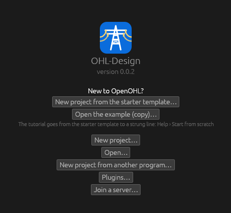

# 0. Before you start

## What you need

- OHL-Design: on macOS double-click **Start OHL-Design.command** in the
  OpenOHL folder; elsewhere run `cargo run --release -p ohl-app`.
- A mouse with a right button.

The **starter template** comes with the program: a wire type, two
structure types, five weather cases, load cases, clearance rules and the
survey points of an invented piece of ground. No route, structure or
wire — those you make.

## The window

1. **Menus**. **Line** holds the line's data: Terrain, Structures,
   Sections, Criteria.
2. **Quick bar**: Undo, Redo, Save all, Fit views, Check wire clearances.
3. **Pages**, like browser tabs: **3D** and **Plan** share this place.
   A closed page comes back from **View**.
4. **The 3D view**: drag to turn, scroll to zoom.
5. **Hotbar**: nine tools; the line under it says what the held tool
   does.
6. **Profile**: the ground and the wires along the line.
7. **Next steps**: what the line still needs; each step is a link.
8. **Properties**: the selected object and its results.
9. **Status bar**: what just happened, or what a tool expects next.

## Tools: hold one, then click

- Press **1**–**9** (or click a slot) to *hold* a tool.
- Click an object in a view to *use* it.
- Press **Escape** to hold **Select** again. With Select a click only
  selects.
- Right-click an object for its menu; press **E** for every tool.

> **If you get lost:** read the status bar, then the **Next steps**
> page. Its next step is in bold.

Why it works this way

A tool stays held until you choose another, so you can click many
objects in a row. A click with Select never moves anything: a structure
moves only with **Move structure**. A tool held from the inventory (E)
goes into the hotbar. The starter template is `examples/starter/` of the
source tree; its README lists every file.

Read more: [Getting started](../user-guide/getting-started.md),
[OHL-Design, the line application](../user-guide/desktop-app.md).

Next: [1. A new project and its ground](01-new-project.md).
