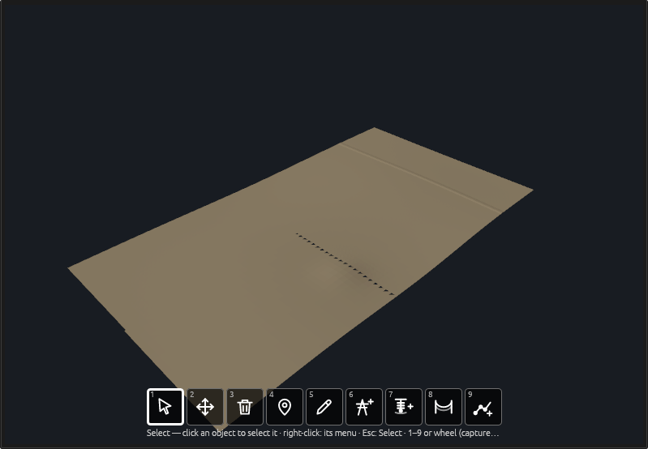

# 1. A new project and its ground

**Goal:** a project made from the starter template, with its invented
ground.

## Steps

1. On the start page click **New project from the starter template…**
   (with a project open: the same entry in the **File** menu).
2. In the **New project** window untick **Start with the default
   weather and load cases (arbitrary values for checking)**. Keep the
   rest.

   

3. Click **Choose where to save it and create…** and pick a new, empty
   folder. The project opens.
4. In the window **New project: first steps** click **Later**.

   

5. Choose **Line › Terrain › Terrain surfaces (TIN)…**.
6. Click **Import…** and choose `starter-survey.csv` (in your project's
   folder).

   

7. Close the window (its **×**).
8. Choose **View › Fit views**.

## What you should see

Gently rolling land in the 3D view, about 1.4 km by 800 m, heights
between about 494 and 512 m.

> **If the 3D view stays empty:** do step 8. The view does not turn to
> new ground by itself.

Why it works this way

The project file keeps the line and copies of the starter's libraries;
the survey and the structure templates are copied beside it. This
tutorial uses the starter's five weather cases; the default cases are
for checking design codes (**Add the default cases…** in Line › Criteria
› Weather cases adds them later). The survey points became a terrain
surface, and that surface is **the ground**: every drawing and check
measures from it. It comes first so that the alignment points take
their heights from it.

Read more: [Starting from nothing](../user-guide/desktop-app.md#starting-from-nothing),
[Terrain surfaces in the project](../user-guide/terrain.md#terrain-surfaces-in-the-project).

Next: [2. The route and the alignment](02-route-and-alignment.md).
