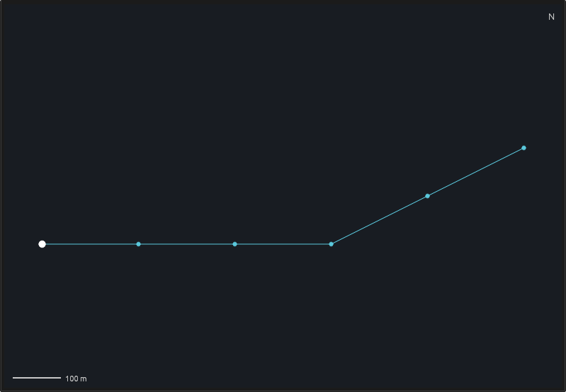
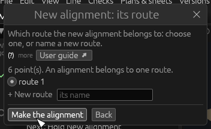

# 2. The route and the alignment

**Goal:** a route, and an alignment of six points with an angle at the
fourth.

## Steps

1. On the **Next steps** page click **Next: Name the route…**.
2. Keep the name *route 1* and click **Create the route**. The **New
   alignment** tool is now held.

   

3. Click the ground in the **3D** view, anywhere. The window **Point
   coordinates** opens.
4. Type **E** and **N** of point 1 from the table, keep the height and
   click **Add the point**.

   | Point | E (m) | N (m) |
   |---|---|---|
   | 1 | 0 | 0 |
   | 2 | 200 | 0 |
   | 3 | 400 | 0 |
   | 4 | 600 | 0 |
   | 5 | 800 | 100 |
   | 6 | 1000 | 200 |

   

5. Repeat steps 3 and 4 for points 2 to 6. A yellow line joins the
   points.

   

6. Press **Enter**.
7. Click **Make the alignment** (*route 1* is chosen).

   

## What you should see

On the **Plan** page (the tab next to 3D; scroll to zoom): points P1 to
P6, straight east for 600 m, then turning left by about 27° at P4.

> **If a point is wrong:** **Backspace** takes the last point back,
> **Escape** gives the alignment up. Later, correct E and N in **Line ›
> Terrain › Alignment points table**.
>
> **If no window opens at a click:** the click took an existing point.
> Press **Backspace** and click beside it.

Why it works this way

A **route** is the path of the line; the structures, wires and checks
belong to it. Its **alignments** are the polylines the structures stand
on, through their **alignment points**. Each point of the table lies on
a survey point, so its height is the surveyed one. You may click in the
plan instead; the 3D view shows the ground and the points while you
click.

Read more: [Routes and alignments](../user-guide/desktop-app.md#routes-and-alignments).

Next: [3. The structures](03-structures.md).
