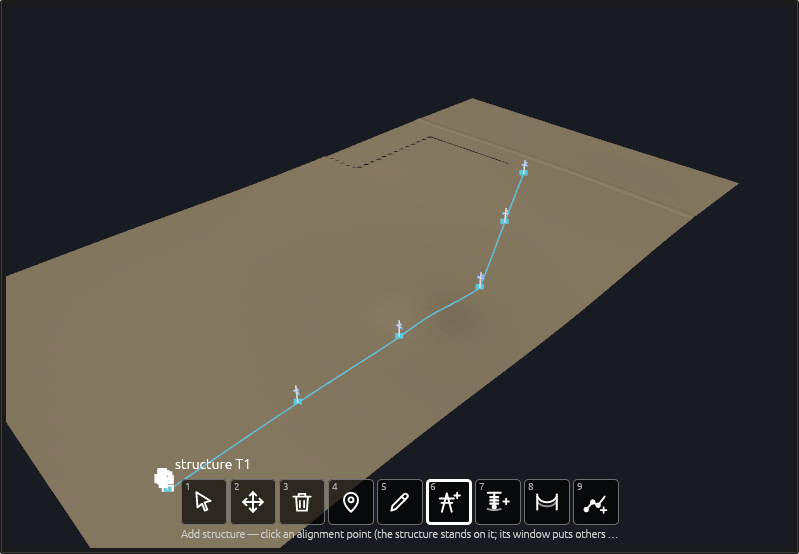

# 3. The structures

**Goal:** six structures in one window — **tension** structures at the
ends and the angle (T1, T4, T6), **suspension** structures between.

## Steps

1. Press **6** to hold **Add structure** (or click **Next: Hold Add
   structure** on the Next steps page).
2. Click alignment point **P1** (E 0, N 0) in the 3D view or the plan.
   The window **Add structure** opens for *T1*.
3. Click the **type** button (it shows *starter-suspension*). The
   structure picker opens.
4. Click the row **starter-tension**, then **Choose**.

   

5. Open **Also on other points of this alignment** (under the point)
   and click **All**.
6. In the **Type** column choose **starter-suspension** for P2, P3 and
   P5. Leave P4 and P6 at *(the type above)*: they become tension
   structures too.
7. Click **Apply**.

   

## What you should see

Six structures, *T1* to *T6*, one on each alignment point, each turned
along the line. The 3D view and the plan fit to them.

> **If you made a mistake:** **Undo** (⌘Z / Ctrl+Z) takes all six away
> at once; then start again at step 2.

Why it works this way

Each structure is a **structure type** placed at one spot: the type
gives its shape, attachment points and strings; the structure gives its
place, height and turn. A tension structure ends sections (chapter 5); a
suspension structure carries the wire through. Each structure is tied to
its alignment point: move one and the alignment follows. The starter
types were built from the template `delta-1c`; **Edit › Tools › New
structure from a template…** builds your own.

Read more: [Editing › Add a structure](../user-guide/desktop-app.md#editing),
[Structure picker](../user-guide/desktop-app.md#structure-picker),
[Structure templates](../user-guide/structure-library.md#structure-templates-ohlpt).

Next: [4. The set numbers](04-strings.md).
