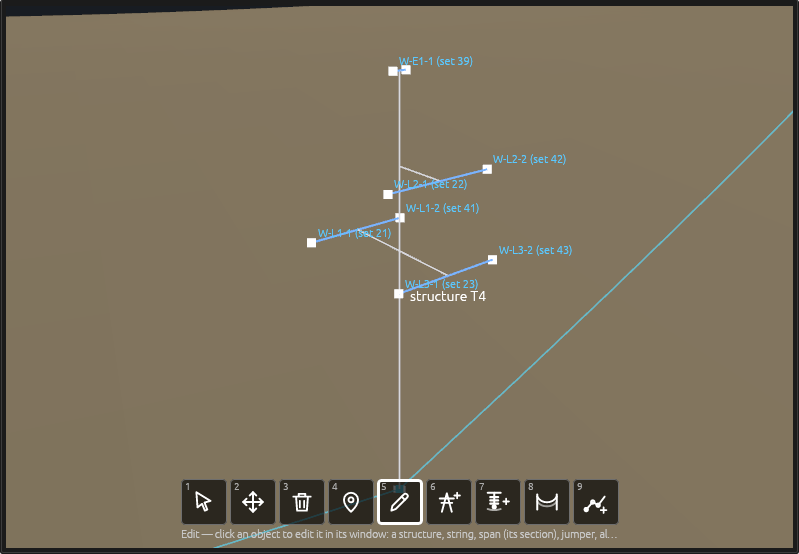
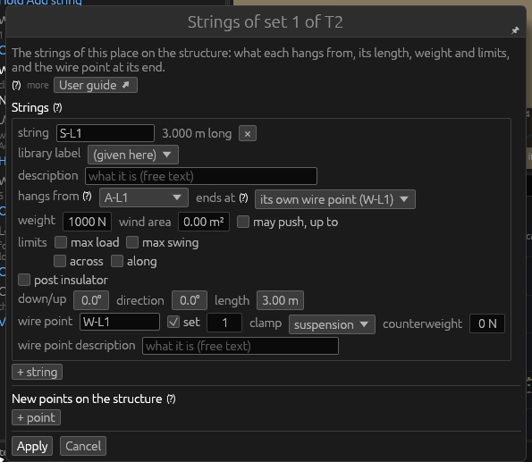

# 4. The set numbers

**Goal:** know which string is which. In chapter 5 you string the wires
by clicking strings, and each string's wire point has a **set** number.
This drawing is all you need:

## Steps

1. Choose **Line › Structures › Display options** and tick **Wire
   points (label, set)** in the **3D** column.
2. Click anywhere outside the menu to close it.

   

3. Press **G** (Go to structure), choose **T2** and press **Enter**.
4. Scroll to zoom in until T2 fills the view. Drag to turn the view.

   

5. Hold **Edit** (press **5**) and click one of T2's strings. The window
   **Strings of set 1 of T2** (or 2, 3, 19) shows the string and its
   set.

   

6. Click **Cancel**.
7. Look at **T4** the same way: **G**, choose **T4**, **Enter**, zoom
   in.

   

## What you should see

Each wire point is labelled with its name and set, e.g. *W-L1 (set 1)*
on T2 and *W-L1-2 (set 41)* on T4. Labels that would overlap are left
out: turn the view and they come back.

Why it works this way

A string runs from an attachment point on the structure to its **wire
point**, where the wire is clamped. The **set** is that wire point's
number on its structure; the structure type gives it. The starter's
types number the phases 1, 2, 3 (L1, L2, L3) and the earth wire 19; a
tension structure has two strings at each place, one for each span, so
it adds 20 for the span behind and 40 for the span ahead. Other
structure types may number their sets differently: their drawings (in
the structure picker, and in the Add structure window) show the sets.
Nothing changed in this chapter — the strings came with the types.

Read more: [Glossary: strings](../user-guide/glossary.md#strings),
[Editing › Edit](../user-guide/desktop-app.md#editing).

Next: [5. Stringing the wires](05-stringing.md).
