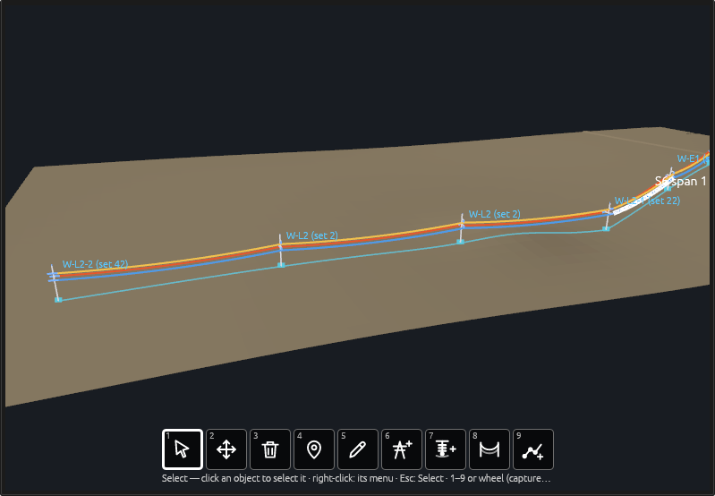
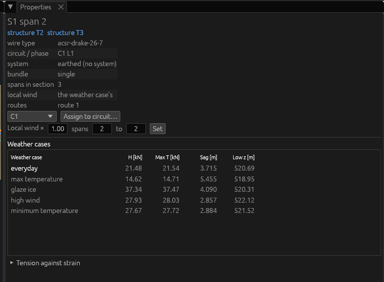

# 5. Stringing the wires

**Goal:** the three phases strung, each in two **sections** — T1 to T4
and T4 to T6 — and a first look at the result.

## Steps

1. Press **8** to hold **String wire**.
2. Click, in this order: T1's string of **set 41**, T2's **set 1**,
   T3's **set 1**, T4's **set 21** (see the [drawing in chapter
   4](04-strings.md)). A yellow line joins them; the status bar counts
   them.

   

   

3. Press **Enter**. The window **String wire: new section** opens for
   *S1*.
4. Type **circuit** `C1` and **phase** `L1`. Keep the rest (20 kN at
   20 °C, invented).
5. Click **Apply**.

   

6. String S2: click T4's **set 41**, T5's **set 1**, T6's **set 21**,
   press **Enter**, click **Apply** (the window already says C1, L1).
7. String the other phases the same way; the window proposes the
   phase, check it and click **Apply**:

   | Section | Strings, in order | Phase |
   |---|---|---|
   | S3 | T1 set 42, T2 set 2, T3 set 2, T4 set 22 | L2 |
   | S4 | T4 set 42, T5 set 2, T6 set 22 | L2 |
   | S5 | T1 set 43, T2 set 3, T3 set 3, T4 set 23 | L3 |
   | S6 | T4 set 43, T5 set 3, T6 set 23 | L3 |

8. Press **Escape** to hold **Select** again.

> **If the wrong string was picked:** **Backspace** takes the last point
> back, **Escape** gives the section up. Zoom in until the set labels
> can be read.

## Look at the result

1. Choose **View › Display weather cases…**, tick **max temperature**
   and click **Apply**.

   

2. Look at the **Profile**: each wire is drawn twice, lower at the
   maximum temperature.

   

3. Click the wire between T2 and T3. **Properties** gives, per weather
   case, its tensions (H, Max T), its **sag** and its lowest point. If
   the Sag column is cut off, drag the page's left edge to widen it.

   

4. Choose **File › Save all** (⌘S / Ctrl+S). That is your first line.

Why it works this way

A **section** is one wire strung between two tension structures, over
one or more spans. It has a wire type, a circuit and phase, and its
**stringing**: here a horizontal tension at a temperature. From that,
every **weather case** — temperature, wind, ice — gets its own tension
and sag, solved as soon as the line changes. A case with wind is drawn
from both sides. The earth wire is strung the same way (sets 59, 19, 19,
39, then 59, 19, 39; no circuit or phase).

Read more: [Sag-tension](../theory/sagtension.md),
[Stringing and status](../user-guide/line-file.md#stringing-and-status),
[Weather cases shown](../user-guide/desktop-app.md#weather-cases-shown).

Next: [6. Jumpers](06-jumpers.md) (Part 2).
