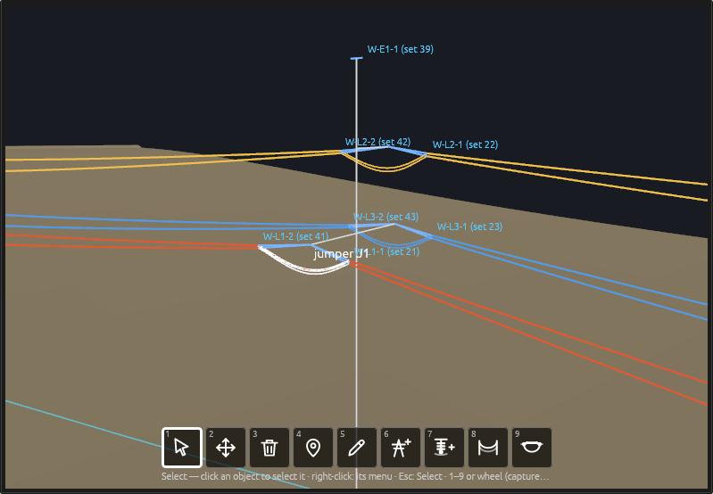
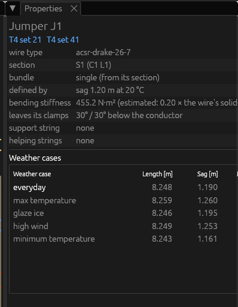

# 6. Jumpers

**Goal:** the two sections of each phase joined at T4 by a **jumper**.

## Steps

1. On the **Next steps** page click **Hold Add jumper** (the tool is
   not in the hotbar at first; it takes slot 9).
2. Click the structure **T4** (its body, not a string). The status bar
   says *added 3 jumpers at T4*.
3. Click **T1**. The status bar says *Add jumper: none missing at T1* —
   a line end has nothing to join.
4. Press **Escape** and click one of the new jumpers (the loops under
   T4's crossarms).

## What you should see

At T4 each phase now runs on: the span behind, its tension string, a
jumper hanging in a loop, the other tension string, the span ahead.

The jumper's **Properties** give its wire type (its section's), its
length and its results in every weather case.

Why it works this way

At a structure, Add jumper joins the section ends of the same
**circuit** and **phase** — that is why each section got C1 and L1, L2
or L3 in chapter 5. Two clicks on strings instead join exactly those
two. A jumper is solved as a wire of its own, from clamp to clamp, with
its bending stiffness estimated from its wire type; the sections carry
an estimate of its load at their clamps (Line › Criteria › Calculation
options… chooses). Joined by the jumpers, S1 and S2 are one **conductor
path**. **Line › Sections › Jumpers table** lists the three.

Read more: [Jumpers](../theory/jumpers.md),
[Jumpers in the line file](../user-guide/line-file.md#jumpers),
[Glossary: electrical](../user-guide/glossary.md#electrical).

Next: [7. Results in detail](07-results.md).
