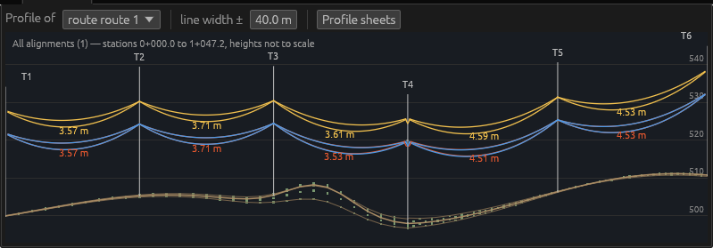

# 7. Results in detail

**Goal:** read the sags and tensions — in the profile, the Sections
table and the crew's sagging table.

## Steps

1. Choose **View › Fit views**: the 3D view and the plan show the whole
   line again.
2. Choose **Line › Sections › Display options** and tick **Sag** in the
   **Profile** column. Click outside the menu to close it. Each span's
   sag is written at mid-span in the profile.

   

3. Choose **Line › Sections › Sections table**. Scroll it to the right:
   **H [kN]** and **Max sag [m]** give each section's tension and
   largest sag in the weather cases shown (*everyday / max
   temperature*). Close the table (its tab's **×**).

   ![The Sections table scrolled to H [kN] and Max sag [m], two values
   per cell: everyday / max temperature](../images/tutorial/tutorial-sections-table.png)

4. Hold **Edit** (**5**) and click a span of S1. The window **Section
   S1** opens.
5. Open **Sagging** and click **Calculate**: the crew's table, each
   span's sag at the stringing temperature.

   

6. Click **Cancel**, then press **Escape** to hold Select.

## What you should see

Spans of 200 m and 224 m, sags of about 3.5 to 4.6 m in the everyday
case, more at the maximum temperature and with glaze ice. The two
sections of a phase have the same stringing tension, so similar sags in
similar spans.

Why it works this way

Nothing is computed when you open a table or a window: every result was
solved when the line changed, in each weather case shown (the others
when first shown). Every view, table and check reads the same solved
line. The sagging table is for the crew in the field: the sags per span
at the temperature they string at, the inclined-span correction and the
clipping offsets.

Read more: [Views](../user-guide/desktop-app.md#views),
[Tables](../user-guide/desktop-app.md#tables),
[Sagging outputs](../user-guide/sagging.md),
[Sag-tension](../theory/sagtension.md).

Next: [8. Checks](08-checks.md).
