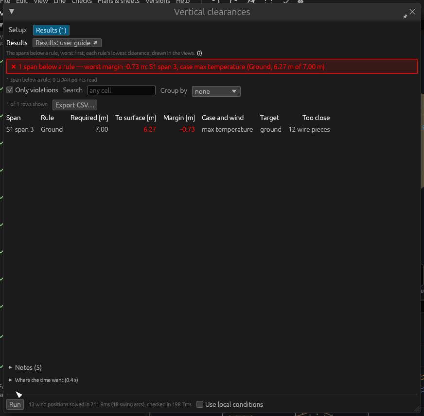
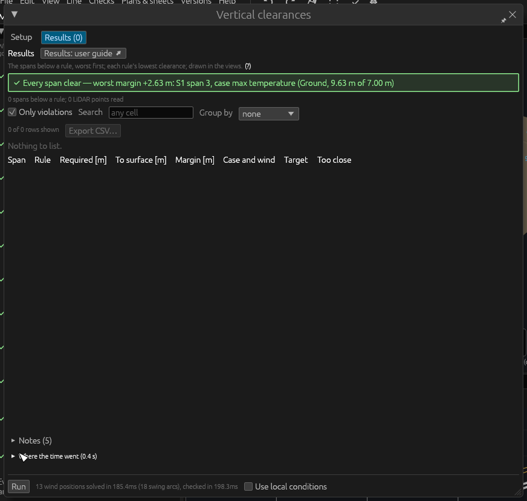

# 8. Checks

**Goal:** check the line — clearances to the ground and between the
wires, the wire tensions and the strings — and see what a failing check
looks like.

The checks run **on demand** and never change the line. Each window has
**Run** at its bottom left. All distances and factors below are the
starter's invented values, not those of any regulation.

## Wire clearances

1. Choose **Checks › Wire clearances › Check wire clearances** (also on
   the quick bar). The **Clearances** window runs the starter's rule file
   at once.
2. Read the green banner: every rule met in the five weather cases.
   **Notes** says what was checked.
3. Close the window.

   

## Vertical clearances, and a failure

1. Choose **Checks › Ground clearances › Vertical clearances…**. It
   starts with one rule, *Ground*, its distance not set yet (Run is
   greyed and the footer says why).
2. Under **2 Rules**, in *Editing rule 1: Ground*, type **7** in
   **distance**.

   

3. Click **Run**. The **Results** tab opens: a green banner, every span
   clear, the worst margin about +2.6 m (S1 span 3 at the maximum
   temperature).

   

4. Now make it fail. Hold **Edit** (**5**), click a span of S1, set its
   **horizontal tension** to **10** kN and click **Apply**. The wire
   sags more.
5. Click **Run** again. The banner is red: *S1 span 3* is about 6.3 m
   above the ground at the maximum temperature, below the 7 m rule.
   Click the banner (or the row) to go to the span in the views.

   

6. Press **Undo** (⌘Z / Ctrl+Z) to get the 20 kN back, click **Run**:
   clear again. Close the window.

## Wire tensions

1. Choose **Checks › Wire tensions…** and click **Add rule**.
2. Type its **factor of RTS**: **0.5** (each wire may carry half its
   rated tensile strength — invented).
3. Click **Run**. All spans pass, the highest usage 54 %. Untick **Only
   violations** to see every span in every weather case.

   

4. Close the window.

## String checks

1. Choose **Checks › String checks…** and click **Run**.
2. Read the banner and open **Notes**: the uplift of the suspension
   strings passes; the starter's strings have no load or swing limits of
   their own, so those are not checked.

   

3. Close the window.

> **If Run stays greyed:** the footer next to it says what is missing —
> usually a distance or a factor still to type.

Why it works this way

The wire clearances check a **rule file** (`.ohlr`, the starter's, kept
in the project) in every weather case of its rules. The vertical
clearances window keeps its own rules and checks every weather case,
with the wind from both sides. The wire tensions and string checks keep
their rules the same way. A distance or factor is never filled in for
you: take it from the regulation you work to. Limits of strings come
with insulator assemblies, or are typed in the Strings table.

Read more: [Clearances](../user-guide/desktop-app.md#clearances),
[Vertical and radial clearances](../theory/clearances.md),
[Wire tensions](../theory/wire-tensions.md),
[String checks](../user-guide/desktop-app.md#string-checks).

Next: [9. Loads for the structures](09-ohl-structure.md).
