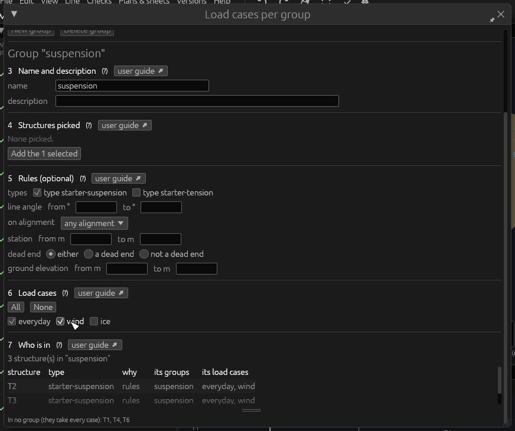

# 9. Loads for the structures



**Goal:** say which structures take which load cases, and see the line's
forces arrive in OHL-Structure.

```
load case library ──► groups of structures ──► each structure: its groups' cases
(everyday, wind, ice)  (picked, or by rules)    (in no group: every case)
                                            ──► OHL-Structure: a load case =
                                                  line forces × your factors
                                                  + loads on the structure itself
```

## Steps in OHL-Design

1. Click **T2** (Select held) to select it.
2. Choose **Line › Structures › Load cases per group…**.
3. Click **New group**. In **3 Name and description** type the name
   **suspension** and press **Enter**.
4. In **5 Rules** tick **type starter-suspension**: every suspension
   structure is in the group, now and when you add more.
5. In **6 Load cases** tick **everyday** and **wind**.
6. Read **7 Who is in**: T2, T3 and T5 take *everyday* and *wind*; T1,
   T4 and T6, in no group, take every case.

   

7. Close the window. T2's **Properties** now say under **Load cases**:
   *Group suspension: it takes 2 case(s): everyday, wind*.
8. Click **Open in OHL-Structure…** there. OHL-Structure opens T2 with
   the forces the line puts on it (OHL-Structure must be built next to
   OHL-Design).

   

## Steps in OHL-Structure

1. Choose **Loads › Load case editor**.
2. Click **+ Case**. Name it *wind, my factors*.
3. Under **1. Line forces** click **Add line forces**, choose the
   library case **wind** and type the factors: vertical **1.35**,
   transverse **1.5**, longitudinal **1.0** (invented). The sentence
   under the description now says what the case does.
4. Choose **Loads › Load table**: the rows your case makes, one per point
   and axis, marked *line*.

<details>
<summary>Why it works this way</summary>

The load cases live in one place, the library (Line › Structures › Load
cases…; the starter has *everyday*, *wind* and *ice*). The groups say
who takes them and follow the line as it changes. The factors of your
own cases live in the structure's load cases, and each case says in
words what it does. **Points (0 off)** in the editor leaves the forces
of a point out (a conductor taken down for works). The starter's
structures are of level 1 (points and strings, no members): loads on the
structure itself — the wind on its body, ice on its members — need a
structure with members (levels 2 and 3).

</details>

Read more: [How load cases reach a structure](../user-guide/load-cases-to-structures.md),
[Load cases per group](../user-guide/load-cases-per-group.md),
[Structure load cases](../user-guide/structure-load-cases.md).

Next: [10. Saving and versions](10-saving.md).
