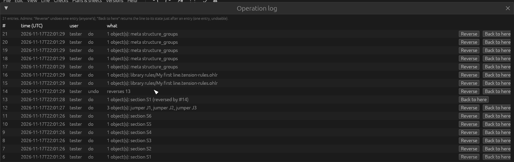
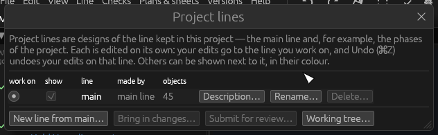

# 10. Saving and versions

**Goal:** know where your work is kept, and where to go from here.

## Steps

1. Choose **File › Save all** (⌘S / Ctrl+S).
2. Choose **Versions › Project lines…**: one line, *main*, the one you
   work on. Close the window.

   

3. Choose **Versions › Operation log…**: every edit of this tutorial,
   one entry each, newest first. Close it.

   

4. Choose **File › Close**, then open the project again from **File ›
   Open recent** (or the start page).

## What you should see

The line as you left it: the ground, six structures, six sections,
three jumpers and the checks' rules.

Why it works this way

Every edit was stored in the project file as you made it — that is the
operation log — so nothing is lost if the program stops. **Save all**
writes the file through and saves the library pages you changed. A
project can hold several designs of the line — the **main line** and
**stages** or **alternatives** — each a **project line** edited on its
own: **Versions › New line from main…** starts one. **Versions ›
Revisions, tags and reviews…** keeps named revisions.

## What next

- Your own structure type: **Edit › Tools › New structure from a
  template…** ([Structure templates](../user-guide/structure-library.md#structure-templates-ohlpt)),
  or open it in [OHL-Structure](../user-guide/structure-app.md).
- An electrical system (voltage, phases): **Line › Sections ›
  Electrical systems table** ([Electrical systems](../user-guide/line-file.md#electrical-systems)).
- The weather cases, load cases and rules of the code you work to
  ([Design codes](../user-guide/design-codes.md),
  [Weather cases](../user-guide/weather.md)).
- Drawings: **Plans & sheets › Profile sheets…** ([Drawings and profile
  exports](../user-guide/drawings.md)).

Read more: [Saving](../user-guide/desktop-app.md#saving),
[Project files](../user-guide/project.md),
[Project lines and stages](../user-guide/project-lines.md),
[Versions, branches and reviews](../user-guide/versions.md).

Back to the [tutorial's contents](index.md).
