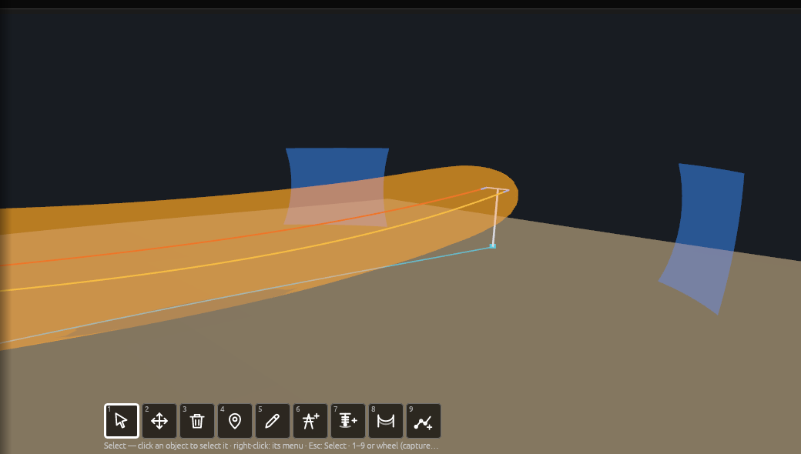
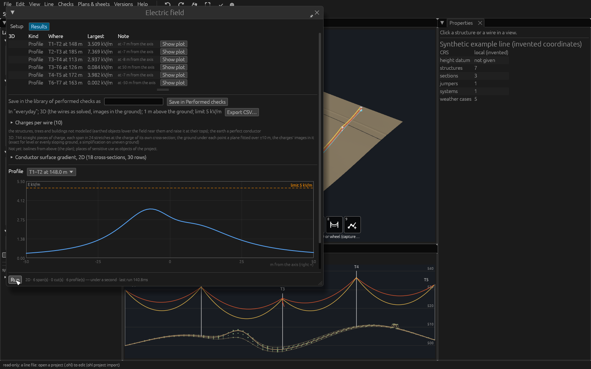

# Analyses of the line

Analyses of a solved line beyond the clearance rules: galloping ellipses,
the conductor jump when the ice drops, blown-out wires against the right of way, LiDAR classification, vegetation
near the wires, safety volumes around the wires for work near the line
and catenaries fitted to the surveyed wires. Each is a
command of `ohl` and (but for classification and the right of way) a window
of the desktop app's **Checks** menu. The methods are in the theory manual:
[Galloping ellipses and blowout](../theory/galloping.md),
[Ice shedding](../theory/ice-shedding.md),
[LiDAR analyses](../theory/lidar-analysis.md),
[Safety volumes](../theory/safety-volumes.md).

**The examples on this page** run on the example line that ships with
OpenOHL (invented): in the repository, `cd examples/synthetic-line` first.
The output shown is what they print.

The commands share the options of `ohl line` for the model: the line or
project file, `--library`, `--structures`, `--insulators`; and for weather
cases `--weather FILE.ohlwc` with `--case NAME` / `--tag TAG` (repeatable;
all cases without them).

**Sections that do not solve.** A section or jumper that does not solve in
a weather or load case is left out of what is computed from it there, and
said so: the clearance checks list it as not solved; the structure loads
and usage of every structure it ends at or hangs on are marked
**incomplete** in that case — "not checked", never a pass (see
[Incomplete structures](loads.md#structure-usage-capacity-checks)), also
in the values handed to the structure application. In the desktop app the
section is drawn in that case where it last was — its last solved shape in
that case, else its shape in another weather case, else the straight
chords between its wire points — as a **dashed red** line; hovering it in
the plan says why, and a click on any of its copies selects the span, whose
properties say why it did not solve and where the drawn shape comes from.

## Galloping ellipses (`.ohlg`)

```bash
ohl clearance galloping synthetic-line.ohl.json \
    --weather weather-cases.ohlwc --params galloping-example.ohlg --csv galloping.csv
```

```text
galloping: Example galloping ellipses (invented values) — 2 methods
case "glaze ice": 8 wire pairs × methods checked, 0 overlapping, 0 below the required clearance
  single loop (example)  S1 span 1        S2 span 1            5.28 m (required 0.30 m) at 50 % (ellipses 11.50 × 4.60, 16.87 × 6.75 m)
  single loop (example)  S1 span 3        S2 span 3            6.18 m (required 0.30 m) at 50 % (ellipses 10.32 × 4.13, 15.39 × 6.16 m)
```

The parameter file names the weather cases its wires gallop in
(`cases = ["glaze*"]`): with `--case` naming none of them, the command
says which cases it has and runs nothing.

Every pair of wires between the same two structures, by every method of the
parameter file, in each weather case the file applies to: the smallest
distance between their ellipses along the span — to the wires' surfaces
(the ellipses are of the wires' axes; each wire's bundle radius and
conductor radius, iced in a case with ice, are taken off) — where, and the
ellipses' sizes; worst first. The parameter file holds **all** coefficients — copy
them from the method you design to; the example's are invented:

```toml
format = "ohl-galloping"
version = 1
name = "My galloping method"
required = "0.3 m"                  # or { by_voltage = [[0, "0.2 m"], [245, "0.5 m"]] }
pair_voltage = "higher"             # higher, sum or difference (as in rule files)
stations = 20                       # ellipses compared at 19 inner stations
cases = ["galloping*"]              # weather cases (default: all chosen)
calculation = "load-fe"             # optional (2026-11-01): how the wires are solved; none: each section's own

[[method]]
name = "single loop"
loops = 1
major = { sag = 1.2, constant = "0.3 m" }
minor = { major = 0.4 }
tilt = 10.0                         # major axis from vertical, top to the right, °
centre_above_rest = 0.25            # centre above the wire at rest, × major axis
along = "sine"                      # or "constant"
```

| Axis term | Meaning |
|---|---|
| `sag` | × the span's sag in the weather case, m |
| `span` | × the horizontal span length |
| `sqrt_sag` | × √sag (√m) |
| `diameter` | × the conductor diameter |
| `log = { factor, scale }` | factor · n · d · ln(scale · sag / (n² d)) |
| `constant` | a length |
| `major` | × the major axis (minor axis only) |

CSV columns: case, method, both spans, distance, required, overlap, where
(fraction of the span), both ellipses' axes, the first wire's position.

In the desktop app: **Checks › Galloping ellipses…** — choose the weather
case (*2 Scope*) and the parameter file (*3 Rules*; the project's `.ohlg`,
or one next to a line file, is chosen first), then **Run** (the window's
footer, bottom left). Under the parameter file's name a line says what it
holds: its methods (with their loops), its requirement and the cases it
names (2026-10-31). The Results tab lists every pair and method (spans
named from 1), *Only violations* on by default, the notes folded above
the table; a row clicked selects its span and draws it in the weather
case of the run. **Export CSV…** writes the rows shown, **Full report
(CSV)…** every pair with the case.

## Ice shedding: the conductor jump when the ice drops

*Built 2026-11-02, in active development (not approved yet); roadmap
O13, the simplified method.* When the ice falls off a span at once, the
wire jumps upwards and may come close to the wire above it. The check
raises each span of the wires a rule names from its iced position by the
rule's **rebound factor** k times its **static rise** (the bare position
at rest less the iced one), and measures the clearance from the jumped
wire to every other wire of the same span (phase to phase, phase to
earth wire), the other wires keeping their ice. The method, its
assumptions and the sources: [Ice shedding](../theory/ice-shedding.md).

```bash
ohl ice-shedding synthetic-line.ohl.json --weather weather-cases.ohlwc \
    --rules ice-shedding-rules.ohlr --csv ice-shedding.csv
```

```text
rule                     case             section  span other     rise m  jump m before m  after m  required status
Every span               glaze ice        S1          2 S2          1.32    2.64    11.30    11.00      2.00 pass
One span                 glaze ice        S2          2 S1          6.60   13.21    11.30    11.31      2.00 pass
```

A row per rule, iced case and span that sheds: how far the wire rises
when its ice drops, the jump (the rise times the rule's factor), its
distance to the nearest other wire before and after, and the rule's
required distance.

The rules are tables of a rule file (`.ohlr`), beside or instead of its
clearance rules:

```toml
[[ice_shedding_rule]]
name = "One span sheds"
cases = ["glaze ice"]       # the iced cases (none: every case with ice)
# bare = "-5 °C bare"       # the bare case (default: the iced case without its ice)
# shedding = "all"          # one (default) or all
# calculation = "creep-fe"  # how the wires are solved (default: each section's own)
factor = 2.0                # the rebound factor k — optional, 2 by default (an upper
                            # bound from mechanics, to be decided; give a published one)
distance = "2 m"            # or { by_voltage = [[110, "1 m"], [245, "2 m"]] }
# pair_voltage = "higher"   # higher (default), sum or difference
# targets = { circuits = ["North"] }   # the wires that shed (default: every wire)
```

- `factor` is required: no value is built in. Take it from the published
  method you design to and check how it defines the factor — here it
  multiplies the static rise from the iced to the bare position at rest
  (k = 1: the bare wire at rest).
- `shedding = "one"` (default): each span sheds alone, the others keep
  their ice; the span's iced horizontal tension is held, which gives the
  largest rise (conservative). `"all"`: every span of the wire sheds; the
  line is solved in the bare case too and the tension drops, so the rise
  is smaller. The time: one solve per iced case, one more per bare case
  with `"all"`.
- A weather case without ice is skipped (a rule naming none with ice
  says so).

The output lists per rule, iced case, span and other wire of the span:
the largest rise, the jump (k × rise), the clearance before (both iced)
and after the jump, the required distance and pass or fail, the smallest
margin first; exit status 0 when every clearance is kept, 1 when one is
not, 2 on an error. CSV columns: rule, case, bare case, section, span,
other section, other span, factor, rise, jump, before, after, required,
margin, status, where (fraction of the span), the closest points.

In the desktop app: **Checks › Ice shedding…** — the rules in *3 Rules*
(kept in the project as `<line>.ice-shedding-rules.ohlr`; a design-code
plugin's preset brings its ice shedding rules), the wires that shed in
*2 Scope*, then **Run**. The Results tab lists every pair; a row clicked
selects its span, drawn in its iced case. The 3D view's layer *Ice
shedding (jumped wires)* draws each jumped span (red where a clearance
after the jump is short, else orange) and the shortest distance of each
failing pair while the window is open. **Save in Performed checks** keeps
the run with the project line ([The library of performed
checks](#the-library-of-performed-checks)).

## Blowout and the right of way

```bash
ohl clearance row synthetic-line.ohl.json --weather weather-cases.ohlwc \
    --case "high wind" --half-width 20 --csv row.csv
```

```text
case "high wind": 10 wires, 0 beyond the right of way (left 20 m, right 20 m)
  S2 span 1          right   -8.27 m  left   19.17 m  0.83 m inside
  S2 span 2          right   -8.16 m  left   17.43 m  2.57 m inside
```

How far each wire swings to the right and to the left of its route's
centreline (alignment, or the line through the structures) in each case,
to its outer surface (bundle radius and conductor radius, iced in a case
with ice, included), and how far it goes beyond the right of way (`--left`,
`--right` for different widths each side). Clearances of the blown-out wires
to buildings, trees and other wires are the radial clearances of a rule file
run in the windy case (`ohl line --rules`, the Clearances window).

## Phase to phase and circuit to circuit

In OHL-Design: [Wire clearances](wire-clearances.md). Rule files' `same_line` rules take `circuits = "same"` (phase to phase) or
`"different"` (circuit to circuit, phase to earth wire), with `case_pairs`
for one wire in one weather case and the other in another — e.g. one circuit
at maximum sag and the other with its ice dropped:

```toml
[[rule]]
name = "Circuit to circuit, ice drop"
target = "same_line"
circuits = "different"
radial = { by_voltage = [[0, "2 m"], [245, "3.5 m"]] }
case_pairs = [["glaze ice", "everyday"]]
```

## Distance between conductors in the span (check plugins)

A design code may require a distance between two conductors of a span
that depends on where along it one looks — on the local sag, the
suspension strings, the angle between the conductors, the voltages — or a
fixed distance while the wind blows them unequally. **OpenOHL measures**
the conductors (the pairs, stations along the span, the distance d between
the axes, the angle β, the local sag, the string length l_k, the sag
between phase spacers, the swing under unequal wind); the required
distance comes from a **check plugin** in use (File › Plugins › Plugin
manager), whose entries in the Checks menu open the two windows
**Distance between conductors…** and **Distance between conductors under
unequal wind…**. Without such a plugin they are not in the menu.

Both windows — what they measure and how, every setting with its default,
effect and time, the results, what is on the safe side — are explained on
their own page: [Distance between conductors](distance-between-conductors.md).
The plugin's own page (its button in the window) explains its rule. A run
is saved in the [library of performed
checks](#the-library-of-performed-checks).

### Under unequal wind

One conductor at a wind p, the other at a share of p up to p, p in steps
from none up to the wind of the weather case chosen, from each side: the
exact closest approach of each pair against the plugin's distance
([Distance between conductors › Under unequal
wind](distance-between-conductors.md#under-unequal-wind-how-it-is-measured)).

## The library of performed checks

**Checks › Performed checks…** (a window like the check's, floating
first, docked with its 📌) lists the checks saved on the project line you work on: name, check, when, by whom, **status** (draft,
checked, approved — chosen in the list), the **line** (unchanged, or
what changed since: e.g. "1 structure changed"), the result and a
**note** (double-click to write it; double-click the name to rename).
Filter by text, check and status. **Open** shows the report in its
check's window; **Export…** writes it to a file (`.ohlcr`), **Import…**
reads one onto this line (a report of the same name is replaced after
you confirm); **Delete…** asks first.

Reports are kept with the project line (its branch in
[Versions](versions.md)): a line made from another takes its reports,
commits, merges and bundles carry them, and each change to a report is
an edit like any other (undo brings it back). Saving a report needs a
project and a designer's rights.

## LiDAR classification

```bash
ohl lidar classify tiles/ --out project.ohl#classified --line line.ohl.json --corridor 100
ohl lidar classify scan.laz --out scan-classified.laz
```

Classifies unclassified points (classes 0 and 1; `--reclassify` for others)
into ground (2), low, medium and high vegetation (3, 4, 5) by height above
the ground, and noise (7, 18). Options: `--cell` (1 m), `--max-window`
(20 m: objects up to this size are removed from the ground), `--slope`
(0.3), `--ground-tolerance` (0.3 m), `--max-points` (200 million). The input
is LAS/LAZ (a file or a folder) or a cloud of a project (`FILE.ohl#name`);
the output a `.las`/`.laz` file or a new cloud of a project (`--replace` to
replace one of that name). Points are held in memory: classify a corridor
(`--line`) on large surveys. About 3 million points a second. Buildings,
poles and wires get vegetation classes: check the result.

## Vegetation and danger trees

The desktop window, step by step with every setting: [Vegetation and
danger trees](vegetation.md). Here the command line `ohl lidar
vegetation`. On the example line and its invented LiDAR tile (`synthetic-lidar.las`,
made by `make_synthetic_lidar.py`: tall trees beside span T1–T2, a tree
under span T4–T5, a stand beside the branch):

```bash
ohl lidar vegetation synthetic-line.ohl.json --lidar synthetic-lidar.las \
    --weather weather-cases.ohlwc --fall-in --growth 0.3 --years 5
```

```text
504 points within 6.50 m (clearance 5.00 + growth 1.50 + buffer 0.00), 1003 points of trees that could fall in (root ball 0.05, allowance 2.00 m)
  span                grow-in  fall-in  nearest m case, position             fall margin m case, position
  S1 span 0               417      633       1.21 high wind, right                   -8.58 max temperature, case
  S2 span 0                 0      342       9.41 high wind, right                   -6.02 rime ice + wind, right
  S2 span 3                87       28       2.72 max temperature, case              -1.21 max temperature, case
```

The trees beside span T1–T2 come within 1.21 m of its wire blown to the
right in high wind, and some could fall onto it (a negative fall margin:
by 8.58 m). With a point cloud kept in a project:

```bash
ohl lidar vegetation line.ohl.json --pointcloud project.ohl#scan \
    --weather cases.ohlwc --case "max temperature" --case "high wind" \
    --clearance 5 --growth 0.5 --years 3 --fall-in --csv vegetation.csv
```

All the cases chosen are solved first — a case with wind **from the left
and from the right** — and every vegetation point (classes of `--role`,
default `vegetation`) is checked once against every position of every
span (in parallel on every core):

- **Grow-in:** closer to a position's surface than the clearance plus the
  growth until the next cut plus `--buffer` (default 0; e.g. the survey's
  accuracy).
- **Fall-in** (`--fall-in`): a point of height h above the ground (from
  the cloud's ground classes, `--ground-role`) is a tree top; the tree,
  grown, falls towards each wire point turning about the edge of its
  **root ball** — a hinge `--root-ball` × its height from the trunk
  (default 0.05; 0: about its base) — and rests on the ground along that
  direction (a ridge between the tree and a low wire shelters it);
  `--fall-through-ground` (2026-11-05, off by default) lets the trunk turn
  on through the ground instead, down to straight below its hinge, as
  some programs count it (more trees found below a steep slope). A
  danger tree when the swept trunk comes nearer the wire's surface than
  `--fall-allowance` (default 2 m, e.g. the flashover clearance).
  `--max-tree-height` (40 m) is the tallest tree looked for.
  `--max-base-ground-distance` (default 5 m): a tree's base is taken
  from the ground only when a ground point lies within that distance in
  plan (`inf`: no limit); the points left without a base are counted,
  with the reason. Those from which a tree of the tallest height could
  reach a span are **questionable**: their fall-in is not checked (not
  on the safe side), so they are listed — the first 20 in the output,
  every one (10 000 at most, the nearest to the wires) as rows of the
  CSV with the kind `questionable: no ground below it` or
  `questionable: no ground point within 5 m`, the nearest span's place,
  the class and the coordinates.
- **Swing arc** (`--swing-arc`): each span of a windy case also anywhere
  along its swing between the left and the right blowout (the span
  swinging as one about the line through its attachment points; since
  2026-10-21 at every radius from the smallest to the largest of the
  three — a band — widened by the **band margin** on every side, so that
  it holds the positions at every intermediate pressure, also for a tree
  between the axis and the arc).
- **Band margin** (`--band-margin M`, default 0.15 m; since 2026-10-21):
  every distance to the band taken this much smaller. The default is the
  worst excess measured on the example lines (0.089 m) plus an allowance:
  conservative. A smaller value is less safe and on your responsibility.
  The jumpers' own margin (in the [safety volumes](safety-volumes.md) and the
  clearance windows) does not apply here: the danger-tree check leaves
  the jumpers out.
- **Unbalanced ice** (`--unbalanced-ice`): each span with vegetation
  within reach solved with its section on its own, the span in a weather
  case of its own (its ice weight, the wind on its iced diameter) and the
  other spans in the section's: `case` (the case's ice on that span
  only, the other spans in the case without ice; cases with ice),
  `thickness=0.01` (the case with 10 mm more radial ice on the span; in
  metres), `extra=5` (the case with 5 N/m more ice load on each wire of
  the span — per subconductor, as a weather case's ice load; before
  2026-10-20 the whole bundle's) or `load=2000` (2000 N at mid-span, the
  whole bundle's).

**Defaults** (since 2026-10-20, the same in the desktop application):
root ball 0.05, allowance 2 m, a ground point within 5 m of a tree base,
a 50 m search distance (`--corridor`) — the utility practice; a
design-code plugin's preset may give others. Before, the command line's
defaults were 0, 0, no limit and 60 m: **runs that relied on the
defaults now give other results.** With `--root-ball 0
--fall-allowance 0 --max-base-ground-distance inf` and no buffer the
results are those of the check before the danger trees. The table lists the spans
with findings: grow-in and fall-in counts, the nearest point and the worst
fall-in margin, each with its case and position (`case`, `left`,
`right`, `arc`, `ice`, `ice left`, `ice right`). The CSV (`--csv`) holds
per span its counts, its nearest point, its worst falling tree and its
worst points (10), with the case and position of each:
`section,span,circuit,phase,kind,grow_in,fall_in,class,x,y,z,distance_m,grow_case,grow_position,height_m,fall_margin_m,fall_case,fall_position,margin_m`.
(Before 2026-10-20 the CSV had one block per case.) `--lidar DIR` reads
LAS/LAZ tiles instead of a project's cloud; `--lidar-classes` gives the
class scheme. A project file's own libraries are used, as `ohl line`
does. `--time-limit` (3600 s) stops a run that takes longer, with an
error.

**Isoclearance lines** (`--isoclearance FILE`, repeatable: `.geojson`,
`.dxf` or `.csv` by the extension): the ground's clearance to the nearest
wire's surface over all the positions checked, contoured over the
corridor (`--corridor`, the search distance, ±50 m around the spans'
chords) every
`--iso-interval` metres (5) up to `--iso-max` (40; lines above are not
drawn), on a `--iso-spacing` grid (1 m) refined from a `--iso-coarse` one
(8 m) where lines can be. A tree of height h standing inside the h line
can reach a wire when it falls (no root ball, level ground). GeoJSON:
LineStrings with `level_m`, project coordinates; DXF: layer
OHL_ISOCLEARANCE, the clearance written on each line; CSV:
`level_m,line,vertex,x,y,z`. The drawings draw them too:
`ohl drawing … --isoclearance-interval 5` (`--isoclearance-max`,
`--isoclearance-spacing`, `--isoclearance-swing-arc`), over the line
width, from the cases drawn and the ground.

**Wind steps** (`--wind-step Pa`, `--wind-sides both|left|right`): each
windy case is also solved in still air and at every pressure from 0 up to
the case's in steps of the value given, from the sides given (the full
pressure is checked from both sides in any case) — as the vertical and
radial clearance windows step the wind; alongside the swing arc or
instead of it. The positions are named `still`, `left (step) at 300 Pa`,
`right (step) at 300 Pa`.

**Clearance by voltage** (`--clearance`, `--fall-allowance`): one
distance (`5`, `"5 m"`), or as a rule file writes a distance by voltage —
a table `'{ by_voltage = [[220, "7 m"], [380, "9 m"]] }'` (up to kV, m:
the first row whose voltage is not exceeded; above the last row its
distance) or `'{ base = "3 m", per_kv = "0.01 m", above_kv = 110 }'`.
Each span is checked with the distance for its wire's system's nominal
voltage (an earthed wire: 0 kV). A single value works as before.
**Classes** (`--classes 42,43`): the vegetation classes by number instead
of by role.

### The vegetation panel

**Checks › Vegetation…** opens the same check in a window: the weather
cases and the scope, a design-code **Preset**, the grow-in and fall-in
values, the wire positions and the search folded under *Model*, the
colours of the points drawn; **Run** in its footer, the results in a
table per span with the questionable trees and every point found drawn
in the views, saved in Performed checks. Every setting and value, step by
step with drawings, what is and is not conservative: [Vegetation and
danger trees](vegetation.md).

See the theory: [Danger trees](../theory/lidar-analysis.md#danger-trees).

## Safety volumes for work near the line

*Built, in active development (not approved yet).* The space within a
distance of the wires in every position of the weather cases chosen —
for planning work near the line (cranes, scaffolds, trees felled): one
closed volume per wire, per circuit or per electrical system, the
jumpers included (the structures not), shown in the 3D view and the
plan, saved with the line and exported as georeferenced DXF, IFC4 and
KML/KMZ files. No safety distance is built in: you enter it (by voltage
or not), or take a rule of a design-code plugin's preset.

**In the desktop app:** Checks › **Safety volumes…**; **from the
command line:** `ohl safety-volume`. Everything about it — how it works
step by step, every setting and field, the files, what is conservative
and what is not — is on its own page:
[Safety volumes](safety-volumes.md).

See the theory: [Safety volumes](../theory/safety-volumes.md).

## As-built wires

```bash
ohl lidar fit-wires synthetic-line.ohl.json --lidar synthetic-lidar.las
```

```text
  span               points   rms m     sag m   model m    Δsag m    Δmid m       °C
  S1 span 0             515   0.030     7.388     7.388     0.000     0.003     15.0
  S1 span 1             575   0.033     8.874     8.869     0.005     0.031     15.1
  S2 span 1             573   0.029    13.724    13.729    -0.005     0.002     14.8
fitted 10 of 10 spans; temperature at the survey: mean 15.0 °C over 10 spans
```

The example tile's wire points were made from the wires solved at 15 °C
(with 3 cm of noise): the fit finds that temperature again. With a point
cloud kept in a project: `ohl lidar fit-wires line.ohl.json --pointcloud
project.ohl#scan --csv as-built.csv`.

For each span: a catenary fitted to the points of the wire classes
(`--role`, default `conductor` and `shield_wire`) near the span's vertical
plane (`--lateral`, 1 m) and its modelled wire (`--vertical`, 3 m) — the
model solved in still air at `--temperature` (15 °C) — then the fitted sag
against the model's, the height difference at mid-span and at the low
point, the fit's RMS, and the **conductor temperature at the survey**: the
temperature at which the model's span sags as surveyed
(`--min-temperature`, `--max-temperature`; `--no-temperature` to skip).
Sections with creep or load conditions need their weather cases:
`--weather`.

Desktop app: **Checks › As-built wires…** (spans named from 1 in its
table since 2026-10-27; Run greyed without a point cloud, saying where
to import one). Its *3 Model*, folded (2026-10-31), has a labelled row
each: **Model temperature** (the still-air case compared with), **Points
across** and **Points up or down** (how far from the modelled wire a
LiDAR point may lie to be fitted) and **Survey temperature** (estimated
from the model's sag at each temperature: longer runs), each with a line
saying what it changes.

## Electrical: line parameters

*Built, in active development, not approved yet* (roadmap O18, 2026-10-27).
The series impedance with earth return and the capacitance of every
circuit, from the wires where they hang in a weather case — the same
geometry as the mechanical design. Methods, assumptions and validation:
[Line parameters](../theory/line-parameters.md).

**What it needs:** the sections' systems and phases (Line › Electrical
systems; sections of no system are taken as earthed earth wires), the
wire types' electrical data (`[cable.electrical]`: AC resistance, geometric
mean radius — see [Wire library](wire-library.md#electrical-data-cableelectrical)),
and the line's **electrical settings**:

| Setting | Default | Meaning |
|---|---|---|
| Soil resistivity | none: **100 Ω·m assumed**, said with every result | homogeneous earth along the line, Ω·m |
| Earth return | Carson's series | or the complex depth, or Carson's first terms ("modified Carson") |
| Height in a span | the solved wire's average | or the attachment height minus 2/3 of the sag |

**In OHL-Design:** Checks › Electrical › **Line parameters…**. The
settings in *3 Model* (folded) are the line's (each change one undoable
command, kept in the project). Choose the weather case in *2 Scope* (the wires as
solved in it; its temperature is the conductors' for the resistances; it
was in the footer until 2026-10-27) and **Run**; the results open in the
Results tab. The table gives per circuit the positive and zero sequence
R, X (Ω/km) and B (µS/km) of the ideally transposed line and the totals.
The **totals are over the wires' length** (2026-11-11; column **Wire
[km]** beside the horizontal **Length [km]**): along each wire as solved
in the weather case, its sag and slope in — more than over the
horizontal length by the sag (0.1–0.3 %) and by the slope (1.5 % on 10°,
6.4 % on 20°), which the totals lacked before. The values per kilometre
are per kilometre of wire and do not change with it; a note says so.
The CSV has both lengths
(`length_km`, and `wire_length_km` as its last column);
the + button shows the circuit's stretches (consecutive spans with the same
sections). Hover a circuit to see how much its sequences couple as built
(a line not transposed). The coupling rows give the zero sequence mutual
impedance between circuits sharing spans. A missing value is "-" (a
circuit without three phases, the coupling's own sequences); the notes
are folded above the table; a row clicked selects the spans of its
circuit's sections (a stretch: its own; a coupling: both circuits').
**Export CSV…** writes the rows shown, **Full report (CSV)…** the
table with the notes, as `ohl electrical` does. The results are marked out of date when the line
changes, like the other checks.

**On the command line:**

```text
ohl electrical parameters LINE.ohl.json|PROJECT.ohl
    [--weather CASES.ohlwc --case NAME | --temperature 20]
    [--height solved|mean] [--soil OHM_M]
    [--earth carson_series|complex_depth|carson_first_terms]
    [--terrain FILE | --surface NAME]
    [--section ID]… [--matrices] [--cross-sections] [--csv OUT.csv]
    [--library WIRES.ohlw]
```

Without a weather case the wires hang in still air at `--temperature`
(20 °C by default). `--height`, `--soil` and `--earth` override the
line's settings for this run (`mean` is the two-thirds rule).
`--terrain` (a terrain file) or `--surface` (a terrain surface of the
project, `ohl surface list`) gives the ground under the spans; without
one the ground is straight between the structures' feet, which over a
valley lies above the wires: such a span's wires are left out, said in the
notes, and the circuit's totals are short of it (the note says so too).
`--section` keeps only the stretches holding those sections;
`--matrices` prints each circuit's phase matrices per km (R + jX, and C in
nF/km); `--cross-sections` every span's wires (offset to the right of the
line, height above the ground). Try it on the synthetic example:

```text
ohl electrical parameters examples/electrical/double-circuit.ohl.json \
    --library examples/electrical/wires.ohlw --cross-sections
```

Not yet: other lines in the corridor, soil resistivity along the route,
a transposition plan, the terrain in the window (the ground is taken
straight between the structures' feet there) and the point cloud's ground,
audible noise (roadmap O18). The magnetic and electric fields: below.

## Electrical: magnetic field

*Built, in active development, not approved yet* (roadmap O18 step 4,
first slice, 2026-10-27). The magnetic flux density (µT, the rms of the
vector) of the line's currents, from the wires where they hang in a
weather case. Methods, assumptions (each marked conservative or not) and
validation: [Magnetic field](../theory/magnetic-field.md).



**What it needs:** the sections' systems and phases (Line › Electrical
systems; the circuits are the phases of a system in one named circuit;
sections of no system are earth wires), and **a current per circuit**
(by default its system's operating current). For the earth wire currents
also the wires' electrical data and the line's soil resistivity (as for
the [line parameters](#electrical-line-parameters)). **No limit is built
in**: an ordinance's values (which current, which places, which limit)
are yours to give, or come from its plugin's parameter file.

**In OHL-Design:** Checks › Electrical › **Magnetic field…** — the
window has a page of its own: **[Magnetic field](magnetic-field.md)**:
what it answers, how it works step by step with drawings, every setting
with its default, its effect and its time (the currents given per
circuit, at the end points or per phase; the earth wires; 2D cuts,
profiles and volumes; the model; the levels), the results, and what is
and is not on the safe side. Its **user guide ↗** buttons open that page.
The settings' effects, measured: [Cut-offs and
grids](../theory/magnetic-field.md#cut-offs-and-grids-measured).

The window's shared parts — the span table, the cuts on the alignment,
the volumes, the weather case per electrical system, the ground — work
the same in the [Electric field](electric-field.md) window. Long volumes
are computed in parts of some 20 million points each (the same surfaces
as in one piece, far less memory). Not yet: the thermal rating as the
currents (on the command line only), places of sensitive use as objects
of the project, the structures' magnetic permeability (estimated small:
theory page).

**On the command line:**

```text
ohl electrical magnetic LINE.ohl.json|PROJECT.ohl
    [--weather CASES.ohlwc --case NAME | --temperature 40]
    (--current CIRCUIT=A[:reverse])… (--end CIRCUIT@STRUCTURE=A|rest)… [--ends]
    (--phase-current CIRCUIT:PHASE=A@DEG)… (--earth-current SECTION=A@DEG[@HZ])…
    [--thermal AMBIENT.ohlta --ambient-case NAME --max-temp °C
        [--method ieee738|cigre601|cigre207] [--reverse CIRCUIT]…]
    [--earth-wires [--towers]] [--no-jumpers] [--two-d [--mean-heights]]
    [--profile FROM:TO[@FRACTION]]… [--width 50] [--height 1] [--step 1]
    [--grid FROM:TO]… [--grid-step M] [--points FILE.csv] [--limit µT]
    [--piece-length M] [--modelled-within M]
    [--cut ALIGNMENT@STATION[#LABEL]]… [--cut-step 1]
    [--volume FROM:TO]… [--volume-step 1] [--above 10] [--level µT]…
    [--obj SURFACES.obj]
    [--terrain FILE | --surface NAME] [--all-points] [--csv OUT.csv]
    [--json OUT.json]
    [--preset-plugin DIR [--params FILE.toml] [--preset NAME] [--out DIR]
        [--cloud FILE.copc.laz|PROJECT.ohl[#NAME]]]
    [--library WIRES.ohlw]
```

**The ground** (both fields, 2026-10-31): `--terrain` or `--surface`;
without either, a project's **surface of the checks**, else its **point
cloud's ground** along the whole line (some seconds, said), as in
OHL-Design. A line file without terrain takes the ground straight between
the structures' feet and says so as a **warning**: across a valley that
line passes close under the wires (a 220 kV span read 14.5 kV/m at 1 m
there, 0.007 kV/m over the real valley floor).

`CIRCUIT` is a circuit's name or its system's id, `*` every circuit;
`:reverse` sets the load flow against the line. `--thermal` takes each
circuit's thermal rating (the least over its sections of the bundle's
ampacity at `--max-temp` in the ambient case; see [Thermal
rating](../theory/thermal.md)) — the ambient case and the temperature are
yours to give; `--current` then overrides single circuits. A circuit
given none takes its system's operating current from the line file
(`current_a`, 2026-11-04; said in the notes), else 0 A. `--profile`
without `@` takes the span's lowest point; none: every span's.
`--grid` adds a grid on a horizontal plane over a span (to draw isolines
elsewhere). `--cut` computes a vertical cut across the line **at a
station of an alignment** (2026-10-31; e.g. `--cut main@150`, `m` after
the station allowed): its plane perpendicular to the alignment, at an
angle point along the bisector — where OHL-Design's cross-section panel
at that station lies —, ± `--width`, from the ground to `--above` over
the highest wire; its points in the CSV as `cut` rows. The span it
crosses is found by the run and printed. The older `FROM:TO[@FRACTION]`
(a span's place; without `@` its lowest point) is still taken and
**converted** to the alignment station of that place — said in the
output (`given as T2:T3@0.25: converted to main@375.00`); a span on no
alignment, an alignment not in the line or a station beyond it is an
error saying so. `--volume` the isosurfaces of the `--level` values over
a span (written by `--obj` as a Wavefront OBJ file, one object per span
and level); both say how far their drawings lie off the levels, and with
`--modelled-within` what the wires left out change. A cut may carry a
**label** after `#` (e.g. `--cut main@150#house 12`): it is printed with
the cut and written in the CSV's last column (`label`) and the JSON.

`--json` writes the results as JSON (format `ohl-field-results-set`: one
`ohl-field-results` document per field run — the cuts with their
alignment station, values, ground and isolines of the `--level` values,
the given points, the settings and the case; [data
model](../development/data-model.md#field-results-json)).

<a id="both-fields"></a>**Both fields in one run** (2026-10-31; built,
in active development, not approved yet; the owner: "Ok for 1 but keep
it clean"): `ohl electrical fields` takes the options both fields share
once — the line, the case, the ground, the profiles, `--cut`,
`--volume`, `--points`, `--width`, `--above` … —, the magnetic field's
own (`--current`, `--end`, `--thermal`, `--earth-wires`, `--grid`,
`--modelled-within` …) and the electric field's own (`--voltage`,
`--plane`, `--tile`, `--steel` …), with the levels and limits per field
(`--level-ut`, `--level-kv-m`, `--limit-ut`, `--limit-kv-m`) and a CSV
per field (`--csv-magnetic`, `--csv-electric`). It runs the magnetic
field, then the electric field, on the same places and the same ground
(the electric field's reach), prints both, writes one JSON set (both
documents) and, with `--preset-plugin`, calls the plugin's report once
with both:

```text
ohl electrical fields LINE.ohl.json|PROJECT.ohl (--current CIRCUIT=A)…
    [--voltage CIRCUIT=KV]… [--plane] [--cut ALIGNMENT@STATION[#LABEL]]…
    [--level-ut µT]… [--level-kv-m KV/M]… [--limit-ut µT] [--limit-kv-m KV/M]
    [--json OUT.json] [--preset-plugin DIR …] [the other options of both]
```

**Field presets from a plugin** (2026-10-31; built, in active
development, not approved yet): `--preset-plugin DIR` names a plugin
with the `field-presets` export (e.g. a future building plugin). The
points its manifest asks for are gathered — the point cloud of
`--cloud` (default: the project's) and the survey points of `--terrain`
—, the plugin gives the cuts and points to compute (with its parameters
from `--params`, else its template; its preset `--preset`, else its
first), they are added to those you give, the field — or both with
`ohl electrical fields` — is run as without it, and the plugin's report
files of the run are written into `--out` (default: the current folder).
Every value the plugin gives is checked first (each cut on an alignment
of the line at a station within it, sizes above 0, names unique, file
names without a folder): [Writing
plugins](../development/plugins.md#field-presets).

<a id="building-cuts"></a>**The building-cuts plugin** (example plugin
`plugins/examples/building-cuts`, 2026-10-31; built, in active
development, not approved yet) finds the **buildings** near the line and
gives the cuts and points the fields need at each of them:

- **Buildings** from the point cloud's class role `building` and from
  survey points whose code matches `building_codes` (default none: the
  point cloud's classes alone; e.g. `BLD*`).
  The points are put on a plan grid (`cell`, 0.5 m); cells closer than
  `gap` (1.5 m) belong to one building; fewer than `min_points` (20)
  points or a footprint under `min_area` (10 m²) is no building (the
  count left out is said). Survey points with a breakline id form one
  outline each, in the surveyed order. The result depends on the points,
  not on their order.
- **Footprint**: the convex hull of the points (default), or with
  `outline = "cells"` the cells' boundary traced (an L-shape keeps its
  notch), corners within `simplify` (0.25 m) of the simplified line
  dropped. The cells' outline runs on the cells' edges: up to one cell
  wider than the points on each side.
- **Heights**: the ground is the 10th percentile (`ground_percentile`)
  of the ground points 2–5 m around the footprint (`ground_ring`; the
  point cloud's ground role and the survey's `ground_codes`; farther
  ones, then the building's lowest point, when none — said); the eaves
  the 50th percentile of the building's elevations, the roof the 98th;
  **floors** = ceil((eaves − ground) / `floor_height` (3 m)), at least 1.
  A building whose eaves are less than 2 m over its ground (a surveyed
  footprint) is taken `default_height` (6 m) high, said.
- **Cuts** across the line **on the alignment** (2026-10-31): each at a
  station of the alignment nearest the building (within
  `max_distance`), its plane perpendicular to the alignment — at an
  angle point along the bisector —, as the engine and OHL-Design's
  cross-section panels place it. The building's stations along the
  alignment drive them: the **governing cut** at the station of the
  point of a phase conductor (as solved in the case run) that comes
  closest in 3D to its box (footprint × ground to roof), and the cut at
  the station of its footprint's **point nearest the axis** (a side
  parallel to the axis: its middle), optionally its centroid's
  (`centroid_cut`), each held within the building's stations; cuts of
  one alignment within `merge` (2 m) are one, labelled with all of them
  (`B007-gov+B007-near`). A building across a structure needs nothing
  more: its stations run through the structure's and the engine finds
  the span each cut crosses. **A line without an alignment gets no
  cut** (said; the places are given). Each cut reaches `cut_margin`
  (10 m) beyond the buildings it crosses (at least `min_width`, 20 m),
  `above` (5 m) over the highest wire, points `step` (1 m) apart; when
  the host's limit of 4 000 000 cut points a run would be passed, the
  step is raised and said.
- **Places of sensitive use** (the given points): the corners and the
  midpoints of the footprint's sides facing the line, and its point
  nearest the axis, at `first_height` + k × `floor_height` (1.5 m, 4.5 m,
  …) above the ground, one per floor, named `B007-F2-c1-h4.5` (building,
  floor, corner `c` / midpoint `m` / nearest point `n`, height).
  **Conservative**: the top floor's place may lie above the eaves (a
  7 m building has places at 1.5, 4.5 and 7.5 m).

By default the buildings and their ground come from the point cloud's
classes alone (the roles `building` and `ground`; owner 2026-11-02):
`building_codes` and `ground_codes` are empty. The host still hands the
plugin the survey points near the line (`survey-codes = ["*"]` in its
manifest); give codes to use them. The ground around
each building is taken from 2 m cells of the ground class (2026-11-02;
1 m cells over a real line passed the plugin's memory).

Its two presets: `buildings` (the cuts and the places) and `places` (the
places alone, quicker). Its parameters: a TOML file
(`plugins/examples/building-cuts/example-parameters.toml`; every key
optional, the defaults above). Isolines at `levels_ut` and `levels_kv_m`
(0.1, 1, 10, 100 µT; 0.1, 1, 5 kV/m); a limit (`limit_ut`, `limit_kv_m`)
gives each building's margin — **no ordinance's value is built in**.

**One run, one report** (2026-10-31): run both fields at once with
`ohl electrical fields` (above); the plugin's report then holds both
fields side by side. A single-field command (`magnetic` or `electric`)
gives the same files with that field alone.

| File | What |
|---|---|
| `buildings.csv` | a row per building: id, points, area, centroid, ground / eaves / roof elevation, floors, span, alignment, station range along it, smallest plan distance to the axis, smallest 3D distance to a phase conductor, its cuts; then **per field** (B in µT, E in kV/m) the largest value in its sections of the cuts, the largest at its places (B: also the cycle's largest), and with a limit the limit and the margin — the margin from the largest of all of them (**conservative**) |
| `points.csv` | every place: building, floor, place, x, y, z, height, then per field the value (B: and the cycle's largest) and the margin |
| `cut-LABEL-B.csv`, `cut-LABEL-E.csv` | a cut's grid per field: offset, elevation, ground, value, below the ground (1/0) |
| `cut-LABEL-B.svg`, `cut-LABEL-E.svg` | the cut drawn 1:1, one drawing per field: the ground profile along the cut (filled below it), each building's section where the cut crosses its footprint (ground to eaves, the roof above dashed) labelled with its id and its largest value, every phase conductor and earth wire crossing labelled (circuit and phase), the axis, the field's bands between the levels (light) and its isolines with a legend, elevation and offset scales, a scale bar; the title gives the alignment, the station (an angle point said) and the span |
| `buildings.geojson` | the footprints (with their summary), the cuts' lines (with alignment and station) and the places, in the line's coordinate system |
| `buildings.dxf` | with `dxf = true`: the same in plan (R12: layers BUILDINGS, CUTS, PLACES) |
| `notes.txt` | what the plugin assumed and found, each field's notes, warnings |

<a id="field-plan-templates"></a>**Field plan templates** (`--plan
FILE.ohlfp`, 2026-11-02; built, in active development, not approved
yet): how the cuts are drawn and in which weather the wires hang, kept
as a project library (kind `field-plans`) or a file:

- **Title**: lines over each drawing (`{line}`, `{cut}`, `{field}`,
  `{case}` replaced) and logos beside them (SVG, PNG or JPEG files, a
  width each).
- **What the cut shows**: the point cloud's points of chosen classes
  within a band of the cut's plane (each class its colour), and a TIN
  (a project surface, or the field's ground) or a background drawing
  of the project (its 3D lines where they cross the cut, by layer).
- **Limits and lines**: the magnetic and electric limits (the margins in
  the tables; the template has the Swiss NISV's 1 µT and 5 kV/m — give
  your ordinance's) and the isolines drawn, each its value, colour,
  width and label (added to the run's levels).
- **Wires**: the colours of the phase conductors and earth wires.
- **Weather**: the case every wire hangs in, the earth wires' own and
  each electrical system's own (by its id) — names of the `--weather`
  file. `--system-case SYSTEM=CASE` (`earth` for the wires of no system)
  overrides it per run.

A new template's text: `ohl_electrical::field_plan::TEMPLATE` (every key
with its default, commented). The parameters' `limit_ut` / `limit_kv_m`,
when given, win over the plan's.

The report is made **one cut at a time** (2026-11-02): on a real line
the whole set of results was 110 MB, more than a plugin gets by default;
now each cut is handed over alone and the tables are made from the cuts'
summaries.

A building's section in a cut takes the grid's points up to half a step
outside it (**conservative**); it is drawn from the building's ground
(one elevation, the 10th percentile around it) even where the cut's
ground under it slopes. The wires drawn are those the plugin found
crossing its own cuts (a cut given with `--cut` is drawn without them).

```text
ohl electrical fields examples/electrical/double-circuit.ohl.json \
    --library examples/electrical/wires.ohlw --current '*=1000' \
    --terrain survey.csv --cloud project.ohl \
    --preset-plugin plugins/examples/building-cuts \
    --params plugins/examples/building-cuts/example-parameters.toml --out report
```

With a plan template and a weather case per system:

```text
ohl electrical fields project.ohl --current '*=900' \
    --weather cases.ohlwc --plan plans.ohlfp --system-case earth=cold \
    --preset-plugin plugins/examples/building-cuts --out report
```

(`survey.csv`, `project.ohl`: your survey and a project with its point
cloud; the plugin is built with `cargo build --release --target
wasm32-wasip2` in its folder.)

Try it on the synthetic example:

```text
ohl electrical magnetic examples/electrical/double-circuit.ohl.json \
    --library examples/electrical/wires.ohlw \
    --current North=1000 --current South=1000:reverse --earth-wires --limit 1
```

## Electrical: electric field

*Built, in active development, not approved yet* (roadmap O18 step 5,
2026-10-29). The electric field strength (kV/m, the rms of the vector)
of the line's voltages, from the wires where they hang in a weather case.
Methods, assumptions (each marked conservative or not) and validation:
[Electric field](../theory/electric-field.md).



**What it needs:** the sections' systems and phases (Line › Electrical
systems; the circuits are the phases of a system in one named circuit;
sections of no system are earth wires, at earth potential) and the
wires' diameters. **No limit is built in**: an ordinance's values (which
voltage, which sag, which places, which limit) are yours to give. Each
circuit is computed at its system's **highest operating voltage** (Line
› Electrical systems, column **max kV** — your value, none is filled
in), else at its **nominal** voltage, which gives a lower field: the
result then says **NOT ON THE SAFE SIDE: nominal voltage used for …**.

**In OHL-Design:** Checks › Electrical › **Electric field…** — the
window has a page of its own: **[Electric field](electric-field.md)**:
what it answers, how it works step by step with drawings, every setting
with its default, its effect and its time (the voltages, the tiled floor
and its tiles, the memory a floor may take, the structures' steel, the
stretches per span, 2D cuts, profiles and volumes, the levels), the
results with the **conductor surface gradient** (2D), and what is and is
not on the safe side. Its **user guide ↗** buttons open that page. Its
span table, cuts, volumes and views work as in the [Magnetic
field](magnetic-field.md) window.

**Conductor surface gradient** (*built 2026-11-04, 2D only, in active
development, not approved yet*): with a 2D run, the field at the
conductors' surfaces at the profiles' spans (each at its lowest point
and both ends) — the corona noise methods' input. Method, convergence,
validation and what is left out: [Conductor surface
gradient](../theory/surface-gradient.md). Not in 3D. On the command line:

```sh
ohl electrical gradient LINE.ohl.json|PROJECT.ohl [--voltage CIRCUIT=KV]… \
    [--profile FROM:TO[@FRACTION]]… [--no-ends] [--charges N] \
    [--weather FILE --case NAME] [--terrain FILE | --surface NAME] \
    [--subconductors] [--csv FILE]
```

On the example line at 220 kV:

```bash
ohl electrical gradient synthetic-line.ohl.json --voltage '*=220' --terrain synthetic-survey.csv
```

```text
T1–T2 at 152.8 m (lowest); potential error 2e-6
  section      circuit        phase   kV earth   n     avg max       max       M–M
  S1           Example 1      L1        127.02   1      12.541    12.541    12.517
  S2           Example 1      L2        127.02   1      12.962    12.962    12.948
```

It prints per cross-section (span, station, lowest/start/end/given, the
simulation's potential error) a row per bundle — section, circuit,
phase, kV to earth, subconductors, average maximum, maximum,
Markt–Mengele — and with `--subconductors` each subconductor's largest
gradient, its angle (from the horizontal, 90° the top) and mean; `--csv`
writes every subconductor.

**On the command line**, a profile across the span T2–T3 in 2D at
220 kV:

```bash
ohl electrical electric synthetic-line.ohl.json --two-d --voltage '*=220' \
    --profile T2:T3 --terrain synthetic-survey.csv
```

```text
profile          station m   max kV/m      at m ground off m
T2–T3                185.0     4.6270      -7.0         2.30
```

In general `ohl electrical electric LINE.ohl.json|PROJECT.ohl`
with the voltages, profiles, points, cuts and volumes as options
(`ohl electrical electric --help`); as for the magnetic field, cuts are
placed at an alignment station and may carry a label (`--cut
ALIGNMENT@STATION#LABEL`), `--csv` writes every point, `--json` the
results (`ohl-field-results-set`), both fields in one run with `ohl
electrical fields` ([above](#both-fields)), and `--preset-plugin DIR
[--params FILE] [--preset NAME] [--out DIR] [--cloud SPEC]` takes a
plugin's field presets (above).

## Electrical: buildings near the line (fields)

<a id="buildings-fields"></a>Checks › Electrical › **Buildings
(fields)…** (2026-11-02, reworked 2026-11-03; built, in active
development, not approved yet): finds the buildings near the line and
**sets up the field windows** with them; the fields are run there, not
in this window (owner 2026-11-03). A plugin with field presets ([the
building-cuts plugin](#building-cuts), or your own) finds the buildings
and gives the cuts across the line at each of them and the places of
sensitive use.

- **Scope**: the whole line; the weather case the wires hang in when the
  field plan names none.
- **Survey data**:
  - the **point cloud's classes** (those in the cloud, else the class
    scheme's), each with two ticks: **buildings** and **ground**. Until
    you tick, the classes of the plugin's roles (its manifest, e.g. the
    scheme's building and ground classes) are ticked; **The plugin's
    classes** goes back to them;
  - the **survey file's codes** (its `code` column), each with the same
    two ticks; the codes ticked are handed to the plugin with its survey
    points and set its `building_codes` and `ground_codes`.
- **Presets**:
  - **Plugin** (those in use with field presets, File › Plugins ›
    Plugin manager…) and its **preset** (empty: its first).
  - **Parameters**: the plugin's own, as a form made from its template —
    each key with its value, the comment above it as its help, a key
    left out by default with a box to set it; **Reset to the plugin's**
    goes back to its template.
  - **Field plan**: a [field plan template](#field-plan-templates) of the
    project (library kind `field-plans`): its limits and weather case go
    to the field windows. **New** opens the template's text (every key
    with its default) in the window, checked as you type; **Save into
    the project** keeps it; **Edit** opens the one chosen.

**Run** (bottom left) only finds the buildings. **Results**: the
buildings found — id, area, ground, height, its cuts and places — and the
notes (what the plugin read and found). **Set up the field tools** hands
the preset's cuts and places to the **Magnetic field** and **Electric
field** windows and opens them, with the plan's limits and weather case;
each window shows them on its *Buildings* row (**Clear** removes them)
and runs them with its own cuts and points (2D runs; the preset's
isolines added). Choose the currents, voltages and everything else
there, and run. The window's setup is kept in the project for the
project line worked on, the preset in each field window's. Without a
point cloud the survey codes alone give the buildings (said).

The plugin's own report (tables, drawings, plan files) is written by
`ohl electrical fields --preset-plugin` ([above](#both-fields)); the
window no longer writes it.
