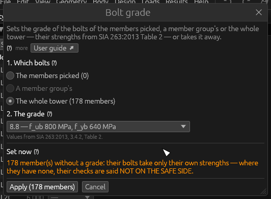
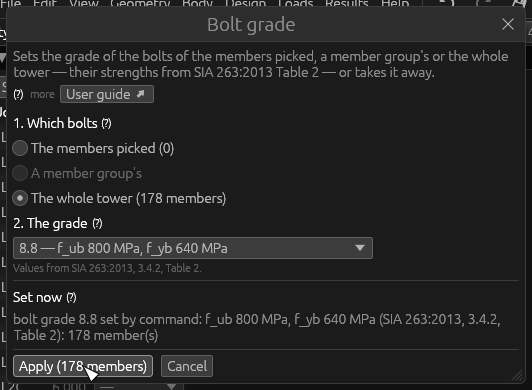

# Bolt grade

(2026-11-19, the owner's decision of that day; built, in active
development, not approved yet.) **What it is for:** the bolts of a tower
imported from a tower program's export often carry only a diameter and a
shear capacity — no grade, no ultimate strength. Their tension, and with
it the prying of bolts pulled out of their plies, cannot be checked: the
results say so, **NOT ON THE SAFE SIDE**. **Design › Bolt grade…** gives
the bolts of the members picked, a member group's or the whole tower a
grade, its strengths from **SIA 263:2013, 3.4.2, Table 2**, and records it
in the structure file as **set by command**, so that every result says
where the bolts' strengths come from.

Nothing takes a grade by itself: there is no default grade in the
program. A bolt without strengths stays without them until a grade is
set here (or its bolt library gives them).

**Setting it up**, in order:

1. Open **Design › Bolt grade…** (the members picked, else the whole
   tower; the grade 8.8 offered first).
2. **1. Which bolts**: the members picked, a member group's (choose the
   group), or the whole tower. A member's bolts are its ends' bolts, its
   design data's bolts, and a gusset plate's own bolts onto it.
3. **2. The grade**: one of SIA 263's strength classes, or **None** to
   take the grade away.
4. Read **Set now**: the grades the members' bolts have, with their
   values, source and who set them, and how many members have none.
5. **Apply**: one undo step.

**The window:**

| Field | What it does |
|---|---|
| 1. Which bolts | the members picked (how many) · a member group's · the whole tower (how many members) |
| 2. The grade | 4.6, 4.8, 5.6, 5.8, 6.8, 8.8 or 10.9 with its f_ub and f_yb (MPa) — the values of SIA 263:2013, 3.4.2, Table 2 (4.8, 5.8 and 6.8 marked "not used in Switzerland", the table's footnote: their elongation too low) — or **None**: the grade taken away |
| Set now | each grade set on the tower's bolts, in words ("bolt grade 8.8 set by command: f_ub 800 MPa, f_yb 640 MPa (SIA 263:2013, 3.4.2, Table 2)") with how many members; the members without a grade, in the warning colour |
| **Apply (n members)** | writes the grade, one undo step (said on the status line: how many changed, how many had it already) |
| Cancel, Escape | nothing changes |

**The grades** (SIA 263:2013, 3.4.2, Table 2, the strength classes of
SN EN 20898-2, read in the standard's text):

| Grade | f_yb (N/mm²) | f_ub (N/mm²) | Elongation at rupture (%) |
|---|---|---|---|
| 4.6 | 240 | 400 | 22 |
| 4.8 ¹ | 320 | 400 | 14 |
| 5.6 | 300 | 500 | 20 |
| 5.8 ¹ | 400 | 500 | 10 |
| 6.8 ¹ | 480 | 600 | 8 |
| 8.8 | 640 | 800 | 12 |
| 10.9 | 900 | 1000 | 9 |

¹ Not used in Switzerland (elongation at rupture too low; the table's
footnote).

**What it changes in the results:**

- The bolts take the grade's **ultimate strength f_ub** and its name,
  over what their bolt library or the member's design data give. The
  design code then checks with it: the bolt's shear where no capacity is
  given (ASCE 10-97 4.3.2; SIA 263 (73)–(75), the factor by the grade),
  its bearing (the lower of the ply's and the bolt's F_u, ASCE 10-97 4.4),
  and **its tension with prying** (ASCE 10-97 4.3.3, 4.3.4; SIA 263 (77),
  (78)) — see [bolts in tension, with prying](../theory/joint-groups.md#bolts-in-tension-with-prying).
- **A capacity given for another grade** — the bolt library's or the
  design data's ultimate strength or grade differing from the one set —
  is dropped, and the grade's worked out by the code instead (said in the
  member's end notes and the run's notes). Capacities given without a
  grade or ultimate (a tower program's shear capacity) are kept.
- Every run says it: the run's notes ("bolt grade 8.8 set by command:
  f_ub 800 MPa, f_yb 640 MPa (SIA 263:2013, 3.4.2, Table 2) — on the bolts
  of n member(s)"), each member end's notes and each bolt group's notes in
  Joint details and the report; Joint details shows the grade with the
  bolts.

**Good to know:**

- The grade is written into the structure file: `bolt_grade = "8.8"` on
  each member and a `[[bolt_grade]]` with its values, `source` and
  `set_by = "command"` (structure file version 21, written only when a
  member has a grade; [structure library](structure-library.md)). A grade
  no member names any more is removed.
- A bolt's `tension_capacity` in a bolt library is its **ultimate tensile
  load**, F_u × A_s, not a design value ([bolt libraries](structure-library.md)).
- **Undo** takes the whole Apply back in one step.
- There is no command-line form: the command is OHL-Structure's (its
  edit, `ohl_structure_edit::set_bolt_grade`, is there for scripts in
  Rust).
