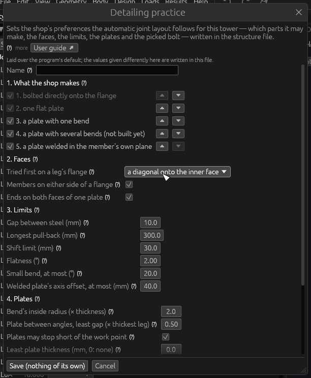
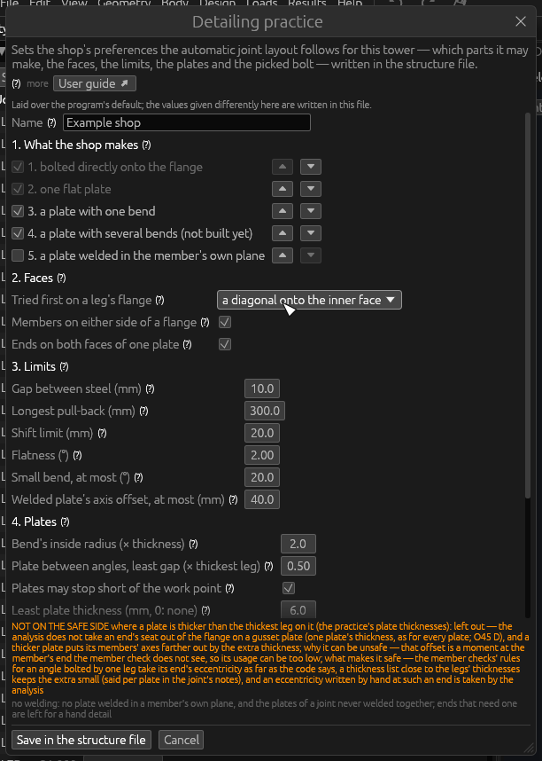

# Detailing practice

(2026-11-26, roadmap O44 L29, the owner's L24 question 5; built, in
active development, not approved yet.) **What it is for:** shops and
utilities detail towers differently — some never weld, some keep every
gusset round the work point, some make plates only in their stock
thicknesses. **Design › Detailing practice…** sets these preferences for
the tower in the structure file, and **Lay out joints** follows them. It
is the editor of the structure file's own `[layout_practice]`
([theory](../theory/joint-layout.md#the-detailing-practice-l24)).

A practice only chooses among what the layout does already: the clash
check, the joint checks after writing (the code's distances, holes
overlapping, the bend check) and the guard that no joint ends worse run
whatever it says. Every value is checked as the layout checks it: a value
out of its range is said in red, with why and what to give instead, and
**Save** waits until it is corrected.

**Setting it up**, in order:

1. Open **Design › Detailing practice…**, or **Edit…** beside
   *Detailing practice* under Lay out joints' preview. The window shows
   the practice in force: this file's own over the code plugin's (the
   member check's plugin, where it gives one), value by value, over the
   program's default.
2. **Name** (optional): shown with the practice in Lay out joints.
3. **1. What the shop makes**: the five forms in the shop's order — bolted
   directly onto the flange, one flat plate, a plate with one bend, a
   plate with several bends (not built yet), a plate welded in the
   member's own plane —, each ticked where the shop makes it (the first two
   always). ⏶ and ⏷ move a form in the order; the order decides only ties.
4. **2. Faces**: which end is tried first on a leg's flange's other face,
   members on either side of a flange, ends on both faces of one plate.
5. **3. Limits**: the gap, pull-back and shift Lay out joints starts with,
   the flatness, the largest small bend, the welded plate's largest axis
   offset.
6. **4. Plates**: the bend's inside radius, the least gap for a plate
   between a built-up member's angles, plates stopping short of the work
   point, and the **plate thicknesses** — a least thickness and the
   thicknesses the shop makes.
7. **5. The picked bolt**: how many bolts in one line an end without bolts
   is given, for the whole tower and per member class.
8. **Save in the structure file**: one undo step. Only the values that
   differ from what the file's table is laid over are written. The joints
   laid out stay as they are until Lay out joints runs again.

**The window** (each field's (?) says its effect on the results and on the
time, measured on eight private real lattice towers, 6 852 joints — the
numbers below):

| Field | What it does | Default | Range |
|---|---|---|---|
| Name | shown with the practice | none | any text |
| 1. What the shop makes | the forms an end may go onto, each allowed or not, in the shop's order | all five, direct → plate → bend → bends → welded | direct and plate always allowed; each form once |
| Tried first on a leg's flange | which of a face's ends is tried on the flange's other face first (L10) | a diagonal onto the inner face | or the later class |
| Members on either side of a flange | an end turned half a turn onto the flange's other face (L10) | yes | yes / no |
| Ends on both faces of one plate | an end on the back of the flat plate past the heel (L11) | yes | yes / no |
| Gap between steel (mm) | Lay out joints' starting gap | 10 | 2 to 100 |
| Longest pull-back (mm) | Lay out joints' starting pull-back | 300 | 10 to 2 000 |
| Shift limit (mm) | Lay out joints' starting shift limit | 30 | 0 to 30 |
| Flatness (°) | the most an end's leg may lie off its flange and bolt flat | 2 | 1 to 2 |
| Small bend, at most (°) | the most a plate is bent by a few degrees before a welded plate | 20 | the flatness to 20 |
| Welded plate's axis offset, at most (mm) | the most a plate in a member's own plane puts its axis out beyond a plate's thickness | 40 | 0 to 40 |
| Bend's inside radius (× thickness) | a bent plate's inside radius | 2 | 1 to 10 |
| Plate between angles, least gap (× thickest leg) | the least gap of a built-up member a plate between its angles is laid out in | 0.5 | 0.5 to 4 |
| Plates may stop short of the work point | a plate whose outline round the work point runs into something stops short | yes | yes / no |
| Least plate thickness (mm, 0: none) | every plate the layout makes at least this thick | 0 (the thickest leg on it) | 0 to 50 |
| Plate thicknesses made (mm, empty: any) | a plate takes the thinnest listed at least as thick as the thickest leg on it and the least | empty | 2 to 100 each, at most 30 |
| Bolts per end, in one line | the provisional bolts of an end without bolts or a class preset | 2 | 2 to 8 |
| … for leg, bracing, redundant, crossing | the same for ends of that class (ticked: its own) | not ticked | 2 to 8 |
| **Save in the structure file** | writes the file's own `[layout_practice]`, one undo step | | |
| Cancel, Escape | nothing changes | | |

## The plate thicknesses

A plate the layout makes is **as thick as the thickest leg on it**
(before L29, and still without a rule). With a least thickness it is at
least that thick; with a list of thicknesses it takes **the thinnest
listed** at least as thick as the thickest leg and the least. It is never
thinner than the thickest leg on it, whatever is given. Where no listed
thickness is that thick, its ends are left for a hand detail, with why.
A plate between a built-up member's angles is as thick as the gap
between them: the least thickness holds for it (a thinner gap: by hand),
the list does not.

**NOT ON THE SAFE SIDE** where a plate is made thicker than the thickest
leg on it, said in the window, in each such joint's notes and in the
run's notes: *left out* — the analysis does not take an end's seat out of
the flange on a gusset plate (one plate's thickness, as for every plate),
and a thicker plate puts its members' axes farther out by the extra
thickness; *why it can be unsafe* — that offset is a moment at the
member's end the member check does not see, so its usage can be too low;
*what makes it safe* — the member checks' rules for an angle bolted by
one leg take its end's eccentricity as far as the code says, a list close
to the legs' thicknesses keeps the extra small (each plate says by how
much), and an eccentricity written by hand at such an end is taken by the
analysis.

## Lay out joints' own settings

The gap, pull-back and shift of **Lay out joints** stay the user's choice
for each run (the owner's L24 question 4): the practice gives their
starting values. Where a run's own go beyond the practice in force — a
smaller gap, a longer pull-back, a larger shift, or a gap below the 2 mm
the clash check sees — Lay out joints says so under its settings, in the
warning colour, and the run's notes say it too; the practice itself is
unchanged.

## Measured

Each value's effect is measured on eight private real towers ([theory](../theory/joint-layout.md#the-practice-measured-its-plate-thicknesses-and-its-editor-l29)).

## Good to know

- **Where it is written**: the structure file's `[layout_practice]`
  (structure file version 27; 29 when it gives a plate thickness rule — an
  older program refuses such a file rather than laying it out without
  the rule). A code plugin may answer a practice of its own (its optional
  `layout-practice` export); the file's values win value by value.
- **Only what differs**: a value equal to the code plugin's or the
  default is not written, so the plugin's later changes still reach it.
  Setting every value back writes no table at all.
- **Undo**: one step takes the whole change back.
- **The joints laid out** are not laid out again by Save: run Lay out
  joints (its preview shows the practice at once when it is open).
- The bundled design codes give no practice (a practice is a shop's, not
  a code's).
