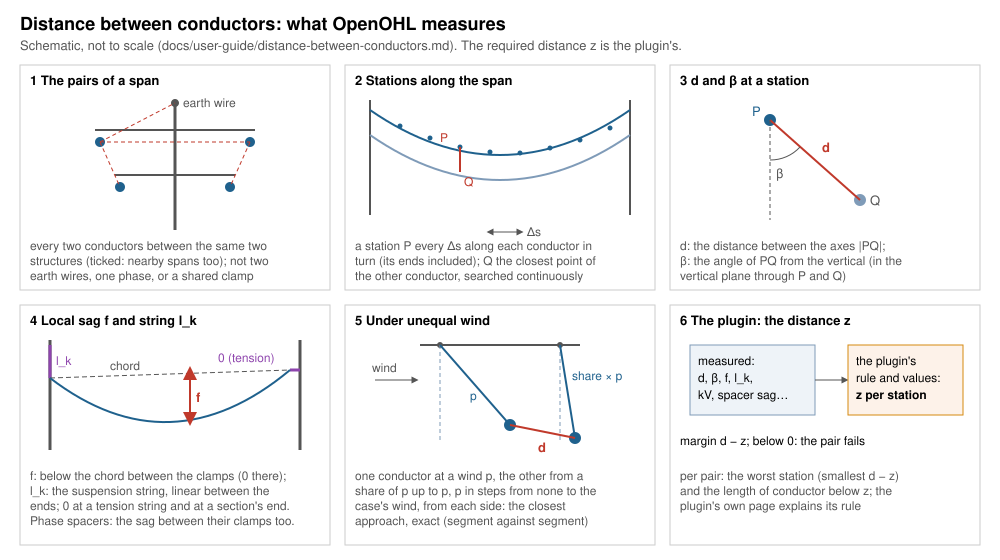

# Distance between conductors

*Built, in active development (not approved yet).* Two windows of
OHL-Design opened from the **Checks** menu when a **check plugin** that
runs them is in use: **Distance between conductors…** (in the span, in
still air or in any weather case) and **Distance between conductors under
unequal wind…**. This page explains both for a line designer: what they
answer, what OpenOHL measures and how, every setting and what is on the
safe side. The core's part in detail: [Distance between conductors: the
core's part](../development/phase-distance-check.md).

## What it answers

**Do two conductors of the line come closer to each other than the
design code allows?** A design code may require a distance between two
conductors that depends on where along the span one looks — on the local
sag, the suspension strings, the angle of the line joining them, the
voltages — or a fixed distance while the wind blows them unequally. The
work is shared:

- **OpenOHL measures** the conductors: which pairs there are, where along
  the span, the distance d between them, the angle β, the local sag f,
  the string length l_k, the sag between phase spacers, the swing under
  unequal wind. This page explains that part.
- **The plugin gives the required distance z** at each place, from its
  rule and its values. OpenOHL has **no rule of its own** for these two
  checks: without a plugin that runs them the windows are not in the
  menu. The plugin's own page — the button **the plugin's rule ↗** in the
  window, shown when the plugin ships one — explains its rule, its values
  and where they come from.

Per pair the result is the worst place (the smallest margin d − z) and,
in the span, the length of conductor below z.

*Left to right, top to bottom: the steps below. The plugin answers
step 6.*

## Which plugin

File › Plugins › Plugin manager lists the plugins; a check plugin in use
adds its checks to the Checks menu, in the submenu it names (e.g. the
design code's name). Its values file (the distances, factors and tables
its rule reads) ships with it and is shown in the window, locked;
[Design codes](design-codes.md) explains the plugins of a project. A
check plugin answers through OpenOHL's `check` interface
([Writing plugins](../development/plugins.md#check-plugins)); nothing of
its rule is built into OpenOHL.

## In the span: how it is measured, step by step

### 1. The weather cases and the wires solved

Each weather case ticked is checked **on its own**: both conductors of a
pair always from the same case. The line is solved in the case as in the
rest of OHL-Design (each section by its own calculation, or as **Wires
by** says), with the structures' local wind and wire ice when **Use local
conditions** is ticked. A section that cannot be solved is named in the
notes and not checked.

### 2. The pairs

Every two conductors **hanging between the same two structures** — of
the circuits in the scope — are a pair. A bundle is measured by its
subconductors: each station of one to the nearest subconductor of the
other. Not paired, because they cannot flash over to each other:

- a jumper with anything;
- two earth wires;
- two conductors of the same circuit and phase (one potential);
- two conductors sharing a clamp.

With **Nearby spans** ticked, conductors **not** between the same two
structures — another line's span, the next span — are paired too where
they come within the maximum distance of each other (20 m by default),
and measured only where closer than that.

### 3. The stations along the span

On the first conductor of a pair, a **station** P every Δs of its length
(0.1 m by default), its two ends included; then the same on the second
conductor against the first, so a short and a long conductor are both
covered.

### 4. d and β at each station

At each station P, OpenOHL searches the **closest point Q** of the other
conductor (in 3D, continuously along it, not at its stations):

- **d** = |PQ|, the distance between the two conductors' **axes**, less
  the small error bound of the wires as computed (a few millimetres): d is
  never above the true distance between the axes. The other clearance
  checks measure to the conductors' surfaces; here the codes define the
  distance between axes, and a plugin whose code means the surfaces adds
  the two radii to its z.
- **β**, the angle of PQ from the vertical, in the vertical plane through
  P and Q (not square to the span: at a large line angle a cut square to
  the span would compare points far apart along the other conductor).

### 5. The local sag f

At P and at Q, each conductor's **local sag**: the vertical distance from
its **chord** — the straight line between its two clamps — down to the
conductor. It is 0 at the clamps and largest near mid-span. A station
within 2 m of a clamp is marked *at a clamp (f ≈ 0)* in the results: there
z is the plugin's term without the sag.

### 6. The string length l_k

Each conductor's **l_k** at its point: the length of the suspension
string that lets it swing, taken at each end of its span and **linear
between the two ends**. At an end:

| At the end | l_k there |
|---|---|
| a suspension string alone | its length |
| a string below two others | that string's length |
| two tension strings hanging from one string's wire point | that string's length |
| two strings to one wire point, a tension string, a wire clamped straight to the structure | 0 |
| **a section's first or last point** | **0, always** — a dead end is held by tension strings even when an import marked none as such |

### 7. Phase spacers: the sag between them

When **phase spacers** join the two conductors in the span, each spacer
is taken as an attachment point: each conductor's **largest sag between
its spacer clamps** (each stretch below its own chord, the span's clamps
included) is measured and given to the plugin besides the local sag. The
local sag f stays the one below the span's chord.

### 8. The required distance and the worst station

Per pair OpenOHL gives the plugin what its rule needs besides the
stations — whether both are in one electrical system, whether they hang
between the same two structures, each one's nominal voltage (none: an
earth wire), the plugin's columns of their sections (e.g. an insulation
level per circuit, set in the window), the mean conductor height of the
span, the diameters and masses, the sags between spacers — and per
station the six numbers d, β, f of each, l_k of each. The plugin returns
**z** at each station, its own numbers (shown with the worst station) and
the rule it applied.

Per pair the result keeps the **worst station** (the smallest d − z: its
two points, d, z, the measured values, the plugin's numbers, the rule)
and the **length of conductor below z** (on the conductor where it is
longest, each stretch counted once).

## Under unequal wind: how it is measured

Panel 5 of the drawing [above](#what-it-answers): the two conductors
swung by unequal wind, their closest approach d.

### 1. The wind levels

**One weather case** gives the wind (its pressure) and keeps its
temperature and ice. The line is solved at every **wind step** (50 Pa by
default) from no wind up to the case's pressure — the case's own always
included — and at the **share** of each step (60 % by default), so the
largest difference of wind is always among the levels. Still air once,
every other level with the wind **from each side**. The levels are solved
side by side on the computer's cores.

### 2. The pairs

The pairs as in the span (in still air); nearby pairs where their boxes,
over all the levels, come within the maximum distance.

### 3. The closest approach, exact

For each pair, every combination: one conductor at a level p, the other
at a level from the share of p up to p, both ways round, the wind on both
from the same side (still air with either). For each combination the
**shortest distance between the two wires' axes**, segment against
segment — **exact**, not at stations (a bundle by its subconductors).
The closest of all is kept, with the two winds and the side.

### 4. The required distance

The plugin is asked once per pair, with one station: d and β, no sag and
no string (zeros). It returns z, its own numbers and the rule.

## The window, setting by setting

Both windows have the same Setup, top to bottom; what differs is said.
The setup is kept in the project per project line and marks the results
*out of date* when changed. Each section and field explains itself in its
**(?)** or on hover. Always written in the window: what blocks **Run**,
every warning and error (the plugin not loaded, a value refused), the time
a run should take, and in the results every note.

### 1 What it checks

The question in short, with **How it is computed** folded below it:
first the plugin's explanation of its rule, then OpenOHL's measuring.
**how it is measured ↗** opens this page; **the plugin's rule ↗** opens
the plugin's own page on the check (only when the plugin ships one).

### 2 Scope

| Setting | Default | What changes in the result | Time |
|---|---|---|---|
| **Weather cases** (in the span) — *n of m*, a tick menu | the still-air cases at 10 °C | each case ticked checked on its own; more cases, more rows | one solve and one measuring of the line per case |
| **Weather case** (under unequal wind) — one | the plugin's suggested case when the project has it, else the windiest | the wind the steps go up to, its temperature and ice | the number of wind levels (below) |
| **Wires by** | each section's own calculation | every wire solved in that condition and by that method (e.g. the final sag after creep) | finite elements slower than ruling span |
| **Circuits** | every circuit | only pairs whose two conductors are in circuits ticked; none: Run greyed | fewer pairs |
| **Routes** and **alignments** | the whole line | only the pairs off structures on those ticked | fewer pairs |

### 3 Rules

The plugin's part, shown for transparency:

- **Choose a values file…**: another values file instead of the values
  used (its extension the plugin's); **Forget the file** goes back.
- **The plugin's choices** (e.g. a diagram or a class), each with its
  hover; the option the plugin gives by default until changed.
- **Circuits checked and their …** (when the plugin needs a value per
  circuit, such as an insulation level): each circuit ticked with its
  voltage and that value, chosen here for all its sections — the same
  value as the column of the Electrical circuits table. An earth wire
  circuit takes its phases' value.
- **Values used**: the values file as tables, and where it comes from
  (the plugin's, a file chosen, a saved report, or the project's copy).
  Locked; an **admin** of the project may **Edit values** (a cell at a
  time, checked by the plugin) and **Save in the project**: the project's
  copy, headed with who edited it and when, used by every run on the
  project and kept in each report. **Back to the plugin's** removes the
  copy.

None of these costs time.

### 4 Model

Folded: the defaults are sound.

| Setting | Default | What changes in the result | Time |
|---|---|---|---|
| **Stations every** [m] (in the span) | 0.1 m (0.1 … 50) | where along a conductor d is measured; smaller finds the closest point more exactly | the stations grow as 1 / Δs: half the spacing, about twice the measuring |
| **Wind step** [Pa] (under unequal wind) | 50 Pa (1 … 1000) | the wind levels from none to the case's; smaller, more levels between which the closest approach is looked for | each level is a solve of the line; the combinations grow with the square of the levels |
| **Other conductor's wind from** [%] (under unequal wind) | 60 % (0 … 100) | the other conductor at this share of the first's wind up to the same; lower, more unequal swings and closer approaches | another level per step |
| **Nearby spans** and **within** [m] | off; 20 m (1 … 200) | also pairs not between the same two structures, measured where closer than the distance; keep it above the largest z | more pairs |

### The footer

- **Use local conditions**: the structures' local wind for clearances and
  wire ice put on their spans before the solve; said in the notes. Its
  hover says the effect and the time it took last.
- Before **Run**, one line says what a run will do — the sections and
  spans in the scope, in how many cases — and the time it should take
  (measured on the window's last run on this computer; before the first,
  *time measured on the first run*); greyed, **Before Run: …** says why
  (the plugin not loaded, no weather case or no circuit ticked).
- **Run** and **Stop**: the check runs in the background; Stop keeps the
  previous results. Under unequal wind the footer counts the run's two
  steps — the line solved at each wind level, then the pairs measured —
  with a bar and the time left.

On a long line (930 conductors, 5593 pairs) the measuring in the span took
about a second on all cores; under unequal wind, a case of 2400 Pa in
steps of 50 Pa (175 levels) about 100 s to solve and 47 s to measure, and
a case of 650 Pa in steps of 50 Pa (27 levels) about 15 s to solve and a
few seconds to measure.

### The results

The **Results** tab starts with the verdict: red, *✖ N pairs below z —
worst d − z …* (its spans and case), or green, *✔ Every pair at z or more*;
a click on it brings the views to the worst pair. One line below says the
plugin's code (and its choice), the pairs checked, those below z and — in
the span — the metres of conductor below z. Then the table, worst first
(*Only violations* on by default; sortable; grouped by case, span or
rule):

| Column | Meaning |
|---|---|
| Case | the weather case |
| Span, Circuit; Other span, Other circuit | the two conductors (section and span; circuit and phase, or earth wire) |
| C | the kind of pair the plugin's values distinguish: within one electrical system (or towards an earth wire), or between systems |
| Voltage [kV] | the nominal voltage used |
| d [m] | the distance found (between the axes) |
| z [m] | the distance required there (the plugin's) |
| d − z [m] | the margin; below 0 in red |
| Below [m] (in the span) | the length of conductor below z |
| f [m], l_k [m] (in the span) | each conductor's local sag and string length at the worst station |
| β [°] | the angle of the line joining them from the vertical |
| k, C [m] (in the span) | the plugin's own numbers at the worst station |
| Wind [Pa], From (under unequal wind) | the wind on each conductor at the closest approach, and its side |
| Rule | the plugin's rule applied |
| Note | *at a clamp (f ≈ 0)*, *nearby span* |
| vs saved | after a run again of a saved report: new, fixed, worse, better |

A click on a row selects the span, draws the pair's sections **in the
result's weather case**, and draws the line between the two points in the
3D view, labelled with d and z; under unequal wind also the two
conductors as measured, each at its wind and labelled with it — nothing
solved again. The line goes when the window closes. **Export CSV…**
writes the rows shown, **Full report (CSV)…** every pair kept with every
value (the sags, the plugin's numbers, the winds, the points'
coordinates). The notes (sections not solved, local conditions) are
folded below.

**Save in the library of performed checks** keeps the run under a name
([Performed checks](analyses.md#the-library-of-performed-checks)): its
parameters (the values file's text included), the pairs below z and
within 1 m of it, the counts. Opened again it shows its results and
whether the line changed since; **Run** runs it again with its
parameters, shows each pair against the saved run and asks whether to
replace it.

## Every setting kept

The window keeps its setup as a project setting per project line,
`app.phase_distance.<line>` (in the span) and `app.unequal_wind.<line>`
(under unequal wind), a JSON object:

| In the window | Key | Unit | Default | Meaning |
|---|---|---|---|---|
| Weather cases / Weather case | `cases` | names | the still-air cases at 10 °C / the suggested or windiest case | the cases checked (under unequal wind one) |
| Circuits | `circuits` | names | every circuit | the circuits checked (also in `scope`) |
| Circuits, Routes, alignments | `scope` | names | every circuit, the whole line | the scope |
| Wires by | `calculation` | e.g. `"max-sag-fe"` | each section's own | how every wire is solved |
| the plugin's choices | `choices` | option numbers | the plugin's defaults | the plugin's choices, in its order |
| Stations every | `spacing` | m | 0.1 | Δs |
| Nearby spans | `nearby` | true / false | false | pairs not between the same structures too |
| within | `max_distance` | m | 20 | how close a nearby pair must come |
| Wind step | `wind_step` | Pa | 50 | under unequal wind |
| Other conductor's wind from | `low_share` | share (0 … 1) | 0.6 | under unequal wind |
| Use local conditions | `local` | true / false | false | the structures' local wind and wire ice |

A values file chosen with **Choose a values file…** is used for the
session only; the project's copy of the values is kept in the project
(edited by an admin), the plugin's own ships with it.

## What is conservative and what is not

OpenOHL's side — the measuring (labels as in the [theory
manual](../theory/conventions.md#conservative-assumptions-and-simplifications)):

- **On the safe side:** d is between the axes **less** both wires' error
  bounds (a few millimetres), never above the true distance between the
  axes.
- **On the safe side:** l_k is **0 at every section end**, whatever the
  strings there are marked; at a suspension string its full length.
- **Exact:** under unequal wind, the closest approach between the two
  wires at the levels measured (segment against segment).
- **NOT ON THE SAFE SIDE (a simplification), in the span:** the distance
  is measured at stations every Δs; the closest point of the other
  conductor is searched continuously, but between two stations of the
  first the true minimum may be a little smaller — the smaller Δs, the
  smaller the difference.
- **NOT ON THE SAFE SIDE (a simplification), under unequal wind:** the
  wind is taken at the levels only; a closest approach between two steps
  is not measured. The share of each step is always among the levels, so
  the largest difference of wind is; a smaller step narrows the rest.
- **NOT CHECKED:** nearby pairs farther apart than the maximum distance,
  or all of them when *Nearby spans* is off — keep the distance above the
  largest z; a section that could not be solved in a case (said in the
  notes); a jumper, two earth wires, one phase's conductors, two sharing
  a clamp.
- **A model, not a measure:** l_k linear between the span's ends, and f
  below the chord between the clamps, are the quantities OpenOHL gives
  the plugin; whether a code's rule takes them so is the plugin's to say
  on its page.

The plugin's side — its rule, its values, whether it adds radii or
margins — is the plugin's: its page (**the plugin's rule ↗**) says what
in it is conservative.

## Without the window

There is no command line for these two checks yet: they run in the
desktop app with their plugin in use. A run saved in Performed checks
keeps its parameters and results in the project and can be exported as
CSV from the window. To time the check under unequal wind on a project of
your own, the benchmark `unequal_wind_benchmark`
(`crates/ohl-app/src/bench.rs`).
