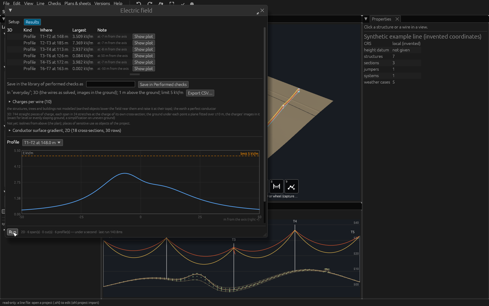

# Electric field

*Built, in active development (not approved yet).* **Checks › Electrical ›
Electric field…** in OHL-Design. This page explains the window for a line
designer: what it answers, how it works, every setting with its default,
its effect and its time, and what is and is not on the safe side. The
calculation in detail, with its sources and its validation:
[theory › Electric field](../theory/electric-field.md) and [Conductor
surface gradient](../theory/surface-gradient.md). The command line:
[Analyses › Electrical: electric field](analyses.md#electrical-electric-field).
The window shares most of its setup with the [Magnetic
field](magnetic-field.md) window.

## What it answers

**How strong is the electric field of the line's voltages near the
ground — across a span, in a vertical cut at a house, in the space around
the wires — and where does it pass a level or a limit you give?** The
field is the electric field strength *E* in kV/m, the rms of the vector,
from the wires where they hang in a weather case. With 2D cuts it also
gives the **conductor surface gradient** (kV/cm), the input of the corona
noise methods.

*The window's results: a profile per span and the plot of one.*

**No limit and no voltage table are built in.** Which voltage, which sag,
which places and which limit an ordinance asks for are yours to give; the
window computes the field and, when you give a limit, the margin to it.

## How it works, step by step

### 1. The wires in a weather case

As in the magnetic field: the line solved in the case you choose (**Wires
by** another calculation if you choose, e.g. *Max sag*: the lowest wires,
the highest field at the ground), each electrical system and the earth
wires optionally in a case of their own.

### 2. The voltages and the charges

Each circuit is at a voltage between phases (kV, rms): by default its
system's **highest operating voltage** (Line › Electrical systems, column
**max kV**, your value), else its nominal voltage — lower, so **not on the
safe side**, and said. From the voltages, the charge per metre of every
wire follows at each cross-section along the span, where the wire really
hangs (each span in 24 stretches).

*The charges from the voltages, with their images in the ground.*

*Each span in stretches, each at its own charge.*

### 3. The ground

The ground is a conductor at earth potential. By default it is a **tiled
floor** laid on the terrain around each profile, cut and volume, its
tiles' charges solved so that it stays at zero potential: it follows
hollows and ridges. Quicker, a **plane under each point**, fitted over a
short distance, exact on level or evenly sloping ground. Optionally the
structures' steel stands on the floor at earth potential.

*The plane under each point against the tiled floor.*

*The tiled floor: fine tiles near the profile, coarse beyond.*

### 4. The field at every point

Every wire in straight pieces of uniform charge (as solved: 64 per span),
the jumpers too; at every point every piece, every tile (or image) and
every piece of steel adds its field, exactly. The whole line is always
modelled.

### 5. Where: profiles, cuts and volumes

The same places as in the magnetic field: **profiles** across the spans at
a height above the ground, **2D cuts** on the alignment, **volumes** over
runs of spans, and **points from CSV**.

A volume too large for one floor (over the memory one calculation may
take) is floored in parts, each over the ground within its reach.

*A long volume floored in parts.*

### 6. The results and the drawings

Every value at a point is computed in full; only the lines and surfaces
between the points are interpolated, and each run says how far they lie
off their levels.

## The window, setting by setting

The Setup tab, top to bottom. The inputs are kept in the project for the
line worked on, written when a run starts or the window closes. Each
heading's **user guide ↗** opens its section of this page.

### 1 What it checks

The question in one line; the method behind the **(?)**; two drawings:
a profile across the line and the sources of the field (the tiled floor
when chosen).

### 2 Scope

| Setting | Default | What changes in the result | Time |
|---|---|---|---|
| **Weather case**, **Wires by**, **Per electrical system**, **Ground from** | as in the [magnetic field](magnetic-field.md#2-scope) | where the wires hang and the ground they stand over | a solve per case |
| **Voltage between phases [kV]**, per circuit | the system's highest operating voltage (*highest*), else its nominal (*the system's nominal — not on the safe side*, in the warning colour) | the field grows in proportion; **highest** / **nominal** beside a typed value sets it back; **0 kV**: voltage-free (at earth potential, like the earth wires); DC systems are left out (said) | none |
| **Profiles by** | 3D | 2D: infinite line charges over level ground at the cross-section — quick, not valid near a line angle, a structure or on sloping ground | 2D: a moment; 3D: the profiles' time in 4 Model |
| **Surface gradient** | on (2D only) | the gradient at the conductors' surfaces at each profile's span, at its lowest point and both ends; changes no field value | some milliseconds per cross-section |
| **Jumpers** | on | off: left out (not on the safe side near the structures) | none |
| **Stretches per span** | 24 | fewer: the charge follows the sag less closely (measured beside it and in the [theory](../theory/electric-field.md#the-charges)) | in proportion |
| **Ground** | tiled floor | *plane under each point*, fitted over **± [m]** (10 m): quick, up to 8 % low on bumps (not on the safe side) and 24 % high in a hollow on a real line | the tiled floor: some seconds per floor, said beside it |
| **tiles [m]: profiles and points / cuts / volumes** | 2 / 8 / 8 m | finer tiles: a closer floor (8 m under a volume some 3 % off on even ground, 4 m 0.5 %) | finer: far longer (4 m some 20 times as long as 8 m under a volume); the volumes' tile cannot be set below what fits the memory |
| **reaching [m]** | 100 m | how far a volume's floor reaches beyond it every way | more tiles |
| **Limit [kV/m]** | none | the margin at every point | none |
| **Points from CSV…** | none | the field at your places (as in the magnetic field) | a point each |

Run is greyed out, with the reason, while every circuit is voltage-free
and **when a floor would need more memory than one calculation may
take**: the memory is a setting of the application, Line › Calculation
options… › *Memory one calculation may take* (2 GB by default, offered up
to three quarters of this computer's memory).

### 3 Spans and what to compute in each

**Make**, the span table, **Profiles**, **Across**, **2D cuts** and
**Volumes** as in the [magnetic field](magnetic-field.md#3-spans-and-what-to-compute-in-each),
with these defaults: profiles ±50 m every 1 m at 1 m, cuts ±60 m every
1 m up to 10 m over the highest wire, volumes ±50 m every 2 m. Beside the
volumes, their floor: its tiles, its memory while solved and its time;
when the longest volume needs more than one floor, how many parts; in red
when it would not fit.

### 4 Model (folded)

| Setting | Default | What changes in the result | Time |
|---|---|---|---|
| **Structures' steel** | off | *earthed (on the tiled floor)*: the members at earth potential, the field lower near the structures, higher at the steel; structures of detail level 1 are left out (counted beside it) | a profile's floor beside two structures longer, said beside it |
| **Wire pieces** | as solved | *at most [m]*: shorter pieces placed on the curve; the field changes by about the wire's offset over the distance to it | in proportion to the pieces |
| **Profiles** | — | the profiles' time: points × pieces, each twice (the charges and their images) | said |

### 5 Views and levels

| Setting | Default | What changes | Time |
|---|---|---|---|
| **Levels drawn [kV/m]** | 1 and 5 kV/m drawn, 10 kV/m not | the isolines and surfaces drawn; display only, none is a limit. **+ level**, **+ the limit** | more levels, more surfaces |
| **colour the cuts by band** | off | a cut's cells in the colour of the highest level at or below their value | none |
| **Cross-sections: also in any cross-section panel I open, every [m]** | off (1 m when ticked) | the field in every cross-section panel you open, from the run's charges | said beside it |

Drawn on the layer **Electric field (isolines, surfaces)** while the
window is open.

### The footer

Before **Run**, one line says what a run will compute and about how long
(the floors counted); when Run is greyed out, why. While it runs: the
step, which floor is being solved, a bar, the time left; **Stop**.

### The results tab

The list of everything computed with **Show plot**, **Open cut**, **Show
in 3D** and a **3D** tick each; the case and model; the **charges per
wire** (per section and span: the voltage to earth, nC/m, the frequency);
the notes; the chosen profile plotted (E against the distance from the
axis, the limit dashed); a table per profile and of the points with their
margin; per view how far its drawings lie off their levels; the
**Conductor surface gradient, 2D** per cross-section and bundle (the
average maximum, the maximum and Markt–Mengele's value, kV/cm rms; per
subconductor in its CSV). **Export CSV…**, **Save in Performed checks**.
The results are marked out of date when the line or the ground changes.

## What is conservative and what is not

From the theory's [choices](../theory/electric-field.md#the-choices-and-why)
and [what is left out](../theory/electric-field.md#what-is-left-out):

- **The nominal voltage** (when neither a voltage for the run nor the
  system's highest operating voltage is given): **NOT ON THE SAFE SIDE**,
  said in the window and in the result with the circuits concerned. The
  surface gradient the same.
- **The plane under each point**: up to 8 % low on bumps (not on the safe
  side); the tiled floor follows the terrain.
- **The structures' steel off** (the default): on the safe side beside a
  structure, not at the steel.
- **Jumpers off**: not on the safe side near the structures.
- **Trees, buildings and people** are not modelled: on the safe side away
  from them, not at their tops.
- **DC systems** are left out (said).

## Without the window

`ohl electrical electric` runs the same calculation from the command line,
`ohl electrical gradient` the surface gradient, `ohl electrical fields`
both fields at once: [Analyses › Electrical: electric
field](analyses.md#electrical-electric-field).
