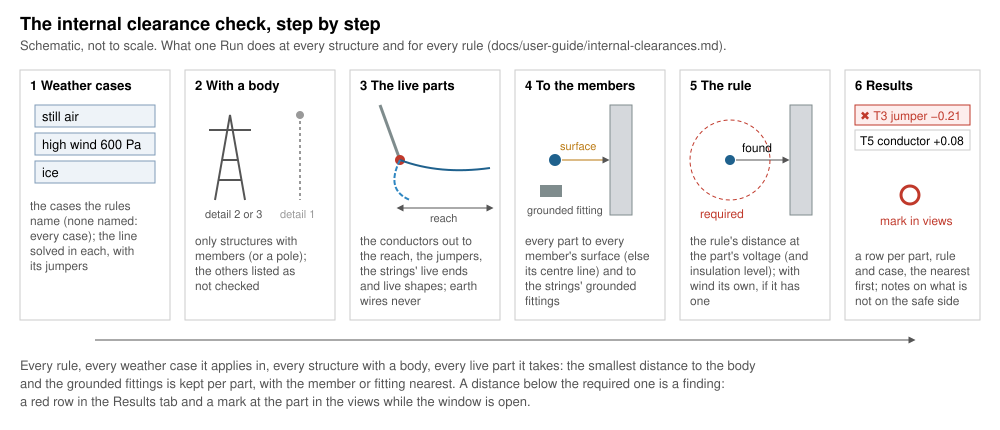
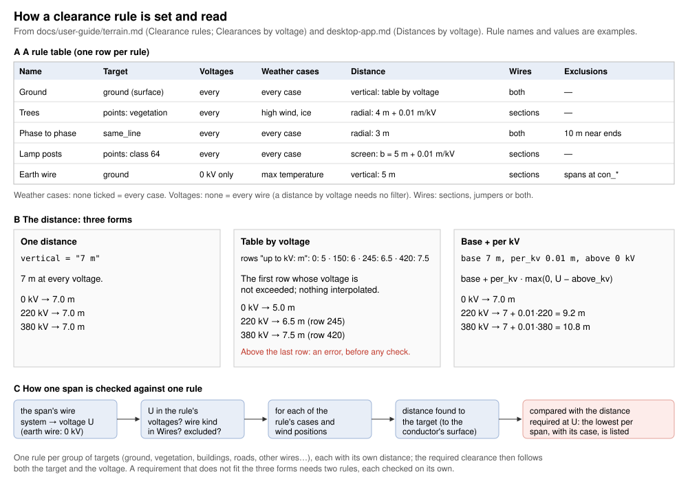

# Internal clearances

*Built, in active development (not approved yet).* **Checks ›
Internal clearances › Internal clearances…** in OHL-Design. This page
explains the window for a line designer: what it answers, how it works,
every setting and every field of a rule. The calculation in detail, with
its sources: [theory › Internal clearances](../theory/internal-clearances.md).
The clearances to the ground and to what stands near the line are in
[Vertical clearances](vertical-clearances.md) and [Radial
clearances](radial-clearances.md).

## What it answers

**At each structure, do the live parts keep their distance from the
structure itself — in every weather case your rules name — and is that
enough for your rules?** The live parts are the conductors near the
structure, its jumpers, the live ends of its strings and the live
fittings on them (grading rings, clamps, horns given as shapes). The
structure is every member of its body and the grounded fittings on its
strings (top fittings, a tower-side horn). A part nearer than a rule
allows is listed and marked in the views.


*The internal clearance: a string swung by the wind towards the body; the
smallest distance from the live parts to the nearest member or grounded
fitting, against the rule's distance.*

Only structures **with a body** are checked: detail level 2 or 3 (members,
or a pole). A structure at detail level 1 is a point with its attachments:
there is nothing to measure against, and it is listed as *not checked*
([below](#a-structure-below-detail-2)).

## How it works, step by step



### 1. The weather cases and the solve

Run solves the line in **each weather case a rule names** (a rule that
names none: every weather case of the project), with its jumpers, each
section as it is solved in the line (its own calculation). The strings
swing as the solve gives them: a suspension string blown towards the
body brings its conductor nearer. A case that cannot be solved is named
in the notes. With **Use local conditions** ticked (in the footer), the
cases are solved on the line with the structures' local wind for
clearances and wire ice on their spans, and a structure's own **wind
study** is taken there (see [4 Model](#4-model-more-options-folded)).

### 2. The structures with a body

Each structure at detail level 2 or 3 of the scope is checked. Before Run,
*1 What it checks* says how many have a body when some have none ("2 of
7 structures have a body …"). The others are listed in the results under
*structure(s) not checked*, each with the reason.

### 3. The live parts

What a rule takes, ticked in the rule:

- **conductors**: each span's conductor from its clamp at the structure
  out to the rule's **reach** (default 20 m, in plan along the solved
  wire), a bundle subconductor by subconductor;
- **jumpers**: each jumper with an end at the structure;
- **string ends**: each string's live end (its wire point, as solved) —
  only on a string with live shapes: without them the wire point is the
  conductor's clamp, already measured with the conductor;
- **shapes**: the live fittings on the strings (Line › Structures ›
  **String shapes**, or the **String builder**: [Volumes on the
  strings](structure-library.md#volumes-on-the-strings)), placed on the
  solved string.

Earth wires have no voltage: they are never checked.

### 4. Measured to the members and the grounded fittings

Every part is measured against **every member** of the body: to the
member's **surface** where its section's profile is known (the member as
drawn, a pole's outline), else to its **centre line** — then the
member's size is left out, which is **not on the safe side**: the
results say so per structure and on every row (*To: centre line*). Every
part is also measured against the **grounded** shapes of every string at
the structure. The insulator itself is never a target: its length is
insulation, not a clearance. Every distance is to the wire's surface
(its radius in the case, iced with ice, taken off).

### 5. The rule's distance

Each part is compared with the distance of **every rule that takes it**:
its weather case, its voltage and — when the rule says so — the
**insulation level** of its system (since 2026-11-11: a code's table with
a low and a high row per voltage is two rules, one for each level). In a
weather case **with wind** (a wind pressure above 0) a rule's own
*with wind* distance is used, if it gives one. A distance given by
voltage is read at the part's nominal voltage, and grows with the
altitude when the rule says so. There is no precedence among rules:
each rule that takes a part gives its own row.



### 6. The results and the marks

The **Results** tab shows the verdict first — red with the worst part
("✖ 3 parts × case too near — worst T3 jumper …: 1.29 m of 1.50 m"),
green with the smallest margin when every part keeps its distance, red
too when nothing was checked — then the notes, the structures not
checked, and the table: one row per part, rule and case, the nearest
first. A row clicked (or the verdict) goes to its structure. The parts
too near (else the nearest) are marked in the views while the window is
open.

## The window, setting by setting

The Setup tab, top to bottom. Every setting is kept in the project's
rule file of the window (`<model>.internal-rules.ohlr`, in the project's
rules folder) as soon as it is changed, and a change of the line marks
the results *out of date*. Each section and field explains itself in its
**(?)** or on hover; only warnings, *NOT ON THE SAFE SIDE* notes, what
blocks **Run** and the time stay written under the fields. Each
section's **user guide ↗** opens its part of this page.

### 1 What it checks

The question in one line, with **How it is computed** folded below it
(the method in a paragraph and the drawing). When some structures have
no body, a warning says how many have one; the others will be listed as
not checked.

### 2 Rules

The rules, one row each, in the shared [rule
table](desktop-app.md#the-rule-table). **Click a rule to edit it
below**: its fields appear under the list. A new window starts with one
rule, *rule 1*, its distance *to set* (0 m): **Run** is greyed, and the
footer says why, until it is set.

- **Preset ▾**: the internal rules of a design-code plugin or of the
  project, **Merge** (by name) or **Replace** ([Presets per
  check](design-codes.md#presets-per-check)).
- **Import…** / **Export…**: rule files (`.ohlr`); an import replaces the
  rules.
- **Add rule**, **Duplicate**, **Remove**, **Move up**, **Move down**.

| Field | Default | What changes in the result | Time |
|---|---|---|---|
| **Weather cases** | none ticked: every case | the cases this rule checks in; the run solves every case any rule names | one solve of the line per case |
| **Voltages** | none ticked: every voltage | only the parts of these nominal voltages | none |
| **Insulation** | any insulation | *low* / *high only*: only the parts of systems of that level; a circuit that only rules of the other level take is **NOT CHECKED**, said in the results | none |
| **Parts** | all four ticked | the parts measured: conductors, jumpers, string ends, shapes | fewer parts: a little faster |
| **Reach [m]** | 20 m | how far along each span from its clamp the conductor is measured; shorter: the conductor farther out is not checked | none worth noting |
| **Distance** | 0 m (to set) | the distance to keep: one value, a table by voltage, or a base plus an amount per kV | none |
| **With wind** | off | ticked: a distance of its own in the cases with wind; off: the distance in every case | none |

The fields of the rule file are in the [table below](#every-field-of-a-rule).

### 3 Scope

- **Circuits**: those checked (all ticked: every circuit, also those
  added later; none: Run greyed).
- **Routes**, their **alignments** and **sections**: only the sections
  ticked, or with a structure on a route or alignment ticked (none
  ticked: the whole line).

Fewer circuits or sections: fewer wires solved, a faster run. The rules
give their own voltages and weather cases besides (*2 Rules*).

### 4 Model: more options (folded)

The **wind study** of a structure: a wind study may give a structure
another wind than the weather case for the conductors' distances to it
(Line › Structures, column *wind study Pa*, or the structure's Local
conditions: [A wind study per
structure](weather.md#a-wind-study-per-structure)). It is taken only
with **Use local conditions** ticked.

| Setting | Default | What changes in the result | Time |
|---|---|---|---|
| **Least pressure [Pa]** | unticked (none); 300 Pa offered when ticked | a structure's wind study below it is taken at it (a design code's bound), said in the notes | none |
| **Cases taking it** | empty: every case of the rules with wind | the weather cases (names, `*` `?`, comma separated) that take the wind study | one more solve of the line per study pressure and case |

Always visible under the fold, when it applies: how many structures give
a wind study, and that it is **not taken** while Use local conditions is
unticked; the note of a project whose weather case groups still hold the
old wind study columns, with **Copy into the structures (n)** — each
structure's value becomes its local wind study (one change, undone with
Undo).

### The footer

- **Use local conditions**: the line with its structures' local wind for
  clearances and wire ice on their spans; their wind study too.
- Before **Run**, one line says what a run will compute and about how
  long it takes, from the window's last run on this computer; or
  **Before Run: …** with what blocks it (no rule, a distance not set, a
  rule that checks nothing, no circuit in scope).
- **Run** and **Stop**: the check runs in the background; Stop keeps the
  previous results. A run stops after ten minutes at the latest, with
  what it has.

### The results

The verdict, the notes (every *NOT ON THE SAFE SIDE* and *NOT CHECKED*
note among them), *n structure(s) not checked* (folded, with the
reasons), then the table: **Structure**, **Part**, **Member or shape**
(`shape string S1 top fitting` for a grounded fitting), **Rule** (with
its insulation condition: `Phase to steel (insulation low)`), **Case**
(`… (wind study 450 Pa)` for a structure's own wind), **Distance [m]**,
**Required [m]**, **To** (*surface* or *centre line*), **Verdict**.
**Only violations**, **Search**, **Group by** (structure, rule, case),
**Export CSV…** (the table as shown) and **Full report (CSV)…** (every
field, as `ohl internal` writes it).

## Every field of a rule

The window's rule editor and the rule file
([Internal clearance rules](terrain.md#internal-clearance-rules-internal_rule))
hold the same rule: an `[[internal_rule]]` table.

| In the window | In the rule file | Unit | Default | Meaning |
|---|---|---|---|---|
| Name | `name` | — | "rule n" | the rule's name in the results |
| Weather cases | `cases` | names (`*` `?`) | every case | the cases the rule applies in |
| Voltages | `voltages` | kV | every voltage | only the parts of these nominal voltages (earth wires never) |
| Insulation | `insulation` | `"low"`, `"high"` | any | only the parts of systems of that insulation level (Line › Electrical systems, column *insulation*; a system that gives none is high) |
| Parts: conductors | `conductors` | — | true | the conductors near the structure, out to the reach |
| Parts: jumpers | `jumpers` | — | true | the jumpers with an end at the structure |
| Parts: string ends | `string_ends` | — | true | the strings' live ends (on strings with live shapes) |
| Parts: shapes | `shapes` | — | true | the live shapes on the strings, and every part against the grounded shapes |
| Reach [m] | `reach` | m | 20 m | how far along each span from its clamp, in plan; above 0 |
| Distance | `distance` | m | none (required; the window's new rule: 0 m, to set) | `"1.5 m"`, `{ by_voltage = [[110, "1.1 m"], …] }` or `{ base = …, per_kv = …, above_kv = … }`; a part whose voltage the table does not reach is not checked, said |
| With wind | `distance_wind` | m | none: `distance` in every case | the distance in the cases with wind, in the forms of `distance` |
| — (kept, shown in the rule's summary) | `altitude = { from, per_1000_m }` | m, share | none | the distances grow by this share per 1000 m above `from`, taken at the structure's or the part's highest point |

Read by the window from the file's `[check]` table:

| Key | Default | Meaning |
|---|---|---|
| `circuits`, `routes`, `alignments`, `sections` | every circuit, the whole line | **Scope** |
| `local` | false | **Use local conditions** |
| `wind_study_min` | none | **Least pressure** |
| `wind_study_cases` | none: every case of the rules with wind | **Cases taking it** (wind study) |

The `[check]` keys `cases`, `method` and `search_distance`, the
`[[rule]]` tables and the `[wind]` table belong to other check windows;
this window does not use them.

## What is conservative and what is not

On the safe side ([theory](../theory/internal-clearances.md#distances)):

- every distance is to the wire's surface, with the bound of how far the
  wire lies off its computed line taken off: never more than the exact
  distance;
- the shapes on the strings are measured exactly as solids (a grading
  ring by chords, at most 0.5 mm less than exact);
- a distance growing with the altitude is taken at the highest point of
  the structure or the part;
- a wind study below the least pressure is raised to it.

Not on the safe side, and said in the results each time it applies:

- **Members without a known section** are measured to their centre
  line: their size is left out (*… members to the members' centre lines:
  their size not counted — on the unsafe side*, per structure; *To:
  centre line* on the row). Give their sections a profile in the section
  library.
- **Strings without shapes**: their fittings' size (clamps, horns, yokes)
  is not counted, the conductor measured from its clamp (*NOT ON THE
  SAFE SIDE: T3: 4 string(s) without volumes …*). Give their insulator
  assemblies shapes.
- **A circuit no rule takes** because of its insulation level: *NOT
  CHECKED, NOT ON THE SAFE SIDE: no internal rule for … (insulation
  high)*. A system's level given wrongly as low is measured against the
  smaller distance: the level is your statement about the line.
- **A part whose voltage a rule's table does not reach**: not checked,
  said per rule.
- **A wind study lower than the case's wind** is taken as given: that is
  the engineer's to justify.
- The way the shapes sit on a solved string is approximate (no twist or
  bending of the string; the strings of a double assembly parallel):
  [theory](../theory/internal-clearances.md#placing-the-volumes-on-a-solved-string).

## A structure below detail 2

A structure at detail level 1 (no members, no pole) is **not checked**:
it is listed under *structure(s) not checked* with the reason, and
counted before Run in *1 What it checks*. When nothing at all could be
checked the verdict is red: *✖ Nothing checked …*. Give the structure a
type with a body ([Structure detail levels](structure-library.md)) to
check it.

## Without the window

`ohl internal` runs the same check from the command line on a rule file
with `[[internal_rule]]` tables, for the whole line
([Internal clearance rules](terrain.md#internal-clearance-rules-internal_rule)):

```sh
ohl internal examples/synthetic-line/synthetic-line-typed.ohl.json \
  --structures examples/synthetic-line/Structures \
  --weather examples/synthetic-line/weather-cases.ohlwc \
  --rules my-internal-rules.ohlr --csv internal.csv
```

It does not apply the window's scope, Use local conditions or the wind
study yet.
