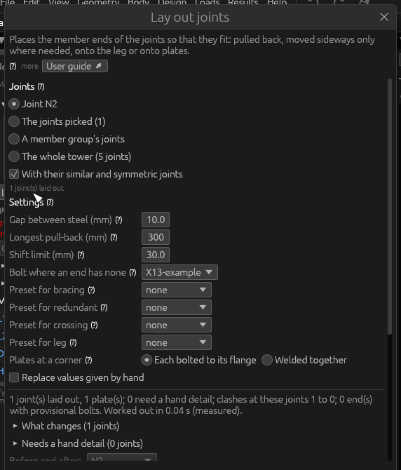
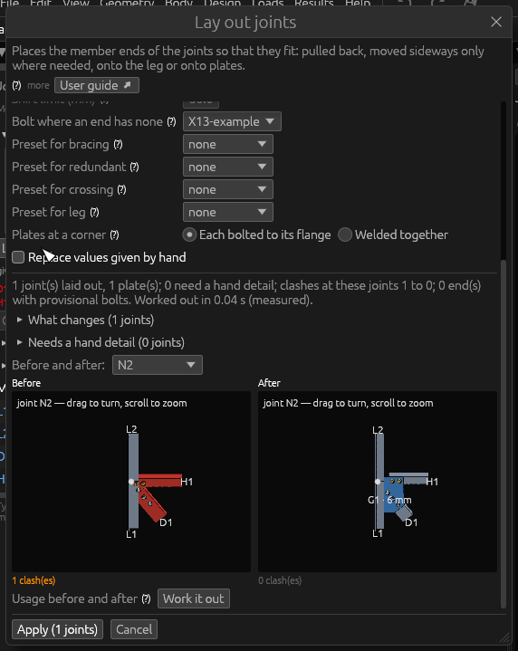
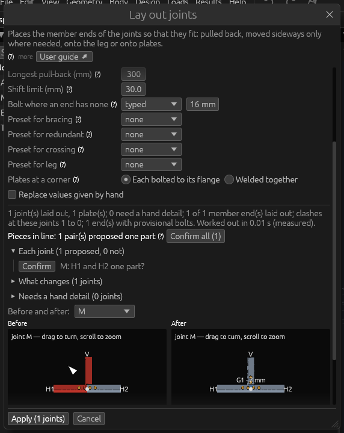
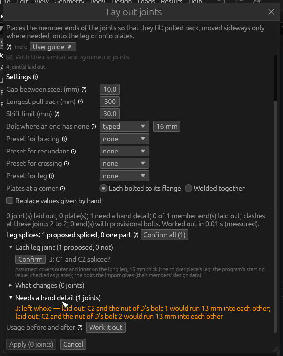
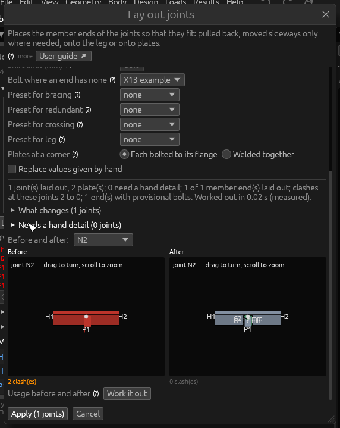
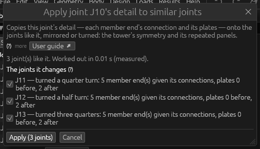
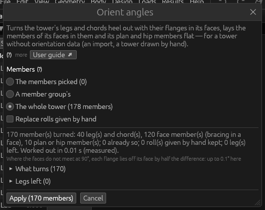

# Lay out joints

(2026-11-18; built, in active development.) **What it is for:** places
the member ends of a tower's joints so that they physically fit — no
steel through steel — once the members are chosen: each end pulled back
(where its steel stops), moved sideways only where that is not enough,
and bolted onto the leg directly or onto a gusset plate. The bolts
themselves are not chosen here (that comes with the design codes).

**Setting it up**, in order:

1. Choose the members' cross-sections, rolls and classes (`bracing`,
   `redundant`…) first: the layout works from them. A tower without
   orientation data (an import, a tower drawn by hand): **Orient angles**
   first ([below](#orient-angles)), so that its legs stand heel out with
   their flanges in the tower's faces.
2. Open **Design › Lay out joints…** (the joints picked, else the whole
   tower), or **Lay out joint…** in Joint details (that joint).
3. Choose **which joints**: the joint shown, the joints picked, a member
   group's joints or the whole tower; tick **With their similar and
   symmetric joints** to lay those out alike (a run plans one joint of
   each kind and applies that plan to the joints like it, checked in each
   one's own place — [J4](#apply-this-joints-detail-to-similar-joints)).
4. Check the **settings** (each one's effect shows at once in the
   preview below): the gap between steel, the longest pull-back, the shift
   limit, the bolt for ends without bolts (and a connection preset per
   member class), the plates of a corner bolted to their flanges or welded
   together, and whether values given by hand are replaced.
5. Read the **preview**: how many joints are laid out, how many plates,
   how many member ends of how many are laid out,
   the joints that need a hand detail — which members, the rest laid out,
   those whose place is kept free — and why, the clashes at these joints
   before and after, the time it took (measured); **What changes** per
   joint; a joint's close-up **before** and **after** (drag to turn both);
   **Usage before and after** (the members' largest usage over the last
   run's cases, as the file is and as laid out — the analysis runs twice).

   
6. **Pieces in line** (2026-11-19, J9): two pieces of one section in
   line through a joint with nothing given there of how they are joined
   (a horizontal in two members at a mid-panel joint) are **proposed one
   part** — *Confirm* per joint (under *Each joint*) or **Confirm all**,
   one undo step each; the preview is then worked out again. Until you
   confirm, each piece **ends at the joint** in the joint checks and in
   the layout (on the safe side): what bolts onto it keeps its bolts on
   that piece's steel. Pieces of a leg with bolts are leg splice places
   (next point); a splice, a kind, what it bolts onto or bolts given at
   the joint: not proposed, said why.

   
   **Leg splices** (2026-11-19, J7): where a leg's pieces meet in line,
   the preview proposes the splice places by the owner's rule — **a
   change of section is a splice** (covers outer and inner on each leg
   bolted, as thick as the thicker piece's leg, the bolts the import
   gives, else provisional ones: *Assumed: …* under each joint says what);
   **the same section is one part** unless you mark a splice there (give
   it in Joint details › + Splice: it is then not proposed one part).
   *Confirm* per joint (under *Each leg joint*) or **Confirm all**, one
   undo step each; never written silently — until you confirm, each piece
   ends at the joint (on the safe side). Once a splice is confirmed, the
   bracing at that joint bolting on a leg's outer face is laid out
   **through the splice's outer cover** (seated on it, its bolts through
   the cover, the leg and the inner cover; the cover checked for the
   bracing's whole force) where its bolts land on the leg's flange clear
   of the splice's own bolts; else it needs a hand detail (a plate over the
   cover is not laid out). A piece of one section confirmed one part has
   its bolts **not checked there — NOT ON THE SAFE SIDE where a splice of
   one section is really there**: mark such splices first.

   
7. **Apply**: one undo step. Escape or Cancel: nothing changes.

**How the layout places a member end** ([theory](../theory/joint-layout.md)):

| Step | What happens |
|---|---|
| Members in line first | the biggest pair of angles in line through the joint (its base): **one part** when they are the same section, turned alike and have no bolts there (a splice with bolts stays a bolted splice: its bolts stay checked); the smaller **nested** in the bigger when it fits inside; other sections: not joined by the run — since 2026-11-19 (J7) a splice is **proposed** (*Leg splices*) and written only when you confirm it. One section in line with bolts: where the splice is is not known (their bolts may be the members' design data, at both ends) — left as given, each ending at the joint, said; confirm the leg splice places (*Leg splices*) or give the splice |
| Who arrives | each member end bolting by one leg of an angle onto the flange of a member at the joint (the leg, a chord, a diagonal a redundant meets); members in line with it (a splice, one part) are left alone; an end bolting onto nothing gets the member running through the joint (of two pieces in line, the one on its side); **two ends that would bolt onto each other** (the pieces of a horizontal onto the redundant standing on them, the redundant onto them): the one running through, else the larger, stays what the other bolts onto, its own end left as it is, said — never both cut back onto each other; an end whose axis lies in neither flange's plane of the joint's leg (a plan diagonal at a vertical post) gets the member running through in whose flange's plane it lies (the horizontal), if there is one — named first, so that its leg lying on it is the one bolted. **Searched** (2026-11-20, L1): an end left for a hand detail is tried on the other members it could bolt onto at the joint (single angles, its axis in a flange's plane; those running through first, in the same order), at most two each; a joint takes another member only where that lays out more of its ends, also after the clash check (else it is laid out as before) |
| Laid flat | a member lying more than 2° off what it bolts onto (the owner's value of 2026-11-19; 5° before) is turned (its roll) **only where that helps**, **one roll for the whole member** (J3, 2026-11-19): where all its ends agree within 2° (the middle of their turns: an end that was flat stays flat, at joints not laid out too) — any turn, the smallest that does it; an **equal-leg** angle may bolt its other leg at one end (a quarter turn more), as a member running from a horizontal flange to an upright one does —; **class by class**: the legs and chords are not turned to suit what bolts onto them, then the diagonals, the secondary bracing (horizontals, plan and hip members, and members without a class — said), the redundants last, each class turned with the ones before already in place; no end of it at a joint not laid out is laid out with its roll now, and at least one of its joints is laid out with the turn; otherwise its roll stays and the preview's notes say why. A roll the layout set is taken back when none of its joints is laid out with it any more. **Half a turn** where an end on a flange's inner face cannot be laid out there (it runs towards the angle's other leg): its outstanding leg to the other side, kept only when more of its ends are laid out and no joint of it loses one (an X-brace: one diagonal on the outer faces of the legs, the other on the inner faces, back to back where they cross). A roll given by hand is kept unless replaced; a leg's or chord's roll set by **Orient angles** is always kept. **Bottom up, then out** (2026-11-20, L1): a member that no one roll lays flat at all its ends, none of them flat now, is turned to lie flat at its end on the tower's **body** first (the lower first), its ends on the arms and the top taking what comes; the body, the arms and the top are found from the legs' lines (no names). Joints alike (J4) are planned at the first of them in that order |
| Concentric first | its gauge line through the work point (drawn so; the analysis keeps the member's axis there, the code's slenderness curve takes the eccentricity gauge to centroid); its end pulled back until its steel clears the flange's heel (on the inner face: the angle's other leg and root), the ends placed before it and the joint's fixed steel (what is not laid out: members in line, built up, given by hand, left for a hand detail; their bolts) by the gap |
| Searched (2026-11-19) | each joint is **searched**, not filled one member after the other: the planes on the biggest members first (what bolts onto a member laid out keeps clear of it as laid out); in each plane every order that can matter, the owner's order first (the diagonals, then the secondary bracing, then the redundants — owner 2026-11-19 —; then the wider leg, the larger angle), backtracking where an end does not fit — the most ends laid out wins, then the least moved sideways, then the owner's order. Typically a short redundant placed first and the bracing pulled back past it. At most 400 tries per joint (said where reached). **Clash-aware** (2026-11-20, L2): while planning, the layout sees what the clash check after writing sees — each member's outstanding leg to its full height, the nuts behind the flange or the plate, each plate's outline as it will be drawn (round the work point, the members' legs over their bolts, the flange under it) — and a member bolting onto a member laid out at the same joint is planned where that member will be drawn. A plate that would run into steel already there **stops short of the work point** (since 2026-11-20): round its members' legs from the flange's toe over their bolts (each bolt's end and edge distances kept) and the flange under them, cut straight short of what it would still run into (at most four cuts; it must still lie on the flange over half a square of its width) — else it is not laid out (its members bolted directly where their bolts land, else left, said: "… the plate would run into …"). The plate checks take the outline as cut |
| A shift | only where that needs more than the longest pull-back (or more than the member's half less its bolts): the smallest sideways move that fits, a millimetre at a time, up to the shift limit. The analysis takes it as an eccentricity (a rigid end offset) |
| Onto the leg or a plate | directly when every bolt of the plane lands on the flange (clear of its other leg and root by the nut, the edge distance from its toe — the code's when its plugin gives one, else the structure's default minimum, assumed, not a code's) and, where the member it bolts onto ends at the joint (pieces in line not confirmed one part, a member whose own end is laid out there), on that member's steel past its cut by the end distance; else every member of the plane onto one plate on that flange, its bolts past the flange by the nut and the gap — on the outer or the inner face. Plates: as thick as the thickest leg bolted on it, outline round the bolts (the code's end and edge distances) cut at the flange's heel by half the gap (on an inner face: at the angle's thickness, root and half the gap from it, clear of its other leg); at a corner one per face, bolted to its flange, or welded together. Each plate the layout makes names the member whose flange it lies on (`on`, since 2026-11-20: it is drawn, seated and tested for clashes on that member — before, a plate on a bracing member's flange was taken to lie on the joint's leg; the file is then written at version 23). **Slightly more plates** (2026-11-20, L1): where the joint would leave members for a hand detail, a face bolted directly is also tried on a plate (taken only where that lays out more — bolting directly wins a tie), and an end bolted directly that would be left for a clash is tried on a plate first. An end on a plate lies the plate's thickness farther out of the flange: not in the analysis, as for every plate (**NOT ON THE SAFE SIDE** by that offset) |
| Off the flange | a member that no roll lays flat at both its ends (2026-11-19): up to 20° off (its ends needing rolls a few degrees apart; since 2026-11-20, L3) first onto a **plate bent by as much** from the flat plate of its face on the flange — one plate, no weld, its bend clear of the member's bolts by their edge distance, turned away from the flange or (past the flange's toe) towards it, whichever moves the member less; the end that lies flat is the one flat now, else the one first bottom up, then out (so an arm's or the top's end takes the bend). Else, or more than 20° off, onto a **plate in its own plane**, welded along the line where it meets the **flat plate** of its face on the flange (the other ends of that face bolted onto the flat plate) — both plates as thick as the thickest leg on them, the weld from both sides (each side a throat of 0.4 × that thickness in whole millimetres, at least 3 mm: the layout's choice, written so the weld is checked), the member's bolts past the flange's toe. On the flange's outer face, or its inner face for a member coming from inside the leg's corner. Only where the member then lies at most one plate thickness farther out of the flange than on a flat plate (its line of action off the work point is not in the analysis); else, and where the flat plate would not reach the flange or would pass too near another end's bolts, a hand detail, said |
| No fit | the member is left exactly as it is and listed with why ("R1 and D1 within 3°: no room on one plate …"); the rest of the joint is laid out. A member left for its own sake (no roll lays it flat, too short, built up…) **keeps its place**: the ends laid out keep clear of it as it is, so the joint needs only that member by hand. Laid out, a member whose steel, bolts or plate would run into anything is first pulled back past it (up to three times), then left as it was with the clash; an end laid directly onto a member whose bolts would not fit that member as written (its flange, its steel where it ends at the joint — the joint checks' rule; e.g. that member left as it was) is left as it was too, said ("laid out, … would run 6 mm into each other"); likewise (2026-11-20) an end whose holes in the member it bolts onto would overlap another end's (one on the flange's outer face, one on its inner face), and the members on a plate whose own bolts onto the member it lies on would lie outside its outline or beyond that member's steel — and the rest of the joint laid out again without it (up to six rounds; then the joint is left whole, as it was). Never forced |

**The window**:

| Field | What it does |
|---|---|
| Joints | the joint shown · the joints picked · a member group's joints · the whole tower; with their similar and symmetric joints |
| Gap between steel (mm) | between the steel of members that do not bolt to each other, and from their bolts' nuts. **Not from a standard** (the owner gave none): 10 mm to start with |
| Longest pull-back (mm) | how far a member's steel may stop from the work point before a shift is tried. Not from a standard: 300 mm to start with (measured on the 78 tower files of a real line: 95 % of the ends laid out need at most 136 mm on every tower, the largest 344 mm) |
| Shift limit (mm) | the largest sideways move of a gauge line off the work point (0: never moved). Not from a standard: 30 mm to start with (measured on the same towers: 37 of 18 289 ends needed a move, the largest 20 mm) |
| Bolt where an end has none | two bolts of it in one gauge line, **provisional** |
| Preset for bracing, redundant, crossing, leg | a connection preset's bolts for an end of that class without bolts (before the bolt picked); provisional too |
| Plates at a corner | each bolted to its flange (usual lattice practice) · welded together |
| Replace values given by hand | off: a cut, shift, roll or what a member bolts onto given by hand is kept (the layout works round it); on: replaced |
| Pieces in line: **Confirm all (n)**, *Each joint* › **Confirm** | writes the pieces proposed one part (`kind = "continuous"` at both ends; a little apart in roll: one roll half-way), one undo step; the preview is worked out again. Those not proposed are listed with why |
| **Apply (n joints)** | writes the preview, one undo step; greyed while the preview is worked out |
| Cancel, Escape | closes the window, nothing changes |

**Good to know:**

- **Laid out once per kind** (2026-11-19, J4): joints alike by the tower's symmetry or a repeated panel (members, sections, rolls, classes and what the layout reads of them alike) are planned once; the others take that plan, mirrored or turned, and are checked for clashes in their own place — where it does not fit there, the joint is planned on its own. The preview's line of numbers says on hover how many joints took the plan of a joint like them.
- What the layout set is **automatic** (the file's [record](structure-library.md#the-joint-layouts-record)): Joint details says *laid out automatically* (on hover: which values), *provisional bolts* and *Needs a hand detail: …*. A value you change becomes yours and is kept.
- **It follows later changes** (in about a tenth of a second on a tower of 3 000 members: only the joints touched, worked out from what they read): an edit near a laid-out joint — a plate made thicker, a member's section, roll or bolts, a value at an end, a joint moved, a setting — lays that joint out again in the same undo step, your values kept, the bolts' grips following the plates. If it no longer fits, the edit is kept, the joint's layout stays as it was and the edit's message says *no longer fits, its layout kept, needs a hand detail* with why.
- **Provisional bolts keep the tower at level 3** for the joint details — everywhere: OHL-Structure, OHL-Design (the structure picker and the structure's properties say why), `ohl structures fe` and the line's calculation level 4. With `joint_details = true` the calculation says so and checks the members in the simple form until no bolt is provisional.
- Where the design code gives **no minimum bolt distances** (the simple check, a plugin without them), the layout keeps the structure's **default minimums** (Design › Analysis, *default bolt minimums*: end and edge 1.5, spacing 3 bolt diameters to start with) — a default minimum, assumed, not a code's. The provisional bolts' pitch and end distance are the default minimums too.
- A member on the **inner face** of a leg (as its roll turns it) is laid out there, directly or onto a plate on that face, clear of the leg's other flange; where it runs towards that flange it is turned half a turn where that helps. A plate on a **built-up** leg is not laid out (drawn through the work point). Members on both sides of one plate: by hand only.
- A **welded plate** (a plate in a member's own plane welded to a flat plate) is two plates of the file, the one in the member's plane marked in the record so the member is drawn lying on it; its weld's throat and length are written (`[[plate.weld]]`) so the weld is checked — change them like any weld (Joint details › the plate). Where two such plates are welded to one flat plate, a weld may be bent about its seam by the other member's force: the check says it **NOT ON THE SAFE SIDE** (the file says the weld's length on both sides together, not that it is two fillets).
- A **bent plate** (since 2026-11-19): a member lying on a flange's inner face that leaves the joint over the heel — through the angle's other leg — is laid out on a plate folded round that leg: one flat where the member lies, the other on the other leg's outer face, bolted to it by two **provisional** bolts (`[plate.leg_bolts]`). The member stays where it lay, only pulled back; the plate is as thick as the thickest leg on it, bent at an inside radius of **two thicknesses — the program's starting value, not a standard's: check it against your steel's bending rules** (change the bend's radius in the file; it is kept). Turning the member half a turn onto the outer face is tried first. The bolts holding the plate lie on the steel of the member they bolt onto (since 2026-11-20): where it ends at the joint, past its cut by the end distance (moved out along it where needed, the flat with them), and slid along it clear of the holes there — the default minimum spacing from each (since 2026-11-20); no place within the longest pull-back: a hand detail, said. Where the other leg is too narrow for the bolts holding the plate, or a member already bolts directly on that leg's face there, the joint says why and the member needs a hand detail. Each flat is checked as a plate; the bend's own bending is checked by the code's plugin (since 2026-11-19; a plugin without that check: not checked, **NOT ON THE SAFE SIDE where it governs**, said on the plate). In the bill of materials the bent flat is weighed from the developed area.

  
- A **plate bent by a few degrees** (since 2026-11-20, L3): written as a bent plate (`[plate.bend]`, its angle the member's few degrees, the inside radius two thicknesses — the program's starting value, check it against your steel's bending rules), the flap carrying the member, the flat on the flange the face's other members. Its bend is a row of the joint checks (the code's strict check: no relief for the flats bearing on each other); the member lies at most one plate thickness farther out of (or nearer) the flange than on a flat plate — like every gusset's offset, not in the analysis.
- A plate **stopping short of the work point** (since 2026-11-20) is marked `short` in the record and its outline written; change it like any outline (it is then yours).
- An `onto` you gave keeps being yours when the layout puts the member onto a plate on that member (since 2026-11-20): Joint details' *laid out automatically* says "onto (yours: D4, kept)", and a run again keeps it.
- **Leg splices**: where two legs of one section meet with their splice bolts, the joint says *where the splice is is not known* — confirm the leg splice places (*Leg splices*: one part by the owner's rule), or give the splice there (+ Splice in Joint details), and lay it out again. A splice you confirmed is yours: a run (also one replacing values given by hand) keeps it and its provisional bolts.
- **Pieces in line confirmed one part** whose rolls were a little apart (Orient angles turns each piece to its face on its own: up to about a degree on real towers) get one roll, half-way between theirs (at most 2° apart — the owner's value of 2026-11-19, not a standard's); the proposal says so. Orient angles run again may turn them apart (the joint checks then say they are not one part, and each ends at the joint: on the safe side) — confirm them again.
- **Undo** takes the whole run back in one step.

**What it changes in the results** (see *Usage before and after* in the
window for your tower):

- The **cuts** and **plates** change no member force: the analysis runs on
  the members' axes as before. The plates get their own checks (bearing,
  block shear, section, welds — [plates](../theory/joint-plates.md)); a
  welded plate's weld with the throat and length the layout wrote; a
  splice's covers as plates for their share by area, the bolts with the
  shear planes the covers give.
- A **welded plate** puts its member at most one plate thickness farther
  out of the flange than a flat plate would; that joint eccentricity, like
  a gusset's own, is not in the analysis (an assumption, said in the
  [theory](../theory/joint-layout.md#a-welded-plate-in-the-members-own-plane-step-4)).
- A **bent plate** leaves its member where it lay on the flange's inner face: nothing new for the analysis (its offset in the estimated eccentricities is 0; such an end is estimated, no longer an upper bound).
- A **concentric** end changes nothing in the analysis (drawn with its
  gauge line through the work point; the code's curve already takes that
  eccentricity).
- A **shift** is a rigid end offset: the moments where a frame member
  meets the joint change, and so the usages; where only bars meet it, the
  shifted member's own check takes the moment (since 2026-11-18; a
  cable's is left out, said **NOT ON THE SAFE SIDE**).
- **Provisional bolts** do not enter the calculation of the joint details:
  the tower stays at level 3 until no bolt is provisional.
- At level 3 the option **Estimated eccentricities** (Results) takes the
  shifts the layout writes — and, for the joints not laid out, those it
  would give, or the shift limit as an upper bound — without writing
  anything ([user guide](structure-analysis.md),
  [theory](../theory/estimated-eccentricities.md)); a welded plate's
  offset is taken there too.

## Apply this joint's detail to similar joints

(2026-11-19, J4; built, in active development, not approved yet.) **What
it is for:** a tower repeats its joints — its symmetry (mirror planes,
quarter turns about its axis) and its repeated panels. Once one joint is
detailed — laid out by **Lay out joints** or detailed by hand — this
copies that detail, mirrored or turned, onto the joints like it, so they
are made alike.

**How to use it:**

1. In **Joint details**, show the joint whose detail you want to copy.
2. Click **Apply this joint's detail to similar joints…** in the joint's
   bar (beside *Copy to the joints like it*).
3. Read the **preview**, worked out on a copy: each joint like it, how
   (mirrored across x or y or a diagonal, turned a quarter, a half or
   three quarters, or the same moved: a repeated panel), how many member
   ends get this joint's connections and how many plates it has before and
   after; the joints left as they are, with why.
4. Untick a joint to leave it as it is.
5. **Apply**: one undo step. Escape or Cancel: nothing changes.

**The window:**

| Field | What it does |
|---|---|
| The joints it changes | each joint like this one, ticked: changed. A joint is *like* this one when a move with a mirror or a quarter, half or three-quarter turn about the vertical carries every member end here onto one of it: the same direction and length (within a tenth of a degree and 2 mm — the tool's tolerance, not a standard's), the same cross-section turned alike, the same class |
| Left as they are | a joint with a splice (here or there: its covers are copied by hand); a joint where the copy would run into more than it does here (the clash check in its own place) |
| **Apply (n joints)** | one undo step; greyed while the preview is worked out or when no joint is ticked. **Enter** applies |
| Cancel, Escape | nothing changes |

**Good to know:**

- At each joint changed, its own connections and plates are **replaced**
  by this joint's: what an end bolts onto said with that joint's members
  and its new plates, the plates' outlines and bend lines placed there,
  the cuts, shifts and bolts as here (a shift is measured towards what the
  end bolts onto, the bolts along and across a leg: the same on a mirrored
  joint).
- A **laid-out** detail stays *automatic* there (a later run or edit may
  lay it out again); one **given by hand** stays yours; a joint left for a
  hand detail is copied with the same words, said with its own members.
- **Lay out joints** does this by itself: it plans one joint of each kind
  and applies that plan to the joints like it — checked for clashes in
  each one's own place, a joint where it does not fit planned on its own
  ([theory](../theory/joint-layout.md#laid-out-once-applied-to-the-joints-like-it-j4)).
- The joints are matched by their members only, not by their connections:
  a joint like this one with other bolts or plates gets this one's.
- **Undo** takes the whole copy back in one step.

## Orient angles

(2026-11-18; built, in active development.) **What it is for:** a tower
whose members carry no orientation — an import (the export a tower is
imported from carries no member orientation, so every angle takes the
default and its legs stand turned anyhow), a tower drawn by hand — gets
its legs and chords turned as a tower is built, before **Lay out
joints**.

**Setting it up**, in order:

1. Give the legs the class `leg` (Member › design data; an import has it)
   and the members their angle sections.
2. Open **Design › Orient angles…** (the members picked, else the whole
   tower).
3. Choose **which members** and whether **rolls given by hand** are
   replaced (an import's rolls: replace them).
4. Read the **preview**: what turns, the rolls kept, the legs left and why.
5. **Apply**: one undo step. Then **Lay out joints**.

**What it turns:**

| Members | How |
|---|---|
| **Legs and chords**: the members of class `leg`, and the angles running on in line (within 10°) through a joint | heel out of the tower, each flange in one of the two faces meeting at it. The faces are those of its neighbouring legs' lines: the tower's section through the member's middle (a leg's from the other legs, a chord's from the other chords: those within 70° of it whose lines a member joins to its line, lying in one plane with both — a face's bracing, a plan member; not a portal's other column, not an arm joined to a leg) is a polygon, the member one of its corners, the corners next to it its neighbours. An angle's legs are at 90°, the faces seldom exactly: the middle of the angle's legs is put on the middle of the faces, each flange off its face by half the difference (said; more than 2° and the bracing there cannot lie flat on it: a bent plate or a hand detail); faces meeting at less than 45° or more than 135° are no corner for an angle (left, said). Two angles in a star or four in a cross are turned the same way; two back to back are left |
| **Plan and hip members**: horizontal angles (within 5°) lying in no steep face | one leg flat, the other pointing down (**assumed**: no water lying in it — a choice of this tool, not a standard's), the flat leg towards the tower's middle |
| **Face members**: the other single angles lying in a steep face (within 20 mm and 5 mm per metre of their length of its plane, between its legs or chords) — its diagonals (also those running on through their crossing), horizontals and redundants | one leg in the face, the other pointing out of the tower (on the outer face of the legs' flanges, usual practice); the leg in the face down from the heel where it can (**assumed**: no water lying in it); an unequal angle's leg bolted in the face. **Lay out joints** may turn it half a turn where an end of it does not fit on an inner face |
| **The rest** (members in no face: a sloping crossarm's bottom bracing, diaphragms) | left: **Lay out joints** lays it flat on what it bolts onto, where that helps |

A leg (class `leg`) is **left**, with why, when it is no corner of the
tower's section (inside it, on a face) or has fewer than two neighbouring
legs or chords (a peak of two legs). An angle running on in line that lies
in a face of the legs (a diagonal through its crossing, a horizontal
through a redundant's joint) is a face member, not a chord.

**The window:**

| Field | What it does |
|---|---|
| Members | the members picked · a member group's · the whole tower (the faces are always found from all the tower's legs and chords) |
| Replace rolls given by hand | off: a member's `roll`, `reference` or `orientation` given by hand is kept (listed with the turn it would get); on: replaced — for an import whose rolls are not as built |
| Preview | how many members turn (legs and chords, plan members), those already so, the rolls kept, the legs left with why, the time it took (measured); **What turns**: each member's turn and its roll before and after |
| **Apply (n members)** | one undo step; laid-out joints at the members turned are laid out again in the same step |
| Cancel, Escape | nothing changes |

What it set is **automatic** (the record's `oriented`, with each roll
before): a run again replaces it, a roll you change becomes yours. A plan
or face member's roll that **Lay out joints** chose for both its ends is
kept (2026-11-19, J3; listed in the preview, *Rolls the joint layout chose
for both ends kept*): the two agree, a run of either after the other
changes nothing. **Lay
out joints** keeps a leg's or chord's roll set here (the tower's shape)
and may turn a plan or face member's where that helps.

**What it changes in the results:** a member's roll turns its section's
axes: the members' stiffness about their axes and so the forces of a
frame model change a little, and the code check takes the angle's axes
as turned (the slenderness of a single angle about its weak axis does not
change with the roll).

