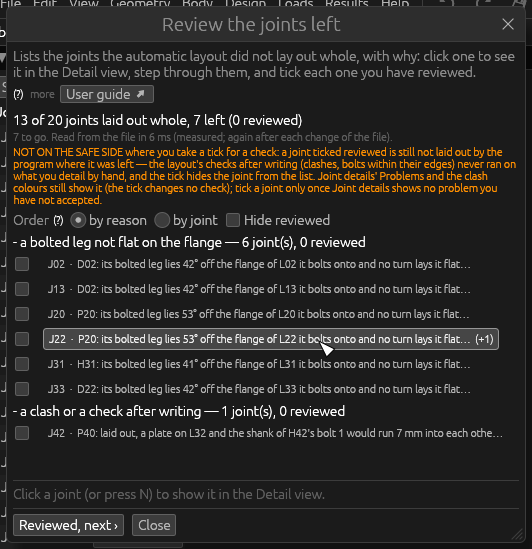
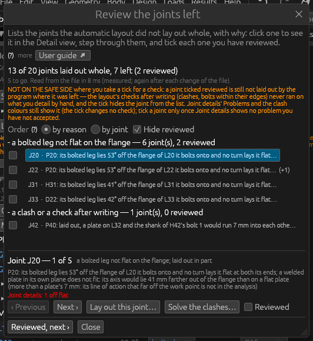

# Review the joints left



(2026-11-26, roadmap O44 L31; built, in active development, not approved
yet.) **What it is for:** the [automatic joint layout](joint-layout.md)
lays most of a tower's joints out, not all. **Design › Review the joints
left…** lists every joint it did not lay out whole, with why, grouped by
reason, so that an engineer can go through the rest quickly: see each one
in the Detail view, lay it out or solve its clashes from there, detail it
by hand where needed, and tick it **reviewed**. The ticks are stored with
the joints in the structure file, so a review can go on over several
sessions.

**Setting it up**, in order:

1. Lay the tower out first: **Design › Lay out joints…**, Apply (the
   list reads the file; a preview not applied is not in it).
2. Open **Design › Review the joints left…** (or **Review the joints
   left…** in Joint details at a joint left). The window opens at the
   joint of Joint details when it is left.
3. Read the counts at the top ("312 of 400 joints laid out whole, 88 left
   (0 reviewed)") and the groups: each reason with its joints and how many
   are reviewed. A click on a group's heading closes or opens it.
4. **Click a joint**: it is selected with its members in the 3D view and
   opens in the **Detail view** (on top of the 3D view), its details on
   the left in Joint details (the two panes: text and edits left, the
   views right).
5. Look at it: the reasons under the list, the clashes and problems Joint
   details finds there now. Then, from the window:
   - **Lay out this joint…** — [Lay out joints](joint-layout.md#lay-out-joints)
     for this joint (with its similar and symmetric joints), a preview
     first;
   - **Solve the clashes…** — [the joint's best whole
     solution](joint-layout.md#solve-the-clashes), before and after, Apply
     in one undo step (enabled where Joint details finds a clash or a
     problem);
   - or detail it by hand in the Detail view.
6. Tick **Reviewed** once the joint is as you want it, and go on:
   **Reviewed, next ›** (Enter) ticks it and shows the next; **Next ›** (N)
   and **‹ Previous** (P) step without ticking.
7. **Hide reviewed** keeps the list to the joints still to look at.
   **Close** (Escape) when you stop; the ticks stay in the file (save it).

**The window:**

| Field | What it does |
|---|---|
| (the counts) | the joints laid out whole of the joints counted, the joints left and how many of them are reviewed; how many are still to go; how long reading the list took (measured, in ms) |
| NOT ON THE SAFE SIDE | always shown: what a tick is and is not (below) |
| Order (?) | **by reason** (default): the groups in their order, each heading with its joints and how many are reviewed; **by joint**: the file's order. The view only: nothing is worked out again |
| Hide reviewed | the joints ticked reviewed left out of the list and of Previous / Next (the view only; off by default) |
| (the list) | one line per joint: its tick, its name, its first reason (the others on hover; "+n" more), a joint whose tick was cleared in the warning colour; a fixed-height box that scrolls |
| Joint … — k of n | the joint shown: its group, laid out in part or not laid out, its reasons (a box that scrolls), the clashes and problems Joint details finds there now |
| ‹ Previous, Next › | the joint before or after in the list's order (keys P and N) |
| Lay out this joint… | opens Lay out joints for this joint |
| Solve the clashes… | opens Solve the clashes for this joint (where Joint details finds a clash or a problem) |
| Reviewed | the tick of the joint shown (as the list's) |
| **Reviewed, next ›** | ticks the joint shown, then shows the next (Enter) |
| Close, Escape | closes the window; the ticks made stay (each was one undo step) |



**Which joints are counted, and which are left.** The joints where two or
more members meet, and any other joint the layout's record names. A joint
is **whole** when a layout run laid it out and left no member there for a
hand detail; every other joint is **left**: laid out in part (some members
left as they were), or not laid out. A joint the record keeps no reason
for — the layout found nothing it could lay out there (its members all
run through as one part, say), or no run asked it — is listed last, under
*no reason recorded*.

**The reasons and their groups.** Each member left has the reason the
layout recorded (the same words as in [Lay out
joints](joint-layout.md#lay-out-joints) and Joint details). Each reason
falls in one group, and a joint is listed in the group of its first
reason in this order — the order of the causes counted in [the
theory](../theory/joint-layout.md#what-leaves-an-end-for-a-hand-detail):

| Group | The reasons in it |
|---|---|
| a leg splice in the way | bolts through a splice's outer cover with no plate over it; a splice whose place is not known |
| its bolts join nothing | bolts drawn at the joint where the member bolts onto nothing (pieces in line not one part) |
| an end out of the flange's plane | the end's axis more than the flatness out of the face of the flange it would bolt onto |
| a bolted leg not flat on the flange | the leg bolted lies off the flange and no turn lays it flat at both ends; an inner face running towards the other leg; a bent or welded plate in its own plane not fitting |
| a built-up member to bolt onto | its bolts not all on the built-up member's angle; a gap between its angles too thin for a plate |
| a clash or a check after writing | laid out, then taken back: a clash, a bolt nearer an edge than its distances, a plate's own bolts beyond its steel |
| a plate would run into steel | the plate the end would go onto running into another part |
| the pull-back or the shift not enough | the end would need pulling back further than the longest pull-back, and no shift within the limit fits |
| a member left as it is in the way | a member left as it was that would no longer fit onto it |
| no room on one plate | two members within a few degrees of each other |
| too short for its bolts | the member shorter than its bolts need |
| other | any other reason |
| no reason recorded | (above) |

**Good to know:**

- **NOT ON THE SAFE SIDE where a tick is taken for a check.** A joint
  ticked reviewed is still **not laid out by the program** where it was
  left: the layout's own checks after writing (the clash check, bolts
  within their edge and end distances, holes not overlapping) never ran
  on what you detail there by hand, and the tick takes the joint out of
  the list's "to go". What makes it safe: the tick changes no check —
  Joint details' Problems, the clash colours (View › Joints with clashes)
  and the analysis' joint checks read the joint as written, ticked or not;
  tick a joint only once Joint details shows no problem you have not
  accepted.
- **The tick is cleared when the joint's layout changes**: a run laying it
  out otherwise, an edit at the joint (a value at a member end, a plate, a
  splice, a member meeting there turned, moved or given another section),
  Solve the clashes applied. The tick holds a stamp of the joint's layout
  when it was made; the joint reads as reviewed only while its layout
  gives the same stamp. A joint ticked before and changed since is shown
  in the warning colour ("ticked before; its layout changed since"). Tick
  a joint once it is as you want it.
- The tick is written into the structure file: `reviewed = "…"` on the
  joint's `[[node]]` (structure file version 29, written only when a joint
  is ticked; older files read with no joint reviewed; [structure
  library](structure-library.md)).
- **Undo** takes back one tick per step.
- Nothing in this window lays out or checks anything: the list is read
  from the file each time it changes (a few milliseconds on a small
  tower; measured on a large one, the time is shown at the top).
- **On the command line** the same list, as CSV or text:

  ```bash
  ohl-structure-export tower.ohls --format joints-left -o left.csv
  ohl-structure-export tower.ohls --format joints-left-text -o -
  ```

  The CSV has one row per joint left, by group: `joint`, `group`,
  `reviewed` (`yes`, `no`, `cleared` — ticked once, its layout changed
  since), `laid_out_in_part` (`yes`, `no`), `reasons` (joined by " | ").
  Both read the file only (no libraries; nothing laid out).
