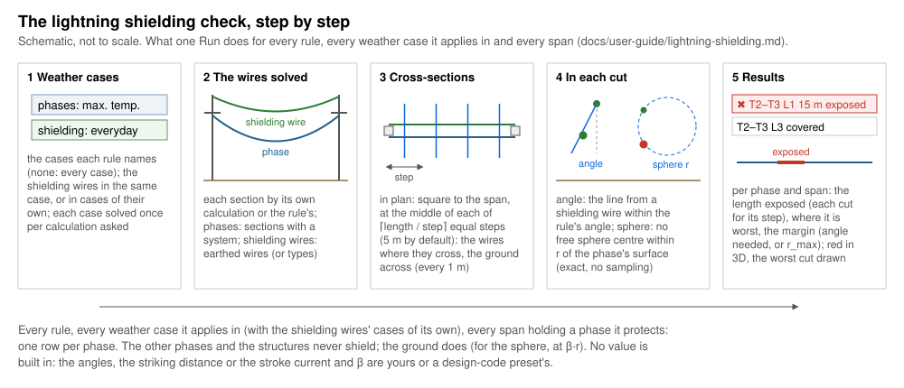

# Lightning shielding

*Built, in active development (not approved yet).* **Checks ›
Electrical › Lightning shielding…** in OHL-Design. This page explains the
window for a line designer: what it answers, how it works, every setting
and every field of a rule. The calculation in detail, with its sources:
[theory › Lightning shielding](../theory/lightning-shielding.md).

## What it answers

**Do the shielding wires keep a lightning stroke off the phases — along
every span, in every weather case your rules name?** Each rule checks the
phases it protects by one of two methods:

- a **fixed shielding angle**: a phase is covered when the line from a
  shielding wire above it leans from the vertical by at most the rule's
  angle;
- the **rolling sphere** of the electrogeometric model: a sphere of the
  striking distance, rolled over the shielding wires and the ground, must
  not touch the phase.

Per phase and span the results give the **length exposed**, where the
phase is **worst** and its **margin**; an exposed phase is listed in red
and drawn red in the 3D view.



*The shielding angle: from each shielding wire, lines leaning from the
vertical by the outer angle (away from the other shielding wire) and the
inner angle (towards it, between the two). A phase within them is
covered.*


*The rolling sphere: no sphere centre within r of a shielding wire nor
within β·r of the ground; a sphere that can still touch the phase means
the phase is exposed to strokes of that striking distance.*

No value is built in: the angles, the striking distance or the stroke
current and the ground factor are yours, taken from the regulation you
work to, or a design-code plugin's preset.

## How it works, step by step



### 1. The weather cases and the solve

Each rule names the weather cases it checks in (none named: every case of
the project). Run solves the line once in **each case a rule names**, each
section by its own calculation unless the rule gives one (**Phases'
calculation**, e.g. the phases at their largest sag). The **shielding
wires** hang in the same case, or — when the rule ticks **Shielding
wires' cases** — in cases of their own (e.g. the phases at their highest
temperature from their load current, the earth wires at an everyday
temperature): each case checked is then combined with each shielding
case, and the row names both (*max temperature (shielding wires:
everyday)*). The shielding wires may have their own calculation too
(**Shielding wires' calculation**). A section that cannot be solved is
named in the notes and left out. With **Use local conditions** ticked (in
the footer), the line is solved with the structures' local wind for
clearances and the wire ice on their spans first
([Local conditions](weather.md#local-conditions)).

### 2. Phases and shielding wires

- **Phases**: the sections with an electrical system, narrowed by the
  rule's **Phases protected** (wire types, systems, circuits; a phase
  counts when it is in every list ticked).
- **Shielding wires**: every earthed wire (a section without a system),
  or the wire types the rule ticks under **Shielding wires**.

The other phases never shield a phase, nor do the structures: a stroke
to any phase is a shielding failure.

### 3. Cross-sections square to the span


Each span is cut by vertical planes **square to the span** (to the
straight line between its two structures in plan), at the **middle of
each step**: ⌈span length / step⌉ equal steps, the step being the
rule's (**Step along the span**, 5 m by default). Each cut takes the
wires where they cross it, as solved, and the **ground across** it every
1 m from the terrain of the checks (none loaded: straight between the
structures' feet and level across — see
[below](#what-is-conservative-and-what-is-not)). A bundle is taken by its
centre and its outer radius. A wire still on its strings at a cut (near a
dead-end) is left out of that cut, said once in the notes.

Each span is checked in its own plane, also at an angle structure: a
phase is shielded by the wires of its own span.

### 4. The shielding angle in a cut


From each shielding wire above the phase, the angle from the vertical to
the **far side** of the phase's bundle is taken (larger than to its
centre: on the safe side). The phase is covered when, for some shielding
wire, that angle is at most the rule's: the **inner angle** when the
phase lies between that wire and another shielding wire (across the
line), the **outer angle** otherwise. A phase with no shielding wire
above it needs 90°: exposed. The angle method looks at the wires only:
neither the ground nor the height of the line count.

### 5. The rolling sphere in a cut


The sphere's radius is the **striking distance** r: typed (m), or from a
**stroke current** I (kA) by r = A·I^b (A = 10 m and b = 0.65 by
default, both editable). The ground's striking distance is **β·r**
(the **ground factor**, 1 by default). The sphere's centre may lie
anywhere at least r from every shielding wire's axis and at least β·r
from the ground; the phase is **exposed** when such a centre lies within
r of the phase's surface. The program decides this **exactly** in each
cut (no sphere positions sampled): it finds the free centre nearest the
phase. A smaller striking distance (a weaker stroke) reaches further in
between the shielding wires and the ground.

### 6. The length exposed, the worst place, the margin



Each cut stands for its step (the first and last ones for the ends up to
the structures): the **length exposed** of a phase in a span is the sum
of the steps of the cuts where it is exposed. **Worst at** is the cut
where it is most exposed (the angle furthest beyond the rule's, or the
sphere reaching deepest into it), in metres along the span from its
first structure. The **margin**:

- shielding angle: the **largest angle the phase needs** along the span,
  against the rule's;
- rolling sphere: **r_max**, the largest striking distance still
  reaching the phase at its worst place (searched from 2 m to 150 m, to
  1 cm; *> 150 m* when it is exposed even there, *–* when covered from
  2 m up), and for a rule given by a current the **stroke current** of
  r_max by the same form — the largest stroke that can still reach the
  phase. The rule's r above r_max: covered there.

### 7. The results, the cross-section and the 3D view

The **Results** tab shows the verdict first — red with the phases ×
spans exposed, the metres in all and the longest (on the example: "✖ 6
phase × spans exposed, 124 m in all — the longest S2 span 2: 25 m of
330 m …"), green when every phase is
covered — then the notes, then the table, one row per phase, span, rule
and case, the exposed first. A row clicked (or the verdict) selects its
span, draws it in the row's weather case and draws its **cross-section
at the worst place** below the table: the ground, the shielding wires,
the phases (red exposed, green covered, the row's ringed), the covered
zone's boundary dashed and the centres of spheres resting on two
objects. The 3D view's layer *Lightning shielding* draws the exposed
parts of the phases in red and the covered zone's boundary between the
cuts, translucent, while the window is open; dimmed when out of date.

## The window, setting by setting

The Setup tab, top to bottom. Every setting is kept in the project's
rule file of the window (`<model>.lightning-rules.ohlr`, in the project's
rules folder) as soon as it is changed, and a change of the line marks
the results *out of date*. Each section and field explains itself in its
**(?)** or on hover; only warnings, *NOT ON THE SAFE SIDE* notes and what
blocks **Run** stay written under the fields. Each section's **user
guide ↗** opens its part of this page.

The window has no *Model* section: every modelling setting (the
calculations, the step) belongs to a rule, so that a design-code preset
brings it with its values.

### 1 What it checks

The question in one line (the longer text behind its **(?)**), with
**How it is computed** folded below it: the method in a paragraph and two
drawings, the shielding angle (outer and inner) and the rolling sphere
resting on a shielding wire and the ground.

### 2 Scope

Every span of the line is checked; each rule gives its phases, its
shielding wires and its weather cases. The **(?)** says how many spans
and rule × case pairs a run takes. Without a terrain for the checks, a
warning stays written: the ground is taken straight between the
structures' feet and level across — *NOT ON THE SAFE SIDE* where the real
ground falls away across the line (Line › Terrain loads one).

### 3 Rules

The rules, one row each, in the shared [rule
table](desktop-app.md#the-rule-table). **Click a rule to edit it below**:
its fields appear under the list.

- **Preset ▾**: the lightning rules of a design-code plugin or of the
  project, **Merge** (by name) or **Replace**; its weather cases missing
  from the project are added
  ([Presets per check](design-codes.md#presets-per-check)).
- **Import…** / **Export…**: rule files (`.ohlr`); an import replaces the
  rules.
- **A shielding-angle rule** / **A rolling-sphere rule** (under *Add
  rule*), **Duplicate**, **Remove**, **Move up**, **Move down**. A new
  rule protects every phase by the earthed wires; its angles or its
  striking distance are *to set* (0): **Run** is greyed, and the footer
  says why, until they are.

| Field | Default | What changes in the result | Time |
|---|---|---|---|
| **Weather cases** | none ticked: every case | the cases this rule checks in; Run solves the line once in every case any rule names | one solve of the line per case and calculation |
| **Shielding wires' cases** | none ticked: the phases' case | each case above checked with the shielding wires in each case ticked here (e.g. cooler, higher): one row per pair | one more solve per case ticked; the spans checked once per pair |
| **Phases' calculation** | each section's own | how the phases are solved: Initial, Creep, Load or Max Sag, by ruling span (RS) or finite elements (FE); a larger sag brings a phase lower, nearer the ground | one more solve per case when given; FE slower than RS |
| **Shielding wires' calculation** | each section's own | the same for the shielding wires; a larger sag brings them lower, nearer the phases | as above |
| **Method** | as added | *Shielding angle* or *Rolling sphere* | the rolling sphere is slower (each cut's exact test, and r_max searched once per phase and span): 3.4 s against 0.3 s for the angle, measured below |
| **Outer angle** (angle) | 0° (to set) | the largest angle allowed away from another shielding wire (or with one shielding wire): larger, fewer phases exposed | none |
| **Inner angle** (angle) | 0° (to set) | the largest angle allowed between two shielding wires: larger, fewer phases exposed | none |
| **Striking distance** (sphere) | typed, 0 m (to set) | *typed*: r in m; *from a current*: I in kA (10 kA offered) with **A** and **b** of r = A·I^b (10 and 0.65); the resulting r is written beside it. A smaller r (a weaker stroke) reaches further in: more exposure | none |
| **Ground factor β** (sphere) | 1 | the ground's striking distance β·r: below 1, the sphere comes nearer the ground, so the ground shields less: more exposure | none |
| **Step along the span** | 5 m | the cuts' spacing: smaller, the length exposed found more finely, a short exposure less likely missed | about in proportion to the number of cuts: rolling sphere 2.5 s at 10 m, 3.4 s at 5 m, 6.5 s at 1 m; shielding angle 0.2 to 0.3 s at any step (measured below) |
| **Phases protected** | none ticked: every phase | only the phases of the wire types, systems and circuits ticked (in every list ticked) | fewer phases: a little faster |
| **Shielding wires** | none ticked: every earthed wire | only the wire types ticked shield; the others, if earthed, are left out | none worth noting |

The times were measured with `ohl lightning` on the example line
(`examples/lightning`, 4 spans, 1.26 km, three phases and two earth
wires; one rule in one weather case; a debug build, the program's start
included). They grow with the line's length
and with the rule × case pairs. On the same example (no terrain given:
the ground level across) the length exposed by the 8 kA sphere was
158.5 m at a 10 m step, 144.4 m at 5 m and 145.9 m at 1 m: a step of a few metres is enough there; each exposure
lay next to a structure.

The fields of the rule file are in the [table below](#every-field-of-a-rule).

### The footer

- **Use local conditions**: the line with its structures' local wind for
  clearances and the wire ice on their spans (the wires' swing, their
  place against the shielding wires); said in the notes.
- Before **Run**, one line says what a run will compute and about how
  long it takes, from the window's last run on this computer ("4 spans ×
  2 rule × case pairs — about 1 s"); or **Before Run: …** with what
  blocks it (no rule, an angle or a distance not set, none of the rules'
  weather cases in the project, a rule whose shielding wires' cases are
  not in it).
- **Run** and **Stop**: the check runs in the background, the spans done
  counted; Stop keeps the previous results.

### The results

The verdict, the notes (folded; every *NOT ON THE SAFE SIDE* note among
them), then the table: **Span**, **Phase**, **Rule**, **Case**,
**Exposed [m]**, **Span [m]**, **Worst at [m]** (along the span from its
first structure), **Margin** (the angle needed in °, or r_max in m with
its stroke current) and **Verdict** (*covered* or *exposed*, red).
**Only violations**, **Search**, **Group by** (rule, case, span); sortable; **Export CSV…** (the table as
shown) and **Full report (CSV)…** (every field, as `ohl lightning`
writes it). Below the table, the cross-section of the row clicked at its
worst place. Only the cross-sections of the **last rule × case pair
checked** are kept (for memory); a row of another pair draws that pair's
cut of its span, its colours that pair's verdict — said in warning
colour above the drawing.

## Every field of a rule

The window's rule editor and the rule file
([Lightning shielding rules](terrain.md#lightning-shielding-rules-lightning_rule))
hold the same rule: a `[[lightning_rule]]` table.

| In the window | In the rule file | Unit | Default | Meaning |
|---|---|---|---|---|
| Name | `name` | — | required ("angle n", "sphere n" in the window) | the rule's name in the results |
| Weather cases | `cases` | names (`*` `?`) | every case | the cases the phases are checked in |
| Shielding wires' cases | `shield_cases` | names (`*` `?`) | none: the phases' case | the shielding wires' own cases; each case of `cases` checked with the shielding wires in each |
| Phases' calculation | `calculation` | `initial-fe`, `creep-rs`, `load-fe`, `max-sag-fe`, … (or as listed, `Max Sag FE`) | none: each section's own | how the phases are solved |
| Shielding wires' calculation | `shield_calculation` | as `calculation` | none: each section's own | how the shielding wires are solved |
| Method | `method` | `"angle"` or `"sphere"` | required | the fixed shielding angle or the rolling sphere |
| Outer angle | `outer_angle` | ° from the vertical | required with `angle` | away from another shielding wire; above 0 and below 90 |
| Inner angle | `inner_angle` | ° | the outer angle | between two shielding wires; above 0 and below 90 |
| Striking distance, typed | `striking_distance` | m | — (this or `stroke_current` with `sphere`) | r, to the wires; above 0 |
| Striking distance, from a current | `stroke_current` | kA | — | I: r = A·I^b; above 0 |
| A | `distance_a` | m | 10 | A of r = A·I^b (only with `stroke_current`) |
| b | `distance_b` | — | 0.65 | b of r = A·I^b (only with `stroke_current`) |
| Ground factor β | `ground_factor` | — | 1 | the ground's striking distance β·r; above 0 |
| Step along the span | `step` | m | 5 | the cuts' spacing; at least 0.1 |
| Shielding wires | `shields` | wire types (`*` `?`) | none: every earthed wire | the wire types that shield |
| Phases protected | `targets = { wire_types, systems, circuits }` | names (wire types with `*` `?`; a system's id, `none`; circuit names) | every phase | the phases protected (only sections with a system are phases) |

A rule file refuses an angle rule with a striking distance, a sphere rule
with angles, both `striking_distance` and `stroke_current`, or
`distance_a`/`distance_b` with a typed distance.

Read by the window from the file's `[check]` table:

| Key | Default | Meaning |
|---|---|---|
| `local` | false | **Use local conditions** |

The other `[check]` keys, the `[[rule]]` tables and the `[wind]` table
belong to other check windows; this window does not use them.

## What is conservative and what is not

On the safe side ([theory](../theory/lightning-shielding.md)):

- the shielding angle is measured to the **far side** of the phase's
  bundle;
- the sphere touches the phase's **surface** (its outer radius), and the
  shielding wires are taken by their **axis** (the sphere could in truth
  come nearer by their radius);
- the ground's envelope is tabulated by chords below its arcs: the free
  region taken slightly larger;
- every free sphere centre counts, also one enclosed under the shielding
  wires that a sphere coming from above could not reach;
- the **other phases and the structures never shield**, and trees and
  buildings are not counted as intercepting strokes;
- a wire still on its strings at a cut is left out there: a shielding
  wire so left out does not shield.

Not on the safe side, and said in the results each time it applies:

- **The step**: each cut stands for its step. An exposure shorter than a
  step, between two cuts or within half a step of a structure, can be
  missed: *NOT ON THE SAFE SIDE: each cross-section stands for its step
  …* in every result. A smaller step finds it and takes longer.
- **No terrain loaded**: the ground straight between the structures'
  feet and level across — where the real ground falls away across the
  line the sphere comes in lower: *NOT ON THE SAFE SIDE: no terrain for
  the checks …*. Load the terrain (Line › Terrain).
- **The fixed angle** ignores the ground and the line's height: for
  tall structures it is known to cover less than it appears to (the
  reason the rolling sphere is offered beside it).
- **r_max** is found at one place per phase and span (its worst at the
  rule's r), not the largest over every cut: the margin is that place's.

## Without the window

`ohl lightning` runs the same check from the command line on a rule file
with `[[lightning_rule]]` tables, for the whole line
([Lightning shielding rules](terrain.md#lightning-shielding-rules-lightning_rule)):

```sh
ohl lightning examples/lightning/shielded-line.ohl.json \
  --weather examples/lightning/weather-cases.ohlwc \
  --rules examples/lightning/shielded-line.lightning-rules.ohlr --csv lightning.csv
```

It prints the notes and one line per phase, span, rule and case, the
exposed first; `--csv` writes every field, `--json` the rows and every
cross-section. The ground: `--terrain` or `--surface`, else the
project's surface of the checks, else its point cloud's ground, else
straight between the structures' feet (a warning). Exit status 0: every
phase covered, 1: some exposed, 2: an error. It does not apply **Use
local conditions** yet.
