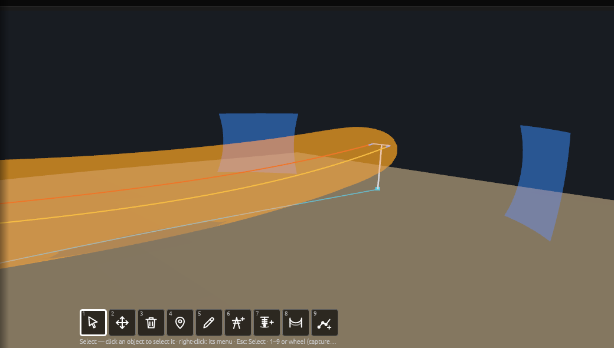

# Magnetic field

*Built, in active development (not approved yet).* **Checks › Electrical ›
Magnetic field…** in OHL-Design. This page explains the window for a line
designer: what it answers, how it works, and its three pages — **3D
volumes**, **2D profiles**, **2D cuts** — each with its methods and every
setting it shows (default, effect, time), then what is and is not on the
safe side. The calculation in detail, with its sources and its validation:
[theory › Magnetic field](../theory/magnetic-field.md). The command line,
the plugins that place cuts at buildings and the plan templates:
[Analyses › Electrical: magnetic field](analyses.md#electrical-magnetic-field).

## What it answers

**How strong is the magnetic field of the line's currents around the
line — across a span, in a vertical cut at a house, in the space around
the wires — and where does it pass a level or a limit you give?** The
field is the magnetic flux density *B* in µT, the rms of the vector, from
the wires where they hang in a weather case.

*The 1 µT surface around the wires of one span, drawn by the window in
the 3D view.*

**No limit is built in.** Which current, which places and which limit an
ordinance asks for are yours to give (or come from a plugin's parameter
file); the window computes the field and, when you give a limit, the
margin to it.

## How it works, step by step

### 1. The wires in a weather case

The line is solved in the weather case you choose, each section by its
own calculation unless you choose another (**Wires by**: e.g. *Max sag*,
the lowest wires and so the highest field at the ground). Each electrical
system, and the earth wires, may take a case of its own: the conductors
at their load's temperature, the earth wires at the air's.

### 2. The currents

Each circuit carries a current (A, rms, each phase), by default its
system's **operating current** from Line › Electrical systems. The three
phases are balanced at their system's phase angles (L1 0°, L2 −120°,
L3 +120°), unless you give each phase its own current and angle.

*The phase currents as phasors; at a point every wire adds its field; B
is the rms of the vector, B max the largest over a cycle.*

### 3. The earth wires and the jumpers

If you tick it, the earth wires carry the currents the phases induce in
them, led into the ground at every structure through its earthing
resistance. The jumpers at the structures carry their phase's current.

*The earth wires as a network over the line, each structure leading
current into the ground.*

### 4. The field at every point: two methods

**From the 3D model** (volumes, cuts, profiles): every wire is cut into
straight pieces (as solved: 64 per span). At every point asked, every
piece adds its field, exactly (Biot–Savart in closed form). For cuts and
volumes, only the wires within a distance of the cut or volume are taken
(2 000 m by default); each run says how much the wires left out change
the field.

**2D only** (profiles): every wire is an infinitely long, straight
conductor parallel to the others, at the height where it crosses the
profile — the classic cross-section formula. No sag along the span, no
line angle, no jumpers, no structures.

*The wire in straight pieces: the only error of a piece is how far the
wire curves away from it.*

*The wires modelled: those within the distance of a cut or volume.*

### 5. The results and the drawings

Every value at a point is computed in full; only the lines and surfaces
drawn between the points are interpolated. Each run measures how far its
drawings lie off their levels and says so.

## The window

The Setup opens with three tabs — **3D volumes**, **2D profiles**, **2D
cuts** (owner, 2026-11-12) — each a page with only the settings its
output needs, in the same numbered sections: 1 What it computes (with its
drawing), 2 Scope, 3 What and where, 4 Model (folded), 5 Views and levels
(volumes and cuts; a profile's plot draws the limit itself). **Run
computes the page shown.** The inputs shared by the pages — the weather
case, the currents, the limit, the levels — are one set of values: change
them on one page and the others show the same.

The window's inputs are kept in the project for the line worked on: it
opens as it was left, on the page it was left on, for every user of the
project (a project kept before the pages opens on the page that made what
it asked). A case or span no longer in the line falls back to the default.
Each heading's **user guide ↗** opens its page's part below. A setting
keeps its label (units in brackets), its value and at most one short line
— its count and its time —; what it does is said on hover and behind its
**(?)**. Warnings, what is not on the safe side and why Run is greyed
stay in view.

### Scope (every page)

| Setting | Default | What changes in the result | Time |
|---|---|---|---|
| **Weather case** | the case shown in the views (then the one kept) | where the wires hang: lower wires, a higher field at the ground | each case not solved yet is solved for the run |
| **Wires by** | each section's own calculation | another (e.g. *Max sag*) solves the case for the run with it | a solve per case |
| **Per electrical system** (folded) | *as above* | a system's (or the earth wires') own case and calculation | a solve per extra case |
| **Ground from** | the surface of the checks | the ground the profiles' height and the cuts' and volumes' bottom stand on: a terrain surface (TIN layer) or the survey's ground points within 250 m of the spans | the survey's points: some seconds to read |
| **Currents**: per circuit, **given** | *the circuit* | *the circuit*: one current, balanced phases; *at its end points*: the current in (or out) at each end, every section's current follows; *per phase*: each phase's current and angle, an unbalanced circuit | none |
| **current [A]** | the system's operating current (*the line's*); ↺ brings it back | the field grows in proportion | none |
| **load flow** | along the line | *against the line*: every phase turned by 180°; which combination governs is the ordinance's question | none |
| **Earth wire currents typed** (folded) | none | an earth wire's own current and angle instead of a computed one | none |
| **Limit [µT]** | none | the margin at every point and the limit line's extent on every profile | none |

Run is greyed out, with the reason, while no circuit carries a current,
or while the page has nothing to compute (no span ticked, no cut asked,
no volume ticked).

### The span table (every page)

Every span a row, the spans of each alignment first in station order and
ticked, the others unticked; the page's own column only (**Profile**,
**2D cuts at** or **Volume**). **Press on a tick and drag across the
rows** to flip them; shift-click ticks a range; a filter, *All*, *None*
and *Invert* act on the rows shown.

### The footer and the results

- Beside **Run**, one line says what Run will compute on the page shown
  and about how long: *Run: 2D cuts, 3 cut(s), from the 3D model — about
  4 s*; the times come from the last run's speed, else from a short
  measurement on this computer. When Run is greyed out, the footer says
  why. While it runs: the step, a bar, the time gone and left; **Stop**.
- **Results**: the list of everything computed — every profile, cut and
  volume with its largest value — with **Show plot**, **Open cut** (a
  cross-section panel on the very plane computed) and **Show in 3D**, and
  a **3D** tick to draw each or not. Then the currents used, the earth
  wires' and structures' currents, the notes (what was assumed or left
  out), the profile plotted (B against the distance from the axis, the
  cycle's largest fainter, the limit dashed), the tables of the profiles
  and points (red above the limit), and per view how far its drawings lie
  off their levels. A 2D-only run says its assumptions above them.
  **Export CSV…** writes every point; **Save in Performed checks** keeps
  the run. The results are marked out of date when the line or the ground
  changes.

**A cut or a step that fails** (2026-11-14) does not lose the rest. Each
cut is computed on its own: one that cannot be computed (its span not
found or off the alignment, a wire not connected) is listed at the top of
the notes in red — *NOT COMPUTED: 1 of 12 cut(s) failed … — cut House 7:
why* — and every other cut keeps its results. The same for a whole step
(the profiles, the cuts, the volumes run one after another): a step that
fails is said in red and the steps that worked are shown. Only **Stop**
ends the run. A run where nothing could be computed gives its errors.

The views are drawn on the layer **Magnetic field (isolines, surfaces)**
while the window is open.

## 3D volumes

**What it gives:** the surfaces of the levels (1 and 10 µT by default)
around the wires over each run of spans with **Volume** ticked, drawn
translucent in the 3D view (**Show in 3D**); the largest value in each
volume.

**How it works:** from the 3D model only. A coarse lattice first (4 steps
apart), then the fine one only where a level passes, near the wires and
wherever a surface goes on; every lattice point is computed in full, only
the surface between the points is interpolated. Spans with Volume ticked
that follow each other make one volume (no seam at the structures).

| Setting | Default | What changes in the result | Time |
|---|---|---|---|
| Scope | see [Scope](#scope-every-page) | | |
| **Volume** column of the span table | none ticked | the spans a volume covers | in proportion to the spans |
| **Volume size ± [m]**, **every [m]** | ±100 m every 2 m | wider: a low level's surface inside the box; a finer step places the surfaces closer to their levels (2 m: 1 µT within 0.05 %, 100 µT within 15 %; 1 m: 0.01 % and 4 %) | said beside it; halving the step takes 4 to 8 times as long |
| **Earth wires** (4 Model) | off | *carry the currents the phases induce*: may raise or lower the field; *through the structures' earthing* (on): each structure's earthing resistance (Structures table, else the line's, else 10 Ω, said) | a network solve |
| **Jumpers** (4 Model) | on | off: left out (not on the safe side near the structures) | none |
| **Wire pieces** (4 Model) | as solved (64 per span) | *at most [m]*: shorter pieces placed on the curve; the field changes by about the wire's offset over the distance to it (a few hundredths of a per cent at 10 m) | in proportion to the pieces; said beside it |
| **Modelled: wires within [m]** (4 Model) | 2 000 m | larger: closer to the whole line's field (longer than the line: every wire); each run says what the wires left out change | in proportion to the wires taken |
| **Levels drawn [µT]** (5) | 1 and 10 µT drawn, 100 µT not | the surfaces drawn; display only, none is a limit. **+ level**, **+ the limit** | more levels, more surfaces |

## 2D profiles

**What it gives:** B across each span ticked, at a height above the
ground, plotted against the distance from the axis and listed (the
largest value, where the limit is passed); and B at the points of a CSV
file (e.g. places of sensitive use).

**How it works:** a row of points square to the span's axis, at the
span's lowest point by default, computed by the method chosen.

### The methods compared

| | From the 3D model (default) | 2D only |
|---|---|---|
| Assumes | the wires as solved: sag, line angles, the line's ends, jumpers, the earth wires' network | infinitely long, straight, parallel conductors at the height where each wire crosses the profile; no sag along the span, no angle, no jumpers, no structures |
| Enough when | always (the reference) | long straight spans away from structures, angles and crossings; at the lowest point it is **on the safe side** against 3D on sagging spans; at the span's mean height it is **not** |
| Not valid | — | near a line angle over 5°, a crossing, or a span between differently arranged structures (warned per profile) |
| Time | seconds per profile (every piece of the whole line at every point; said beside it) | a moment |
| Its settings | earth wires, jumpers, wire pieces | earth wires, *wires at the span's mean height* |

The 2D-only method's assumptions are said under its choice and above its
results.

| Setting | Default | What changes in the result | Time |
|---|---|---|---|
| Scope | see [Scope](#scope-every-page) | | |
| **Points from CSV…** | none | the field at your places: a CSV with a header naming `x`, `y` and `z` (elevation) or `height` (above the ground), optionally `name` | a point each |
| **Method** | from the 3D model | see the comparison above | see above |
| **wires at the span's mean height** (2D only) | off | on: the line parameters' mean height, a lower field than under the lowest point (not on the safe side) | none |
| **Profile** column of the span table | the spans of the alignments | the spans profiled | one profile each |
| **Profiles** | at each ticked span's lowest point | *beside its structures* (10 m into the span from each), or *one span* at its lowest point or a place 0–1 along it | one profile each |
| **Across ± [m]**, **every [m]**, **at [m] above the ground** | ±100 m every 1 m at 1 m | wider: the low levels' reach inside the profile; a finer step: more points; higher: nearer the wires, a higher field | in proportion to the points |
| **Earth wires** (4 Model) | off | as on the volumes | a network solve |
| **Jumpers**, **Wire pieces** (4 Model, from the 3D model) | on; as solved | as on the volumes; profiles always take the whole line | as on the volumes |

## 2D cuts

**What it gives:** the isolines of the levels in vertical planes across
the line at the stations asked in the span table (*+ station*: mid-span,
lowest point or a distance from its first structure), with **Open cut**
showing each on the wires; and the cuts and places handed over by the
**Buildings** window.

**How it works:** a lattice of points in the vertical plane at the
alignment station, perpendicular to the alignment (at an angle point
along the bisector), exactly where a cross-section panel opened at that
station lies; from the lowest ground up to a reach over the highest wire.

*A cut at a house: the isolines between the grid's points.*

### The methods

| | From the 3D model | 2D only |
|---|---|---|
| Assumes | the wires as solved within the distance modelled, at every point of the cut | — |
| Enough when | always | **not available yet**: the engine computes cuts from the 3D model only (shown greyed in the window) |
| Time | said beside the cuts' sizes (points per cut × wires taken) | — |

| Setting | Default | What changes in the result | Time |
|---|---|---|---|
| Scope | see [Scope](#scope-every-page) | | |
| **Buildings** | none | the cuts and places a buildings preset handed over (its places computed with the cuts, from the 3D model) | as their cuts |
| **2D cuts at** column of the span table | none | the cuts asked; a span on no alignment can have no cut (said under the table) | one cut each |
| **Cut size ± [m]**, **every [m]**, **up to [m] over the highest wire** | ±100 m every 1 m, 10 m | the cut's size; a finer step draws the isolines closer to their levels (1 m: the 1 and 3 µT isolines within 0.03 %) | said beside it: points per cut and seconds |
| **Earth wires**, **Jumpers**, **Wire pieces**, **Modelled: wires within** (4 Model) | as on the volumes | as on the volumes | as on the volumes |
| **Levels drawn [µT]** (5) | 1 and 10 µT drawn, 100 µT not | the isolines drawn; display only | none |
| **colour the cuts by band** (5) | off | a cut's cells in the colour of the highest level at or below their value | none |
| **Cross-sections: also in any cross-section panel I open, every [m]** (5) | off (1 m when ticked) | the field in every cross-section panel you open (C), from the run's wires | some seconds per panel, said beside it |

## What is conservative and what is not

From the theory's [choices](../theory/magnetic-field.md#the-choices-and-why)
and [what is left out](../theory/magnetic-field.md#what-is-left-out):

- **Balanced currents** (the default) hold no net current: the result
  says **NOT ON THE SAFE SIDE far from the line**. Give the currents per
  phase to include one.
- **2D only** at the wires' place under the lowest point is on the safe
  side against 3D on sagging spans; at the span's mean height it is not;
  near a line angle, a crossing or a structure it is not valid (warned).
- **Jumpers off**: not on the safe side near the structures.
- **Earth wire currents** may raise or lower the field: run with and
  without them when it matters. Through the structures' earthing, the
  line's ends are not on the safe side (no substation earthing).
- **Wires within** a distance (cuts, volumes): the wires left out change
  the field; each run says by how much.
- Left out: the earth's currents, the steel's permeability, harmonics,
  other lines (said), DC systems (said) — small or said in the result.

## Without the window

`ohl electrical magnetic` runs the same calculation from the command line
(`ohl electrical fields` runs both fields at once):
[Analyses › Electrical: magnetic field](analyses.md#electrical-magnetic-field).
