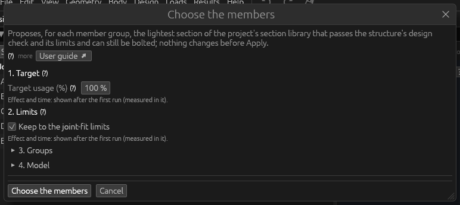

# Choose the members


(2026-11-26, roadmap O49 stage 1; **built, in active development, not
approved yet**.) **What it answers:** for each member group of a level 3
structure, the lightest section of the project's section library that
passes the structure's design check and its limits and can still be
bolted. **Design › Choose the members…** proposes; you accept. Nothing in
the structure changes before **Apply**, and Apply is one undo step. How
it is worked out, and what it assumes: [The member sizer](../theory/member-sizing.md).

## How it is solved

1. The structure as it is: every load case solved.
2. For each **member group** (the members of one group with one section;
   members without a group with their mirror images), the sections of its
   **family** in the library — the same shape and steel: an angle stays an
   angle — tried from the lightest up. A section is taken when every
   member of the group passes:
   - **the design check**: its usage by the structure's code (the code
     plugin loaded: ASCE 10-97 by default) at most the target in every
     load case;
   - **the code's limits** on the members' sizes, from the code's plugin
     (ASCE 10-97: slenderness 3.4, leg w/t 3.7.1, thickness 3.3; SIA 263:
     slenderness 4.5.1.7);
   - **the joint-fit limits**: its leg takes its bolt at mid-leg (the
     hole clear of the root fillet, the code's edge distance to the toe),
     and it is long enough for the bolts its end force needs (the code's
     end distance and spacing, one line).
3. The forces change with the new sections (stiffness, weight): solved
   again and chosen again, until the choice stops changing. A choice that
   comes back takes the heavier, said.
4. **The proposal is a full run** of the structure with the chosen
   sections — never estimated forces. Every member above the target is
   listed.

Only a member's **section** changes — and, where its design data give the
`thickness` and `width_thickness` of the old section, those two are
removed (said in the row's hover): the code then works them out from the
new section. Never a work point, a roll, a group or a bolt.

## Setting it up

1. Open **Design › Choose the members…** (a level 3 structure: every
   member with a section; a load case in the load table).
2. **1. Target**: the largest usage a chosen section may have.
3. **2. Limits**: keep to the joint-fit limits (on by default).
4. **3. Groups** (folded): split a group (each member gets its own
   section) or keep it as it is.
5. **4. Model** (folded): the most rounds.
6. Press **Choose the members**: the window shows each step while it
   works (a thread of its own; Escape stops it).
7. Read the proposal; untick a group you do not want; **Apply**.



## The window

| Field | Default | What it does | Effect on the result | Time |
|---|---|---|---|---|
| 1. Target usage (%) | 100 % | the largest usage of every member of a group in every case | lower: heavier sections with a reserve | about the same |
| 2. Keep to the joint-fit limits | on | a section whose leg cannot take its bolt, or a member too short for its bolts, is not taken | off: the check and the code's limits alone; the proposal says how many groups the limits kept heavier, and by how much mass | none extra (worked out in the same run) |
| 3. Groups: Split | none | each member of the group, with its mirror images, gets its own section | lighter, more different sections | a little more per split group |
| 3. Groups: Keep | none | the group is left as it is | — | less |
| 4. Model: Rounds at most | 10 | each round solves every case with the sections chosen and chooses again | not settled within them: the heavier of the last two choices, said | one solve of every case and one trial per section tried, per round |
| **Choose the members** | | runs the sizer | | shown when done (measured) |
| The totals | | groups changed, the sized members' mass before → after, the largest usage before → after, joint-fit problems before → after, the time, the rounds and trials | | |
| The notes | | the joint-fit limits' effect; NOT ON THE SAFE SIDE notes in the warning colour; members above the target | | |
| The table | | per group: **Take** (ticked for every change), the group (its members on hover), how many members, the section before → after (why on hover, the section without the joint-fit limits where it differs, the design data removed), the mass (kg) before → after, the usage before → after (what governs on hover; above the target in the warning colour), the governing case, the joint-fit problems before → after | | |
| **Apply (n group(s))** | | writes the ticked groups' sections, one undo step | | |
| Choose again | | runs again with the settings above | | |
| Cancel, Escape | | closes the window, a run going on stopped; nothing changes | | |

The proposal is for the structure and the settings it was worked out
with: a change to either asks to choose again before Apply.

## What is and is not on the safe side

- The proposal's usage is a full run of the structure with the chosen
  sections: on the safe side as OHL-Structure's run is.
- **NOT ON THE SAFE SIDE**, said in the window when it applies:
  - **the core's simple check** chosen as the structure's code: it leaves
    out a design code's column curve, imperfections, net sections and
    connections, so a chosen section can be too small for a design code —
    load the design code's plugin and size again;
  - **no code limits known** (the simple check, a plugin without the
    `member-limits` export): a section can pass its usage and still break
    its code's slenderness or thickness limit — the bundled `asce10` and
    `sia263` give them;
  - **height extensions**: the structure is sized as written; an
    extension changes the forces in the body, so a member can be
    overloaded on one — run Results on each extension after Apply.
- The conservative assumptions (a member without a class held to the
  stricter slenderness, a crossing diagonal's longer length, the heavier
  choice of a cycle) are listed in the [theory](../theory/member-sizing.md#conservative-assumptions).

## The command line

```bash
ohl-structure-size tower.ohls --sections Sections --loads tower-loads.csv
ohl-structure-size tower.ohls --target 0.9 --split web -o tower-sized.ohls
ohl-structure-size tower.ohls -o tower-sized.ohls --accept a --accept b
```

One line per group (`*` where it changes): section, mass, usage and
governing case, joint-fit problems, before → after, and why; then every
member above the target ("ABOVE THE TARGET: …"; exit status 2). Options:
`--sections`, `--loads`, `--case`, `--target`, `--no-joint-fit`,
`--rounds`, `--split`, `--keep`, `-o` (write the structure with the
changes), `--accept` (with `-o`: only these groups). A tool of its own
beside `ohl-structure-report`.

## Good to know

- A group whose section is not in the project's library (the structure's
  own `[[section]]` table) is left as it is, said.
- A group no section of its family passes at the target gets the one
  using least among those meeting the limits, said in its row (choose
  another family or arrangement).
- **Undo** takes the whole Apply back in one step.
- The joint layout is not run in the loop (a later stage): lay the joints
  out again after Apply.
