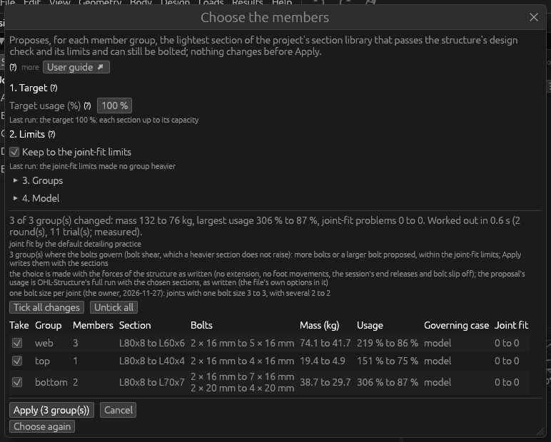
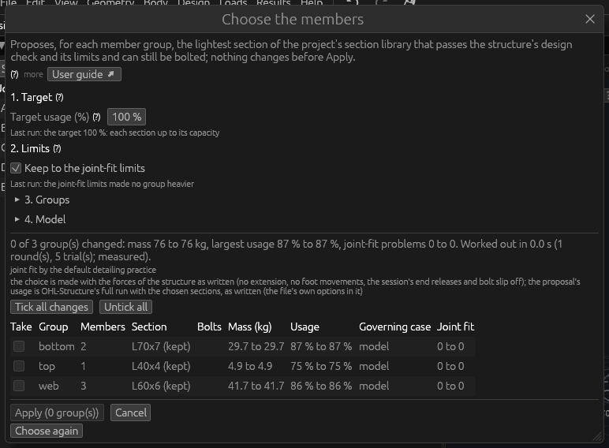

# Choose the members


(2026-11-27, roadmap O49 stage 1; **built, in active development, not
approved yet**.) **What it answers:** for each member group of a level 3
structure, the lightest section of the project's section library that
passes the structure's design check and its limits and can still be
bolted. **Design › Choose the members…** proposes; you accept. Nothing in
the structure changes before **Apply**, and Apply is one undo step. How
it is worked out, and what it assumes: [The member sizer](../theory/member-sizing.md).

## How it is solved

1. The structure as it is: every load case solved.
2. For each **member group** (the members of one group with one section;
   members without a group with their mirror images), the sections of its
   **family** in the library — the same shape and steel: an angle stays an
   angle — tried from the lightest up. A section is taken when every
   member of the group passes:
   - **the design check**: its usage by the structure's code (the code
     plugin loaded: ASCE 10-97 by default) at most the target in every
     load case;
   - **the code's limits** on the members' sizes, from the code's plugin
     (ASCE 10-97: slenderness 3.4, leg w/t 3.7.1, thickness 3.3; SIA 263:
     slenderness 4.5.1.7);
   - **the joint-fit limits**, with the rules Lay out joints uses: its leg
     takes its bolt at mid-leg (the hole clear of the root fillet, the
     code's edge distance to the toe); it is long enough for the bolts its
     ends have or their force needs (the code's end distance and spacing,
     one line); a plate of the [detailing practice](detailing-practice.md)
     takes its leg.

   Where no section both passes and fits its joints, the lightest passing
   is taken and its joint-fit problems are said (its joints to detail by
   hand).
3. The forces change with the new sections (stiffness, weight): solved
   again and chosen again, until the choice stops changing. A choice that
   comes back takes the heavier, said. A choice the structure does not
   solve with (a buckling mode the lighter members let happen) goes back,
   group by group, to the sections that solved — never lighter again, said
   on each.
4. **The proposal is a full run** of the structure with the chosen
   sections — never estimated forces. Every member above the target is
   listed.

Only a member's **section** changes — and, where its design data give the
`thickness` and `width_thickness` of the old section, those two are
removed (said in the row's hover): the code then works them out from the
new section. Never a work point, a roll, a group or a bolt.

## Setting it up

1. Open **Design › Choose the members…** (a level 3 structure: every
   member with a section; a load case in the load table).
2. **1. Target**: the largest usage a chosen section may have.
3. **2. Limits**: keep to the joint-fit limits (on by default).
4. **3. Groups** (folded): split a group (each member gets its own
   section) or keep it as it is.
5. **4. Model** (folded): the most rounds.
6. Press **Choose the members**: the window shows each step while it
   works (a thread of its own; Escape stops it).
7. Read the proposal; untick a group you do not want; **Apply**.

Under each setting, after a run, a small line says its effect and time
measured in that run (*Last run: …*).


## The window

| Field | Default | What it does | Effect on the result | Time |
|---|---|---|---|---|
| 1. Target usage (%) | 100 % (the most) | the largest usage of every member of a group in every case | lower: heavier sections with a reserve; the line under it says how many groups the target made heavier than 100 % and by how much mass (with the last round's forces) | about the same |
| 2. Keep to the joint-fit limits | on | a section whose leg cannot take its bolt, a member too short for its bolts or one no listed plate takes is not taken where a connectable one passes | off: the check and the code's limits alone; the line under it says how many groups the limits kept heavier, and by how much mass | none extra (worked out in the same run) |
| 3. Groups: Split | none | each member of the group, with its mirror images, gets its own section | lighter, more different sections | a little more per split group |
| 3. Groups: Keep | none | the group is left as it is | — | less |
| 4. Model: Rounds at most | 10 (at least 2) | each round solves every case with the sections chosen and chooses again | not settled within them: the heavier of the last two choices, said; the line under it gives each round's time | one solve of every case and one trial per section tried, per round |
| **Choose the members** | | runs the sizer | | shown when done (measured) |
| The totals | | groups changed, the sized members' mass before → after, the largest usage before → after, joint-fit problems before → after, the time, the rounds and trials | | |
| The notes | | NOT ON THE SAFE SIDE notes in the warning colour, always shown; the rest (the joint-fit rules' source, groups to detail by hand, members without a known bolt, …) in a box that scrolls; members above the target in a box of their own | | |
| The table | | per group: **Take** (ticked for every change), the group (its members on hover), how many members, the section before → after (why on hover, the section without the joint-fit limits where it differs, the design data removed), the mass (kg) before → after, the usage before → after (what governs on hover; above the target in the warning colour), the governing case, the joint-fit problems before → after (in the warning colour where some are left) | | |
| **Apply (n group(s))** | | writes the ticked groups' sections, one undo step | | |
| Choose again | | runs again with the settings above | | |
| Cancel, Escape | | closes the window, a run going on stopped; nothing changes | | |

The proposal is for the structure and the settings it was worked out
with: a change to either asks to choose again before Apply.

How long it takes, measured: under a second on the invented truss of the
pictures; on real towers of 2 300 to 2 700 members with 300 to 360
groups, 40 s to 2.5 min of CPU time (three or four rounds).

### The bolts


Where a group fails only by its bolts' shear (the code's plugin says what
governs), a heavier section would not help: the window's **Bolts** column
proposes more of its own bolts, or a larger bolt of the project's bolt
library where more do not fit the member ("2 × 16 mm to 4 × 16 mm"; hover
for why). Ticking the group takes its bolts with its section; Apply writes
both in one undo step. On the command line the proposal is the line
`bolts … → …` under the group. Built, in active development (not
approved yet).

**Per bolt size** (2026-11-27): a group whose members have bolts of
several sizes gets one proposal per size — one line each in the Bolts
column ("2 × 16 mm to 3 × 16 mm", "2 × 20 mm to 4 × 20 mm"; hover for the
members and why).



**One bolt size per joint** (the owner, 2026-11-27: *"for the bolts please
try to use the same ones for a joint. this would ease the construction
once outside"*): more bolts of the joint's size come first; where a
member's bolts must go to a larger bolt, the other bolts of the old size at
its joints go with it (the same count of the larger bolt, never weaker),
shown in the Bolts column as "one bolt size per joint: …". Where one size
cannot be had (sizes mixed already, bolts laid out at the joint, a member
not sized, a leg that does not take the larger bolt, a member whose check
then fails) the joint stays mixed, said with why; the notes count the
joints with one size and with several, before and after.

**The bolts govern and no proposal fits**: a group whose members' bolts
are given at their ends (level 4, with the joint details) or not given
keeps its **current section**, said ("its current section kept"): a
heavier one does not raise the bolt shear, a lighter one is not taken for
it.



## What is and is not on the safe side

- The proposal's usage is a full run of the structure with the chosen
  sections: on the safe side as OHL-Structure's run is.
- **NOT ON THE SAFE SIDE**, said in the window when it applies, each with
  what is left out, why it can be unsafe and what makes it safe:
  - **the core's simple check** chosen as the structure's code: it leaves
    out a design code's column curve, imperfections, net sections and
    connections, so a chosen section can be too small for a design code —
    load the design code's plugin and choose again;
  - **no code limits known** (the simple check, a plugin without the
    `member-limits` export): a section can pass its usage and still break
    its code's slenderness or thickness limit — the bundled `asce10` and
    `sia263` give them;
  - **height extensions**: the structure is sized as written; an
    extension changes the forces in the body, so a member can be
    overloaded on one — run Results on each extension after Apply.
- The conservative assumptions (a member without a class held to the
  stricter slenderness, a crossing diagonal's longer length, the heavier
  choice of a cycle, a choice that does not solve taken back) are listed
  in the [theory](../theory/member-sizing.md#conservative-assumptions).

## The command line

```bash
ohl-structure-size tower.ohls --sections Sections --loads tower-loads.csv
ohl-structure-size tower.ohls --target 0.9 --split web -o tower-sized.ohls
ohl-structure-size tower.ohls -o tower-sized.ohls --accept a --accept b
ohl-structure-size tower.ohls --problems
```

One line per group (`*` where it changes): section, mass, usage and
governing case, joint-fit problems, before → after, and why; under it one
`bolts … → … (n member(s)) — why` line per bolt proposal; then every joint
whose bolts stay of several sizes ("BOLT SIZES MIXED: joint …: sizes — why")
and every member above the target ("ABOVE THE TARGET: …"; exit status 2). Options:
`--sections`, `--loads`, `--case`, `--target` (at most 1), `--no-joint-fit`,
`--rounds` (at least 2), `--split`, `--keep`, `--problems` (each group's
joint-fit problems before and after, in words), `-o` (write the structure
with the changes), `--accept` (with `-o`: only these groups). A tool of
its own beside `ohl-structure-report` and `ohl-structure-layout`.

## Good to know

- A group whose section is not in the project's library (the structure's
  own `[[section]]` table) is left as it is, said; so is a group whose
  members carry capacities written by hand (`capacity_tension`,
  `capacity_compression`).
- A structure analysed from a finite-element model file of its own
  (`model = …`) is refused: its sections are in that file.
- A group no section of its family passes at the target gets the one
  using least among those meeting the limits, said in its row (choose
  another family or arrangement).
- Pieces of one member line of one section (a leg split at its joints)
  are one part for the joint fit: their ends there hold no bolts.
- At level 4 the joints' details were laid out for the old sections: lay
  the joints out again after Apply (said in the notes).
- **Undo** takes the whole Apply back in one step.
- The joint layout is not run in the loop (a later stage): lay the joints
  out again after Apply.
