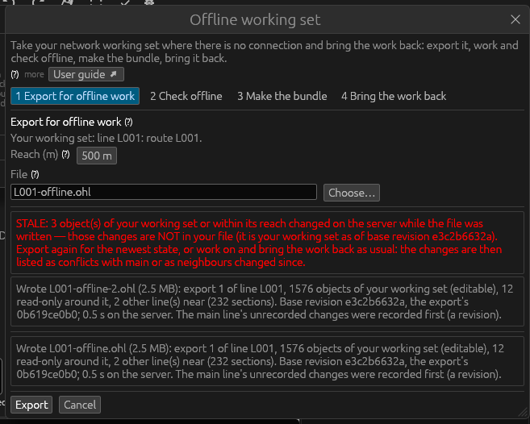
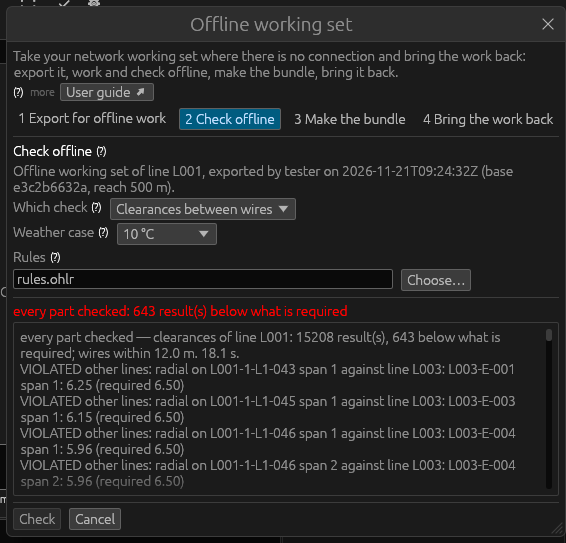
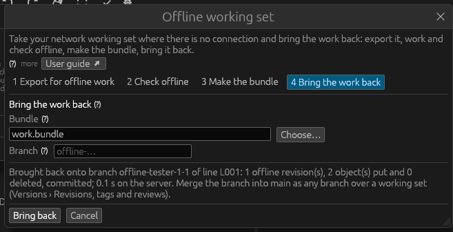

# Offline working sets in OHL-Design

*Built 2026-11-21, in active development, not approved yet*
([decisions](../development/decisions.md#2026-11-21-country-server-the-web-viewers-sign-in-the-offline-working-set-window-schema-8),
[offline working sets on a network](server.md#offline-working-sets-phase-12-in-active-development),
[the same on the command line](network-commands.md#offline-working-sets-phase-12)).

Take your network working set where there is no connection and bring the
work back — in OHL-Design, without the command line. **Versions ›
Offline copy** has four entries for a network's working set, each
opening the **Offline working set** window at its step:

| Entry | When | What it does |
|---|---|---|
| **Export working set for offline work…** | joined to a network with a working set ([File › Join a network](working-set.md)) | step 1 |
| **Check the offline working set…** | the exported file open (File › Open) | step 2 |
| **Make the bundle of offline work…** | the exported file open | step 3 |
| **Bring offline work back…** | joined to the network again | step 4 |

An entry that cannot be used now is greyed, and its hover says why.

## The Offline working set window

**What it is for**: to take your working set offline with the
neighbours the network's checks need, and to bring the work back onto a
branch of the network.

**How to use it**:

1. **Join the network** with your working set (File › Join a network),
   then **Versions › Offline copy › Export working set for offline
   work…**. Check the **Reach**, choose the **File** (Choose…) and press
   **Export**. The network's server writes the file; the window waits for
   it (long work waits behind the others' edits) and then says what the
   file holds.
2. **Leave the network** and **open the file** (File › Open). Work as
   usual — your working set is editable, its context and the neighbours
   are read-only — and **commit** (Versions › Commit…).
3. **Versions › Offline copy › Check the offline working set…**: choose
   the check and its settings and press **Check**: the network's own
   check, with the neighbours the file holds.
4. **Versions › Offline copy › Make the bundle of offline work…**: choose
   where the bundle goes and press **Make the bundle**.
5. **Join the network again**, then **Versions › Offline copy › Bring
   offline work back…**: choose the bundle and press **Bring back**. Your
   work lands on a **new branch over your working set** — never on main
   — and the window lists what changed on the server meanwhile. Merge the
   branch as any branch over a working set
   ([Working sets](working-set.md)).

**The window** (the steps across the top: **1 Export for offline
work**, **2 Check offline**, **3 Make the bundle**, **4 Bring the work
back**; a click changes the step):

| Step | Field | What it does |
|---|---|---|
| 1 | Your working set | The line and what you picked, as the network follows it. |
| 1 | Reach (m) | How far around your working set the neighbours are taken: **500 m** by default, at most 10 000 m. A check made offline that reaches further says NOT ALL CHECKED. A larger reach makes a larger file. |
| 1 | File | Where the offline working set is written (a project file, `.ohl`). **An existing file is never replaced** (it may hold work): choose another name. |
| 2 | Which check | **Clearances between wires** (by rule), **Magnetic field** (with the lines near) or **Loads on shared towers** (each tower under each line's cases, the worst kept). |
| 2 | Weather case | The case of your line the wires are solved in (clearances, field). |
| 2 | Rules | Clearances: the clearance rules' file (`.ohlr`). |
| 2 | Distance (m), Current (A), Limit (µT) | Field: how far from your line (500 m by default, at most 2 000 m); the current of every circuit (empty: each line's own); a limit to compare with (empty: none). |
| 2 | Towers | Loads: the shared towers to check, separated by commas (empty: every shared tower of your working set). |
| 3 | Bundle | Where the bundle is written (by default beside the open file, with the extension `.bundle`). An existing file is never replaced. |
| 4 | Bundle | The bundle step 3 made. |
| 4 | Branch | The new branch's name (empty: `offline-USER-N-K`, from your name and the export). |
| | **Export** / **Check** / **Make the bundle** / **Bring back** | The step's action. Greyed while something is missing or another step is under way; its hover says why. |
| | **Cancel** | Closes the window (Escape). While the window waits for the server, the answer still comes: the status line says what the server did (an export recorded then writes no file: export again). |

Enter does not run a step (each talks to the server or writes a file):
press the button.

**What each step reports**:

- **1**: the file written, its size, how many objects of your working
  set (editable) and around it (read-only), the other lines near, the
  base revision, and what you may not see (**left out and only counted**:
  checks offline say NOT ALL CHECKED for it). **A stale export** is said
  first, in red: *STALE: N object(s) of your working set or within its
  reach changed on the server while the file was written — those changes
  are NOT in your file*. The file is your working set as of its base
  revision: export again for the newest state, or work on — the changes
  are then listed when you bring the work back (as conflicts with main,
  or as neighbours changed since).

  

- **2**: the check's status first — *every part checked* in green only
  when nothing is below what is required; in red with how many results
  are below it; **NOT ALL CHECKED** in red with each reason (neighbours
  left out, a check reaching beyond what was exported) — then the
  results, the notes (what is assumed; NOT ON THE SAFE SIDE where it is
  not) and each finding (the first 200, then how many more). A whole
  route's clearances take seconds (17 s for a route of the synthetic
  country of 300 pylons on the test computer); the window stays usable
  meanwhile.

  

- **3**: the bundle written: its revisions since the export. Uncommitted
  changes refuse it — commit first.
- **4**: the branch, the revisions and objects it carries, then **what
  changed on the server meanwhile** — in red when there is any: the
  objects you changed that also changed on main (**conflicts**: the merge
  asks you to settle them; nothing is settled for you) and the read-only
  neighbours changed since your export (the checks you made offline are
  then out of date: check again on the network).

  

**Good to know**:

- **Rights**: you need to see everything the export holds, *export* on
  each object of your working set and edit on something of each of its
  routes; bringing back is decided by your rights **as they are then**.
- **Refused, nothing kept**: a bundle changing a read-only neighbour or a
  library file, a bundle changed by hand, of another user's export, of an
  export the network does not know, or brought back already.
- **Nothing is reserved** for you while you work offline: others may
  change your working set on the network; bringing back lists it.
- **Main's unrecorded changes** (edits on the network not yet in a
  revision, anyone's) are recorded first by the network's server itself —
  a revision by `network:server`, in the audit under your name — so you
  can export whoever made them (since 2026-11-23; before, only someone
  who could record them all could export then).
- The export and the bundle go through your connection to the network
  (one per user); the check and the bundle work on the open file alone,
  without the network.
- Versions › Offline copy's first two entries (Export line as bundle,
  Import bundle) carry a project line between copies of a **project
  file**; they are not for a network.

## Checks with the export's neighbours

*Built 2026-11-23 (Structure loads with the shared towers and the magnetic field with the lines near 2026-11-24), in active development, not approved yet*
([decisions](../development/decisions.md#2026-11-23-country-server-the-check-windows-with-an-offline-files-neighbours)).

**What it is for**: the ordinary check windows (Checks menu) on an
offline working set's file read the **other lines near your working
set** that the network exported with it — not only step 2's network
checks. Each window says so, never silently.

**How to use it**:

1. Export your working set (step 1 above), leave the network and **open
   the file** (File › Open).
2. Open a check window as usual — **Checks › Wire clearances** (the
   Clearances window), **Structure loads**, **Magnetic field**,
   **Electric field** or a plugin's check.
3. Read the block **Offline working set: neighbours from its export**
   (Clearances: under *1 What it checks*; the others: first in their
   results' notes): which export (its date, its number when OHL-Design
   wrote it), which lines it read, and that they may be stale.
4. **Run** the check. The results say again what was read — for the
   Clearances window, how many sections of each line lie within the
   rules' reach — and whether anything is NOT ALL CHECKED.

   

**What each window does with them**:

| Window | With the export's neighbours |
|---|---|
| Clearances (wire clearances by rule) | The **rules to other lines** (`target = "other_lines"`, crossings among them) take the other lines' wires: each line near is solved in every weather case and wind position checked, with its own line's settings and wires (as the network's checks solve it). Their wires are named `LINE:SECTION span N` in the *Other wire* column. On the same file the rule finds the same pairs and distances as step 2's network check (tested). Before, these rules were skipped ("other lines are checked by `ohl line --other-line`"). |
| Structure loads | The towers of your working set **shared with another line** (one of the same type within 0.5 m) are named and, since 2026-11-24, **computed with every line's sections on them**, under each line's load cases, the worst kept — the network's own check on the file (step 2's *Loads on shared towers*), so the same loads (tested) — in the Results' **Shared towers** view ([the window's guide](structure-loads-window.md#shared-towers-offline-working-set)). The Loads and Usage views keep this line's own loads (the Usage view: NOT ALL CHECKED for the shared towers). A shared tower outside your working set: NOT ALL CHECKED. No shared tower: said, nothing of other lines is missing. |
| Magnetic field | Since 2026-11-24 the lines whose wires come within **500 m** (the network's field distance) of the spans computed are **added**: each solved in the run's weather case with its own settings and wires, its field added by size at every profile point, given point and cut — the network's own selection and sources, so on your working set's spans the same field as step 2's *Magnetic field* (tested). *Other lines' current* gives their circuits without a current of their own. Spans of the read-only parts around your working set reach beyond the export: NOT ALL CHECKED ([the window's guide](magnetic-field.md#other-lines-on-an-offline-working-sets-file)). |
| Electric field | The lines within **500 m** are named: their field is **not added** — NOT ALL CHECKED, NOT ON THE SAFE SIDE where they come near. The network computes no electric field with other lines either. |
| A plugin's check (e.g. Distance between conductors) | A check whose declared reach needs neighbours gets this line only: the lines it would reach are named, NOT ALL CHECKED. |

**They may be stale** (said in orange in each window): the file holds
the neighbours **as of its export** and knows nothing of the network
after it. When OHL-Design wrote the file, the window also says whether
something changed **while** it was written — *STALE already when
exported: N object(s) … changed on the network while the file was
written* (in red), or *Nothing changed on the network while the file was
written*. A file written by `ohl network export-working-set` does not
know it (said). Bringing the work back (step 4) lists what changed
since.

**NOT ALL CHECKED** (in red, and the verdict never says *every rule
met* then): neighbours you may not see were left out of the export
(only counted); a rule reaching farther than the export's reach (export
again with a larger reach, or check on the network); a neighbour line
that does not solve; a neighbour's wire library that could not be read;
a rule to other lines across weather cases (case pairs: not in this
window).

**Good to know**:

- The neighbours are read once when the file opens; nothing about them
  changes while you work offline (they are read-only).
- What the server said of the export is kept in the file as an
  application setting (`app.offline_export`): not part of the line, not
  in its revisions, not in a bundle.
- On a network's working set while joined, the check windows still say
  that its neighbours are not pulled in (run the check on the network).
