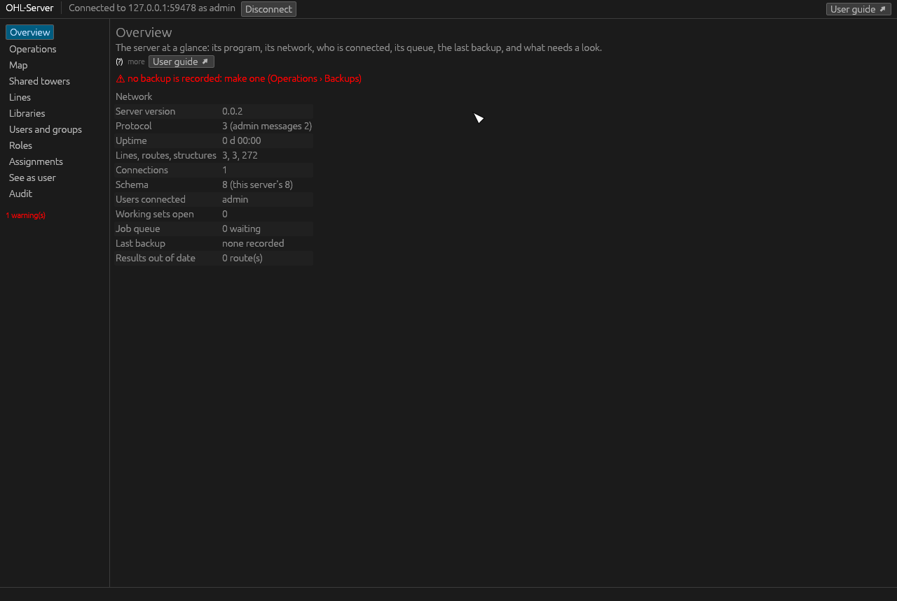
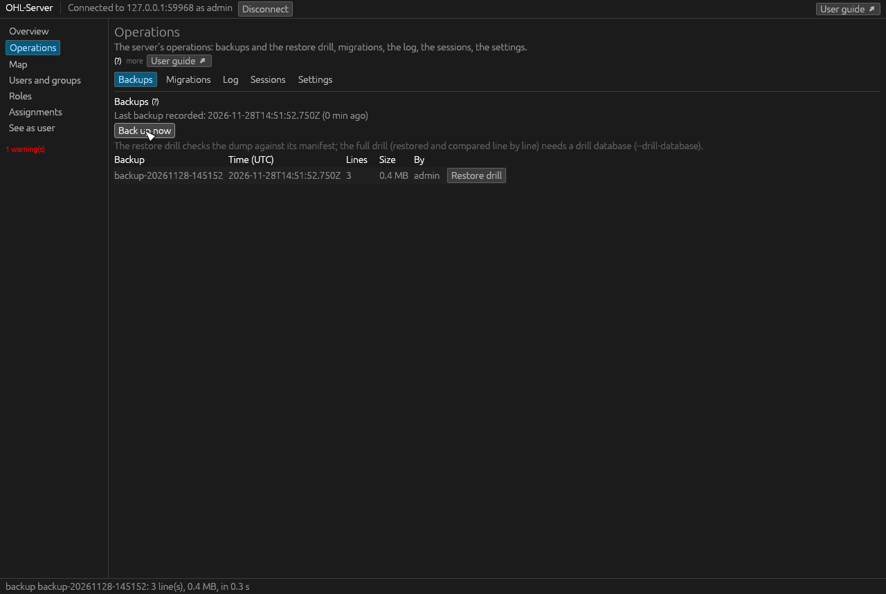
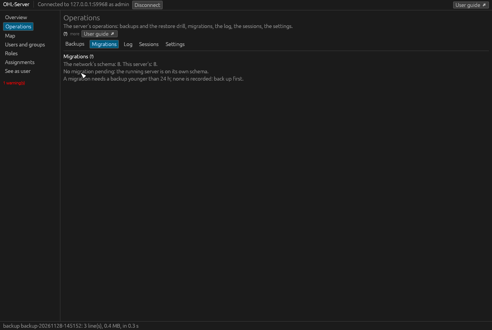
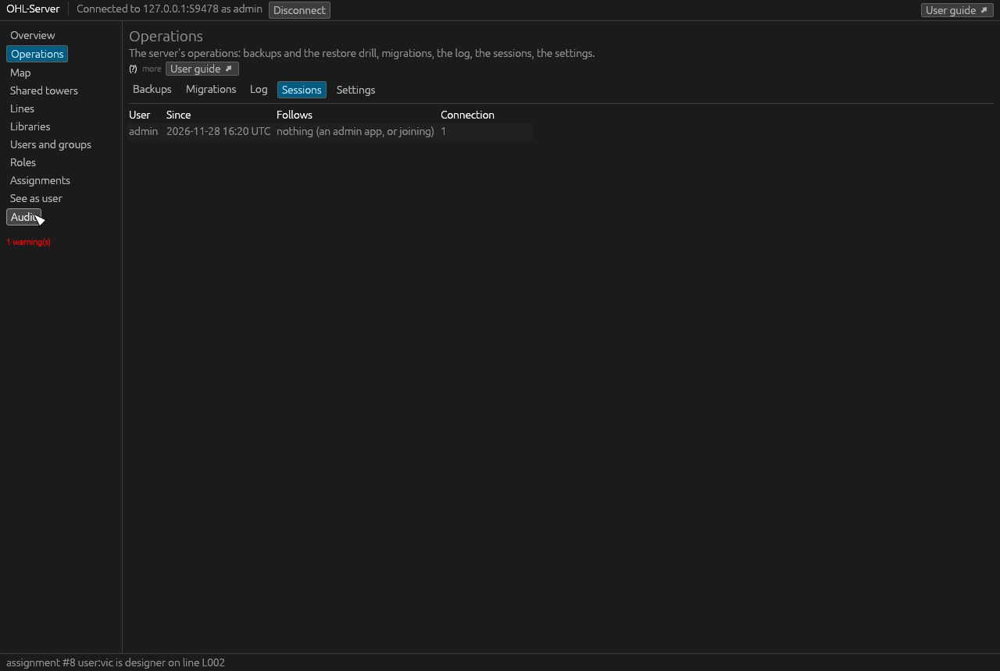
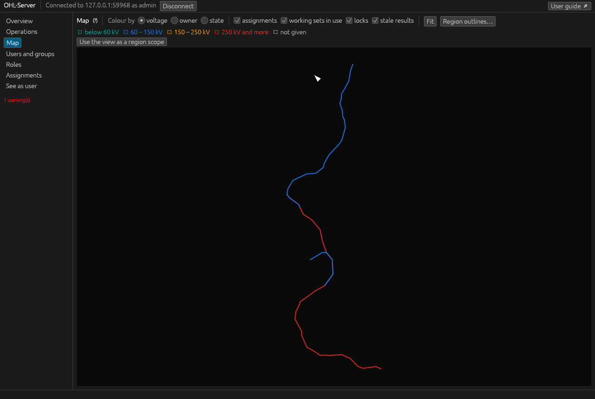
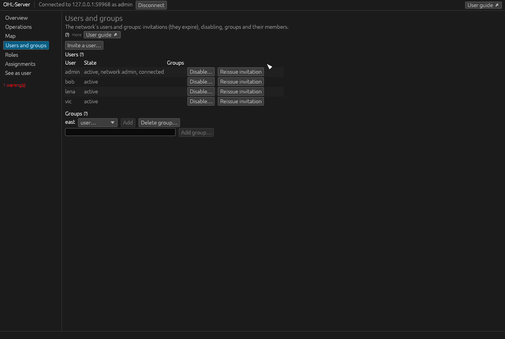
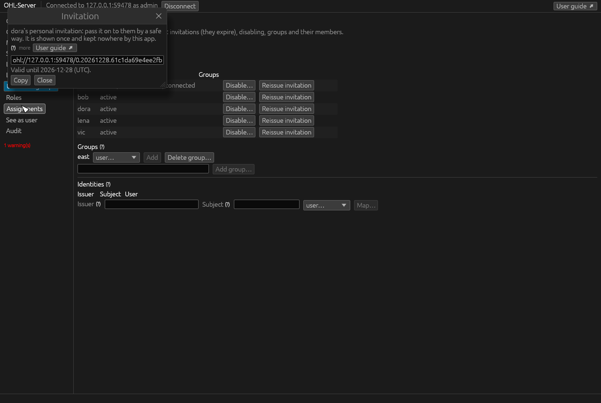
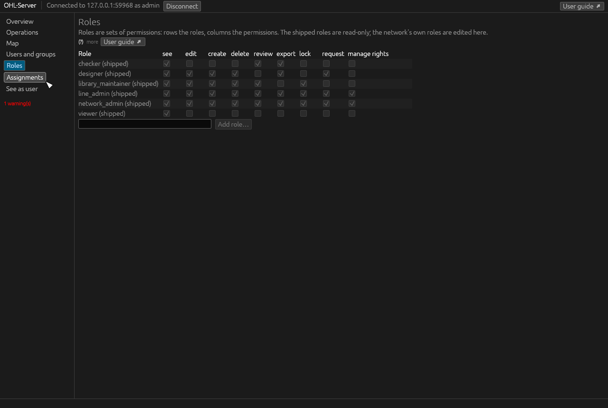
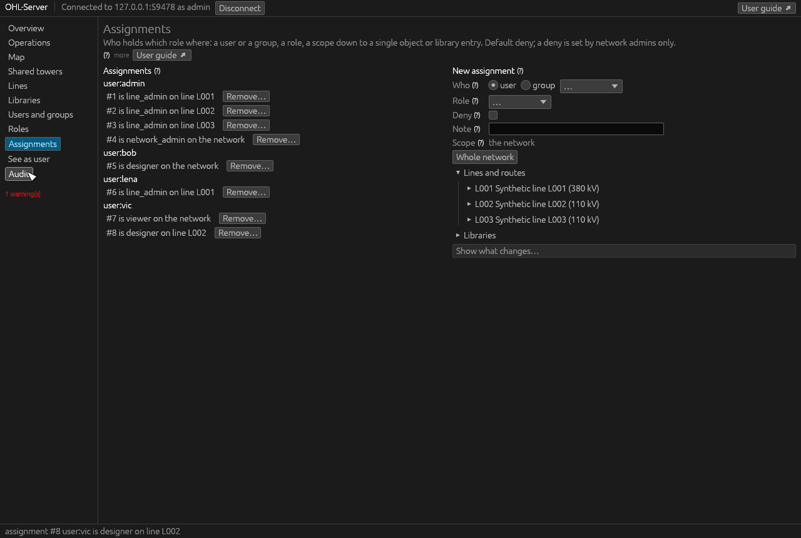
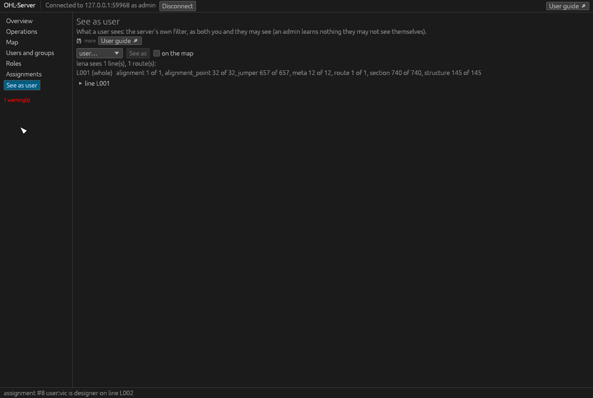

# OHL-Server, the admin app

*Stages A and B built 2026-11-28 (ROADMAP O17, the owner's answers of
the same day), in active development, not approved yet.* OHL-Server
(`ohl-server-app`) is the third application of OpenOHL, beside OHL-Design
and OHL-Structure: an app **for the admins of a network's server**
([server mode](server.md), [deployment](server-deployment.md)). It shows
the server's state and runs its operations, draws a simplified map of
the network, and manages the rights of its users. It does no engineering
work: no editing of lines, no 3D, no checks.

It talks to the server's protocol only, **never to the database**: what
it shows and changes goes through the server, which checks every message
with the same rights function as every other client's and writes every
change to the network's append-only audit
([ADR-0013](../adr/0013-country-server.md),
[security review](../development/server-security-review.md#the-admin-messages-2026-11-28)).

Who may open it (the owner's answer 3): **network admins**, **line
admins** (for their lines) and **library maintainers** (for their
libraries). Each sees only the pages and objects their rights allow; a
user who neither manages rights nor maintains a library is refused (and
the refusal is audited). A library maintainer (a role that may review and
lock, on a library) sees the Overview's counts, the map and the rights
pages read-only, their libraries in the Assignments' list; giving rights
on a library needs *manage rights* there (the Libraries page comes with
stage D).

| Page | Network admin | Line admin, library maintainer |
|---|---|---|
| Overview | everything | the program, the counts of what they manage |
| Operations | yes | not shown |
| Map | every route | the routes they may see |
| Users and groups | changes | read-only list |
| Roles | edits the network's own roles | read-only matrix |
| Assignments | every scope, denies | their lines' or libraries' scopes only, no deny |
| See as user | yes | what both they and the user may see |

## Starting it

1. Start `ohl-server-app` (built with the other programs:
   `cargo run --release -p ohl-server-app`).
2. Choose a mode on the start page: **Host a network** (the server runs
   inside the app) or **Connect to a server** (a server running
   elsewhere, the production way).
3. Once signed in, the pages are on the left; what the server said last
   is at the bottom (in red when refused).

## Host mode

The network's server runs inside the app — for a small office or a
test. **Closing the app stops the server**; it asks first and names who
is connected. For a server that keeps running without the app, use `ohl
network serve` ([deployment](server-deployment.md)) and connect to it.

1. **Database**: the connection string (`host=… dbname=… user=…` or
   `postgresql://…`), as `ohl network serve` takes it. The **password
   file**, **TLS** mode and **CA file** are those of the command line
   (`OHL_DATABASE_PASSWORD_FILE`, `--db-sslmode`, `--db-ca`). Nothing of
   the form is saved: a connection string may hold a password.
2. **Listen on**: the address and port (UDP, QUIC; default
   `0.0.0.0:4433`). **Keys file**: keeps the personal invitations' key,
   so invitations survive a restart (empty: they change at the next
   start). **Backup folder**: where Operations › Backups writes.
3. **Admin**: you, a network admin of that database. On a new network,
   tick **First network admin** (only while the network has none; as
   `ohl network rights bootstrap`, audited).
4. **Look at the database** (optional) says its schema and its network
   admins: an empty database gets its schema at the start; an older one
   is migrated at the start — refused without a backup younger than the
   network's `backup_max_age_hours` (24 h by default), as `ohl network
   serve` refuses.
5. **Host**: every line is read (seconds on a country), then the app
   signs in to its own server with your personal invitation.

Closing (the window's close button, or **Stop the server…**):

**Stop the server and close** lets every user go (they keep their
offline work and join again once a server runs); **Cancel** keeps it
running. The question never takes Enter.

## Connect mode

1. **Invitation**: your personal invitation (`ohl://address/code/…`, from
   a network admin — `ohl network serve --invite NAME`, or Users and
   groups › Invite).
2. **User**: your user name on the network.
3. **Connect**. Or **Sign in…** when the server offers the
   organisation's identity provider (OIDC): the browser opens its page;
   the token comes back to the app and stays in memory only, as in
   OHL-Design's [sign-in](sign-in.md). The invitation then only names the
   server (its address and certificate).

A server older than the admin messages is said ("update the server");
the app connects to nothing else.

## Overview

The server at a glance, refreshed every 5 seconds: its version, the
network's schema and the server's, the protocol, the uptime, the lines,
routes and structures, the users connected, the working sets open, the
job queue (checks, exports and bundles waiting, a check or an export
running), the last backup and its age. **Warnings** (also counted under
the page list): no backup recorded, a backup older than 24 h,
migrations pending, routes with results out of date.

## Operations

Network admins only. Every action is in the audit.

### Backups

**Back up now** writes a backup into a new folder of the server's backup
folder (`--backup-dir` of `ohl network serve`, or the host form's):
PostgreSQL's dump of the whole network in one snapshot and its manifest
(each line's hash), made while the server runs; it is recorded, so a
migration may run within the next 24 h. The list shows each backup's
time, lines, size and maker. **Restore drill** checks a backup: its
dump against the manifest's hash; with a **drill database**
(`--drill-database`, an empty database never the network's own) it is
restored there and every line and the network's own tables are compared
with the manifest — the full drill. Empty the drill database before the
next one. One backup or drill runs at a time; the server keeps serving
meanwhile.

### Migrations

The network's schema and the running server's. A running server is on
its own schema: a migration happens when a server program of a newer
version starts, refused without a backup younger than
`backup_max_age_hours` (or `ohl network migrate`, see
[deployment](server-deployment.md#backups-and-restores)). The tab says
whether the last backup allows one.

### Log

The server's log (the newest 4000 lines it keeps), in a fixed-height box
that follows the newest line; **Filter** keeps the lines holding a text.
No secret is ever logged.

### Sessions

Who is connected, since when, and what they follow. **Let go…** asks for
a reason (shown to the user, kept in the audit) and closes their
connection; they may join again at once — disable the user (Users and
groups) to keep them out. Your own connection is not let go here.

### Settings

Read-only. **start** settings are the server's start options (its
command line or configuration: changed by starting it again); the
database is shown by host and name only, never its password. **network**
settings are the network's own (`ohl network setting`).

## Map

2D, read-only, simplified: never measured on (each alignment drawn with
at most 64 of its points).

- **Colour by** voltage (the highest nominal voltage of the route's
  line's systems), owner (the line's systems' owner) or state (results
  out of date, in use, locks held).
- **Shared towers** (on two routes or more) are always marked (small
  squares); **structures** are drawn as dots once the view is narrower
  than 40 km (asked for the area in view, 20 000 at most).
- **Overlays**: the assignment selected on the Assignments page (its
  routes, line or region in green), the working sets in use (yellow),
  locks (a purple dot), stale results (red dashes).
- **No background by default.** **Region outlines…** imports outlines
  from a GeoJSON file (polygons, multi-polygons, lines; in the network's
  own coordinates, as the file gives them); they are kept with the app's
  settings on this computer, never on the server. A tile background is
  not built (see the roadmap's questions).
- Drag to pan, scroll to zoom, **Fit** to see everything. A click picks
  a route or a structure: **Use as the assignment's scope** takes it to
  the Assignments page; **Use the view as a region scope** takes the
  rectangle in view.

## Users and groups

Everyone the network knows: active or disabled, network admin,
connected, their groups. Network admins change them; others see the list
(to pick whom to assign).

1. **Invite a user…**: a name, a display name, the days the invitation
   is valid (90 by default). The user is added (no rights until
   assigned) and their personal invitation is shown **once** — pass it
   on by a safe way; anyone holding it signs in as that user.
2. **Reissue invitation**: a new one; every older invitation of that
   user is refused from now on, and they are let go if connected.
3. **Disable…** / **Enable…**: a disabled user has no rights at all and
   is let go.
4. **Groups**: add a group, add or take out members, delete a group
   (with its assignments).

Each change goes through [what changes](#what-changes) first.

## Roles

The permission matrix: rows the roles, columns the permissions (see,
edit, create, delete, review, export, lock, request, manage rights). The
**shipped** roles (viewer, designer, checker, library_maintainer,
line_admin, network_admin) are read-only; the network's own roles are
edited by network admins: tick, then **Save…** (what changes first).
**Add role…** makes a role that may see; **Delete…** removes an own
role (refused while an assignment names it).

## Assignments

Who holds which role where: a user or a group × a role × a scope, down
to a single object or library entry. Default deny: nothing is allowed
that no assignment gives. A **deny** is set by network admins only.

1. **Who**: a user or a group. **Role**. **Deny** (network admins).
   **Note** (kept with the assignment).
2. **Scope**: **Whole network** (network admins), or in the tree —
   network › line › route › structure (a route's structures are asked
   for when it is opened) — or in the **Libraries** list (kind › file ›
   entry), or from the map (a route, a structure, the view as a region).
   A line admin sees only their lines, a library maintainer only their
   libraries.
3. **Show what changes…**, then **Save**.

The list on the left shows the assignments whose scope you manage,
grouped by who holds them; a click shows one on the map, **Remove…**
takes it away (what changes first).

## What changes

Every rights change — an assignment given or removed, a membership, a
role's permissions, a user disabled — opens this window first. The
server works out, on a copy of the rights and without saving, **who
gains and who loses which permission on which scope**, counted ("1
user(s) gain 6 permission(s), 0 user(s) lose 0" for a designer given a
line), with notes (a change
that will be refused for your rights, a shipped role, nobody's rights
changing). **Save** is enabled once it is shown; the server's rights
function decides again when it is saved. **Escape** or **Cancel**:
nothing changes.

## See as user

What a user sees: the server's own filter, as both you and they may (an
admin learns nothing they may not see themselves): per line, whole or
not, and each kind's objects seen out of all. **on the map** shows only
the routes they see. Each look is in the audit.

## Not built yet

Stages C–F (ROADMAP O17), with the server phases they follow: C with
phase 8 (shared towers), D with phase 9 (the Libraries page: locks,
maintainers, requests, releases), E the Lines page (export one model,
import with its report), F with phase 13 (the Audit page, to CSV). OIDC
identity mappings are made with `ohl network rights map-identity` until
then.
