# OHL-Server, the admin app

*Stages A to F built 2026-11-28 (ROADMAP O17, the owner's answers of
the same day), in active development, not approved yet.* OHL-Server
(`ohl-server-app`) is the third application of OpenOHL, beside OHL-Design
and OHL-Structure: an app **for the admins of a network's server**
([server mode](server.md), [deployment](server-deployment.md)). It shows
the server's state and runs its operations, draws a simplified map of
the network, and manages the rights of its users. It does no engineering
work: no editing of lines, no 3D, no checks.

It talks to the server's protocol only, **never to the database**: what
it shows and changes goes through the server, which checks every message
with the same rights function as every other client's and writes every
change to the network's append-only audit
([ADR-0013](../adr/0013-country-server.md),
[security review](../development/server-security-review.md#the-admin-messages-2026-11-28)).

Who may open it (the owner's answer 3): **network admins**, **line
admins** (for their lines) and **library maintainers** (for their
libraries). Each sees only the pages and objects their rights allow; a
user who neither manages rights nor maintains a library is refused (and
the refusal is audited). A library maintainer (a role that may review and
lock, on a library) sees the Overview's counts, the map and the rights
pages read-only, their libraries in the Assignments' list, and changes
**their libraries** on the [Libraries](#libraries) page (grant, refuse,
release, withdraw, lock); giving rights on a library needs *manage
rights* there.

The pages of stages C to F (Shared towers, Lines, Libraries, Audit) need
a server of the same program (admin messages 2); on an older server they
are not shown and the app says nothing more.

| Page | Network admin | Line admin, library maintainer |
|---|---|---|
| Overview | everything | the program, the counts of what they manage |
| Operations | yes | not shown |
| Map | every route | the routes they may see |
| Users and groups | changes | read-only list |
| Roles | edits the network's own roles | read-only matrix |
| Assignments | every scope, denies | their lines' or libraries' scopes only, no deny |
| See as user | yes, and explain | what both they and the user may see, explain |
| Shared towers | every tower, who may edit | the towers they may see; who may edit on their lines |
| Lines | export, import | export the lines they may export whole |
| Libraries | every kind, every change | their libraries' changes; the rest read-only |
| Audit | yes | not shown |

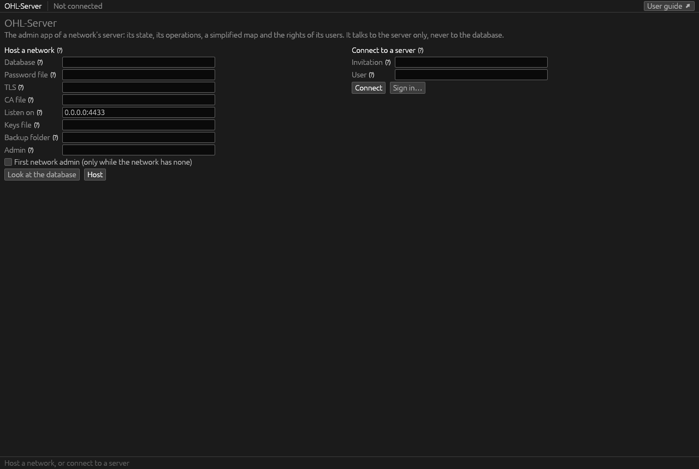

## Starting it

1. Start `ohl-server-app` (built with the other programs:
   `cargo run --release -p ohl-server-app`).
2. Choose a mode on the start page: **Host a network** (the server runs
   inside the app) or **Connect to a server** (a server running
   elsewhere, the production way).
3. Once signed in, the pages are on the left; what the server said last
   is at the bottom (in red when refused).

## Host mode

The network's server runs inside the app — for a small office or a
test. **Closing the app stops the server**; it asks first and names who
is connected. For a server that keeps running without the app, use `ohl
network serve` ([deployment](server-deployment.md)) and connect to it.

1. **Database**: the connection string (`host=… dbname=… user=…` or
   `postgresql://…`), as `ohl network serve` takes it. The **password
   file**, **TLS** mode and **CA file** are those of the command line
   (`OHL_DATABASE_PASSWORD_FILE`, `--db-sslmode`, `--db-ca`). Nothing of
   the form is saved: a connection string may hold a password.
2. **Listen on**: the address and port (UDP, QUIC; default
   `0.0.0.0:4433`). **Keys file**: keeps the personal invitations' key,
   so invitations survive a restart (empty: they change at the next
   start). **Backup folder**: where Operations › Backups writes.
3. **Admin**: you, a network admin of that database. On a new network,
   tick **First network admin** (only while the network has none; as
   `ohl network rights bootstrap`, audited).
4. **Look at the database** (optional) says its schema and its network
   admins: an empty database gets its schema at the start; an older one
   is migrated at the start — refused without a backup younger than the
   network's `backup_max_age_hours` (24 h by default), as `ohl network
   serve` refuses.
5. **Host**: every line is read (seconds on a country), then the app
   signs in to its own server with your personal invitation.

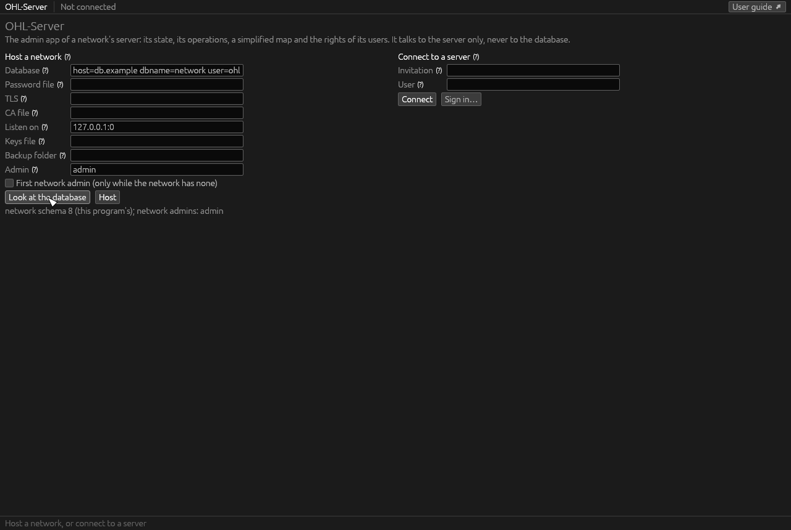

Closing (the window's close button, or **Stop the server…**):

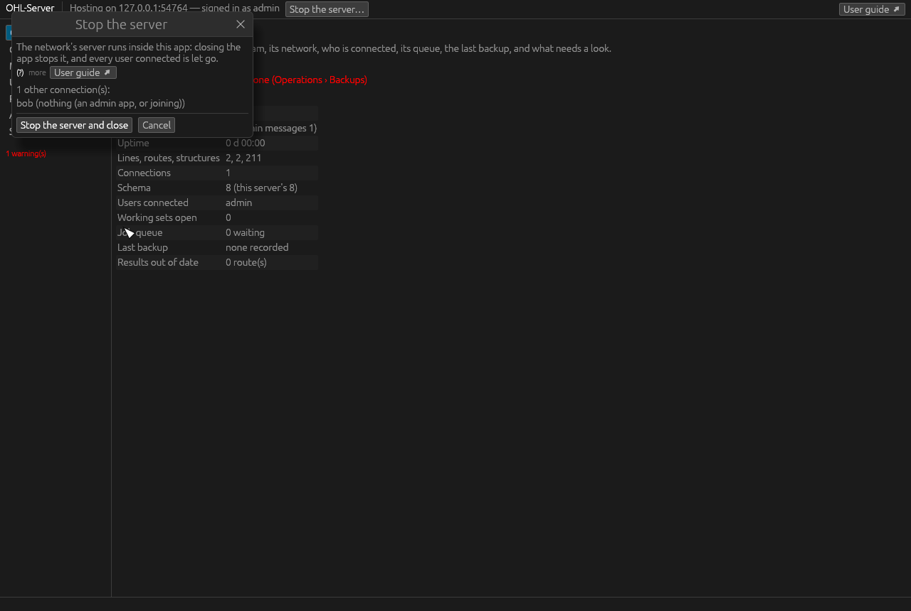

**Stop the server and close** lets every user go (they keep their
offline work and join again once a server runs); **Cancel** keeps it
running. The question never takes Enter.

## Connect mode

1. **Invitation**: your personal invitation (`ohl://address/code/…`, from
   a network admin — `ohl network serve --invite NAME`, or Users and
   groups › Invite).
2. **User**: your user name on the network.
3. **Connect**. Or **Sign in…** when the server offers the
   organisation's identity provider (OIDC): the browser opens its page;
   the token comes back to the app and stays in memory only, as in
   OHL-Design's [sign-in](sign-in.md). The invitation then only names the
   server (its address and certificate).

A server older than the admin messages is said ("update the server");
the app connects to nothing else.

## Overview

The server at a glance, refreshed every 5 seconds: its version, the
network's schema and the server's, the protocol, the uptime, the lines,
routes and structures, the users connected, the working sets open, the
job queue (checks, exports and bundles waiting, a check or an export
running), the last backup and its age. **Warnings** (also counted under
the page list): no backup recorded, a backup older than 24 h,
migrations pending, routes with results out of date.

## Operations

Network admins only. Every action is in the audit.

### Backups

**Back up now** writes a backup into a new folder of the server's backup
folder (`--backup-dir` of `ohl network serve`, or the host form's):
PostgreSQL's dump of the whole network in one snapshot and its manifest
(each line's hash), made while the server runs; it is recorded, so a
migration may run within the next 24 h. The list shows each backup's
time, lines, size and maker. **Restore drill** checks a backup: its
dump against the manifest's hash; with a **drill database**
(`--drill-database`, an empty database never the network's own) it is
restored there and every line and the network's own tables are compared
with the manifest — the full drill. Empty the drill database before the
next one. One backup or drill runs at a time; the server keeps serving
meanwhile.

### Migrations

The network's schema and the running server's. A running server is on
its own schema: a migration happens when a server program of a newer
version starts, refused without a backup younger than
`backup_max_age_hours` (or `ohl network migrate`, see
[deployment](server-deployment.md#backups-and-restores)). The tab says
whether the last backup allows one.

### Log

The server's log (the newest 4000 lines it keeps), in a fixed-height box
that follows the newest line; **Filter** keeps the lines holding a text.
No secret is ever logged.

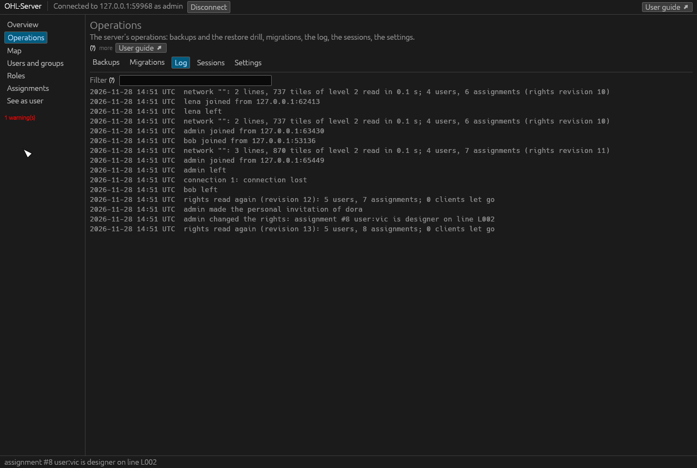

### Sessions

Who is connected, since when, and what they follow. **Let go…** asks for
a reason (shown to the user, kept in the audit) and closes their
connection; they may join again at once — disable the user (Users and
groups) to keep them out. Your own connection is not let go here.

### Settings

**start** settings are the server's start options (its command line or
configuration: changed by starting it again), read-only; the database is
shown by host and name only, never its password. **network** settings
are the network's own (`ohl network setting`, today
`backup_max_age_hours`): **Change…** beside one sets it (network admins;
the server checks the value and keeps the change in the audit).

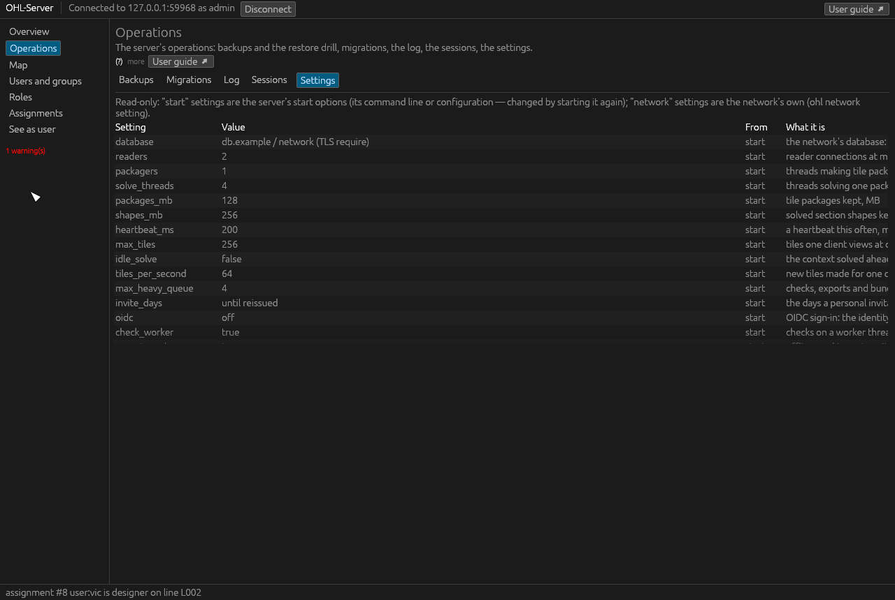

## Map

2D, read-only, simplified: never measured on (each alignment drawn with
at most 64 of its points).

- **Colour by** voltage (the highest nominal voltage of the route's
  line's systems), owner (the line's systems' owner) or state (results
  out of date, in use, locks held).
- **Shared towers** (on two routes or more) are always marked (small
  squares); **structures** are drawn as dots once the view is narrower
  than 40 km (asked for the area in view, 20 000 at most).
- **Overlays**: the assignment selected on the Assignments page (its
  routes, line or region in green), the working sets in use (yellow),
  locks (a purple dot), stale results (red dashes).
- **No background by default.** **Region outlines…** imports outlines
  from a GeoJSON file (polygons, multi-polygons, lines; in the network's
  own coordinates, as the file gives them); they are kept with the app's
  settings on this computer, never on the server.
- Drag to pan, scroll to zoom, **Fit** to see everything. A click picks
  a route or a structure: **Use as the assignment's scope** takes it to
  the Assignments page; **Use the view as a region scope** takes the
  rectangle in view.

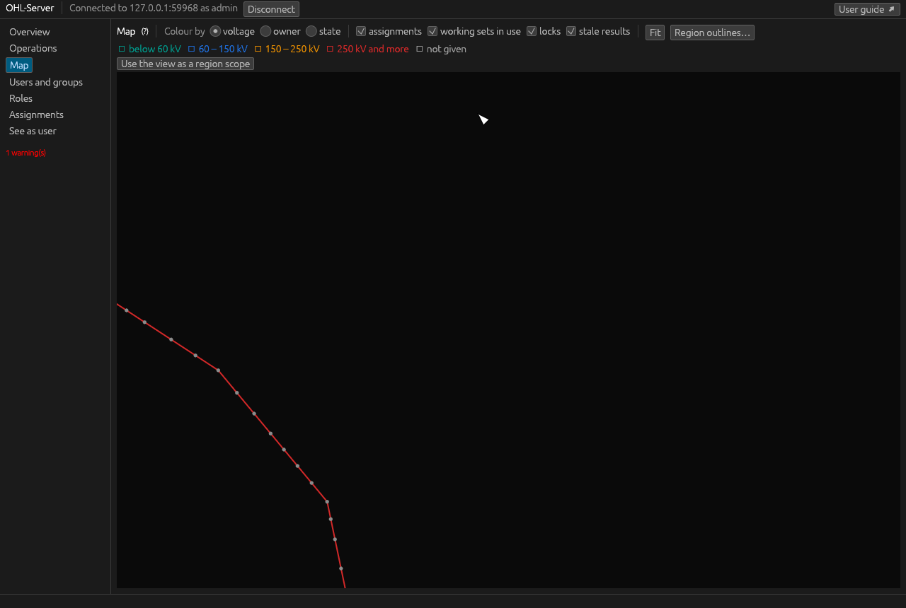

### Drawing a region

A polygon of your own as an assignment's region (stage C):

1. **Draw a region**, then click its corners on the map (pan and zoom as
   usual; **Undo corner** takes the last one back).
2. **Finish the region** (three corners or more): it becomes the scope
   of the new assignment on the Assignments page. A polygon whose edges
   cross is refused (the server refuses it too) — undo corners or draw
   it again. **Cancel** or **Escape**: nothing drawn.

A region grants what lies wholly inside it and denies what it touches
(the rights' rule). A concave polygon is drawn outlined, a convex one
filled too.

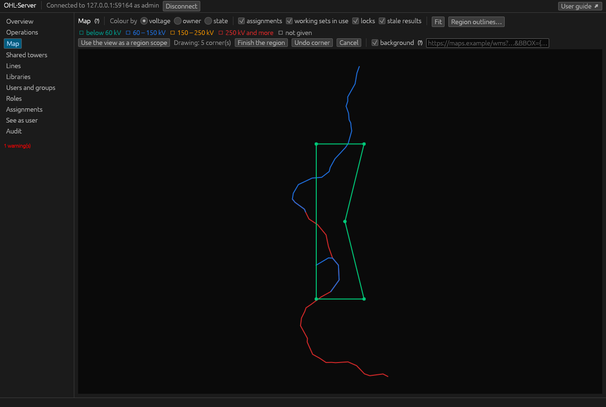

### Background from your own map server

None by default, and **no request goes anywhere** until you type a URL
and tick **background** (the owner's answer 5: no third-party default).
The map then asks your organisation's own map server for **one image of
the view** in the network's own coordinate system, once the view rests
(0.4 s), on a thread of its own; panning and zooming keep the last image
until the next one comes.

1. Type the URL template beside **background**: `{x0}`, `{y0}`, `{x1}`,
   `{y1}` are the view (m, the network's coordinates), `{width}`,
   `{height}` the picture's size in pixels, `{crs}` the network's
   coordinate system. For example a WMS GetMap request:
   `https://maps.example/wms?SERVICE=WMS&REQUEST=GetMap&VERSION=1.3.0&LAYERS=base&CRS={crs}&BBOX={x0},{y0},{x1},{y1}&WIDTH={width}&HEIGHT={height}&FORMAT=image/png`.
2. Tick **background**.

Only `https://` (or `http://`) URLs; 15 s and 32 MB at most per image;
no redirect followed; a PNG or JPEG. The URL is kept with the app's
settings on this computer, never on the server. Your map server learns
the area you look at.

| Before (no background) | After (an image of the owner's map server) |
|---|---|
|  | 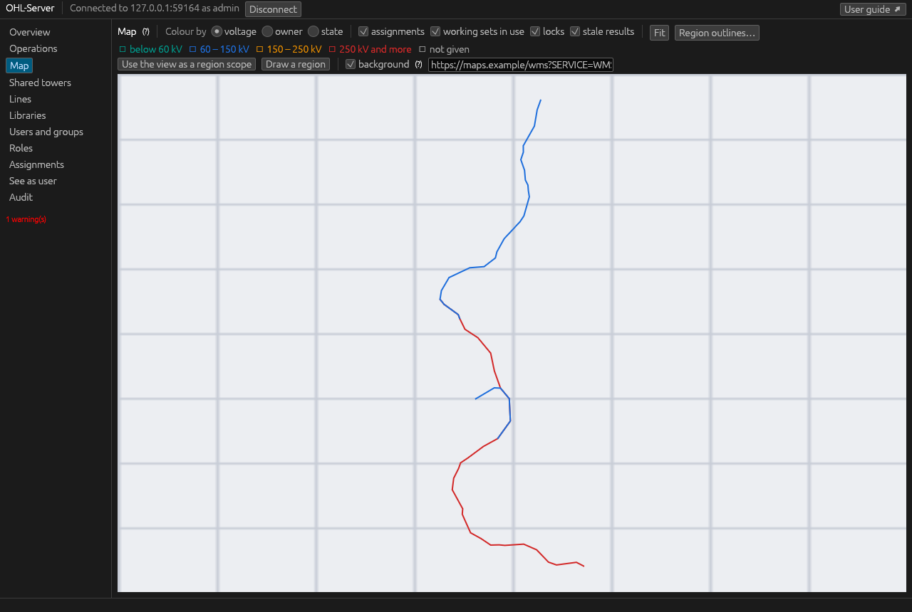 |

## Users and groups

Everyone the network knows: active or disabled, network admin,
connected, their groups. Network admins change them; others see the list
(to pick whom to assign).

1. **Invite a user…**: a name, a display name, the days the invitation
   is valid (90 by default). The user is added (no rights until
   assigned) and their personal invitation is shown **once** — pass it
   on by a safe way; anyone holding it signs in as that user.
2. **Reissue invitation**: a new one; every older invitation of that
   user is refused from now on, and they are let go if connected.
3. **Disable…** / **Enable…**: a disabled user has no rights at all and
   is let go.
4. **Groups**: add a group, add or take out members, delete a group
   (with its assignments).

Each change goes through [what changes](#what-changes) first.

### Identities

For a server with the organisation's identity provider (OIDC, `--oidc-*`):
each provider's subject signs in as the network user it is mapped to; a
subject mapped to nobody is refused. Network admins only.

1. Type the **Issuer** (exactly the server's `--oidc-issuer`) and the
   **Subject** (the ID token's `sub`), pick the **user**.
2. **Map…**, then [what changes](#what-changes) and **Save**.
3. **Unmap…** beside a row: that subject no longer signs in.

Both are in the audit (as `ohl network rights map-identity` /
`unmap-identity`).

## Roles

The permission matrix: rows the roles, columns the permissions (see,
edit, create, delete, review, export, lock, request, manage rights). The
**shipped** roles (viewer, designer, checker, library_maintainer,
line_admin, network_admin) are read-only; the network's own roles are
edited by network admins: tick, then **Save…** (what changes first).
**Add role…** makes a role that may see; **Delete…** removes an own
role (refused while an assignment names it).

## Assignments

Who holds which role where: a user or a group × a role × a scope, down
to a single object or library entry. Default deny: nothing is allowed
that no assignment gives. A **deny** is set by network admins only.

1. **Who**: a user or a group. **Role**. **Deny** (network admins).
   **Note** (kept with the assignment).
2. **Scope**: **Whole network** (network admins), or in the tree —
   network › line › route › structure (a route's structures are asked
   for when it is opened) — or in the **Libraries** list (kind › file ›
   entry), or from the map (a route, a structure, the view as a region).
   A line admin sees only their lines, a library maintainer only their
   libraries.
3. **Show what changes…**, then **Save**.

The list on the left shows the assignments whose scope you manage,
grouped by who holds them; a click shows one on the map, **Remove…**
takes it away (what changes first).

## What changes

Every rights change — an assignment given or removed, a membership, a
role's permissions, a user disabled — opens this window first. The
server works out, on a copy of the rights and without saving, **who
gains and who loses which permission on which scope**, counted ("1
user(s) gain 6 permission(s), 0 user(s) lose 0" for a designer given a
line), with notes (a change
that will be refused for your rights, a shipped role, nobody's rights
changing). **Save** is enabled once it is shown; the server's rights
function decides again when it is saved. **Escape** or **Cancel**:
nothing changes.

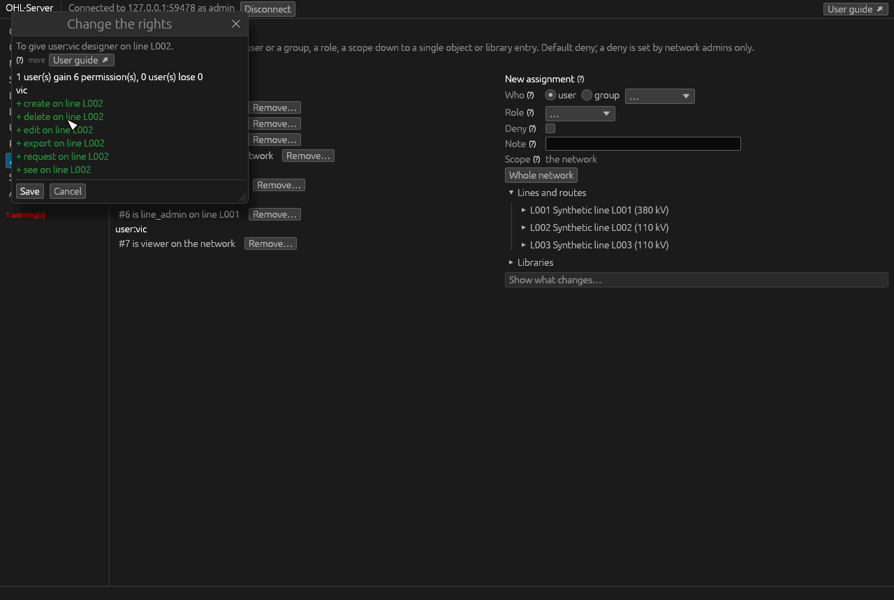

## See as user

What a user sees: the server's own filter, as both you and they may (an
admin learns nothing they may not see themselves): per line, whole or
not, and each kind's objects seen out of all, then the tree of each line
and the routes they see. **on the map** shows only the routes they see. Each look is in the audit.

### Explain

Why the user picked above may or may not do something (as `ohl network
rights explain`): pick the permission and the target — the network, a
line, or an object of it (its kind and id) — then **Explain**. The
answer names the assignments granting and denying it there (their
numbers, as on the Assignments page) and notes a user who is not active
or a permission that needs *see*. Only about what you may see yourself;
each question is in the audit.

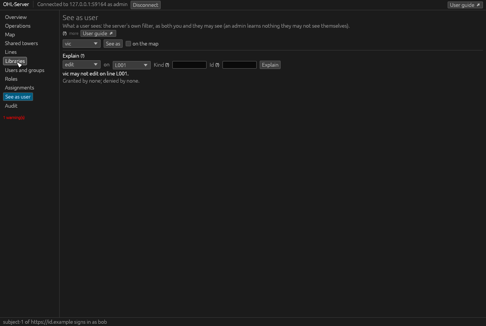

## Shared towers

Towers carrying two routes or more (phase 8), as the map marks them:
their line, their routes — a route whose results are out of date in red,
with why (a shared tower moved, a library updated…) — and, one at a
time, **who may edit** the tower (active users whose rights allow
editing it; shown to who manages rights on its line). **On the map**
centres the map on it. The first 5000 are listed; the count is always
whole.

**Twin towers**: pick a line and a distance (0.5 m, the import's), then
**Find twins**: its towers within that distance of another line's tower
of the same type — likely one tower in two models. They are **shown,
never merged** (twins stay as they are, the owner 2026-11-25). Only
towers you may see on both lines are listed.

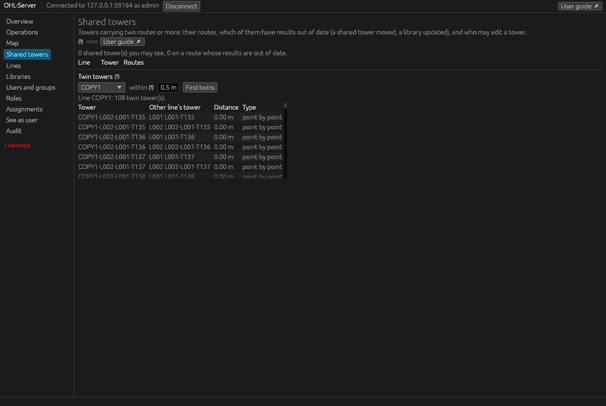

## Lines

The lines you may see: their routes, structures, sections and routes out
of date; *(part)* when you see only part of one.

**Export one** (needs *export* on the whole line, as `ohl network
export`):

1. **Export…** beside the line, and choose where to keep the file.
2. The server writes it on its exports' thread (one snapshot of the
   database: a change landing meanwhile is not in it), then the app
   fetches it in pieces of 512 KB (progress shown; written as `….part`
   until whole). The file opens in OHL-Design alone: the library files
   it uses stand in it.

**Import one** (network admins, as `ohl network import`):

1. **Import a line…**, and pick a project file (`.ohl`).
2. Give its **code** (the new line's; ids another line has are renamed
   `CODE-id`), a **name** (default: the file's line's name) and the
   twin distance; **Import**.
3. The file goes to the server in pieces (progress shown) into a folder
   of the server's own, then is imported as one new line: its current
   state (its history stays in the file), its users joined with their
   roles on it, twin towers listed — never merged. The report is shown
   (ids renamed, twin towers, what stayed in the file).

The file's users join the network with an assignment on the new line;
the server lets go every connection whose rights changed — yours too
when you are one of them: the app joins again at once and stays on the
Lines page with the report. The import runs on the server's authority
(it needs the network's writer): other users wait for it (a few seconds
for a synthetic line of a hundred structures).

A file held for a connection on the server (an export to fetch, an
upload to import) is removed when it is fetched, imported or cancelled,
and when the connection ends. Both are in the audit.

| Before | After: the import's report |
|---|---|
| 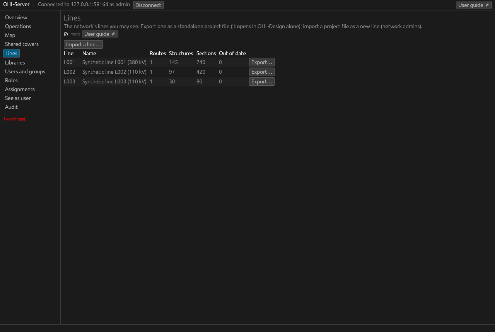 | 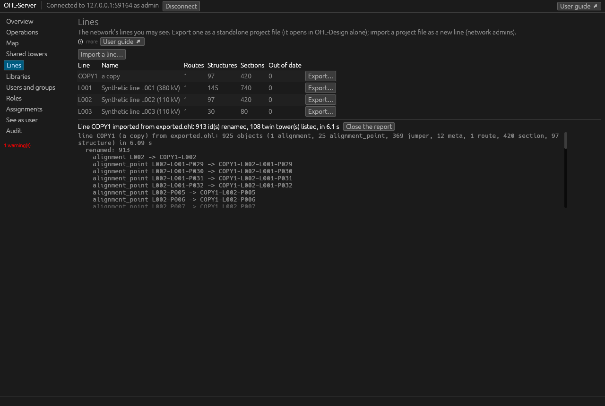 |

## Libraries

The network's libraries (phase 9), as you may see them:

- **Kinds**: each kind locked or not, its maintainers, its releases; its
  files and their entries (version, the release it first came in, or
  *not released*; withdrawn entries greyed). **Uses** beside an entry:
  where it is used (the use index: line, branch, object, its routes),
  only what you may see.
- **Requests**: yours and those of the libraries you maintain; their
  state, who asked, why, who decided and their note.
- **Which lines pin which release**: each line's pin per kind against
  the latest release (*n behind*), withdrawn entries it still uses;
  built lines stay pinned.

A maintainer of a kind (and a network admin) changes it — every change
in a window first, decided by the server (maintainers of the kind; a
grant by a maintainer who did not ask) and kept in the audit:

1. **Grant…** / **Refuse…** a request; a refusal **says why** (its
   requester is shown it).
2. **Release…**: the kind's head frozen under a tag; no line changes
   until its pins are updated.
3. **Withdraw…** / **Restore…** an entry: kept for who uses it, no new
   use.
4. **Lock…** / **Unlock…** a kind (unlocking: network admins).

**Update library pins…** beside a line shows **a proposal first**: per
kind from which release to which, the files and entries that change,
those the line uses, the routes that go out of date, the line's own
files kept, and whether you may carry it out. **Update the pins**
then moves them as one logged command of the line.

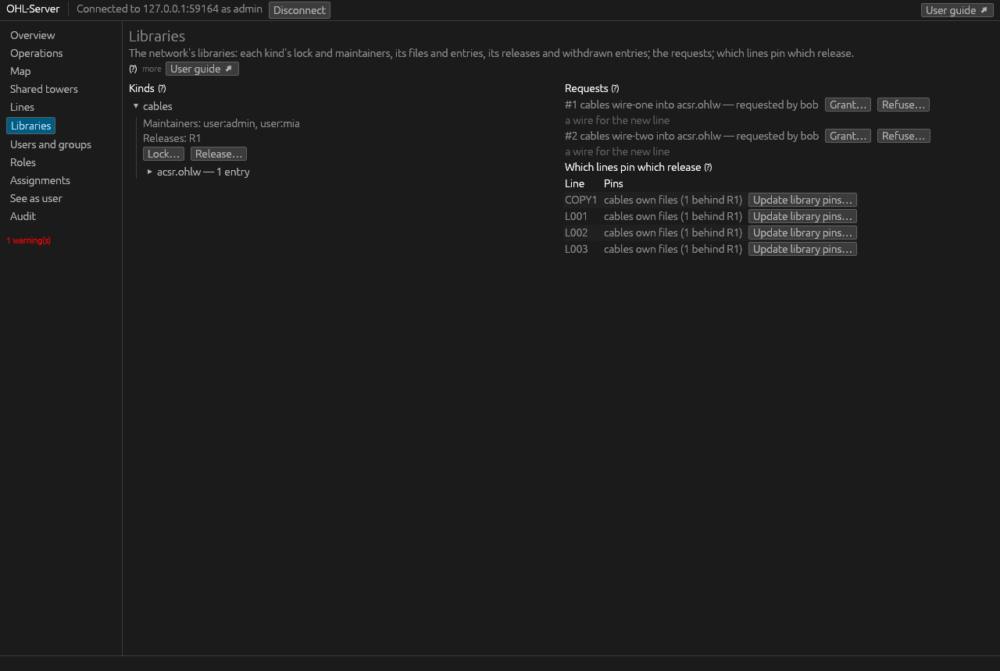

| A refusal says why | Update library pins: the proposal |
|---|---|
| 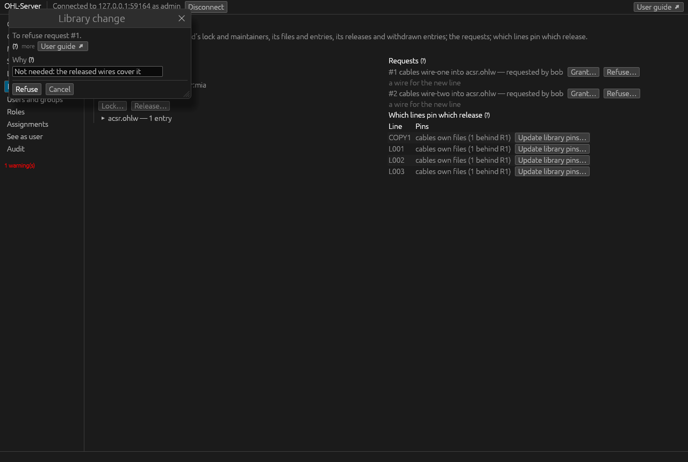 | 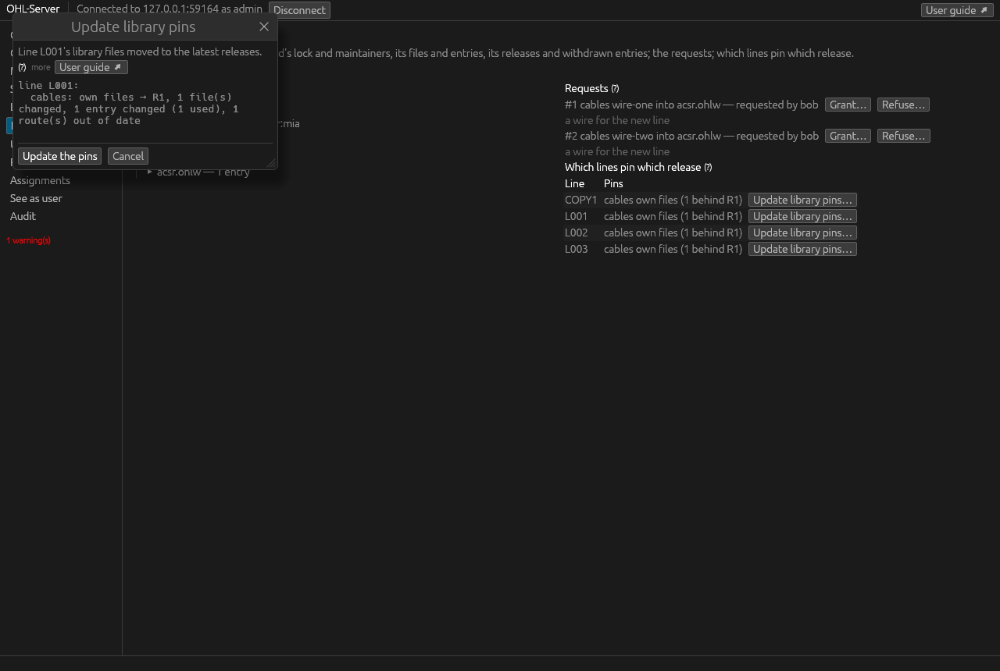 |

## Audit

The network's append-only audit (network admins): every rights change,
refusal, invitation, disconnection, backup, export, import, library
change, setting and "see as", **newest first**, 200 rows a page.

1. Filter by **Who** (the user, exactly), **What** (the action's start:
   `admin.`, `library.`, `refused`, `see_as`…), **Scope** (text in the
   target: `line L001`, `user:bob`, `cables`), **Text** (in the detail)
   and **From** / **Until** (UTC, `YYYY-MM-DD` or `YYYY-MM-DD HH:MM`; a
   day alone until its end); **Apply** (or Enter).
2. **Older** / **Newer** page through it.
3. **Export to CSV…** writes every row of the filter to a file of this
   computer (in pages of 1000; a field starting `=`, `+`, `-` or `@` is
   kept as text for spreadsheets).

Reading the audit changes nothing and is not itself audited.

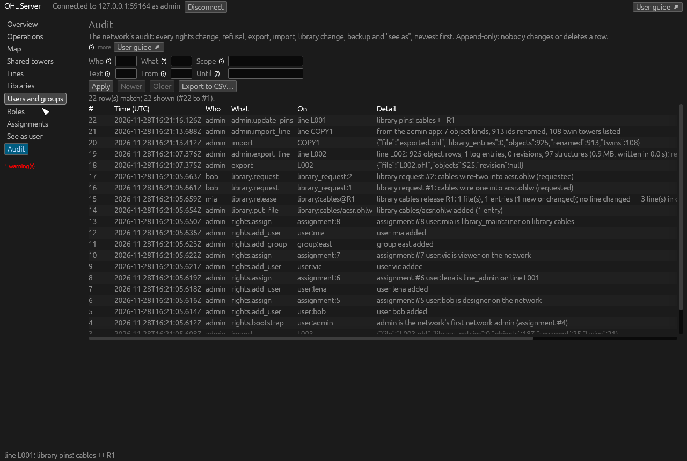

## Not built yet

Nothing of stages A–F is left out; the owner's questions on what was
built are in ROADMAP O17. Later: the map's background from tiles (one
image of the view today), the import off the authority (it needs the
writer).
