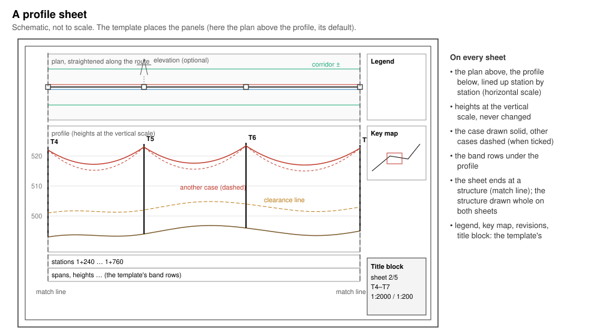
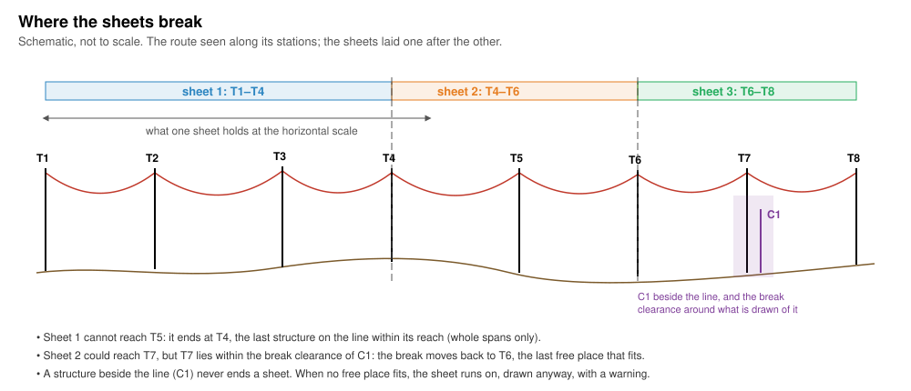
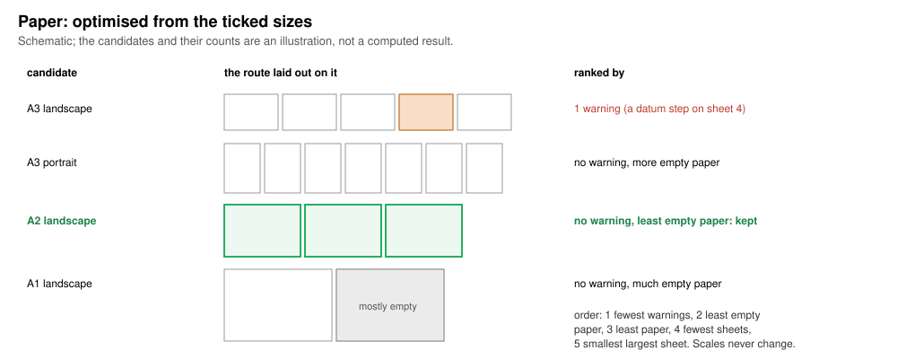

# Profile sheets

*Built, in active development (not approved yet).* **Plans & sheets ›
Profile sheets…** in OHL-Design. This page explains the window for a line
designer: what the sheets are for, how a route is cut into sheets, and
every setting. The window's **How it works: user guide ↗** button opens
this page. Everything the drawings hold in detail (structures, line
width, elevations, files, the profile CSV and XML):
[Drawings and profile exports](drawings.md); the template's every key:
[Sheet templates](sheet-templates.md); how the profile's height range is
chosen: [theory › Plan and profile drawings](../theory/drawings.md).

## What they are for

**How high do the wires hang over the ground along the route, span by
span, and where does each structure stand?** A profile sheet shows a
stretch of a route as **plan and profile**: the plan, straightened along
the route, above the profile, both at the same horizontal scale so they
line up station by station; the profile with the ground, the side ground,
the required-clearance line, the structures and the wires; under it the
template's **band rows** (stations, spans and what else the template
lists). A route is cut into as many sheets as it needs, each in the frame
and title block of the sheet template. The same window writes the
profile's numbers as CSV and XML.



*A profile sheet (schematic). The template places the panels; by default
the plan is above the profile.*

The sheets are for the export only: the Profile page stays one continuous
view along the route, without sheet breaks. **Show the export's sheets
over the profile and the plan** (in this window) shows where they would
break ([Sheet preview](drawings.md#sheet-preview)).

The route plan, the situation plans and the phase plan take this window's
weather cases, each with its own template and route
([Route plan](route-plan.md), [Plans](drawings.md#plans-route-plan-situation-plans-phase-plan)).

## How it works, step by step

### 1. The route and its weather cases

Each route chosen in **Route** is drawn on sheets of its own, in its own
files. The wires are drawn in the weather case of each circuit (**Weather
cases per circuit**, else the template's `[cases]`, else the case shown),
solid; with **the other solved weather cases too**, the others dashed. A
case not solved yet is solved while the window is open, and the export
waits for it.

### 2. How a route is cut into sheets



From the paper and the template, the export knows how many metres of
route one sheet holds at the **horizontal scale**. Starting at the
route's first structure (or at the station range's start), each sheet
takes **as many whole spans as fit** and ends at the last free place
within its reach; the next sheet starts there (a **match line**). A
sheet never ends in the middle of a span. A free place is:

- a structure **on the line** (on the alignment), or an alignment point
  without a structure;
- at least the **Sheet breaks** clearance on paper (2 mm by default)
  from what is drawn of every other structure.

A structure **beside the line** (a connection away from the alignment)
never ends a sheet. When the farthest place within reach is not free, the
break moves back to the last one that is. When none fits, the sheet runs
on to the next free place: it is drawn anyway, longer than its paper, and
the export warns. A span longer than the sheet is drawn anyway too, with a
warning.

### 3. The plan above the profile

The plan shows the line width (± m, **Line width**) either side of the
axis, straightened along the route: the axis, the corridor, the wires,
the structures, and, as asked, the project's drawings and orthophotos
under it, the isoclearance lines of the last vegetation check, and the
structures' **elevations**. Along the route it is at the horizontal
scale; across, at the same scale unless **Plan across** gives its own.

### 4. The profile and its heights

The profile panel takes the height left on the sheet. Its heights are at
the **vertical scale**, which is never changed. Its height range fits the
ground, the clearance line and the wires' lowest points; when the
structures' tops do not fit they are cut at the panel's top (warned);
when not even the ground and the wires fit, the **datum is stepped** at a
structure (warned). Details: [Sheets](drawings.md#sheets) and the
[theory](../theory/drawings.md#the-profiles-height-range-on-a-sheet).

### 5. The band rows, the sheet's ends and the furniture

Under the profile the template's band rows. A structure at a sheet's end
is drawn whole on both sheets. Around the panels the template's frame,
legend, key map, scale bars, north arrow, revision and stringing tables,
notes and title block, with this window's values (sheet *n*/*N*, the
first and last structure, the station range, the scales).

### 6. The paper



With a fixed paper every sheet is that size (landscape, or **portrait**).
With **optimised from the ticked sizes**, every ticked size in each
allowed orientation is laid out exactly as the export would, at the
scales set (never changed), and the layout kept per route is the one
with the fewest warnings, then the least empty paper in the panels, then
the least paper, then the fewest sheets, then the smallest largest sheet.
**different sizes allowed** lets a route's sheets take different sizes of
one standard; **same paper on every route** chooses one for all routes.
The export says which layout each route took. More in [Paper size and
orientation](drawings.md#paper-size-and-orientation).

### 7. The files

The drawing is written in the formats ticked, one set of files per route
([The files](#the-files)), into the folder chosen.

## The window, setting by setting

In the window's order. The settings are kept in the project per project
line (project setting `app.drawings.<line>`), except the route and the
folder ([In the desktop app](drawings.md#in-the-desktop-app)).

### The settings grid

| Setting | Default | What it changes in the drawing | Time |
|---|---|---|---|
| **How it works: user guide ↗** | — | Opens this page. | — |
| **Template** | the built-in template | The page, frame, title block, band rows, legend, key map and styles. A list (built in, the project's, the library folder's, a plugin's), **Load file…** (a `.ohlsheet` kept in the project) and **Save as file…**. A template that does not read is said under it. | — |
| **Route** | every route | *every route*, or one route: each route on sheets of its own. | one drawing per route |
| **Paper** | A3, split at structures | **one continuous drawing** (no sheets); **the template's: …, split at structures** (when the template gives a page); **optimised: size and orientation from the ticked sizes**; or a ticked size, **split at structures**. | optimised: one layout per candidate (longer than a fixed paper; not measured yet) |
| **portrait** (beside a fixed paper) | off | The sheets turned to portrait. Greyed for one continuous drawing. | — |
| with optimised: orientation | landscape or portrait | **landscape or portrait**, **landscape only**, **portrait only**: the orientations tried. | both: more candidates |
| with optimised: **different sizes allowed** | off | A route's sheets may take different sizes of one standard (e.g. A3 and A4), to use less paper. | more candidates |
| with optimised: **same paper on every route** | off | One paper for every route (only with *every route* and more than one route). | — |
| with optimised: **Compare sizes** / **Hide** | — | Lists every candidate for the first route drawn, best first. | lays out every candidate |
| **Paper sizes (n ticked)** (folded) | ISO A0–A4 | The sizes offered in the list and those the optimiser may choose from, by standard (ISO A with the long A sizes, ISO B, ANSI, ARCH). | — |
| **Scale** horizontal 1: / vertical 1: | 2000 / 200 (10 to 100 000) | Along the route (plan and profile) and the profile's heights; their ratio is the exaggeration. A larger horizontal number: more route per sheet, fewer sheets. | — |
| **Line width** ± m | 40 (1 to 2000) | How far either side of the axis the plan shows, and which structures beside the line and wires are drawn. The same setting as the Profile page's **line width ±**. Not where sheets end. | — |
| **Sheet breaks** mm | 2 (0 to 20) | The clearance on paper between a sheet break and what is drawn of every other structure (step 2). Larger: breaks move back more often. | — |
| **Stations** from … to … m | off (0 to 1000 when ticked) | Only this station range: the first sheet starts and the last ends at it. | fewer sheets |
| **Clearance line** | from the ground rule, when the project has one | **ground +** m: a line that far above the ground in the profile (typed, when not from a rule). With the project's ground rules: which rule (**the largest for each circuit**, or one by name) and **from the ground rule "…" (… m)**: its largest vertical distance over the line's voltages. | — |
| **Side profiles** | none | **+** adds a ground profile beside the axis (dashed in the profile) at an offset, right positive; **×** removes it. | — |
| **Plan across** **own scale 1:** | off | The plan across the line at its own scale (along it the horizontal scale stays, to line up with the profile). | — |
| **Logos** | none | **Add a logo…** (SVG, PNG, JPEG) into the title block, its width in mm (30 by default); **×** removes it. | — |
| **Elevations** | off | **off**, **above**, **below**: each structure seen along the line on the plan, a leader from where it stands; **base** mm from the line (10), **at** ° to the line (90: perpendicular). The plan panel grows to hold them. See [Elevations](drawings.md#elevations). | — |
| **PNG** dpi | 150 (30 to 600) | The PNG images' resolution (also the route plan's). | higher: larger images, longer |
| **Formats** | PDF | **SVG**, **DXF**, **PDF**, **PNG**, **CSV**, **XML** (each says what it writes on hover). | PNG: rendering each sheet |

### Below the grid (folded sections)

| Section | What it holds |
|---|---|
| **Values of the template (title block, band rows)** | The values of the template's fields; required ones marked `*` (the export says which are missing); a field per sheet takes **+ a sheet's value**. |
| **Weather cases per circuit (drawn, stringing tension)** | For each circuit (and the earth wires) the case its wires are **Drawn** in and the **Stringing** case (written by a `stringing` band row): a case's name, else the template's, else the case shown. |
| **Revisions (n)** (when the template has a revision table) | The rows: **Add a row**, **Add the last version commit**, × to delete. |
| **Versions of the line, roles** | **This line**: its role (*as it is*, or a role of the template, e.g. new, thick); **Add a project line…** draws another version of the line with it in a role, with its label. |
| **More of the template** | **corridor ±** m (default the template's); **profile side lines** (as the template says, the corridor's edges, at a distance from the axis, under the lowest arm — then **Circuits: n of m**); **LiDAR classes** (where the template draws LiDAR points); the project's drawings and orthophotos under the plan and under the key map; **lines below the lowest conductor (the project's ground rules)**; **the template's band rows** (on); **elevations at 1:**; **elevation labels** (number, type, height, vertical string length, heights to and between the arms, arm heights); **elevations as stick figures**. Each key in [Sheet templates](sheet-templates.md). |

### The ticks under them

| Setting | Default | What it changes |
|---|---|---|
| **Preview sheet**, **sheet n** | off, 1 | One sheet as the export draws it, in a window of its own (its route and sheet chosen there too). Drawn in the background once the settings stay unchanged for half a second. |
| **the profile alone (no plan)** | off | No plan panel; the files are named `…-profile`. |
| **the other solved weather cases too (dashed)** | off | The other solved cases' wires, dashed, each from its own solution. |
| **the violations of the last clearance check (n) as markers** | on (shown when there are any) | The violations of the last clearance check as markers. |
| **Show the export's sheets over the profile and the plan** | off | The [sheet preview](drawings.md#sheet-preview) over the views; nothing computed differently. |
| **Isoclearance lines of Checks › Vegetation** / **Leave them out** | shown after a vegetation run that computed them | The isoclearance lines on the plan (layer `OHL_ISOCLEARANCE`), or not. |

### Name, folder, Export

| Setting | Default | What it changes |
|---|---|---|
| **Name** | empty: *the route's name* | The name of the files in place of the route's. Several routes at once: each route's id follows the name. **×** clears it. Kept in the project. |
| **Folder** | none | **Choose…** the folder written into. The plan windows write here too when they have none of their own. |
| **Export** | — | Writes the files in the background with a progress window; the window stays open for the next export. What went wrong is written above it. 30 minutes per route at most (exit clause). |

## The files

For route `R` (`R-profile…` with the profile alone; a **Name** in place of
`R`):

| Format | One continuous drawing | Sheets |
|---|---|---|
| SVG, PNG, DXF | `R.svg`, `R.png`, `R.dxf` | `R-sheet-01.svg` … |
| PDF | `R.pdf` (one page) | `R.pdf`, a page per sheet |
| DXF model space | `R-plan-model.dxf` (not with the profile alone), `R-profile-model.dxf` | the same |
| CSV, XML | `R-profile.csv`, `R-profile.xml` | the same |

What each format holds: [Files](drawings.md#files).

## From the command line

`ohl drawing` solves the line as `ohl line` does and writes the same
sheets:

```bash
ohl drawing examples/synthetic-line/synthetic-line.ohl.json \
  --terrain examples/synthetic-line/synthetic-survey.csv \
  --weather examples/synthetic-line/weather-cases.ohlwc --clearance 7 \
  --route main --format pdf,dxf,csv --page A3 \
  --hscale 1:2000 --vscale 1:500 --from 0+100 --to 1+000 --out drawings
```

| In the window | Command line |
|---|---|
| Template, its values, revisions | `--sheet-template`, `--field`, `--fields`, `--revision` |
| Route | `--route ID` (repeatable; default every route) |
| Paper, portrait | `--page` (a size, `WIDTHxHEIGHT`, or `optimised`; none: one continuous drawing), `--orientation` |
| optimised: sizes, different sizes, same paper | `--paper-sizes`, `--mixed-sizes`, `--same-paper` |
| Scale | `--hscale`, `--vscale` |
| Line width | `--plan-width` (also `--line-width`) |
| Sheet breaks | `--break-clearance` |
| Stations | `--from`, `--to` |
| Clearance line | `--clearance`, `--rules` |
| Side profiles | `--side-offset` (repeatable) |
| Plan across | `--plan-scale` |
| Logos | `--logo FILE[:WIDTH_MM]` |
| Elevations | `--elevations`, `--elevation-offset`, `--elevation-rotation`, `--elevation-scale`, `--elevation-labels`, `--elevation-stick` |
| PNG | `--dpi` |
| Formats | `--format` (default `svg`) |
| Versions of the line, roles | `--version LINE=ROLE[:LABEL]`, `--role` |
| More of the template | `--corridor-width`, `--profile-lines`, `--profile-distance`, `--profile-circuits`, `--sheet-lidar-classes`, `--plan-drawings`, `--plan-orthophoto`, `--no-plan-backgrounds`, `--key-map-drawings`, `--key-map-orthophoto`, `--conductor-clearance`, `--no-bands` |
| the profile alone | `--profile-only` |
| Folder | `--out` |

Every option: [From the command line](drawings.md#from-the-command-line).
On the command line the weather cases are the template's `[cases]` (one
for the conductors, one for the earth wires, the stringing case), else
the first case given solid and the others dashed; there is no choice per
circuit as in **Weather cases per circuit**, no **Compare sizes**, no
**Name** and no preview.

## What is not there yet

- No DWG files (DXF R12 only, without line weights, true colours or
  images: the orthophotos and PNG/JPEG logos are left out of it, with a
  warning).
- No title block editor in the app: the template file is edited
  ([Sheet templates](sheet-templates.md)).
- PDF fonts are not embedded.
- The time the optimised paper and **Compare sizes** take is not measured
  yet.
- A sheet that runs on, a span longer than the sheet, a stepped datum or
  structure tops cut are drawn anyway and warned: change the scales or the
  paper.

Nothing on the sheets is a check: they draw the line as solved, with the
clearance line and the markers of the checks you ran. There is nothing on
or off the safe side in the drawing itself; the clearances it shows are
those of [the checks](vertical-clearances.md).
