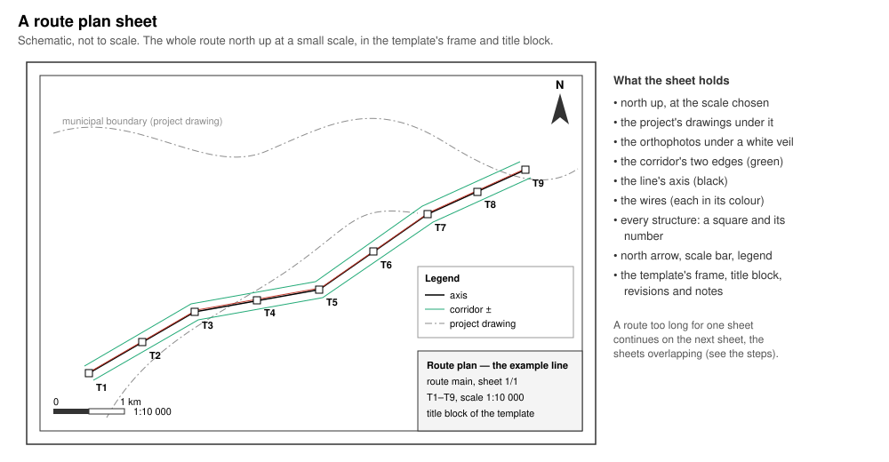
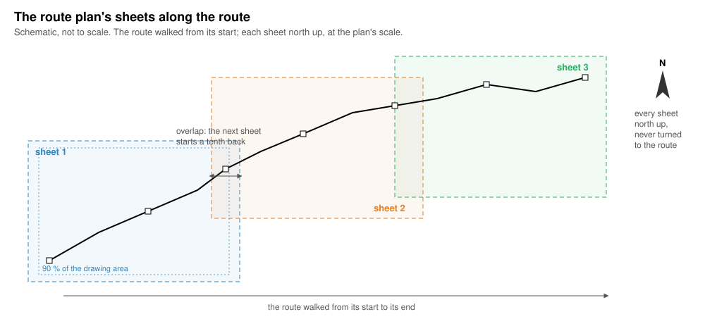
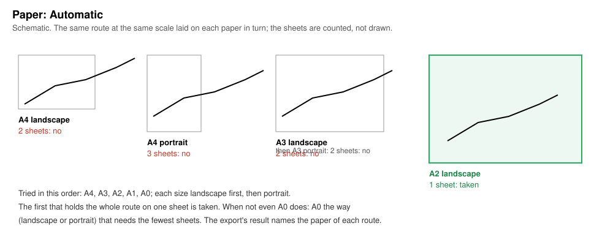

# Route plan

*Built, in active development (not approved yet).* **Plans & sheets ›
Route plan…** in OHL-Design. This page explains the window for a line
designer: what the drawing is for, how it is made, and every setting. The
window's **How it works: user guide ↗** button opens this page. The other
plans and the general rules of the drawings (formats, templates, files):
[Drawings and profile exports](drawings.md#plans-route-plan-situation-plans-phase-plan).

## What it is for

**Where does the line run, as a whole?** The route plan shows a route
from end to end **north up** at a small scale (1:5000 to 1:25 000,
1:10 000 by default), over the project's drawings (for example municipal
boundaries) and orthophotos: the line's axis, its wires, every structure
numbered, the corridor, a north arrow, a scale bar and a legend, in the
frame and title block of its own sheet template. It is the overview a
submission or a meeting starts from; the profile sheets and the situation
plans give the detail.



*A route plan sheet (schematic): north up, the template's frame and title
block around it.*

## How it works, step by step



### 1. The route and its weather cases

Each route chosen in **Route** is drawn as a plan of its own, in its own
files. The wires are drawn in the weather cases of the Profile sheets
window (**Weather cases per circuit**, else the template's `[cases]`, else
the case shown). A case not solved yet is solved while the window is
open; an **Export** asked meanwhile says *solving weather case … first*
and starts once it is.

### 2. The paper and the drawing area

The sheet template gives the frame, the title block and the room left for
the map (the drawing area). With **Paper: Automatic** the paper is chosen
per route first (step 3); with a fixed paper every sheet is that paper,
landscape.

### 3. The automatic paper



For each route, the papers A4, A3, A2, A1 and A0 are tried in that order,
each **landscape first, then portrait**. The first that holds the whole
route on **one sheet** at the scale chosen is taken. When not even A0
does, the route is drawn on A0 in the orientation that needs the
**fewest sheets**. The sheets are only counted, not drawn, so the choice
takes no time worth measuring. The export's result says which paper each
route took, for example:

- `route main: paper A2 portrait, the smallest that holds it on one sheet at 1:10 000`
- `route main: no paper up to A0 holds it on one sheet at 1:10 000: A0 portrait, 3 sheets`

### 4. The sheets along the route

The route is walked from its start. Each sheet takes as much of the
route's axis as fits within **90 %** of its drawing area at the scale (a
margin all round), and is centred on that stretch. The next sheet starts
**a tenth** of that stretch back, so neighbouring sheets overlap. Every
sheet is **north up**: it is never turned to follow the route, so a route
running north–south takes taller sheets or more of them. A route that
fits takes one sheet.

### 5. What is drawn on each sheet

Bottom to top: the orthophotos (under a white veil), the project's
drawings (their lines and texts, thin), the corridor's two edges, the
line's axis, the wires (each in its colour), and every structure as a
small square with its number. Then the template's parts: the north arrow,
the scale bar, the legend (the photo, each drawing, the corridor, the
axis), revisions and notes, and the title block with the sheet's number,
its first and last structure and the scale.

### 6. The files

The sheets are written in the formats ticked, one set of files per route
([The files](#the-files)), into the folder chosen.

## The window, setting by setting

In the window's order. Only the template, its values and the **Name** are
kept in the project (per project line, project setting
`app.plan_sheets.route.<line>`); the other settings stay for the session.

| Setting | Default | What it changes in the drawing | Time |
|---|---|---|---|
| **How it works: user guide ↗** | — | Opens this page. | — |
| **Template** | the Profile sheets window's template, the first time; then its own | The frame, title block, legend, north arrow, scale bar, pens and words of the route plan. A list (built in, the project's, the library folder's, a plugin's), **Load file…** (a `.ohlsheet` kept in the project) and **Save as file…**. See [Sheet templates](sheet-templates.md#which-drawing-uses-what). | — |
| **Route** | every route | *every route*, or one route. Each route drawn is a plan of its own, in its own files. | one plan per route |
| **Paper** | **Automatic** | **Automatic** (step 3), or a fixed **A0**, **A1**, **A2**, **A3** or **A4**, landscape. A fixed paper too small for the route gives more sheets. | Automatic: none worth measuring |
| **Scale** 1: | 10 000 (5000 to 25 000) | The map's scale. A larger number: the route smaller on paper, fewer sheets or a smaller automatic paper. | — |
| **Under it**: **the project's drawings** | on | The project's DXF drawings (Line › Terrain › Backgrounds) under the map, thin, in the legend by name. Off: none. | reading them |
| **Under it**: **orthophotos** | on | The project's orthophotos under the map, under a white veil (SVG, PDF and PNG; DXF holds no images). Off: none. | reading and resampling them |
| **Under it**: **the corridor** | on | The corridor's two edges along the axis. Their distance from the axis: the Profile sheets window's **corridor ±** (More of the template) when ticked, else the template's corridor width, else the Profile sheets window's **Line width**. Off: no corridor drawn — unless the template or the Profile sheets window gives a corridor width, which is drawn anyway. | — |
| **Formats** | PDF | **SVG**, **DXF**, **PDF**, **PNG** (each says what it writes on hover). At least one, else *tick a format*. | PNG: rendering each sheet |
| **Values of the template (title block)** (folded) | the template's defaults | The values of the template's fields (required ones marked `*`), as in the Profile sheets window. | — |
| **Revisions (n)** (folded; when the template has a revision table) | none | The rows of the revision table: **Add a row**, **Add the last version commit**, × to delete. | — |
| **Name** | empty: *route-plan, after the route* | The name of the files in place of the application's. Several routes at once: each route's id follows the name, so no file overwrites another. **×** clears it. | — |
| **Folder** | the Profile sheets window's folder | **Choose…** the folder written into. None chosen and none in the Profile sheets window: *choose a folder*. | — |
| **Export** | — | Writes the plans in the background, with a progress window; the window stays open. Greyed while an export runs. What went wrong is written above it. | 30 minutes per route at most (exit clause) |

The PNG resolution is the Profile sheets window's **PNG** dpi.

## The files

For route `R`, in the folder chosen:

| Format | Files |
|---|---|
| PDF | `R-route-plan.pdf`, a page per sheet |
| SVG, DXF, PNG | `R-route-plan-01.svg`, `-02.svg` … (one file per sheet) |

With a **Name**, for example `Submission 2026`: one route gives
`Submission_2026.pdf`; several routes give `Submission_2026-R.pdf` for
each. DXF (R12) holds no images: the orthophotos are left out of it.

## From the command line

`ohl drawing` writes the route plan beside the profile sheets with
`--plans route` and `--route-plan-scale` (1:5000 to 1:25 000, default
10 000); `--route ID` chooses the routes, `--format` the formats:

```bash
ohl drawing examples/synthetic-line/synthetic-line.ohl.json \
  --terrain examples/synthetic-line/synthetic-survey.csv \
  --weather examples/synthetic-line/weather-cases.ohlwc \
  --plans route --route-plan-scale 1:10000 --format pdf --page A3 --out plans
```

It writes `<route>-route-plan.pdf` (and the profile sheets, as without
`--plans`). On the command line:

- the paper is `--page`, else the sheet template's, else A3 — there is
  **no automatic paper** yet, and `--page optimised` gives A3 for the
  route plan;
- the route plan takes the sheets' template (`--sheet-template`), not one
  of its own;
- the project's drawings and orthophotos are drawn when the line is a
  project file that has them (`--backgrounds` names another); there is no
  option to leave them or the corridor out; the corridor is drawn at
  `--corridor-width`, else the template's width, else `--plan-width`.

## What is not there yet

- **The command line** has no automatic paper and no choice of what lies
  under the map (above).
- **Fixed papers** are offered landscape only, and only A0 to A4; the
  automatic choice also tries portrait.
- **The overlap** between sheets is fixed (a tenth of the stretch); the
  margin (90 % of the drawing area) too.
- **The sheets are fitted to the axis**: the corridor and the wires near a
  sheet's edge lie in its margin, and what reaches beyond the drawing area
  is cut at its edge.
- **The station range** of the Profile sheets window does not apply: the
  route plan always draws the whole route.
- Paper, scale, the ticks, the formats and the route are not kept in the
  project (only the template, its values and the name are).
- No links to public map services, no land use along the corridor.

Nothing on the route plan is computed: it draws the line as solved.
Nothing in it is a check, so there is nothing on or off the safe side.
