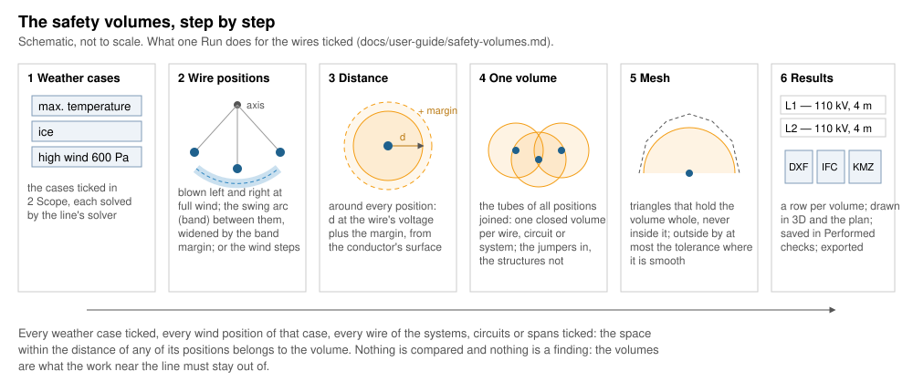

# Safety volumes

*Built, in active development (not approved yet).* **Checks › Safety
volumes…** in OHL-Design. This page explains the window for a line
designer: what it computes, how it works, every setting and every field.
The calculation in detail, with its sources and its checks by hand:
[theory › Safety volumes](../theory/safety-volumes.md).

## What it answers

**Where must work near the line stay out of?** A crane, a scaffold, a
tree being felled or a machine must keep a distance from the live wires.
The window builds, around the wires you choose, the space within that
distance of the wires **in every position they can take** in the weather
cases you tick: hanging in still air, blown to the left and to the
right, anywhere on their swing between, sagging more when hot or iced.
That space is a **safety volume**: one closed volume per wire, per
circuit or per electrical system.

Nothing is compared and nothing is "violated": the volumes are the
result. They are drawn in the 3D view and the plan, kept with the line
(Checks › Performed checks) and exported as georeferenced **DXF**,
**IFC** and **KML/KMZ** files for site plans, BIM models and maps.


*Across the span at mid-span: the wire's swing band and the safety
volume around it (the check by hand of the theory, to scale).*

## How it works, step by step



### 1. The weather cases

You tick the weather cases (temperature, ice, wind) that matter for the
work: typically the hottest case (the largest sag), an iced case and a
windy one. Each case is solved by the line's own solver, each section by
its own calculation unless **Wires by** says otherwise.

### 2. The wire positions

A windy case is taken blown to the left and to the right at its full
pressure. As you choose, also:

- the **swing arc**: every position between the two blowouts. The span
  is swung as one about the line through its attachments, as a band from
  the smallest to the largest radius of the solved positions, widened by
  the **band margin** (0.15 m). Each jumper gets a band of its own,
  widened by the **jumper band margin** (0 m unless you enter one).
- the **wind steps**: still air and every pressure from 0 up to the
  case's, in steps (50 Pa), each solved exactly; one solve per step and
  side.


*The swing band between the blowouts, widened by its margin.*

### 3. The distance around every position

Around every position the volume reaches the **distance** you entered,
plus the **margin**, measured from the conductor's surface (each
subconductor of a bundle, iced in a case with ice). The distance may
depend on the voltage: each wire takes the distance of its own
electrical system's nominal voltage, an earthed wire that at 0 kV. **No
distance is built in**: you type the one of the rules you work to, or
take a rule of a design-code plugin's preset.

### 4. One volume per wire, circuit or system

The tubes around all positions of a wire are joined into one closed
volume. Per circuit, its phases are one volume; per system, all circuits
of one electrical system are one (the wires without a system — earthed
wires — together in one named *(no system)*). Each wire keeps its own
distance in any grouping. The **jumpers** are part of the volumes, so a
volume is continuous at the structures; the structures themselves
(steel, insulators, fittings) are not.


*At a dead end: the jumper joins the two sections' volumes into one
piece.*

### 5. The mesh

Each volume becomes a closed mesh of triangles. The mesh **holds the
exact volume whole** — it is never inside it — and lies outside it by
at most the **tolerance** (0.05 m) where the volume is smooth; where two
tubes meet, its triangles bridge the groove between them, a little
farther out. The results give for each volume how far outside it lies at
most, measured.

### 6. The results, the views and the files

The Results tab lists one row per volume; a click turns the 3D view to
it. The volumes are drawn translucent in the 3D view (each in its
circuit's colour) and their outlines in the plan while the window is
open. **Save in Performed checks** keeps the run with the line; **Export
to a folder…** writes the files.

## The window, setting by setting

The Setup tab, top to bottom. The setup is kept in the project per
project line (project setting `app.safety_volumes`) and read again when
the project opens. Each section and field explains itself in its **(?)**
(on hover: a short line, then the longer text); only warnings — *NOT ON
THE SAFE SIDE* in warning colour —, what blocks **Run** or the export,
the solves a windy case needs and the coordinate system stay written
under the fields. Every **user guide ↗** opens this page at its section.

### 1 What it checks

The question in short, with **How it is computed** folded below it (the
method in a paragraph, the drawings of the distance around a conductor
and of the mesh outside the volume).

### 2 Scope

- **Weather cases**: tick any number; at least one (else *Before Run:
  tick a weather case*). The case shown in the views is ticked when the
  window first opens. More cases: more solves, a longer run, larger
  volumes where the cases differ.
- **Route**: with View › Work on route, only the systems, circuits and
  spans of that route are offered; what was ticked outside it is kept.

#### What is included

- **Scope by: Systems | Circuits | Spans** (default Circuits): the list
  below shows the line's systems (name and voltage; and a row *(no
  system)*: the earthed wires and any section without a system, at
  0 kV), circuits (name, system and voltage) or spans (section, span
  number from 1, the two structures, the length in plan). A search field,
  **All**, **None** and **Invert** act on the rows shown. All with nothing
  searched: every one, also those added later; none ticked: Run says to
  tick one. A span ticked brings every wire on it, a jumper when the spans
  at both its ends are ticked. Fewer wires: a shorter run.
- **One volume per: wire | circuit | system** (default wire): how the
  wires are grouped into closed volumes (step 4). The drawing beside it
  follows the choice. It changes the number of volumes and rows, not the
  space they cover.

### 3 Rules

#### Distance

- **from the conductors' surface**: the shared distance editor
  ([Distances by voltage](desktop-app.md#distances-by-voltage)) — **One
  distance**, a **Table by voltage** or **Base + per kV**, the distance
  at the line's voltages shown under it. Empty until you enter it (*Before
  Run: the distance: set the distance*). Larger: a larger volume, a
  little longer to mesh.
- **preset** and **rule**: a design-code plugin's preset and one of its
  rules, shown greyed (*preview — Apply to edit*); **Fill the distance**
  copies its radial distance (else its vertical one) into the editor.
- **No safety distance is built in** stays written under the editor.
- **Margin [m]** (default 0): added to the distance for every wire — the
  survey's accuracy, tools or loads swinging near the line.

The drawing beside it shows the largest distance at the line's voltages
and the margin around a conductor.

### 4 Wind

#### Wire positions

Out of the folded *Model* since 2026-11-12: the wind decides what the
volumes hold.

- **swing arc** (default **on**, since 2026-11-12, as the clearance
  windows start): also every position between the two blowouts (step 2).
  Three solves per windy case; a larger volume between the blowouts,
  never a smaller one. Off, with the wind steps off too, a windy case
  gives only its two full blowouts: the window says *NOT ON THE SAFE
  SIDE* under the wind, and the results say it too.
- **band margin** (m, with the swing arc, default 0.15): the band is
  widened by it. Smaller is less safe: below the default the window says
  so in warning colour, on your responsibility, with a button setting
  0.15 m again. A change marks a run with the arc *out of date*.
- **jumper band margin** (m, with the swing arc, default 0): the jumpers'
  bands' own widening. At 0 a jumper's band does not hold the jumper
  between its blowouts (up to 0.293 m outside on the example line):
  enter a value for your jumpers, or tick the wind steps. With the arc
  alone and 0 m the window says *NOT ON THE SAFE SIDE for the jumpers*
  under the wind, and the results say it too.
- **wind stepped** and **step** (Pa, default 50): also still air and every
  pressure up to the case's. Exact at the pressures solved; one solve per
  step and side — a fine step on a long line takes minutes (the window
  says how many solves a windy case needs, and suggests the arc when
  they are many).
- **from** (with the steps): both sides, the left or the right, looking
  ahead along the line.
The drawing shows the positions seen along a span.

### 5 Model (folded)

The modelling settings: their defaults are sound, open it to change
them.

- **Wires by**: how every wire is solved for the volumes (e.g. max sag,
  finite elements or ruling span); none chosen: each section's own
  calculation. A larger sag: a volume reaching lower; finite elements are
  slower.

#### Mesh

- **Tolerance [m]** (m, default 0.05, from 0.005 to 1): how far the mesh may
  lie outside the exact volume where it is smooth. Smaller: more
  triangles, a longer run, larger files; never a smaller volume.

### Export

**DXF + .prj**, **IFC4**, **KML**, **KMZ** (DXF, IFC and KMZ ticked by
default) and **Export to a folder…**: after a run, the formats ticked
are written into the folder chosen ([The files](#the-files)). Before a
run it says *Run first* in warning colour. The line under it names the
line's coordinate system, or says none is set (KML needs one: Properties
of the line, *CRS*). Also in the Results tab.

### The footer

- **Use local conditions**: the line with its structures' local wind for
  clearances and wire ice on their spans; said in the notes.
- Before **Run**, one line says what a run will build (the systems,
  circuits or spans ticked in how many cases, one volume per what) and
  about how long it takes, from the last run on this computer; or
  **Before Run: …** what keeps it from running (no weather case, nothing
  ticked, no distance).
- **Run** and **Stop**: the volumes are built in the background; Stop
  keeps the previous results.

### The results

- One line: how many volumes from how many wire positions, the weather
  cases, the distance and the wind.
- **NOT ON THE SAFE SIDE** notes, written in warning colour above the
  table (2026-11-12): the structures rigid in the wire solve (always);
  the windy cases at their full blowouts only (without the arc and the
  steps); the jumpers on their bands without a margin (the arc alone,
  jumper band margin 0 m, a line with jumpers).
- **Notes** (folded): the other notes — what was assumed and left out.
- The table, one row per volume: **Volume** (its name: circuit and phase,
  circuit or system), **Voltage**, **Distance [m]** (with the margin),
  **Triangles**, **Volume [m³]**, **Outside by ≤ [m]** (the most the mesh
  lies outside the exact volume, measured) and **Time [s]**. Sortable,
  **CSV** to save it. A row clicked selects the volume's first span and
  turns the 3D view to it.
- **Save in the library of performed checks as** (default *safety
  volumes*) and **Save in Performed checks**: the run with its settings
  and meshes, reopened from Checks › Performed checks (a run of more than
  2 million triangles is saved without its meshes: run it again to see
  and export them). A name in use asks to **Replace it**.
- When the line, its weather cases or the band margins change, the
  window says *out of date* with **Run again**, and the volumes are drawn
  dimmed.

## Every field

What the window keeps (in its setup `app.safety_volumes` and in a saved
run's parameters) and what `ohl safety-volume` takes:

| In the window | Saved as | Command line | Unit | Default | Meaning |
|---|---|---|---|---|---|
| Weather cases | `cases` | `--case` (repeatable) | names | the case shown | the cases solved |
| Scope by | `scope` | — | `systems`, `circuits`, `spans` | `circuits` | which list chooses the wires |
| Systems ticked | `systems` | `--system` (repeatable) | ids (`(no system)`) | all | the wires of these systems |
| Circuits ticked | `circuits` | `--circuit` (repeatable) | names | all | the wires of these circuits |
| Spans ticked | `spans` | `--span SECTION:N` (repeatable) | N from 1 | all | the wires on these spans |
| One volume per | `per` | `--per` | `wire`, `circuit`, `system` | `wire` | the grouping |
| Distance | `distance` | `--distance` (required) | m | none (to set) | `5`, `"5 m"`, `{ by_voltage = [[110, 3], [380, 5]] }` or `{ base = …, per_kv = …, above_kv = … }` |
| margin | `margin` | `--margin` | m | 0 | added to the distance |
| swing arc, wind stepped | `wind` | `--wind` | `none`, `steps`, `arc`, `both` | window `arc`; command line `none` | the positions between and below the full blowouts |
| step | `wind_step` | `--wind-step` | Pa | 50 | the pressure step |
| from | `wind_sides` | `--wind-sides` | `both`, `left`, `right` | `both` | the sides of the steps |
| band margin | `band_margin` | `--band-margin` | m | 0.15 | the swing band's widening |
| jumper band margin | `jumper_band_margin` | `--jumper-band-margin` | m | 0 | the jumpers' bands' widening |
| Wires by | `calculation` | — | e.g. `max-sag-fe` | each section's own | how every wire is solved |
| tolerance | `tolerance` | `--tolerance` | m | 0.05 | the most the mesh lies outside where smooth |
| Use local conditions | `local` (setup only) | — | — | off | the structures' local wind and ice |
| Formats | — | `--format` | `dxf`, `ifc`, `kml`, `kmz` | DXF, IFC, KMZ | the files written |
| Save as | the run's name | — | — | *safety volumes* | its name in Performed checks |
| — | — | `--crs` | `EPSG:<code>` | the line's | the coordinate system when the line has none |
| — | — | `--out`, `--name` | folder, stem | —, `safety-volume` | where the files go |
| — | — | `--time-limit` | s | 3600 | exit clause (an error, never a partial result) |

A saved run also records `loads_per` (ice and wind per stretched or
unstretched metre) and `version`; its results hold, per volume, the
name, circuit, phases, sections, voltage, distance, margin, positions,
triangles, volume, the measured "outside by at most" and the mesh.

## The files

Written in the line's coordinate system (Properties of the line, *CRS*);
each file carries the line, the distance, the wind and the date.

| file | contents |
|------|----------|
| `.dxf` + `.prj` | DXF R12: 3D faces (`3DFACE`), a layer `SAFETY_<volume>` per volume, in the line's coordinates; the `.prj` holds the coordinate system as WKT (EPSG systems) |
| `.ifc` | IFC4: one `IfcSpatialZone` per volume (object type `SafetyVolume`, referenced in the site), a closed triangulated face set, translucent; georeferenced by `IfcMapConversion` to an `IfcProjectedCRS` named by its EPSG code; property set `OHL_SafetyVolume` (line, circuit, phases, sections, voltage, distance, margin, rule, weather cases, wind, date, tolerance, volume) |
| `.kml`, `.kmz` | WGS84: each volume a placemark of triangles at absolute heights, with the same properties; needs the line's real coordinate system (EPSG) |

Heights in KML are the line's (above its height datum), **not corrected
to a geoid**: see the [theory](../theory/safety-volumes.md#the-files).

## What is conservative and what is not

On the safe side (theory, [The envelope](../theory/safety-volumes.md#the-envelope)
and [The mesh](../theory/safety-volumes.md#the-mesh)):

- the distance is measured from the conductor's surface; a bundle is
  taken as a circle about its centre holding all subconductors;
- the swing band holds every radius and every angle between the
  blowouts, widened by the band margin of 0.15 m;
- the mesh is never inside the exact volume (every radius carries 2 mm
  more, so that rounding in the files keeps it so); near the swing arcs
  each cell's triangles are grown by the largest error found in it,
  doubled; coarsening only ever moves the mesh outward;
- a mesh failing its final check (closed, no triangle inside the volume,
  every part held) is not used: the finer mesh is kept.

Not on the safe side, or not included:

Each of these is said in the results' notes (*NOT ON THE SAFE SIDE: …*,
written above the table and printed by the command line) whenever it
applies:

- **Without the swing arc and the wind steps** a windy case gives only
  its two full blowouts: the positions at lower pressures between still
  air and the blowouts are not in the volume. The window starts with the
  arc on; the command line's `--wind` still defaults to `none`.
- **Jumpers with the swing arc, without the wind steps, at a jumper band
  margin of 0 m**: a jumper can lie outside its band between its
  blowouts (up to 0.293 m on the example line). Enter a jumper band
  margin or tick the wind steps.
Not said in the results, explained in the theory:

- The swing arc is a **rigid swing** about the attachments (a
  simplification; the band margin covers it on the example lines).
- **The structures** (steel, insulators, fittings) are not part of the
  volumes. That they are rigid in the wire solve (a structure giving
  under the wires' pull lowers the sags) is said in every result.
- The **distance** is yours: no rule is built in, and nothing checks
  that it is the one your work needs.
- **KML heights** are not corrected to a geoid.

## Without the window

`ohl safety-volume` builds the same volumes from the command line and
writes the files. On the example line, 5 m around the wires in the high
wind case (about 40 s in a debug build):

```bash
ohl safety-volume synthetic-line.ohl.json --weather weather-cases.ohlwc \
    --case "high wind" --distance 5 --out volumes
```

It writes `volumes/safety-volume.dxf` and `.ifc`, one closed mesh per
circuit and phase, and says that it writes no `.prj` and no KMZ: the
example's coordinate system ("local (invented)") is not an EPSG one.
With every option, on a line in a real coordinate system:

```bash
ohl safety-volume line.ohl.json --weather cases.ohlwc --case "high wind" --case "max temperature" \
    --wind both --wind-step 100 --distance '{ by_voltage = [[0, 2], [110, 3], [380, 5]] }' \
    --margin 0.5 --per circuit --crs EPSG:2056 --out volumes --format dxf,ifc,kmz
```

The flags are in [Every field](#every-field). It prints the notes the
window folds. On the example line (two cases, wind stepped and swing arc,
4 m): three volumes of 23 000–48 000 triangles, about a minute and a half
(2026-10-21, a shared computer).
