# Sheet templates (.ohlsheet)

*Built 2026-10-20, in active development (not approved yet).*

A **sheet template** is a small text file that says everything about a drawing
that a company or an authority sets: the paper and its margins, the frame, the
order and size of the panels, the pens, the rows under the profile, the title
block, the revision table, the legend, the key map and more. What is computed —
the ground, the wires, the structures, where sheets end — stays the same whatever
the template.

A template serves the profile sheets and the route, situation and phase
plans alike, each drawing choosing its own (2026-11-08: the Profile sheets
window and each plan's window have their own **Template** row, chosen the
same way): the plans take its frame, title block, revision and stringing tables,
key map, notes, legend, scale bar, north arrow and pens as the sheets do; what only a
profile has (bands, panels, sag labels) they leave out. See [Which drawing uses
what](#which-drawing-uses-what).

Every drawing on this page was drawn by OpenOHL from a small template and the
invented example line (`tools/sheet_template_figures.py` makes them again), apart
from the sketches that show dimensions.

## Start from a copy

You rarely write a template from nothing:

1. Copy `libraries/sheet-templates/default.ohlsheet` (the built-in look: neutral
   colours, a title block across the bottom), or
   `examples/sheet-templates/example-a1.ohlsheet`, which uses **every key**, each
   explained in a comment, with invented values.
2. Change what you need. A table you leave out keeps its default.
3. In the app: Plans & sheets › Profile sheets… › **Load file…**. On the command line:
   `ohl drawing … --sheet-template my.ohlsheet`.

## A sheet at a glance


| No. | What you see | Set in |
|---|---|---|
| 1 | The margin, a wide one on the left for binding | [`[page]`](#the-page-and-the-frame) |
| 2 | The frame's lines | [`[frame]`](#the-page-and-the-frame) |
| 3, 4 | The plan and profile panels | [`[layout]`](#the-panels) |
| 5 | The rows under the profile | [`[[band]]`](#band-rows) |
| 6 | The structures' elevations | [`[elevations]`](#elevations) |
| 7 | The corridor's edges | [`[corridor]`](#the-corridors-sides-and-the-centreline) |
| 8 | North arrows | [`[north_arrow]`](#north-arrows) |
| 9 | The key map | [`[key_map]`](#the-key-map) |
| 10 | Graphic scales | [`[scale_bar]`](#graphic-scales) |
| 11 | The legend | [`[legend]`](#the-legend) |
| 12 | The revision table | [`[revisions]`](#the-revision-and-stringing-tables) |
| 13 | The title block | [`[title_block]`](#the-title-block) |
| 14 | A free note | [`[[note]]`](#notes) |
| 15 | The wires, by phase, [kind or role](#versions-of-the-line-kinds-and-roles); other pens by [layer](#pens-by-layer) | [`[line_styles]`, `[roles]`, `[layers]`](#versions-of-the-line-kinds-and-roles) |
| 16 | The station labels | [`[layout]`](#the-panels) |

Also available and off here: the [stringing table](#the-revision-and-stringing-tables),
[sag labels and lines below the lowest conductor](#lines-below-the-lowest-conductor),
[LiDAR points](#lidar-points) and [drawings and orthophotos under the
plan](#drawings-and-orthophotos-under-the-plan).

## Which drawing uses what

The three plans draw their content themselves (the line seen from above, or its
phases) and take the template's page furniture as the sheets do (2026-11-07). Two
things a plan always has: a north arrow and a scale bar (the phase plan, not to
scale, neither) — where the template places them and at its size and length, else in
the plan's corners. This table was checked by changing each part of a template and
comparing the files written (built, in active development, not approved yet).

| Part of the template | Plan-and-profile sheets | Route and situation plans | Phase plan |
|---|---|---|---|
| `[page]` format, orientation, margins | yes | yes | yes |
| `[frame]` | yes | yes | yes |
| `[title_block]` and its cells, `[[image]]` | yes | yes | yes |
| `[[field]]`, `[if_empty]` | yes | yes | yes |
| `[text] colour` | yes | yes | yes |
| `[layers]` | [the layers with lines](#pens-by-layer) | the layers with lines (corridor, centreline, wires, structures, legend, frame) | the layers with lines |
| `[legend.labels]` | yes | `axis`, `corridor_near`, `plan_route`, `plan_situation` | `phase_…`, `plan_phase` |
| `[revisions]`, `[stringing_table]`, `[key_map]`, `[[note]]` | yes | yes | yes |
| `[legend]` place and size | yes | yes (else their legend in the plan's lower left) | no (no legend entries: the circuits' table instead) |
| `[scale_bar]` | yes | place `"bottom"`: in the bottom row; the first of `lengths`; else the plan's lower left | no (not to scale) |
| `[north_arrow]` | yes | its `size` when placed; always drawn, top right | no |
| `[corridor]` | yes | `width` (else the drawings' line width) and `pen` | no |
| `[layout]`, `[[band]]`, `[sag_labels]`, `[elevations]` | yes | no (no profile) | no |
| `[centreline]`, `[line_styles]`, `[roles]`, `[conductor_clearance]`, `[lidar]` | yes | no | no |
| `[plan_background]` | yes | no: their own drawings and photo ticks | no |
| `[cases]` | yes | yes (the wires drawn) | no: the case shown |

**The route plan**


**A situation plan**


**The phase plan**


**One title block for every drawing.** In a template meant for the plans as well,
write:

- `{plan_kind}` for what the drawing is ("route plan", "phase plan" …; the words
  are yours, [`plan_sheets`, `plan_route` …](#the-templates-words));
- `{scales}` for the scale: each plan writes its own there, while `{hscale}` and
  `{vscale}` stay the sheets' scales;
- `{heading}` says what each drawing is: ": plan and profile" on the sheets,
  ": route plan", ": phase plan" … on the plans, in the same words as
  `{plan_kind}`.

How the plans are chosen and what they contain: [Plans](drawings.md#plans-route-plan-situation-plans-phase-plan).
Several drawings in one go, each with its own template: [Plan sets](drawings.md#plan-sets).

## Where templates come from

- **Built in**: `default`.
- **The project**: templates kept in the project line (Plans & sheets › Profile sheets… › **Load file…**), their images embedded: the project travels
  whole. Each project line has its own (they are library files of kind
  `sheet-templates`).
- **The library folder**: `libraries/sheet-templates/*.ohlsheet` (shipped,
  or a company's folder of that name next to the program).
- **Plugins**: a plugin's presets, from its `sheet-templates` export or
  from `.ohlsheet` files its manifest lists ([Writing
  plugins](../development/plugins.md#sheet-template-presets)). A
  coordinator writes an authority's preset this way; nothing in OpenOHL
  names an authority.

`ohl sheet-templates [--project FILE] [--plugin DIR] [--out DIR]` lists
them all (source, name, page, fields, `*` marking the required ones) and
with `--out` writes each as a `.ohlsheet` file with its images embedded.

## The file

TOML text, with these rules throughout:

- **Lengths on paper** carry their unit: `"10 mm"`, `"1 cm"`. A bare number is mm.
- **Lengths in the field** carry theirs too: `"100 m"`, `"1 km"`.
- **Colours** are `"#rrggbb"`.
- A **pen** is `{ width = "0.3 mm", colour = "#2a7f3f", dash = "6 1.5" }`, any of
  the three. A dash is its lengths on paper in mm, on and off in turn; `""` is
  solid.
- **Every table may be left out**: its defaults give the built-in look.
- **Unknown keys are refused**, and so is a placeholder that names no field, so a
  typing mistake is reported instead of being ignored.

| Top key | What it is |
|---|---|
| `format` | `"ohl-sheet-template"` |
| `version` | `1` |
| `name` | Its name in the lists; a [plan set](drawings.md#plan-sets) names a template by it |
| `description` | What it is for, shown in the lists |

## The page and the frame


**`[page]`: the paper**

| Key | Values | Default | What it does |
|---|---|---|---|
| `format` | A standard size (`A0`–`A4`, `A3x3` …, `B1`–`B4`, `ANSI D`, `ARCH E` …), `WIDTHxHEIGHT`, or `"optimised"` | The export's | The paper. The paper chosen for the export (`--page`, the window) goes over it |
| `orientation` | `"landscape"`, `"portrait"` | Landscape; with `"optimised"`, both allowed | Which way the sheet lies. With `"optimised"`, the only orientation allowed |
| `sizes` | A list of sizes | A0–A4 | With `"optimised"`: the sizes to choose from ([Paper size and orientation](drawings.md#paper-size-and-orientation)) |
| `mixed` | `true`, `false` | `false` | With `"optimised"`: different sizes of one standard on a route's sheets |
| `width`, `height` | Lengths | | A long format of your own, instead of `format` |
| `margin` | `{ left, top, right, bottom }` | 5 mm each | From the paper's edge to the frame. A wide left margin is the binding edge |

**`[frame]`: the lines around the sheet**

| Key | Values | Default | What it does |
|---|---|---|---|
| `border` | A list of `{ inset, width }` | One line, inset 0, 0.5 mm | Each line of the frame, `inset` inwards from the margin. Its colour comes from the layer `OHL_FRAME` |
| `padding` | A length | 5 mm | The room between the frame and everything inside it |

Everything around the panels — the title block, the revision table, the legend, the
key map, the scale bars, the notes — lies **inside the padding**.

**`[text]`: the texts**

| Key | Values | Default | What it does |
|---|---|---|---|
| `font` | `"Helvetica"` | `"Helvetica"` | The standard PDF font, the only one for now; SVG and PNG take a sans-serif font of the computer |
| `size` | A length | 2.5 mm | The size of the band rows' labels |
| `colour` | A colour | `#000000` | The title block, notes, legend and labels |

## The panels


**`[layout]`**

| Key | Values | Default | What it does |
|---|---|---|---|
| `order` | `["plan", "profile", "bands"]`, or with the plan last | Plan first | The panels from top to bottom; the bands stay right under the profile |
| `gap` | A length | 8 mm | Between the panels |
| `plan_height` | `"auto"` or a length | `"auto"` | The plan's height. `"auto"` fits the line width, the corridor and the elevations; a length is a minimum |
| `axis_room` | A length | 14 mm | Left of the panels, for the heights and the rows' labels. Widen it for long labels |
| `beyond_match` | `"none"`, `"faded"` | `"none"` | What is drawn past the match line |
| `station_labels` | `true`, `false` | `true` | The stations under the profile, or under the bands |
| `plan_title`, `profile_title` | Text | `"Plan"`, `"Profile"` | The panels' titles; `""` writes none |

The profile takes the height left over: the more the plan, the rows and the bottom
row use, the less it has.


`beyond_match = "faded"` draws the next sheet's content past the match line in 30 %
of its colour, to the paper's edge, so a reader sees how the line goes on:


**Where the other things go.** Several tables take a `place`, which puts them in one
of these spots:


The bottom row is filled from the frame's far edge towards the title block, in the
order drawn. When it is wider than the room there, the export says so on every sheet.

## Band rows

`[[band]]` adds a row under the profile; rows are drawn in the order you write them.
The drawing below uses every kind, each labelled with its own name:



| `kind` | What the row shows |
|---|---|
| `structures` | Each structure's entry, as `format` says |
| `stations` | The stations at the structures |
| `ground_height` | The ground's height at the structures and every `every` |
| `span_length` | Each span's length, between its structures |
| `structure_height` | Each structure's height |
| `line_angle` | The line's angle at the alignment's points, in degrees |
| `lowest_wire_height` | The height of the lowest wire in each span, in the solid case |
| `ground_clearance` | Per span, the least distance from the ground up to the ground clearance limit (the [one line for the whole line](#lines-below-the-lowest-conductor)), in red below 0, where the ground reaches above it. Without ground rules, a clearance check's values if given |
| `sag` | One line per circuit, the earth wires last: each span's sag in m, the largest of the circuit's wires, in the case each circuit is drawn in. As tall as its lines need |
| `stringing` | One line per circuit, the earth wires last: each tension section's horizontal tension in the stringing case, in kN per subconductor, the lowest and highest of its spans as a range, per phase where wires have phase labels (`380 kV …: L1 36.6–36.7, L2 38.4 kN`). As tall as its lines need, the same on every sheet of a route. No stringing case chosen: empty. Its words are `stringing` and `earth_wires` in [`[legend.labels]`](#the-templates-words) |
| `text` | A value you give per sheet (`field`) |

| Key | Values | Default | What it does |
|---|---|---|---|
| `kind` | One of the above | Required | What the row shows |
| `height` | A length | 8 mm | Its height; the minimum for `sag` and `stringing` |
| `label` | Text | Empty | Its name, left of the row, in [`axis_room`](#the-panels) |
| `every` | A length in the field | None | `ground_height`: also a value every this far |
| `field` | A field's key | | `text`: the [`[[field]]`](#fields) it shows |
| `decimals` | A number | 1 (`sag`: 2) | Decimals of its numbers |
| `format` | Text | `"{name} {type}"` | `structures`: what each entry says |

A `structures` row's `format` takes `{name}`, `{type}` (its type and extension),
`{type_id}`, `{extension}`, `{station}` and `{height}` (above its base). A line break
(`"{name}\n{type}"`) makes two lines. What a structure does not have is left out and
the spaces closed up.

All of it comes from what the drawing holds, with no new engineering number. The
export window and `--no-bands` switch the rows off.

## The title block

The title block is a grid. You give the widths of its columns and the heights of its
rows, then say what each cell holds and where it sits. **`at` is `[row, column]`,
counted from 0**, and `span` is how many rows and columns it covers.


The block above, written out:

```toml
[title_block]
corner = "bottom_right"
width = "150 mm"
columns = ["28 mm", "*", "24 mm", "34 mm"]
rows = ["14 mm", "6 mm", "6 mm", "6 mm"]
grid = true

[[title_block.cell]]
at = [0, 0]
image = "logo.svg"

[[title_block.cell]]
at = [0, 1]
span = [1, 3]                  # one row, three columns
text = "{plan_kind}\n{heading}"
size = "3 mm"
bold = true

[[title_block.cell]]
at = [1, 0]
text = "Route"
size = "2 mm"

[[title_block.cell]]
at = [1, 1]
text = "{route} — {route_name}"
size = "2.4 mm"
```

**`[title_block]`**

| Key | Values | Default | What it does |
|---|---|---|---|
| `corner` | `"bottom_right"`, `"bottom_left"` | `"bottom_right"` | Which corner it sits in |
| `width` | `"auto"` or a length | `"auto"` | `"auto"` runs across the whole frame |
| `columns` | A list of lengths, `"*"` or `"logos"` | One `"*"` | `"*"` shares the room left between such columns; `"logos"` is as wide as the logos given with the export |
| `rows` | A list of lengths | One of 32 mm | The rows' heights |
| `line` | A length | 0.4 mm | The outline's width |
| `grid` | `true`, `false` | `false` | Lines between the cells too; else the outline only |

**`[[title_block.cell]]`**

| Key | Values | Default | What it does |
|---|---|---|---|
| `at` | `[row, column]` | Required | Where it sits, from 0 |
| `span` | `[rows, columns]` | `[1, 1]` | How many it covers |
| `text` | Text with [fields](#fields) | Empty | Its text; `\n` breaks a line |
| `size` | A length | 3 mm | The text's size. A text too wide or tall for its cell is made smaller, down to 40 % |
| `bold` | `true`, `false` | `false` | Bold |
| `align` | `"left"`, `"centre"`, `"right"` | `"left"` | Across the cell |
| `image` | An image's name, or `"{logos}"` | None | An [`[[image]]`](#images), or the logos given with the export |

### Images

`[[image]]` declares the images that cells name:

| Key | Values | What it does |
|---|---|---|
| `name` | Text | The name cells use, e.g. `"logo.svg"` |
| `file` | A file name | Its file, next to the template |
| `data` | Base64 | Or its bytes, inside the template |
| `media_type` | `image/svg+xml`, `image/png`, `image/jpeg` | Its type; default from the name |

See [Images per format](#images-per-format) for how each export treats them.

## Fields

Texts take placeholders, `{name}` or `{name:format}`, filled in on each sheet.

**Computed for every sheet:**

| Field | What it holds | Example |
|---|---|---|
| `project`, `line` | The project, the project line | |
| `route`, `route_name` | The route's id and name | `main`, `Main route` |
| `heading` | The drawing's heading: the route, then what the drawing is | `Route main — Main route: plan and profile`; on a plan `… : route plan` |
| `title`, `title1`–`title3` | The title lines; `title` all of them | |
| `plan_kind` | What the drawing is, in the template's words | `route plan` |
| `revision` | The newest revision of the revision table, unless you give the field a value | `B` |
| `sheet`, `sheets` | This sheet's number, how many | `2`, `5` |
| `from`, `to` | The stations it covers | `0+640.0` |
| `from_structure`, `to_structure` | The structures it starts and ends at | `T3` |
| `ends` | The two together; nothing for a station range | `(T1 – T3)` |
| `hscale`, `vscale`, `plan_scale` | The sheets' scales | `2500` |
| `exaggeration` | Vertical over horizontal | `10` |
| `scales` | The scales in words; on a plan, its own scale | `1:5000` |
| `format`, `page_width`, `page_height` | The paper | `A2`, `594`, `420` |
| `date` | The export's date | |
| `cases` | The weather cases drawn | |
| `crs` | The coordinate system | |
| `height_datum` | The project's height datum (see below) | `LN02 (EPSG:5728)` |
| `program` | The program and its version | |

**Formats:**

| Written | Gives | For |
|---|---|---|
| `{sheet:03}` | `002` | Zero padded |
| `{hscale:.0}` | `2500` | Decimals |
| `{date:%d.%m.%Y}` | `07.11.2026` | Dates: `%d`, `%m`, `%Y` |
| `{from:km}` | `0+640.0` | Stations, the default |
| `{from:m}` | `640.0` | Stations as metres |

**Values you give: `[[field]]`.** They are asked for in the export window, or given
with `--field KEY=VALUE` (`KEY@SHEET=VALUE` for one sheet) or `--fields FILE.toml`
(`KEY = "value"`, `[per_sheet.KEY] 2 = "value"`, `[[revision]]`).

| Key | Values | Default | What it does |
|---|---|---|---|
| `key` | Text | Required | Used as `{key}` |
| `label` | Text | Empty | What the export window calls it |
| `default` | Text | Empty | Used when none is given |
| `required` | `true`, `false` | `false` | The export is refused while it is empty, naming the field, for the plans too. A draft copy of the template can untick it |
| `per_sheet` | `true`, `false` | `false` | One value per sheet |

**No empty gaps: `[if_empty]`.** A field that comes out empty is written as `[if_empty]`
says: by field (`height_datum = "heights above the survey's datum"`) or `"*"` for
every other. Without it: "unknown datum" (`height_datum`), "unknown coordinate system"
(`crs`) or "–". `ends` and `title`, `title1`–`title3` may say nothing and stay empty
unless `[if_empty]` names them.

`{height_datum}` is the project's height datum (Line › Terrain › Coordinate system ›
Define…; see [coordinate systems](coordinates.md#in-the-desktop-application-line--terrain--coordinate-system)),
else the vertical part of the coordinate system when it names one (`EPSG:2056+5728`
→ `EPSG:5728`, a proj4 `+geoidgrids=`).

## The legend

Made from what each sheet actually draws: it lists every pen, symbol and line type on
that sheet. Number 11 in the [drawing above](#a-sheet-at-a-glance).

| Key | Values | Default | What it does |
|---|---|---|---|
| `place` | `"above_title_block"`, `"bottom"`, `"off"` | `"off"` | [Where it goes](#the-panels) |
| `title` | Text | `"Legend"` | Its title |
| `width` | A length | The title block's, else 120 mm | Its width |
| `height` | A length | 30 mm | Its height. The entries flow in columns; those that do not fit are warned about |
| `column_width` | A length | 60 mm | A column of entries |
| `size` | A length | 2 mm | Its texts |
| `[legend.labels]` | Table | English | [The template's words](#the-templates-words) |

## North arrows

| Key | Values | Default | What it does |
|---|---|---|---|
| `place` | `"plan"`, `"off"` | `"off"` | One per straight stretch, at the plan's top edge |
| `size` | A length | 8 mm | Its length |

## Graphic scales

| Key | Values | Default | What it does |
|---|---|---|---|
| `place` | `"bottom"`, `"plan"`, `"profile"`, `"off"` | `"off"` | `"bottom"`: the bottom row, along and up. `"plan"`: the plan's lower left corner, along only. `"profile"`: the profile's upper left corner, along and up |
| `lengths` | `["100 m", "10 m"]` | Chosen from the scales | What each shows: along the line, and up. Chosen: round lengths of about 40 mm along and 20 mm up |

In the bottom row the scales have a box of 70 × 16 mm at least. It grows with the bars,
which are drawn at true scale: at 1:1000 a bar of `"100 m"` is 100 mm long and its box
120 mm wide, so the bar along the line ends before the bar up; a bar up taller than the
box makes it taller. A larger box leaves less room for the panels.

## The key map

A small plan of the route with this sheet's stretch marked, in the bottom row, north
up.


| Key | Values | Default | What it does |
|---|---|---|---|
| `place` | `"bottom"`, `"off"` | `"off"` | In the bottom row |
| `width`, `height` | Lengths | 60 mm, 30 mm | Its size |
| `scale` | A number (1:…) | Fitted | Its own scale |
| `extent` | `"route"`, `"sheet"` | `"route"` | The whole route, or a window around this sheet's stretch |
| `margin` | A length in the field | 0 | `extent = "sheet"`: how much wider the window is on every side |
| `structures` | `true`, `false` | `false` | The structures' names, thinned so that none touches another, the route, the sheet's box or the map's edge |
| `north_arrow` | `true`, `false` | `true` | A north arrow in its corner |
| `corridor` | `true`, `false` | `true` | The corridor's edges |
| `highlight` | A pen | | The sheet's stretch |
| `box` | A pen | The highlight's colour, 0.2 mm | The box around the sheet's stretch |
| `drawings` | `true`, `false` | `false` | The project's drawings under it. The export window's ticks and `--key-map-drawings` switch them |
| `orthophoto` | `true`, `false` | `false` | The project's orthophotos under it. Also `--key-map-orthophoto` |
| `veil` | 0 to 1 | 0.4 | A white veil over its orthophotos |

## The revision and stringing tables


**`[revisions]`** shows the last revisions. The heading sits at the bottom, next to
the title block, and the rows go up from it: **the newest at the top**, unused rows
empty above them.

| Key | Values | Default | What it does |
|---|---|---|---|
| `place` | `"above_title_block"`, `"off"` | `"off"` | [Where it goes](#the-panels) |
| `rows` | A number | 4 | How many of the last revisions |
| `row_height` | A length | 5 mm | A row's height |
| `size` | A length | 2 mm | Its texts. One too wide is made smaller, to 60 %, then shortened with "…" |
| `columns` | A list of `{ title, width, value }` | None | `value` takes `{rev.index}`, `{rev.date}`, `{rev.text}`, `{rev.by}`, `{rev.checked}` and the sheet's fields |

The rows are kept with the drawing settings, or given with
`--revision "A;2026-10-20;first issue;AB;CD"`.

**`[stringing_table]`** lists the tension sections on the sheet with their stringing
tension, the earth wires last.

| Key | Values | Default | What it does |
|---|---|---|---|
| `place` | `"bottom"`, `"above_title_block"`, `"off"` | `"off"` | [Where it goes](#the-panels); `"bottom"` comes after the key map |
| `rows` | A number | 8 | The room kept on every sheet. More rows than this: the last says how many are left out, with a warning |
| `row_height` | A length | 5 mm | A row's height |
| `size` | A length | 2 mm | Its texts |
| `columns` | A list of `{ title, width, value }` | None | `value` takes the fields below and the sheet's |

| Field | What it holds |
|---|---|
| `{st.from}`, `{st.to}` | The tension section's end structures, along the route |
| `{st.circuit}` | Its circuit; the earth wires: the `earth_wires` word |
| `{st.phase}` | Its phase label. **With this column, one row per section, circuit and phase.** Without it, one row per section and circuit, its phases' tensions in one cell (`L1 36.6, L2 37.2, L3 38.4`) |
| `{st.tension}` | kN, the lowest–highest of its spans |
| `{st.case}` | The stringing case ([`[cases]`](#weather-cases-cases) `stringing`) |

## Notes

`[[note]]` puts a free text anywhere on the sheet. A note follows the frame, unless
you tie it to the drawing:


| Key | Values | Default | What it does |
|---|---|---|---|
| `at` | `[x, y]` | Required | Where its first line starts, from the frame's left and top. **Negative: from the right and bottom** |
| `from` | `"frame"`, `"drawing"` | `"frame"` | `"drawing"`: `y` runs down from the drawing's lowest row (the bands' station labels, or the plan when it is below), so the note follows the drawing on every sheet |
| `width` | A length | 100 mm | Its lines are broken to this width, and at the padding |
| `size` | A length | 2 mm | Its text |
| `bold` | `true`, `false` | `false` | Bold |
| `text` | Text with [fields](#fields) | Required | The text |

A note lying over the title block, the revisions, the legend, the key map or the scale
bars is warned about: move its `at`.

## Weather cases (`[cases]`)

Since 2026-10-23 a template may give the weather cases the sheets draw and the
stringing tension's, by default:

```toml
[cases]
conductors = "80 °C"    # every circuit's phase conductors (the largest sag)
earth_wires = "10 °C"   # the earth wires
stringing = "10 °C"     # the stringing band's tension
```

Each is a weather case's name, or a temperature: the project's first case at that
temperature with no wind and no ice. None given: the case shown (the stringing band
empty). The export window's **Weather cases per circuit** chooses, per circuit (each
system, and the earth wires), the case drawn and the stringing case over these. Each
wire is drawn in its circuit's case, the jumpers in their circuit's (that of the
section at their first end). `ohl drawing` takes them among the cases given with
`--case` (one missing is an error naming it).

## The corridor's sides and the centreline


With a corridor and the ground, the profile also shows the **ground along both edges
of the corridor**. The **near side** is the one nearest a reader of the profile: by
default the **right**, looking along increasing stations, which is the plan's lower
edge and the side the profile is seen from when it lies under the plan. Each edge has
its own pen, the same in the plan, the key map and the profile, so each ground line
matches its edge; both are in the legend.

**`[corridor]`**

| Key | Values | Default | What it does |
|---|---|---|---|
| `width` | A length in the field | None: no corridor | The half width. The export window's tick and `--corridor-width` go over it |
| `label` | Text, `{width}` | None | Written at each edge in the plan |
| `pen` | A pen | | Both edges |
| `near_side` | `"right"`, `"left"` | `"right"` | Which side is the near one |
| `near`, `far` | Pens | | Each edge's pen, over `pen` |
| `profile` | `true`, `false` | `true` | The ground along both edges in the profile |

`--side-offset` still adds ground profiles at any offset.

**`[centreline]`**

| Key | Values | Default | What it does |
|---|---|---|---|
| `pen` | A pen | Grey, dash-dot | The axis in the plan |
| `ground` | `true`, `false` | `true` | The ground on the axis in the profile. Always drawn solid: a dash of its layer is ignored |

## Elevations

`[elevations]` draws each structure beside the line, seen along it, so its shape can be
read next to where it stands. How they are drawn: [Elevations](drawings.md#elevations).


| Key | Values | Default | What it does |
|---|---|---|---|
| `place` | `"above"`, `"below"`, `"off"` | The export's (off) | Which side of the line. Also `--elevations` |
| `offset` | A length | 10 mm | From the axis to the elevation's base |
| `rotation` | Degrees | 90 | The angle between the line and its height; 0 lays it along the line |
| `scale` | A number (1:…) | The horizontal scale | Its own scale |
| `labels` | A list of `number`, `type`, `height`, `string_length`, `dimensions`, `arm_heights` | None | Number, type and height above the top; a chain of heights on one side; a line per arm on the other |
| `size` | A length | | Its labels' size |
| `stick` | `true`, `false` | `false` | A schematic stick figure, even where members or a pole's outline exist |
| `pen` | A pen | | Its lines |

Their words are `elevation_dimension`, `elevation_arm` and `elevation_string` in
[`[legend.labels]`](#the-templates-words). The plan panel grows to hold them.

## Versions of the line, kinds and roles


Several versions of the line can be drawn on one sheet — the project line worked on and
other **project lines** (or line files on the command line) — each in a **role**:
`existing`, `project`, `removal`, `decommissioned`, `other`, or any role the template
defines. Each is solved in the same weather cases; its structures and wires near the
route (within the line width) are drawn along the route's centreline, in plan, profile
and elevations, on the layer `OHL_VERSIONS`, labelled (`{name}`, `{voltage}`) and listed
in the legend. The line's own role (`--role`, the window's **This line**) styles the
line itself (e.g. new thick, existing thin). Other lines nearby or crossing (a line file
given with `--version FILE=other`) are drawn the same way.

**`[line_styles]`** draws wires by **kind** instead of their phase colour:

| Key | Values | Default | What it does |
|---|---|---|---|
| `by_kind` | `true`, `false` | `false` | By kind instead of by phase colour |
| `low_voltage_up_to_kv` | A number | None | Systems up to this voltage are low voltage, above it high. None: every system with a voltage is high voltage. No system (earthed) is an earth wire |
| `kind_field` | `plugin.column` | None | A section's field naming its kind (`hv`, `lv`, `telecom`, `earth`), over the voltage |
| `construction_field` | `plugin.column` | None | A section's field: `cable` draws it dashed |
| `cable_dash` | A dash | | Cables' dash |
| `[line_styles.kinds.hv]`, `.lv`, `.telecom`, `.earth` | `colour`, `width`, `dash`, `label` | | Each kind's pen and its word in the legend |

**`[roles.<role>]`** styles a version in that role, over the kind's pen:

| Key | Values | What it does |
|---|---|---|
| `label` | Text | Its word in the legend |
| `width` | A length | Its wires' pen width (over the kind's, or 0.35 mm) |
| `weight` | A number | A factor on that width: 1.6 thicker, 0.6 thinner |
| `colour` | A colour | Its wires and structures, over the kind's or phase's |
| `dash` | A dash | Its wires' dash |
| `structure_colour` | A colour | Its structures (default `colour`, else dark grey) |
| `names` | `true`, `false` | Its structures' names drawn |
| `removed` | A role | What the project does not keep of this version is drawn in that role, the rest in this one |

`removed = "removal"` (e.g. on `existing`) splits a version into what stays and what
goes: a structure not within 1 m of one of the project's (in plan and at its top), or a
wire whose ends are not within 1 m of a project wire's in the same weather case, is drawn
as removal. The project is the line itself when its role is `project`, and the versions
in the role `project`. Another weather case's dash goes over a solid line.

## Lines below the lowest conductor


With `[conductor_clearance] show = true` (or the export window's tick,
`--conductor-clearance`) the profile carries, for each circuit, a line **parallel to its
lowest conductor, lowered by the ground clearance its rule requires**: the ground must
stay below it. The distance comes from the project's clearance rules for the ground
(`target = "ground"`, `vertical`; by the circuit's voltage: `by_voltage`, `base` /
`per_kv` / `above_kv`) — the rules of Checks › Ground clearances (a design code's preset
fills them in), else the rule file chosen; `--rules` / `--clearance` on the command line.
Its weather cases are the rule's (`cases`); a rule naming none takes the drawn case with
the largest sag, and the legend says so. A rule naming cases that are not drawn gives no
line and a warning. See [Plan and profile
drawings](../theory/drawings.md#lines-below-the-lowest-conductor).

**`[conductor_clearance]`**

| Key | Values | Default | What it does |
|---|---|---|---|
| `show` | `true`, `false` | `false` | Drawn |
| `circuits` | A list of names | Every circuit with a rule | The circuits drawn |
| `mode` | `"also"`, `"instead"` | `"also"` | As well as, or instead of, the line above the ground |
| `label` | Text: `{distance}`, `{rule}`, `{circuit}`, `{case}`, `{voltage}` | `{distance} m below the lowest conductor ({rule})` | Each line's label |
| `label_at` | `"auto"`, `"middle"`, `"start"`, `"end"` | `"auto"` | `"auto"`: clear of the structures, wires and ground |
| `envelope` | `true`, `false` | `false` | One line for the whole line: at each station the lowest of the circuits' lines, the limit the ground must stay under |
| `envelope_label` | Text: `{distance}`, `{rule}`, `{case}`: those of the circuits in it, each once | `ground clearance limit ({distance} m below the lowest conductors, {rule})` | Its label |
| `pen` | A pen | | The lines |

**`[sag_labels]`** writes the sag in each span under each circuit's lowest wire at
mid-span, in its drawn case. A label that would touch another goes under it.

| Key | Values | Default | What it does |
|---|---|---|---|
| `show` | `true`, `false` | `false` | Written |
| `circuits` | A list of names | Every one | By name; the `earth_wires` word for the earth wires |
| `label` | Text: `{sag}` (m, two decimals), `{circuit}` | `f = {sag} m` | The text |
| `size` | A length | 2 mm | Its size |
| `gap` | A length | 1.5 mm | Under the wire |

## LiDAR points

With `[lidar] profile = true` and/or `plan = true` the survey's LiDAR points of the
chosen classes within the corridor — else the line width — are drawn as dots on the layer
`OHL_LIDAR`, under everything else. The legend names each class by the class scheme (a
group by its `label`). The app draws the points it has loaded (the project's point
budget); `ohl drawing` reads them from `--lidar` or `--pointcloud` (the class scheme from
`--lidar-classes`, else the one stored with the points, else ASPRS).

| Key | Values | Default | What it does |
|---|---|---|---|
| `profile` | `true`, `false` | `false` | By station and height |
| `plan` | `true`, `false` | `false` | Seen from above |
| `classes` | `[2, 3, 5]` | None | The classes drawn. The export window's **LiDAR classes** and `--sheet-lidar-classes 2,3,5` choose others |
| `size` | A length | 0.25 mm | A dot's diameter |
| `cell` | A length | 0.2 mm | One dot per class in each square of this size on paper: this thins what is drawn, never a computed number |
| `[lidar.styles]` | `"2" = { colour, size, label }`, also `"3-5"` or `"3,4"` | The class scheme's colour | Each class's or group's look |

## Drawings and orthophotos under the plan

The project's backgrounds (Line › Terrain › Backgrounds: DXF drawings and orthophotos
kept in the project file) can be drawn under the plan, **straightened along the line**
like everything else there: a point at station *s* and offset *o* from the axis is drawn
at *s* along the sheet and *o* across it. They are display only; nothing computed depends
on them, and the sheet breaks do not move.


```toml
[plan_background]
drawings = true            # or ["cadastre", "survey"]; default false
texts = false              # the drawings' texts
points = false             # the drawings' points, as dots
own_colours = false        # else every line in `pen`'s colour
pen = { colour = "#8c8c8c", width = "0.13 mm" }
orthophoto = true          # or ["Orthophoto 2024"] (image layers); default false
veil = 0.6                 # white veil over the photo, 0 (none) to 1
dpi = 200                  # the photo's resolution on paper, 50 to 600
quality = 75               # its JPEG quality, 10 to 100
```

| Key | Default | What |
|---|---|---|
| `drawings` | `false` | the project's drawings: `true` every one, or a list of their names |
| `texts` | `false` | their texts, at their letter height on the ground (at the sheet's scale along the line; left out below 0.5 mm, at most 10 mm), written along the sheet (not turned) |
| `points` | `false` | their points, as dots of 0.5 mm |
| `own_colours` | `false` | each line in the drawing's own colour (white drawn black); else every one in `pen`'s colour |
| `pen` | 0.13 mm, `#8c8c8c` | the drawings' pen (with `own_colours`: its width and dash) |
| `orthophoto` | `false` | the project's orthophotos: `true` every image layer, or a list of layers; where several cover a point, the last (by layer and name) is drawn |
| `veil` | `0.6` | a white veil over the photo, so that the line stays readable: each colour mixed with that share of white |
| `dpi` | `200` | the photo's resolution on paper |
| `quality` | `75` | its JPEG quality |

**Drawings.** Their lines are taken within three times the line width (or the corridor's
half width, when wider) of the axis: each segment is cut into pieces of at most 2 m before
it is straightened, so a long straight line beside a bend follows the bend on paper, and
cut where it leaves that width. Lines on a layer switched off in the DXF are left out. On
each sheet they are clipped to the plan panel and drawn on the layer
`OHL_BACKGROUND_DRAWINGS` (SVG, DXF, PDF, PNG), under everything else; the legend lists
each drawing. Not in the plan's model-space DXF (the drawing itself is already in project
coordinates there).

**Orthophotos.** Each sheet's plan panel is filled pixel by pixel at `dpi`: every pixel's
station and offset is taken back to the ground (the centreline's segment at that station,
the offset along its normal) and the photo read there, at the coarsest level of its
pyramid that is not coarser than the pixel (bilinear between its pixels). The image is
veiled, written as one JPEG and drawn under everything else on the layer
`OHL_BACKGROUND_PHOTO`: embedded in SVG, as the JPEG itself in PDF, drawn in PNG. **DXF
R12 has no images**: the DXF sheets leave it out, with a comment in the file and a warning
of the export. An A1 plan panel of 800 × 150 mm at 200 dpi is about 15 million pixels; a
sheet's photo has at most 40 million (a lower resolution beyond). The sheet preview of the
export window draws it at 60 dpi.

**At bends.** The plan is straightened segment by segment, the backgrounds exactly like
the wires and the structures: on the outside of a bend a wedge of ground is not shown, on
the inside a wedge is shown twice — the wider the panel and the sharper the bend, the
larger. The axis and everything along it stay true.

The export window's **More of the template** ticks *the project's drawings under the plan*
and *the project's orthophotos under the plan* switch them on or off over the template
(on: the names the template lists, else every one; kept in the drawing settings). On the
command line: `--plan-drawings` and `--plan-orthophoto` (alone: the template's names, else
every one; or `--plan-drawings cadastre,survey`, `--plan-orthophoto "Orthophoto 2024"`),
`--no-plan-backgrounds`, `--plan-background-dpi 150`, and `--backgrounds FILE.ohl` for the
project file to read them from (default: the line's, when it is a project file). Hiding a
background in the views does not leave it out of the sheets.

## Pens by layer

`[layers]` sets the pen of everything on a layer, any of width, colour and dash:

```toml
[layers]
OHL_GROUND = { width = "0.4 mm", colour = "#6b3f12" }
OHL_GRID = { width = "0.1 mm", colour = "#d8d8d8" }
OHL_MATCH = { width = "0.3 mm", colour = "#0066cc", dash = "2 1" }
```

A more particular key goes over it: `[corridor] pen` over `OHL_CORRIDOR`, for example.
The same names are the layers of the DXF files and the `class` of the SVG files.

Pens act on lines. `OHL_TITLE`, `OHL_TITLE_FIELDS`, `OHL_TITLE_IMAGE`, `OHL_LOGO` and
`OHL_LABELS` hold only texts and images: they take no pen here, their look comes from
[`[title_block]`](#the-title-block) and [`[text]`](#the-page-and-the-frame).

| Layer | What is on it |
|---|---|
| `OHL_FRAME` | The frame's lines |
| `OHL_TITLE`, `OHL_TITLE_FIELDS`, `OHL_TITLE_IMAGE`, `OHL_LOGO` | The title block, its filled fields, its images, the logos |
| `OHL_PANELS`, `OHL_GRID`, `OHL_LABELS` | The panels' outlines, their grid, their labels |
| `OHL_CENTRELINE`, `OHL_CORRIDOR` | The axis in the plan, the corridor's edges |
| `OHL_GROUND`, `OHL_GROUND_SIDE` | The ground on the axis, the ground along the corridor's edges |
| `OHL_CLEARANCE`, `OHL_CONDUCTOR_CLEARANCE` | The line above the ground, the lines below the lowest conductor |
| `OHL_STRUCTURES`, `OHL_MEMBERS`, `OHL_ELEVATIONS` | Structures, their members and poles, their elevations |
| `OHL_WIRES`, `OHL_VERSIONS` | The wires, the other versions of the line |
| `OHL_ISOCLEARANCE`, `OHL_MARKERS`, `OHL_MATCH` | Isoclearance lines, violation markers, match lines |
| `OHL_BANDS`, `OHL_REVISIONS`, `OHL_STRINGING` | The band rows, the revision and stringing tables |
| `OHL_LEGEND`, `OHL_KEY_MAP` | The legend, the key map |
| `OHL_LIDAR`, `OHL_BACKGROUND_DRAWINGS`, `OHL_BACKGROUND_PHOTO` | LiDAR points, drawings and orthophotos under the plan |

## The template's words

Templates carry their own texts. Every entry the export puts in the legend has a kind, and
`[legend.labels]` gives its words (English without):

| Kind | Default | Placeholders |
|---|---|---|
| `axis` | axis of the line | |
| `corridor_near`, `corridor_far` | corridor edge, near (far) side ({side}) ±{width} m | `{side}` (right, left; on the route and situation plans ±), `{width}` |
| `weather_case` | weather case {case} | `{case}` |
| `structure`, `structure_role` | structure, structure ({role}) | `{role}` |
| `clearance_violation` | clearance violation | |
| `datum_step` | datum step (heights read on each side) | |
| `ground_cut` | ground cut, lowest {height} m | `height`; written in the profile where the ground is cut under a span over a deep valley |
| `ground` | ground on the axis | |
| `ground_side` | ground beside the axis | `{offset}` |
| `clearance_line` | ground + {distance} m (required clearance) | `{distance}` |
| `conductor_clearance` | lowest conductor of {circuit} ({voltage}) – {distance} m, rule "{rule}", {case}{note} | `{circuit}`, `{voltage}`, `{distance}`, `{rule}`, `{case}`, `{note}` |
| `conductor_clearance_note` | — the rule names no weather case: the case drawn with the largest sag, {case} | `{case}` |
| `match_line` | match line (sheet's end) | |
| `phase_circuits`, `phase_owner`, `phase_line_type`, `phase_circuit`, `phase_conductor`, `phase_number` | Circuits, Owner, Line type, Circuit name, Conductors, No. (the phase plan's table of circuits) | |
| `plan_sheets`, `plan_route`, `plan_situation`, `plan_phase` | plan and profile, route plan, situation plan, phase plan (the field `{plan_kind}`) | |
| `isoclearance` | isoclearance {level} | `{level}` |
| `lidar` | {name} (LiDAR class {class}) | `{name}`, `{class}` (a code or a group's key) |
| `version` | {label}: {words} | `{label}`, `{words}` |
| `background_drawing` | drawing {name} | `{name}` (the drawing's name) |
| `orthophoto` | orthophoto {name} | `{name}` (the image layers) |
| `elevation_string` | string {length} m | `{length}` (written at each elevation, not in the legend) |
| `elevation_arm` | {height} m | `{height}` (the same) |
| `elevation_dimension` | {length} m | `{length}` (the same) |
| `stringing` | {circuit}: {tension} kN | `{circuit}`, `{tension}` (the `stringing` band row) |
| `earth_wires` | earth wires | (the earth wires' name in the stringing band and table) |

The panels' titles are `[layout] plan_title` and `profile_title`; the wires' words come
from `[line_styles.kinds.*] label` and `[roles.*] label`, the corridor's plan label from
`[corridor] label`.

## Images per format

| Format | Logos and images |
|---|---|
| SVG | embedded |
| PNG | drawn |
| PDF | embedded as images (SVG drawn at about 300 dpi), cropped to what they cover |
| DXF R12 | SVG images as their **outlines** (layer `OHL_TITLE_IMAGE`); PNG and JPEG left out, said in the export's warnings (R12 has no images) |

The orthophoto under the plan: embedded in SVG (JPEG), the JPEG itself in PDF, drawn in
PNG, left out of DXF (said in the export's warnings).

## What is not there yet

- Only the PDF standard font Helvetica: embedding another font (a subset
  of an open font, on a template's request) is planned.
- No title block editor in the app: the file is the editor (Save as
  file…, edit, Load file…).
- No DXF 2000 with image references (PNG/JPEG logos and the plan's
  orthophoto in DXF).
- The drawings' texts under the plan are not turned with the drawing.
- On the route, situation and phase plans a template sets the frame, the
  title block and the words only ([Which drawing uses
  what](#which-drawing-uses-what)): the corridor's pen, the legend's place,
  the north arrow and the scale bar are the program's.
