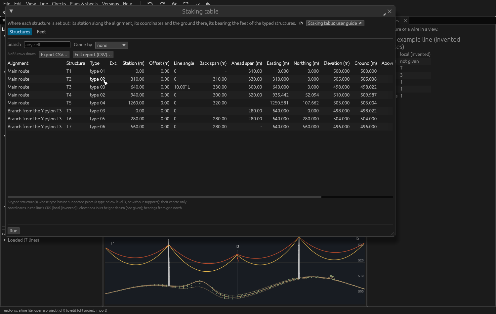
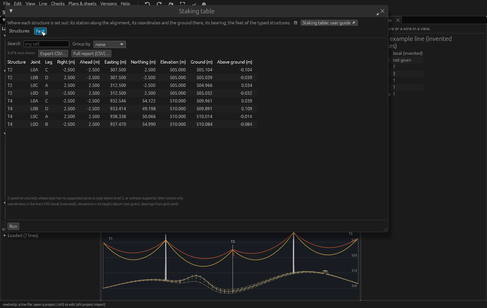

# Staking table

*Built 2026-11-14, in active development (not approved yet); owner: "can
you go ahead and make a staking table".* The staking table lists what a
survey crew needs to **set the structures out on site**: where each
structure stands along its alignment and in coordinates, the ground
there, which way it faces, and — for a lattice tower whose type is
modelled to its feet — where each foot goes. It is read from the line as
it is and the project's ground; nothing in the model changes. Implemented
in `crates/ohl-line/src/staking.rs` (`ohl_line::staking`), the window
`crates/ohl-app/src/staking.rs` and `ohl staking`.

## Opening it

1. Open the project (or a line file) with its structure library and,
   for the ground columns, a terrain surface (the project's active
   surface).
2. **Line › Structures › Staking table…**. It is computed at once, in the
   background. After edits, **Run** (bottom left) computes it again; a
   banner says when the line or the ground changed since.
3. Choose the **Structures** or the **Feet** tab. **Export CSV…** writes
   the rows shown; **Full report (CSV)…** writes every row with every
   field, as the command line does. **Search** filters the rows; **Group
   by** groups them (by alignment, for instance).

The **(?)** beside the window's first sentence explains every column;
**Staking table: user guide ↗** opens this page.



## Structures

One row per structure **and alignment**, alignment by alignment in
station order. A structure on two alignments (the Y pylon where a branch
leaves) is listed on both, with its station on each. Structures on no
alignment come last, without a station (the notes count them).

| Column | What it is |
|---|---|
| Alignment | The alignment's name; *(no alignment)* for a structure on none. |
| Structure, Type, Ext. | The structure, its type and its height extension (empty for an untyped structure). |
| Station (m) | The horizontal distance along the alignment to the structure's centre projected onto it. |
| Offset (m) | The horizontal distance of the centre from the alignment, **positive to the right looking ahead**. A structure standing on an alignment point has 0. |
| Line angle | The angle the line turns at the structure, between its back span and its ahead span in plan: **R** turning right, **L** turning left; 0 at the ends of the alignment and for a structure off the alignment's run (beside it: a connection, a termination). |
| Back span, Ahead span (m) | The horizontal distances to the structures before and after it along the alignment's run (empty at the ends, and for a structure off the run). |
| Easting, Northing, Elevation (m) | The structure's **centre at the ground as placed** — the point the structure is given at. |
| Ground (m) | The project's terrain surface under the centre; empty where there is no surface. |
| Above ground (m) | Elevation − Ground: 0 when the structure stands on the terrain; otherwise how far it was placed above (+) or below (−) it — worth checking before staking. |
| Height adj. (m) | How far the type's feet stand above that point: the foundations' reveal set on the structure. |
| Bearing (°) | The direction **ahead** along the line, degrees clockwise from grid north (0–360). The cross-arms are square to it; at an angle structure the structure is turned to the bisector, so the bearing is that of the bisector. |

## Feet



For every typed structure whose type is modelled to its feet — its
**supported joints** (detail level 3, [Structure libraries](structure-library.md#detail-levels))
— one row per foot, with the structure's extension applied: an
extension's own joints carry the feet, and a **leg extension** lowers its
leg ([Extensions and leg extensions](structure-library.md#extensions-and-leg-extensions)). A type without supported
joints (levels 1 and 2, a pole) gives the centre only; the notes count
those structures.

| Column | What it is |
|---|---|
| Structure, Joint | The structure and the joint of its type. |
| Leg | **A** right-ahead, **B** left-ahead, **C** left-back, **D** right-back — the quarters the leg extensions name; empty for a foot on an axis (a pole's). |
| Right, Ahead (m) | The foot's offset from the structure's centre in the structure's axes. |
| Easting, Northing, Elevation (m) | Where the foot is: the structure's centre, raised by its height adjustment, its type placed with its orientation and extension. |
| Ground (m) | The terrain under the foot. |
| Above ground (m) | Elevation − Ground: how far the foot stands above (+) or below (−) the ground there. On sloping ground the four feet differ: this is where leg extensions or foundation heights are chosen. |

## Coordinates and what is not included

- Coordinates are the **line's**, in its coordinate reference system, and
  elevations in its **height datum**; both are named in the notes. Bearings
  are from **grid north** of that system (not true or magnetic north).
- Distances are horizontal.
- **Not included**: guy anchors as such (a guyed type's anchor is listed
  where it is a supported joint of the type, without a separate label),
  foundation dimensions and excavation, offsets to reference stakes, and
  the structures of other project lines.

## Without the window: `ohl staking`

```bash
ohl staking examples/synthetic-line/synthetic-line-typed.ohl.json --terrain examples/synthetic-line/synthetic-survey.csv --csv staking.csv --feet-csv feet.csv
```

It prints both tables and the notes. The structure types come from
`--structures` (default: the `Structures` folder next to the line). The
ground comes from `--terrain` (a survey file) or `--surface` (a terrain
surface of the project); for a project without either, its surface of the
checks; else the ground columns stay empty and the command says so.
`--csv` writes the structures, `--feet-csv` the feet, `--json` the whole
table.

CSV columns — structures:
`alignment,structure,type,extension,station,offset,line_angle_deg,back_span,ahead_span,easting,northing,elevation,ground,above_ground,height_adjust,bearing_deg`
(the line angle signed, positive turning right); feet:
`structure,joint,leg,right,ahead,easting,northing,elevation,ground,above_ground`.
Empty: not there (no ground, no station).

*Validation:* `ohl-line` `staking::tests` (stations in order along each
alignment, a span the distance between the centres, the four feet of a
lattice tower in their quarters at their distance and height, the notes
without a library or ground; bearings and legs), the app's
`staking_table_window`.
