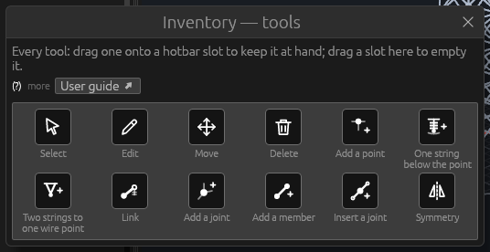
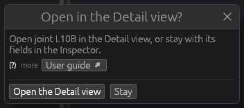
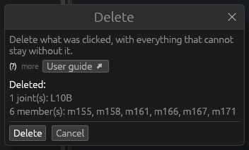
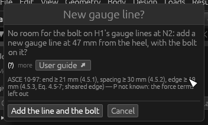

# OHL-Structure tools

*Built, in active development (not approved yet).* OHL-Structure, the
structure application, has a hotbar of tools at the bottom of its 3D
view, as OHL-Design does. This page explains how its tools are held and
used, and each tool: what it is for, how to use it, its options and what
to look out for — the 3D view's tools, then [the Detail view's
tools](#the-detail-views-tools) of a tower's joint. The window as a whole: [OHL-Structure, the structure
application](structure-app.md). OHL-Design's tools: [Tools](tools.md).

## Holding and using a tool

- **The hotbar**: nine slots at the bottom of the 3D view. A click on a
  slot or the keys **1–9** hold its tool; hover a slot for the tool's
  name, key and what a click does. An empty slot holds Select.
- **The strip above the view** names the tool held, its options (the
  snap grid, a string's length, the symmetry, where a joint is inserted),
  in grey what a click does, and a **User guide ↗** button opening this
  page at the tool. The Detail view's strip has the same.
- **Escape** lets go of the tool: Select is held again (with the Link
  tool, the point chosen is dropped first). Over the Detail view, Escape
  first goes back from a member to its joint. With a tool's window open
  (below) or the inventory, Escape closes that first.
- **The inventory** — **E**, the **E** button beside the slots, or
  **Edit › Tools › Tool inventory**: every tool. Drag one onto a slot,
  drag a slot onto another to swap them, drag a slot into the inventory
  (or right-click it) to empty it. The slots and the slot held are kept
  for the next start. **E** or **Escape** closes it.

**The tool windows.** A tool that asks something first opens a small
window (Delete, Edit's *Open in the Detail view?*, Add bolt's *New gauge
line?*). Each has the same shape as in OHL-Design ([The tool
windows](tools.md#the-tool-windows)): one plain sentence at the top with
a **(?)** for more and a **User guide ↗** button opening this page at
the tool; the window's action first in the button row, **Cancel** (or
**Stay**) last; **Escape** cancels; a deletion takes no Enter.
- **Edit › Tools** lists every tool by group — *Select and edit*,
  *Geometry*, *Body* — with its hotbar key; choosing one holds it.

With **Select**, **Move**, **Symmetry** and **Link** held, a click in
the view selects (Link: picks the point, then the joint); with the other
tools a click **acts** on what is under the pointer, or, on nothing,
where it meets the plane facing you through the structure's middle. A
drag turns the view (with Move held, a drag from a joint or point moves
it). A right-click opens the menu of what is under the pointer.

**Every change a tool makes is one undo step**: **Edit › Undo** (⌘Z;
Ctrl+Z on Windows and Linux) takes it back. The Geometry and Body menus
and panels have the same actions under the same names, on what is
selected.

**The default hotbar**, slots 1 to 9: Select, Edit, Move, Add a point,
One string below the point, Link, Add a joint, Add a member, Delete.
Two strings to one wire point, Insert a joint and Symmetry wait in the
inventory.

| Tool | Group | What a click does |
|---|---|---|
| [Select](#select) | Select and edit | selects (Shift + click: another) |
| [Edit](#edit) | Select and edit | opens where the object is edited (the Inspector; a tower's joint or member: the Detail view) |
| [Move](#move) | Select and edit | a drag moves a joint or point |
| [Delete](#delete) | Select and edit | deletes it with what goes with it, asked first |
| [Add a point](#add-a-point) | Geometry | an attachment point on the joint clicked, or at the top |
| [One string below the point](#one-string-below-the-point) | Geometry | a string below the point clicked |
| [Two strings to one wire point](#two-strings-to-one-wire-point) | Geometry | two strings from two points to one wire point |
| [Link](#link) | Geometry | links an attachment point to a joint |
| [Add a joint](#add-a-joint) | Body | a joint above the joint clicked, or where clicked |
| [Add a member](#add-a-member) | Body | a member between two joints clicked |
| [Insert a joint](#insert-a-joint) | Body | a joint inserted on the member clicked |
| [Symmetry](#symmetry) | Body | (the strip: the body's symmetry, Make symmetric) |

## Select

**What it is for.** Selecting joints, members, attachment points and
wire points, to see and edit them in the Inspector and the tables.

**How to use it**

1. Hold **Select** (slot 1, or Escape).
2. Click an object in the 3D view: it is selected (and its row in its
   table). **Shift + click** adds another, or takes it out again. A
   click on nothing clears the selection.
3. Drag to turn the view.

**Good to know.** Nothing moves with Select: joints and points move
only with the Move tool held.

## Edit

**What it is for.** Edit opens the place where the object clicked is
edited.

**How to use it**

1. Hold **Edit** (slot 2).
2. Click a joint, a member, an attachment point or a wire point:
   - it is selected, its fields are shown in the **Inspector** (brought
     to the front) and its row in its table;
   - on a **tower**, a joint or member first asks **Open … in the Detail
     view?** — **Open the Detail view** shows it there with its details
     on the left, **Stay** (or **Escape**) keeps to the Inspector. With
     the Detail view open already, it is shown there at once, not asked.

     

**Good to know.** Edit itself changes nothing: the change is made in the
Inspector, a table or the Detail view (each one undo step). See [Joint
details](structure-app.md#joint-details-towers).

## Move

**What it is for.** Moving a joint, an attachment point or a wire point
by dragging it in the 3D view.

**How to use it**

1. Hold **Move** (slot 3).
2. Drag a joint or point: it moves in the plane facing you, snapped to
   the grid or onto a joint near the pointer.
3. Release: the move is made.

**Options (the strip).** **snap**: the grid a dragged (or added) joint
or point snaps to, m (5 cm at first; 0: none).

**Good to know**

- Members are not dragged; a drag elsewhere turns the view; a click
  selects.
- An attachment point on a joint stays on its joint: dragging it
  changes its offset (see [Attachment points, joints and the Link
  tool](structure-app.md#attachment-points-joints-and-the-link-tool)). A
  joint moved takes its points along.
- With a symmetry set, a joint moved takes its mirror images along.
- **Undo**: one step per drag.

## Delete

**What it is for.** Deleting a joint, member or point with whatever
cannot stay without it.

**How to use it**

1. Hold **Delete** (slot 9).
2. Click the object. The **Delete** window lists it with everything that
   goes with it (a point: its strings).

   

3. **Delete** deletes them all; **Cancel**, **Escape** or the window's ×
   changes nothing. The window takes no Enter.

**Good to know**

- **Delete** or **Backspace** deletes everything selected the same way,
  asked first; **Delete…** in an object's right-click menu too.
- With a symmetry set, the mirror images go along.
- **Undo**: one step.

## Add a point

**What it is for.** Adding an **attachment point**, where strings hang.

**How to use it**

1. Hold **Add a point** (slot 4).
2. Click:
   - a **joint**: a point on it (it moves with the joint) — not on a
     support joint, since strings hang from attach joints (the message
     says so);
   - elsewhere: a point at the top of the stick figure, to be moved in
     the view or the Attachment points table.

**Good to know.** The new point is selected; the message line names it.
**Undo**: one step.

## One string below the point

**What it is for.** Hanging one string below a point, down to a new wire
point.

**How to use it**

1. Hold **One string below the point** (slot 5).
2. Set **string length** in the strip.
3. Click an attachment point (or a wire point): a string of that length
   hangs straight down from it to a new wire point.

**Options (the strip).** **string length**: the length of a new string,
m (4 m at first).

**Good to know.** The new wire point has **no set**: put its set in the
**Sets** table (the message says so). **Undo**: one step.

## Two strings to one wire point

**What it is for.** Two strings from two attachment points to one wire
point below their middle (a V).

**How to use it**

1. Hold **Two strings to one wire point** (from the inventory or Edit ›
   Tools).
2. Set **string length** in the strip.
3. Click the first attachment point, then the second: two strings go to
   one new wire point, the string length below the middle of the two
   points.

**Good to know.** As for one string, the new wire point has no set: put
it in the **Sets** table. A click on nothing between the two clicks
starts again. **Undo**: one step.

## Link

**What it is for.** Linking an attachment point to a joint, where the
point is: its distance from the joint is kept as its offset (a rigid
link, whose moment the analysis applies at the joint).

**How to use it**

1. Hold **Link** (slot 6; or **Link to a joint…** in a point's
   right-click menu).
2. Click an attachment point: the **attach joints** are ringed. The one
   under the pointer shows the offset's length and its moment arm.
3. Click a ringed joint: the point is linked to it.

**Keys.** A **right-click** or **Escape** drops the point chosen; a
second one lets go of the tool.

**Good to know**

- Only attach joints take a link; another joint under the pointer says
  *not an attach joint: set its kind to attach in OHL-Structure* (its
  kind is set in the Joints table).
- A point cannot be put on a member: [Insert a joint](#insert-a-joint)
  on the member first, then link the point.
- **Unlink** is in the point's menu (in the view or the Attachment
  points table) and in the Inspector.
- **Undo**: one step.

## Add a joint

**What it is for.** Adding a joint of the body.

**How to use it**

1. Hold **Add a joint** (slot 7).
2. Click:
   - a **joint**: a new joint 1 m above it;
   - elsewhere: a joint where you click, in the plane facing you through
     the structure's middle, snapped to the grid.

**Options (the strip).** **snap**: the grid, m (5 cm at first; 0:
none).

**Good to know.** With a symmetry set, its mirror images are added too.
The message gives the new joint's id and place. **Undo**: one step.

## Add a member

**What it is for.** Adding a member between two joints.

**How to use it**

1. Hold **Add a member** (slot 8).
2. Click the first joint, then the second: a member joins them.
3. The next member starts at the second joint: click the next joint to
   go on.

**Good to know.** With a symmetry set, its mirror images are added too.
A click on nothing starts again. **Undo**: one step per member.

## Insert a joint

**What it is for.** Inserting a joint on a member, so a point can be
linked there.

**How to use it**

1. Hold **Insert a joint** (from the inventory or Edit › Tools; or
   right-click a member: **Insert a joint**).
2. Set **at** in the strip.
3. Click a member: an **attach** joint is inserted at that fraction of
   its length from its first joint.

**Options (the strip).** **at**: the fraction of the member's length
from its first joint (0.5 at first).

**Good to know**

- The member is split there into two pieces that stay **continuous**
  (the same cross-section, kind and other fields; a rigid connection,
  not a hinge). The second piece is named `<id>-2`.
- Each piece keeps the whole member's buckling length (`lk`):
  **conservative**, as the joint braces nothing; set `lk` when it is
  braced.
- Then link a point to it with the [Link](#link) tool.
- **Undo**: one step.

## Symmetry

**What it is for.** Setting the body's symmetry, so joints and members
take their mirror images along when added, moved or deleted.

**How to use it**

1. Hold **Symmetry** (from the inventory or Edit › Tools; also Body ›
   Symmetry).
2. In the strip choose **none**, **x (left ↔ right)** (about the plane
   x = 0, left and right of the line), **y (ahead ↔ back)** (about
   y = 0) or **both**.
3. **Make symmetric** gives every joint and member the mirror images it
   lacks (greyed until a symmetry is chosen).

**Good to know.** A click in the view selects while Symmetry is held. A
joint on a mirror plane stays on it. Each change is one undo step. See
[The Body panels](structure-app.md#the-body-panels).

## The Detail view's tools

The Detail view of a tower's joint ([Joint
details](structure-app.md#joint-details-towers)) has its own tools: a
toolbar over the bottom of the drawing — click a slot to hold its tool —
and, above the drawing, the tool held with what a click does. **Rotate
member** acts in the close-up, the others in the face view and the member
view; a tool taken in the other view switches the joint to the view it
acts in. **Escape** goes back to Edit.

**Member end**, **Move bolt** and **Rotate member** pick before they
drag: a click picks the member end or the bolt under the pointer — the
end drawn blue, the bolt ringed blue, with a thin outline on what a click
would pick — and a drag moves only what is picked. A drag started on
something else picks that and moves nothing, so it is always clear what
a drag will change. Every change is one undo step.

### Edit in the Detail view

**What it is for.** Seeing and changing a bolt, a plate or a member of
the joint.

**How to use it**

1. Hold **Edit** (the toolbar's first slot; Escape holds it again).
2. Click:
   - a **bolt**: its properties at the top of the details below (its
     place, its kind, the library bolt's values, whether it keeps the
     code's distances), with the **bolt libraries** to change it (a
     member end's bolts are of one kind: the bolt chosen is that end's),
     **Bolt layout…** and **Remove this bolt**; it is ringed in the face
     view;
   - a **plate**: what it is welded to (its *Welded to* menu) and the
     welded plate it belongs to, its thickness, the leg it lies on, the
     members onto it, and its **Plate details / outline** ([A plate
     corrected by hand](structure-app.md#joint-details-towers));
   - a **member** (face view): the member in detail (**‹ Joint** or
     Escape: back). In the member view, a click beside the bolts opens
     that end's bolt layout form.

**Good to know.** Escape lets go of what was picked. Each change in the
details is one undo step.

### Add bolt

**What it is for.** Putting a bolt on a member's leg where the design
code's distances hold.

**How to use it**

1. Hold **Add bolt**.
2. Click on a member's bolted leg. The bolt is placed by the **design
   code of the capacity method** (ASCE 10-97: its minimum end distance,
   spacing and edge distance, 4.5): onto the nearest gauge line, at the place clicked or
   the nearest place along it that keeps the distances.
3. Where that line has no room near the click, the **New gauge line?**
   window opens (below). Where there is no room at all, the status bar
   says why.

**The window: New gauge line?**

It says which member at which joint has no room, the gauge of the new
line offered (mm from the heel; the nearest gauge that keeps the code's
distances, up to three lines) and why. **Add the line and the bolt**
writes both (one undo step); **Cancel** or **Escape** writes nothing.

**Good to know.** With the simple check (no design code) the bolt goes on
the nearest line, along to 5 mm. Bolts that break the code are drawn red,
the clause on hover.

### Move bolt

**What it is for.** Moving a bolt along the member (and across it in the
member view), or onto the angle's other leg.

**How to use it**

1. Hold **Move bolt**.
2. Click a bolt: it is picked (ringed blue).
3. Drag it: it moves and is placed as Add bolt places it — in the face
   view along the member only, in the member view along and across. With
   no room, the **New gauge line?** window is offered as for [Add
   bolt](#add-bolt).

**To the other leg.** While a bolt is picked, the button above the
drawing (or the key **L**) puts it on the angle's other leg, where it was
along the member and across from the heel: the end is then bolted by
**both** legs; the last bolt taken off a leg leaves it bolted by the
other alone. The bolt stays picked, so L takes it back. In the member
view the other leg is drawn **folded out below the heel**: a bolt dragged
across the heel line goes onto it, and Add bolt and Remove bolt work
there too (the code's distances are marked on the leg bolted only).

### Remove bolt

**What it is for.** Taking a bolt away.

**How to use it.** Hold **Remove bolt** and click a bolt: it goes (one
undo step).

### Member end

**What it is for.** Setting where a member's steel stops at the joint,
and shifting its end sideways so it fits.

**How to use it**

1. Hold **Member end**.
2. Click a member to pick its end (in the member view, a click on its
   half picks that end): drawn blue.
3. Drag it: along it, where its steel stops; across it (in the face
   view), its end's shift — its force then passes beside the work point,
   an eccentricity the analysis takes into account.

**Options (the strip above the drawing).** **step**: what a drag snaps
to (5 mm unless set; kept between runs).

### Rotate member

**What it is for.** Rolling a member about its own axis (the close-up).

**How to use it**

1. Hold **Rotate member**; the joint is shown in its close-up.
2. Click a member to pick it: its axis drawn blue, its **Roll** row above
   the drawing (degrees, quarter turns, Lay flat).
3. Drag it sideways: it rolls about its axis, half a degree a point,
   snapped to the tool's **step**; the member and its bolts are drawn
   turned as you drag (the plates and the other members follow once it is
   set). Let go: the roll is set (one undo step, the member's `roll`).

**Options (the strip).** **step**: 5° unless set (kept between runs).

**Good to know.** A drag on nothing turns the view.
