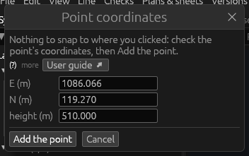
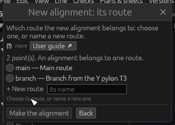
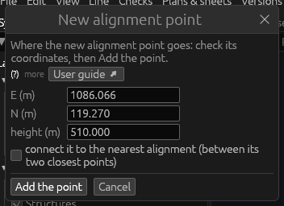

# Tools: Alignments

*Built, in active development (not approved yet).* The three tools of
the **Alignments** theme lay out where the line runs: **New alignment**
draws an alignment point by point, **Add alignment point** places a
single point, **Edit alignment** changes the course of an alignment
already there. This page explains each tool and its windows. A route is a
path of the line made of alignments; an alignment is the polyline through
alignment points along which the structures stand ([Glossary](glossary.md#the-line-and-its-route),
[Routes and alignments](desktop-app.md#routes-and-alignments)). The
tutorial lays out a first alignment step by step: [2. The route and the
alignment](../tutorial/02-route-and-alignment.md).

While an alignment tool is held, alignment points, structures and the
survey and LiDAR points shown can be clicked, whatever Edit › Snap says.
A click picks:

| Clicked | The point taken |
|---|---|
| an alignment point | that point, as it is (shared by both alignments: a junction) |
| a structure | a new point tied under the structure (it follows the structure) |
| a survey point or a LiDAR point shown | a new point at its exact E, N and height |
| anything else (the ground) | a new point, its coordinates asked for in a window |

## New alignment

**What it is for.** New alignment draws a new alignment through points
you click in order, then puts it on a route. It is in a new user's
hotbar (slot 9), and a new project holds it after its first steps.

**How to use it**

1. Hold **New alignment**.
2. Click the alignment's points in order, in the 3D view or a
   cross-section (the table above says what each click takes). The
   points laid out are joined by a draft line; the status bar counts
   them. On the ground, the **Point coordinates** window asks for the
   point first (below).
3. Press **Enter**: the **New alignment: its route** window opens.
4. Choose its route (or name a new one), then **Make the alignment**.

**Keys.** **Enter** ends the points and asks for the route.
**Backspace** takes the last point back. **Escape** gives every point up
(the tool stays held; in first person, the mouse stays captured — a
second Escape frees it).

**The Point coordinates window** opens when the click finds nothing to
snap to:

| Field | What it does |
|---|---|
| **E (m)**, **N (m)** | The point's easting and northing; where you clicked is offered. |
| **height (m)** | Its height; the ground's there is offered. |

All three are needed, as numbers (an apostrophe as thousands separator,
`2'600'000`, is read). Type other values to put the point elsewhere.
**Add the point** adds it; **Cancel** (or the window's ×) leaves it out.
This window takes no Enter: click **Add the point**.

**The route window** (*New alignment: its route*): an alignment belongs
to one route.

| Field | What it does |
|---|---|
| (the count) | How many points, and how many of them are existing points (shared). |
| the routes | One choice per route of the line. Chosen at first: the route you work on (View › Work on route), else the one route of the points it shares, else the line's only route. |
| **+ New route** | A new route's name. With no route yet, a name is proposed: a line is a route first, then its alignments. A name already taken says so. |

**Make the alignment** makes it on the route chosen; with a new route's
name typed the button reads **Create the route and the alignment** and
makes both. **Back** (or the window's ×) returns to laying out the
points, the points kept.

**Good to know**

- The alignment gets the next free id; its new points get ids of their
  own; its first point is selected afterwards.
- A point already on the new alignment cannot be clicked twice (the
  status bar says so).
- The first point of an empty line brings the 3D view and the plan to
  it.
- Opening a menu gives up the points being laid out.
- **Undo**: the route, the new points and the alignment are made in one
  step; Edit › Undo (⌘Z) takes them all back.

## Add alignment point

**What it is for.** Add alignment point places one alignment point: on
no alignment yet (to be used by New alignment later), or put into the
nearest alignment between its two closest points.

**How to use it**

1. Hold **Add alignment point** (from the inventory or Edit › Tools ›
   Alignments; or right-click a survey or LiDAR point: **Add alignment
   point here…**).
2. Click a survey or LiDAR point, a structure, or the ground. The **New
   alignment point** window opens.
3. Check the coordinates and the tick, then **Add the point**.

**The window**

| Field | What it does |
|---|---|
| **tied under *structure* (it follows it)** | Shown when a structure was clicked: the point sits under it and follows it. Untick it to type the coordinates. |
| **E (m)**, **N (m)**, **height (m)** | Where the point goes: those of what was clicked (on the ground, where you clicked and the ground's height). All three are needed. |
| **connect it to the nearest alignment (between its two closest points)** | Ticked: the point is put into the nearest alignment, between its two closest points. Unticked (the default): it is on no alignment yet. |

**Add the point** adds it and selects it; **Cancel** leaves it out. The
window takes no Enter.

**Good to know**

- A click on an existing alignment point adds nothing: the status bar
  says there is an alignment point there already.
- Points on no alignment are drawn too and can be picked one after
  another by New alignment, as String wire picks strings.
- **Undo**: one step.

## Edit alignment

**What it is for.** Edit alignment changes the course of an alignment:
it replaces the stretch between two of its points by new points, extends
it from one of its ends, or branches a new alignment from a point in its
middle.

**How to use it**

1. Hold **Edit alignment** (from the inventory or Edit › Tools ›
   Alignments).
2. Click a point **of the alignment** to start from. (A click elsewhere
   first says *click a point of an alignment first*.)
3. Click the new points in order — taken as for New alignment; an
   existing point is shared; on the ground the **Point coordinates**
   window asks for the point.
4. Finish:
   - click **another point of the same alignment**: the points between
     the two are replaced by the new ones;
   - or, having started from its **first or last point**, press
     **Enter**: the new points are added there, before its first or
     after its last;
   - or, having started from a point **in its middle**, press **Enter**:
     an alignment has two ends only, so the points make a **new
     alignment** from that point, and the route window opens as for New
     alignment.

**Keys.** **Enter** finishes at an end (or branches). **Backspace**
takes the last point back. **Escape** gives the new points up.

**Good to know**

- The points taken off the alignment are not deleted: they stay, on no
  alignment unless on another.
- Structures already placed stay where they are when the alignment
  changes; **Put it on the line again** in a structure's Placement…
  window turns one back onto the line.
- **Undo**: the whole change is one step.
