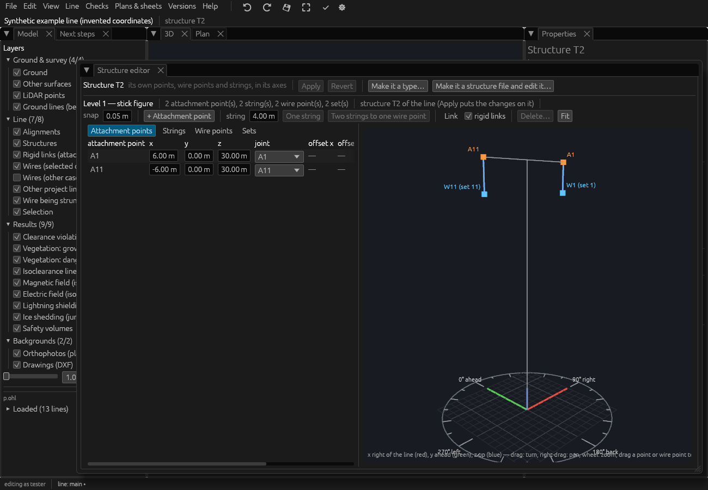
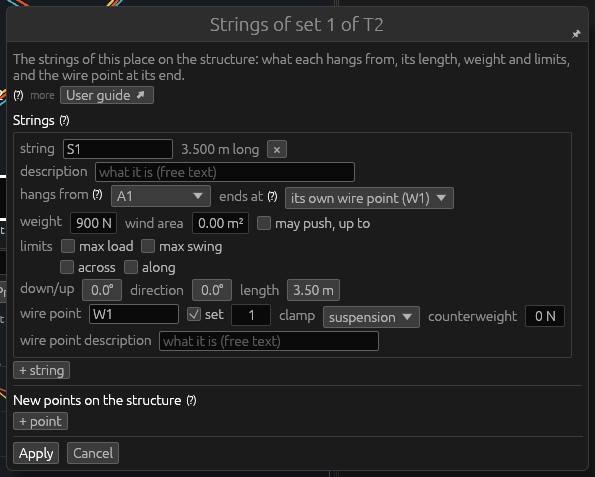
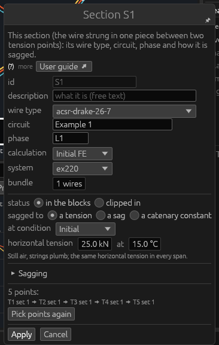
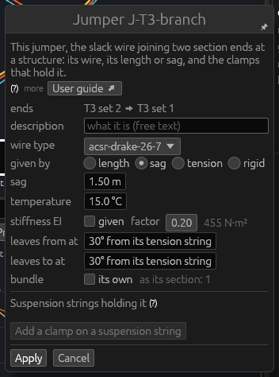
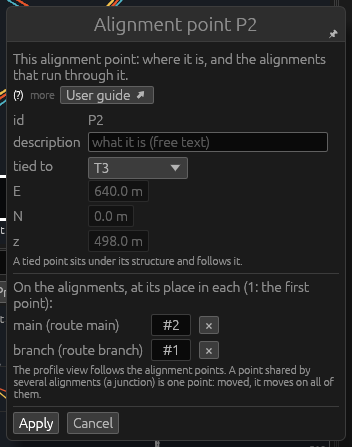
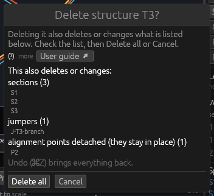
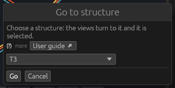

# Tools: General

*Built, in active development (not approved yet).* The four tools of the
**General** theme work on any object: **Select** it, **Edit** it,
**Delete** it, or **Go to** a structure. This page explains each tool,
the windows it opens and every field in them. How tools are held and
what every tool window shares: [Tools](tools.md).

## Select

**What it is for.** Select is the tool you hold by default: a click
selects an object, and its values are shown in **Properties**. Select
changes nothing.

**How to use it**

1. Hold Select: slot 1 of the hotbar, or **Escape** from any other tool.
2. Click an object in the 3D view, the plan, the profile or a
   cross-section: it is selected in every view and in the tables.
3. **Double-click** an object to fly to it.
4. **Shift + click** adds an object to the selection; **⌘ + click**
   (Ctrl + click on Windows and Linux) adds it or takes it out.

**Keys.** **Escape** clears the selection (when nothing else takes the
key). **Delete** or **Backspace** deletes everything selected, as the
Delete tool would (one undo step). **Edit › Clear selection** clears it
too.

**Good to know**

- What can be clicked is chosen in **Edit › Snap: what can be clicked**
  (structures, spans and jumpers by default; strings, wire points,
  alignment points, LiDAR points… when ticked).
- A right-click also selects, and opens the object's menu.
- With several objects selected, Properties shows the one clicked last.

## Edit

**What it is for.** Edit opens the window where the object clicked is
changed: a structure's structure screen, a string's window, a section's
window, and so on — one window per kind of object, described below.

**How to use it**

1. Hold **Edit** (slot 5 of the default hotbar).
2. Click the object in the 3D view or a cross-section (or right-click it
   anywhere and choose **Edit…**).
3. Change the fields, then **Apply** (Enter). **Cancel** (Escape) closes
   the window without a change.

**Keys.** Enter applies, Escape cancels (in every Edit window but the
structure screen, which is a page).

**Good to know**

- While Edit is held, strings, jumpers, span points, spacers and
  alignment points can be clicked whatever Edit › Snap says.
- A spread load (an orange stretch on a wire) opens its section's
  window; a span point opens its own.
- **Undo**: every Apply is one change; Edit › Undo (⌘Z) takes it back.
- In a read-only project the windows do not open (the status bar says
  why), except a LiDAR point's, which then shows its values read-only,
  and a kept measurement's or note's.

### Edit on a structure

Edit on a structure opens its **structure screen** (as **Strings and
points…** in its Properties), and frees the mouse:

- **A structure with a type**: its type on the **Structure library**
  page, the tables of attachment points, strings and wire points with
  their sets beside the type in 3D. A change there changes the
  **type**: every structure of that type follows when it is saved.
- **A structure without a type**: the docked **Structure editor** page,
  the same tables for this structure alone (its own points, strings and
  wire points in its axes), with **Apply**, **Revert** and **Make it a
  type…** (saves it as a structure type of the library).

The screen is explained in [The structure
screen](desktop-app.md#the-structure-screen). Its body and design are
edited in OHL-Structure (**Open … in OHL-Structure…** at the top of the
screen). Where the structure stands — its type, extension, height
adjustment, position, orientation — is changed in **Properties ›
Placement…**: the same window as [Add structure](tools-structures.md#add-structure),
with **Put it on the line again** (on its alignment point, or the
nearest free one within 5 m, turned along the line).

### Edit on a string

Edit on a string opens **Strings of set *n* of *structure***: every
string that holds that wire point, and the strings joined to them (a V,
a string below a V). The same window opens for a new string with [Add
string](tools-structures.md#add-string). Each string is a box of its own:

| Field | What it does |
|---|---|
| **string** | Its label; its length is shown beside it. **×** takes the string away with the wire point it makes (and what hangs from that). |
| **library label** | Its entry in the string library (an insulator assembly, Line › Structures › String library): its length, weight, wind area and stiffness are taken from it; a tension assembly makes a strain clamp. *(given here)*: its own values; a library label is given to it when applied. |
| **description** | Free text. |
| **hangs from** (?) | The attachment point of the structure it hangs from, or the bottom of another string. Choosing another keeps its length and angles: its wire point, and what hangs below it, moves along. |
| **ends at** (?) | **its own wire point** (made by the string), or another wire point of the structure. Ending where one string ends already makes two strings to one wire point (both keep their lengths); refused, with the reason, where the legs cannot meet. |
| **weight** | Its own weight, N; half goes to each end. |
| **wind area** | The area the wind blows on, m² (0: its assembly's); half at each end. |
| **may push, up to** | Ticked: it takes compression up to this force (1000 N when first ticked); beyond it the string is flagged. Unticked: tension only, slack when pushed. |
| **limits** | **max load** (100 000 N when first ticked), **max swing** (60°), **across** (60°), **along** (30°): each ticked and given, or not given. Kept with the string for a plugin or a report; **not checked by OpenOHL**. |
| **length** (one of two strings to one wire point) | Its length; the other leg keeps its own, the point where they meet moves. Its angles are shown beside it. |
| **down/up**, **direction**, **length** (a string making its wire point alone) | Where its wire point is, from its top: the angle from straight down (0° down, 90° level, 180° up), the direction in plan, clockwise seen from above (ahead along the line at the project's angle, see Line › Structures › Angles around structures), and the length, m. This is where it is before stringing; once strung it is drawn as solved. |
| **wire point** | The wire point's name. Shown red while empty or taken by another point, wire point or string. |
| **set** | Ticked: a wire is clamped here, and sections and jumpers end on this set number. Unticked: other strings may hang from it (a jumper's suspension string has no set). |
| **clamp** | With a set: **suspension** (the wire runs through, its strings hang) or **strain** (a dead end: its strings are tension strings lined up with their conductor). |
| **counterweight** | A weight hanging at the clamp, N (0: none). |
| **wire point description** | Free text. |

Below the strings:

- a wire point no string reaches (clamped straight to the structure):
  its place **across**, **along**, **up** in the structure's axes, m;
- **+ string**: another string with its own wire point, 3 m straight
  down (set it as you need);
- **New points on the structure** (?): an attachment point to hang a
  string from where none fits — its label, its place across (to the
  right looking ahead), along (ahead) and up (from the base), a
  description, **×** to take it away; **+ point** adds one. On a
  structure with a type the point is put on one of its type's **attach
  joints** (only those are offered; the nearest first), its distance
  from it shown as the offset.

On a structure with a type, the change makes these strings the
structure's own, over its type's (the window says so); **Back to the
type's strings** removes them again.

### Edit on a section (a span)

A section is one wire strung between two tension points. Edit on any of
its spans opens **Section *id***. The same window opens for a new
section with [String wire](tools-wires.md#string-wire).

| Field | What it does |
|---|---|
| **id** | Its name (typed only when new). |
| **description** | Free text. |
| **wire type** | From the wire library (hover a type for its name). With an empty library the window says so and offers to open it. |
| **circuit** | The circuit's name. |
| **phase** | Its phase label (`L1`, `L2`…). |
| **calculation** | The wire condition it is solved in (initial, after creep, after load, or the larger sag of the two) and the method (RS: ruling span; FE: finite elements). See [Calculations](line-file.md#calculations-condition-and-method). |
| **system** | Its electrical system, or *(from the jumpers, or earthed)*. |
| **bundle** | Subconductors (1 to 8); with more than one, their spacing (m apart) and the bundle's rotation (°). |
| **status** | **in the blocks** (the wire rolls over the suspension clamps in every weather case; a structure moved sags it again) or **clipped in** (each span keeps its unstressed length; a structure moved changes the spans next to it). |
| **sagged to** | **a tension**, **a sag** or **a catenary constant** (H / w, the same in every span). Switching starts from 20 kN, 10 m or 1500 m. |
| **at condition** | The condition the value holds in: Initial, After creep, After load. After creep or load the initial stringing is worked back from it (about 10 solves of the section, once). |
| **horizontal tension** / **sag** / **catenary constant**, **at** | The value, and the temperature it holds at, °C. A sag is given **in** the ruling span or in a span chosen. |
| **unstressed lengths at** (clipped in) | The temperature, and each span's unstressed length, m. |

Under the fields, for an existing section, the folded **Sagging** panel:
the crew's table (see [Sagging outputs](sagging.md)). Then its points in
line order, and **Pick points again**: String wire is held to pick the
section's strings again (Enter ends).

**Circuit, phase and system belong to the whole conductor path.**
Changing one of them, the first **Apply** lists the path's other
sections that would change with it; a second **Apply** changes them all
as one step. See [Stringing and status](line-file.md#stringing-and-status)
for what the stringing values mean.

### Edit on a jumper

Edit on a jumper opens **Jumper *id***. A new jumper's window ([Add
jumper](tools-wires.md#add-jumper)) has the same fields.

| Field | What it does |
|---|---|
| **ends** | Its two ends (structure and set), from ➡ to. |
| **description** | Free text. |
| **wire type** | From the wire library. |
| **given by** | **length** (its unstressed, cut length at its temperature), **sag** (its sag in still air at its temperature: cut to that), **tension** (a riser, pulled to a tension at its higher end and solved as a taut wire — see [A riser](../theory/jumpers.md#a-riser-a-jumper-given-by-its-tension)) or **rigid** (a tube or bar, straight between its clamps). Switching starts from 5 m, 1 m or 2000 N. |
| **length** / **sag** / **tension** | The value: m, m, or N per subconductor at its higher end. |
| **temperature** | The temperature the value holds at, °C (not for a rigid jumper). |
| **stiffness EI** | **given**: its bending stiffness, N·m² (0: hinged ends); else a **factor** of the wire's solid-bar stiffness (0.2–0.35 usual; the project's default), the result shown beside it. Not for a riser or a rigid jumper. |
| **leaves from at**, **leaves to at** | The angle it leaves each clamp at, ° from its tension string (the project's default until changed). |
| **bundle** | **its own** (subconductors and spacing), else as the section at its first end. |

**Suspension strings holding it** (?) — clamps on strings of the
structure between its ends, each holding the jumper in a clamp that
swings and turns freely:

- per clamp: the **structure** (one of the jumper's ends), the **wire
  point** (one without a set, on one string or two), **at** (its middle,
  as a share of the jumper's length from its first end), **long** (the
  clamp's length, m), **Remove…** (asks first: Remove or Keep; its
  strings stay on the structure);
- **Lengths between the clamps**: the cut lengths of the pieces; typing
  them gives the jumper's length (their sum, shown as **total**) and the
  clamps' places;
- **Add a clamp on a suspension string**: only for a jumper given by its
  length and without a support string (the hover says why not).

A riser has no suspension strings; a rigid jumper neither.

### Edit on an alignment point

Edit on an alignment point opens **Alignment point *id***:

| Field | What it does |
|---|---|
| **id** | Its name (not changed here). |
| **description** | Free text. |
| **tied to** | *(free)*, or the structure it sits under (it follows that structure). |
| **E**, **N**, **z** | Its coordinates, m — typed only when it is free; **z** follows the ground while **on the ground** is ticked. |
| **On the alignments** | Each alignment it is on, with its route and its place **#** (1: the first point). **×** takes it off that alignment (the point stays). **+ on another alignment…** puts it on another, where it fits along it. |

A point shared by several alignments (a junction) is one point: moved,
it moves on all of them. The profile follows at once.

### Edit on a span point

Edit on a span point (or a point on a jumper) opens **Point *label* of
*section*, span *n*** (or **Point *label* of jumper *id***): the [Add on
span](tools-wires.md#add-on-span) window for this one point — **point**
or **object**, **place by**, **at**, **label**, **description** and the
object's fields. A new **label** is followed by everything that names
the point (spreads, spacers, taps).

### Edit on a spacer

Edit on a spacer opens **Spacer *id***, the window [Add
string](tools-structures.md#add-string) opens for a new spacer:

| Field | What it does |
|---|---|
| **ends** | Its two span points. |
| **id** | Its name (typed only when new). |
| **description** | Free text. |
| **insulator** | *own values*, or an insulator assembly of the library: its weight, wind area, stiffness and length are taken. |
| **length** | **given** (3 m when first ticked), else the distance between its ends where the wires hang at stringing. |
| **weight** | N. |
| **wind area** | m². |
| **stiffness EA** | N (the project's insulator stiffness until changed). |
| **compression** | **takes compression** up to the force given (the project's default when ticked; beyond it the spacer is flagged), else tension only. |

### Edit on a LiDAR point

With LiDAR points clickable (Edit › Snap › LiDAR points), Edit on one
opens the **LiDAR point** window: its **easting**, **northing** and
**height** (m), its **class** (from the project's class scheme; its
roles beside), and its intensity and returns as stored (kept). **Apply**
changes the point as one step; the views and the checks that read the
cloud follow. A viewer, or a cloud that is not the project's own, sees
the window read-only. More: [Editing](desktop-app.md#editing).

### Edit on a kept measurement or a note

Edit on a measurement kept in the project, or on a note (their orange
lines and labels), opens a window titled by its kind and id: its value
(a measurement), who made it and when, and its **Label** (a
measurement's) or **Text** (a note's).

- **Save** (or Enter in the field) keeps the new text;
- **Delete** deletes it from the project (undo brings it back);
- **Cancel** (Escape) changes nothing.

See [The Measurements panel](tools-measure.md#the-measurements-panel).

## Delete

**What it is for.** Delete removes the object clicked from the line,
with whatever cannot stay without it.

**How to use it**

1. Hold **Delete** (slot 3 of the default hotbar).
2. Click what to delete in the 3D view or a cross-section:

   | Clicked | What goes |
   |---|---|
   | a structure | the structure; its sections, jumpers… are listed first |
   | a string (or its wire point) | the strings of its set, with what goes with them (the sections through it and their jumpers) |
   | a span | its whole **section** |
   | a jumper | the jumper |
   | a span point | the point, with everything hanging on it: the spacers clamped on it and the jumpers tapped on it (with those hanging on them) |
   | a jumper point | the point, with the jumpers hanging on it |
   | a spacer | the spacer |
   | a spread load | asked: see below |
   | an alignment point | the point, off every alignment it is on (asked first when on several) |

3. When nothing else goes with it, it is deleted at once. Otherwise the
   window **Delete *what*?** lists everything that is also deleted or
   changed, by kind. Check the list, then **Delete all** — or
   **Cancel** (Escape).

**Windows of their own**

- **An alignment point on several alignments**: **Delete alignment point
  *id***. Its alignments are listed (with their routes), each with a
  tick. **Delete from all** deletes the point; **Take it off the ticked
  ones** takes it off those only (it stays on the others; the points
  around keep their order); **tick all**, **tick none**; **Cancel**.
- **A spread load**: **Delete spread *name*?** lists its two points and
  what keeps each. **Spread only** (its points stay as bare points),
  **Spread and its points** (those of its points that are bare and used
  by nothing else) or **Cancel**.
- **A span point a spread ends on**: **Delete span point *label*?**: a
  spread needs both its points, so **Delete the point and its spreads**
  (their other points stay) or **Cancel**.

**Keys.** The confirmation does not take Enter: click **Delete all**.
Escape cancels every one of these windows.

**Good to know**

- A string of a structure **type** is left out of that one structure
  (the type itself is not changed).
- **Delete** or **Backspace** deletes what is selected, the same way;
  **Delete…** in an object's right-click menu too.
- **Undo**: every deletion is one change; Edit › Undo (⌘Z) brings
  everything back.

## Go to structure

**What it is for.** Go to structure brings the views to a structure you
choose from a list, and selects it. It changes nothing.

**How to use it**

1. Press **G** (or hold the tool, slot 4 of the default hotbar, and
   click in the 3D view; or Edit › Go to structure…). The window opens
   on the structure clicked or selected, else on the line's first one.
2. Choose the structure in the list (each with its type).
3. **Go** (Enter): it is selected, the 3D camera comes within 150 m of
   it and the plan is centred on it. **Cancel** (Escape) closes the
   window.

**Good to know.** G works whatever tool you hold (not while typing in a
field). Go to structure needs no editing rights.
