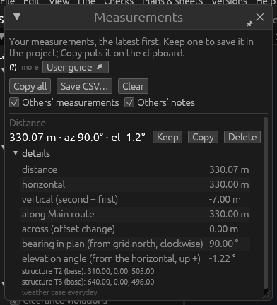
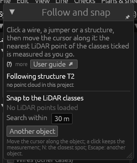
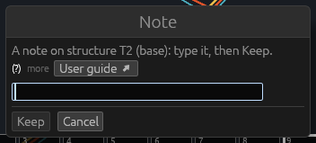

# Tools: Measure

*Built, in active development (not approved yet).* The tools of the
**Measure** theme measure the line as it is drawn: distances, heights,
stations, clearances, angles — and **Follow and snap** measures to the
LiDAR along an object, **Note** writes a note on it. The measuring tools
change nothing in the line and need no editing rights; a measurement
kept, or a note, is put into the project, apart from the line. This page explains each tool,
what it gives, and the **Measurements** panel where the results go. More
on the measuring tools: [Measuring](desktop-app.md#measuring).

## How the measuring tools work

1. Hold a measuring tool (the inventory, or Edit › Tools › Measure).
2. Point in the 3D view or a cross-section: the point under the cursor
   is **marked and named** before you click (a wire, a structure, a LiDAR
   point, the ground…). The status bar gives the cursor's **station and
   offset** on the nearest alignment and its height.
3. Click the points the tool asks for. Before the last click the value
   already **follows the cursor**: the line is drawn with its value at
   its middle.
4. With the last click the measurement goes to the **Measurements**
   panel, which opens with the first one (and frees a captured mouse).

**What a click takes**

| Clicked | The point measured |
|---|---|
| a wire (a span or a jumper) | the point of it clicked, in the weather case shown, measured to its **surface**: the subconductor nearest to the other end, less its radius |
| a structure | its base |
| a string (its set) | its wire point, as placed |
| a LiDAR point or a survey point | the point |
| an alignment point | the point |
| anything else | the point under the cursor on the ground |

**Keys.** **Escape** gives up the points clicked so far and starts
again.

Values are shown to 0.01 (m or °) and copied in full. Every tool that
measures between two points (Distance, Stations, Wire to wire, Wire to
object) also gives the direction from the first point to the second:
its **bearing in plan** (from grid north, clockwise, 0–360°; none for a
point straight above the other) and its **elevation angle** (from the
horizontal, up positive).

## The Measurements panel

The **Measurements** panel lists your measurements, the latest first. It
opens with the first measurement, or from **Edit › Tools › Measurements
panel**; **Dock as a panel** (📌 in its title bar) puts it beside the
pages, as Properties.

| Control | What it does |
|---|---|
| **Copy all** | All the measurements as tab-separated text, in full precision, on the clipboard. |
| **Save CSV…** | The same as a CSV file. |
| **Clear** | Empties the list (kept measurements stay in the project). |
| **Others' measurements**, **Others' notes** | Ticked: those other users kept are shown, in the panel and in the views. Yours only (also in Edit › Tools › Display options). |
| **Kept in the project** | The measurements and notes kept, each with its value as computed now, its kind and author, and **Delete** (undo brings it back). |
| each measurement | Its kind, its value, and **Keep**, **Copy**, **Delete**; **details** folded under it (the latest open): every part of it, the points clicked with their coordinates, the weather case, how each end was taken. |

**Keep** puts a measurement into the project:

- it is **shared**: every user sees it, with its author;
- it is kept apart from the line itself (no check is marked out of date;
  it is not in the line file);
- it is **computed again** from what it is attached to whenever the
  line, the weather case shown or its solution changes (a wire by the
  point of it clicked, a structure, a wire point, a span point, an
  alignment point, a LiDAR point or a free point by its coordinates);
- deleting what it is attached to **deletes it too**, in the same step.

Kept measurements and notes are drawn in orange in the plan, the profile
and the 3D view. The [Edit](tools-general.md#edit-on-a-kept-measurement-or-a-note)
tool on one changes its label or deletes it.

## Distance

**What it is for.** The distance between two points, and its parts.

**How to use it.** Hold **Distance**; click the first point, then the
second.

**What it gives**: the **distance**; its **horizontal** and **vertical**
parts (second − first); along and across the alignment (both points on
one alignment); the bearing and elevation angle. A wire is measured to
its surface (its axis when its wire type is not in the library — the
details say which).

## Height above ground

**What it is for.** How high a point is above the ground straight under
it.

**How to use it.** Hold **Height above ground**; click a point — a wire,
a LiDAR point, a structure, or anywhere. One click.

**What it gives**: the **height above ground**, the **point height** and
the **ground height**. A wire is taken at the bottom of its lowest
subconductor. The ground is the project's ground surface, the one the
checks use. With no ground surface under the point, the details say so.

## Stations

**What it is for.** Where two points lie along the route.

**How to use it.** Hold **Stations**; click two points.

**What it gives**: each point's **station** and **offset** on the
nearest alignment; the difference **along** it (both on one alignment;
on two alignments the details say there is no station difference); the
**straight** distance in plan; the bearing and elevation angle.

## Wire to wire

**What it is for.** The shortest distance between two wires over their
whole spans.

**How to use it.** Hold **Wire to wire**; click a wire (a span or a
jumper), then another. Both clicks must be on wires (the status bar says
so otherwise).

**What it gives**: the **shortest distance** between the two spans as
solved in the weather case shown — every segment of one against every
segment of the other, exact on the solved wires — to their surfaces;
the distance **between the axes**; its horizontal and vertical parts;
the **angle from the vertical**; the bearing and elevation angle of that
shortest line. Where you clicked on the wires does not matter.

## Clearance at a point

**What it is for.** A wire's clearance to the ground where you click,
and the smallest along its span.

**How to use it.** Hold **Clearance at a point** (or right-click a span:
**Measure the clearance**); click a wire. One click.

**What it gives**

- **shortest to the ground here** and **vertical clearance here**, at
  the point clicked: the shortest distance to the ground surface (over
  every triangle that can be nearer than the ground straight under it,
  exact) and the vertical one, from the bottom of the lowest
  subconductor;
- on the click, **smallest vertical along the span** and **smallest
  shortest along the span**, at its solved points (the wire's axis less
  its radius: a bundle's subconductors are not taken apart there — a
  simplification, said in the details).

A measurement, not a check: no rule, no limit. For checks see [Vertical
clearances](vertical-clearances.md) and [Radial
clearances](radial-clearances.md).

## Wire to object

**What it is for.** The shortest distance from a wire to a structure or
a point.

**How to use it.** Hold **Wire to object**; click a wire (a span or a
jumper), then a structure or a point (a LiDAR or survey point, the
ground).

**What it gives**: the **shortest distance** from the whole span, as
solved in the case shown, to the structure's lines (its members, else
its stick drawing, and its strings) or to the point, to the wire's
surface; between the axes; its horizontal and vertical parts; the angle
from the vertical; the bearing and elevation angle.

## Angle between points

**What it is for.** The angle at a point between the lines to two
others.

**How to use it.** Hold **Angle between points**; click three points —
the **second is the vertex**.

**What it gives**: the **angle at the second point** between the lines
to the first and the third (0–180°); the same **angle in plan**; each
arm's length, bearing and elevation angle. Both arms are drawn. A wire
is taken at the point of its axis clicked (not its surface).

## Follow and snap

**What it is for.** Follow and snap measures from an object of the line
to the nearest LiDAR point along it, live, as you move the cursor along
the object — to find the closest vegetation or building along a span.

**How to use it**

1. Hold **Follow and snap**. Its panel opens (it can be docked).
2. Click a **wire** (a span), a **jumper** or a **structure**: it is
   selected and followed. A click on nothing takes the object selected
   (also a span point's or a spread's span, a string's or a point's
   structure).
3. Tick the **LiDAR classes** to snap to.
4. Move the cursor along the object: for the object's point under the
   cursor (elsewhere: the object's point nearest in plan to the cursor)
   the **nearest stored LiDAR point** of the classes ticked within the
   search distance is measured, to the wire's surface. The line jumps
   from point to point as the cursor moves, with no click.
5. **Click** to keep that measurement in the project (as Keep in the
   Measurements panel); the tool stays on the object for the next one.

**The panel**

| Field | What it does |
|---|---|
| **Following …** | The object followed (or *Click the object to follow*), and what was found. |
| **Snap to the LiDAR classes** | A tick per class of the point cloud, with its count. Ticked at first: those shown, except the line's own (conductors, shield wires, insulators, structures, by their roles in the class scheme) and noise. |
| **Search within** | The search radius around the object, m (30 m at first). Nothing of the classes within it: it says so, never a farther point. |
| **Another object** | Lets go of the object, to click another. |

**Keys.** **N** jumps to the **closest spot of the whole object** (kept
until the cursor moves). **Escape** lets go of the object.

**Good to know**

- The points are the stored ones at full density, not the thinned ones
  drawn; those around the object are read once, in the background.
- A point on a structure is kept by its offset from the structure's
  base: it follows the structure moved, not turned.
- Closing the panel puts the tool away (Select is held again).

## Note

**What it is for.** Note writes a note on an object or a point, kept in
the project for everyone working on it.

**How to use it**

1. Hold **Note**.
2. Click an object (a structure, a wire, a string, a span point, an
   alignment point, a LiDAR point) or a point on the ground. The
   **Note** window opens in the middle of the screen, ready to type.
3. Type the note, then **Keep** (Enter). **Cancel** (Escape) writes
   nothing.

**Good to know**

- The note is **shared** with the others working on the project, drawn
  in the views with a short leader where it is attached, and **deleted
  with what it is attached to**.
- On a wire it is attached to the point of the wire clicked (its share
  of the span).
- The Edit tool on a note changes its text or deletes it; notes are
  listed under **Kept in the project** in the Measurements panel.
- **Undo**: keeping a note is one step.
