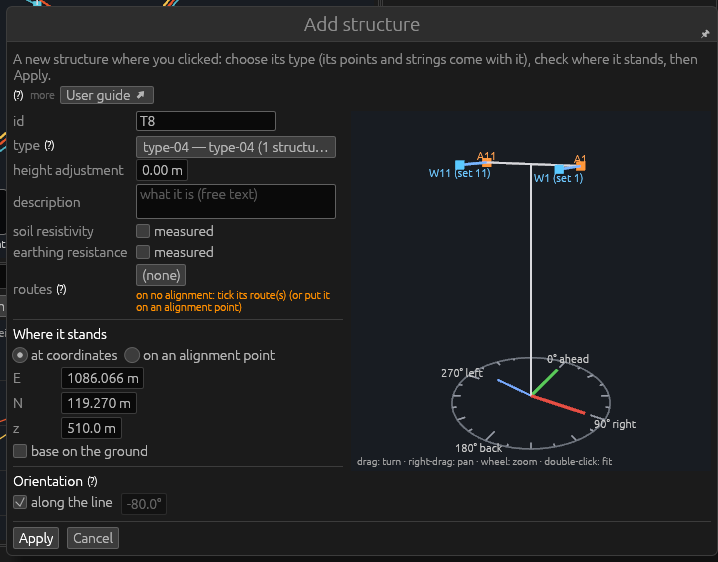
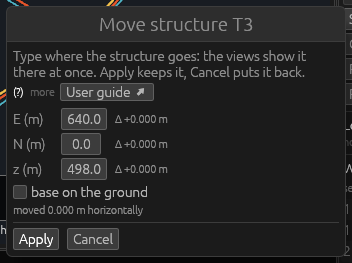
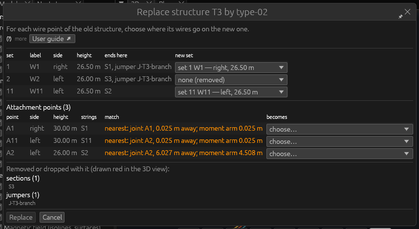
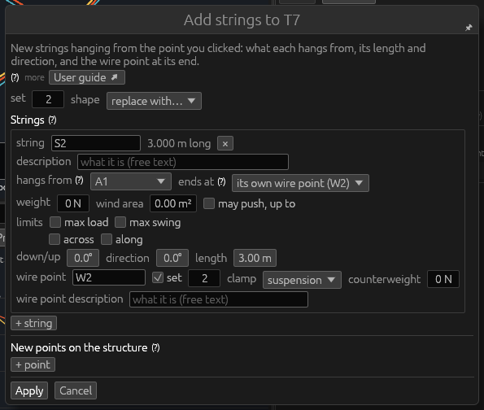
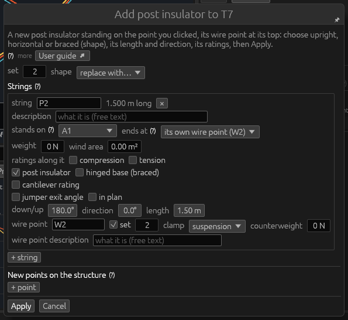
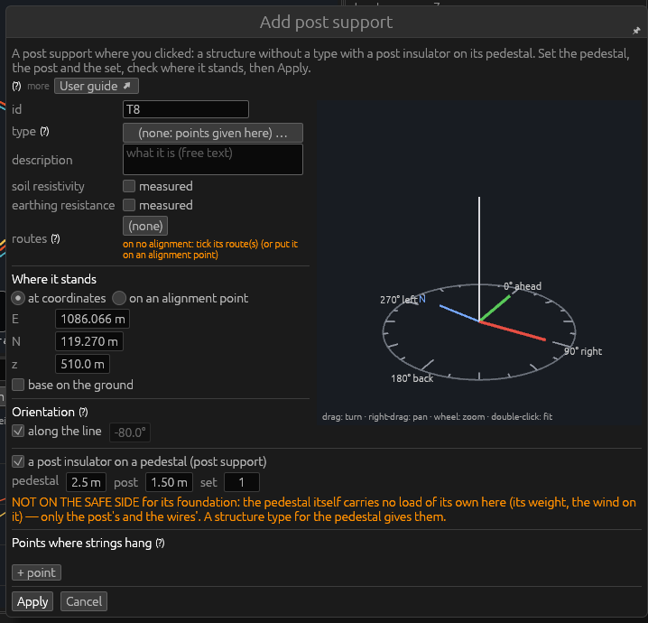

# Tools: Structures

*Built, in active development (not approved yet).* The seven tools of the
**Structures** theme place and change structures: **Add structure**
stands a new one on the line, **Move structure** moves one, **Replace
structure** puts another structure type in its place, **Link attachment
point** links an attachment point to a joint of its type, **Move
attachment point** moves one to another joint of its type, **Add
string** hangs a new string on a structure (or puts a spacer between two
wires), and **Add post insulator** stands a post insulator on it. This page explains each tool, its windows and every field. The
words structure, structure type, attachment point, string, wire point and
set are those of the [Glossary](glossary.md#structures). The tutorial
places structures and looks at their strings in [3. The first
structures](../tutorial/03-structures.md) and [4. Strings on the
structures](../tutorial/04-strings.md).

## Add structure

**What it is for.** Add structure stands a new structure where you
click: on an alignment point (tied to it, turned along the line) or on
the ground. Its type brings its attachment points, strings and wire
points with it.

**How to use it**

1. Hold **Add structure** (slot 6 of the default hotbar).
2. Click an **alignment point** without a structure, or the **ground**,
   in the 3D view or a cross-section (or right-click an alignment point:
   **Add structure here…**). The **Add structure** window opens.
3. Choose its **type**, check where it stands, then **Apply** (Enter).

**The window**

| Field | What it does |
|---|---|
| **id** | Its name; the next after the line's last structure is offered (`T7` → `T8`). |
| **type** (?) | A structure type of the library: the button opens the [structure picker](desktop-app.md#structure-picker), where the extension can be chosen too. Offered at first: the type of the nearest structure. *(none: points given here)*: a structure without a type, whose attachment points you give below and whose strings you add with Add string. |
| **extension** | *(base)* or one of the type's extensions (shown when the type has some). |
| **height adjustment** | How far the type's feet stand above the ground, m (foundations; may be negative). |
| **description** | Free text. |
| **soil resistivity** | **measured**: the soil resistivity at this structure, Ω·m (100 Ω·m when first ticked). The line parameters take on each span the geometric mean of its two structures' values. Unticked: not measured (the line's value is used). |
| **earthing resistance** | **measured**: the resistance of its earthing to remote earth, Ω (10 Ω when first ticked; used by Magnetic field, earth wires through the structures). Unticked: the line's value, else 10 Ω assumed. |
| **routes** (?) | The routes it is on. Standing on an alignment (on a point, or within 5 m of one): that alignment's routes, by itself. Away from every alignment (a crossing line): tick its route(s) here, or **+ New route…**. |

**Where it stands**

- **on an alignment point**: chosen in the list of the alignments'
  points (`PX — alignment #3 — E …, N …`; a point under another
  structure is greyed). Clicked on an alignment point, or within 5 m of
  a free one, it is chosen for you. The structure stands on the point,
  tied to it: the alignment follows the structure when it moves.
  **base on the ground** (ticked: on the terrain there; unticked: at the
  point's own height).
- **at coordinates**: **E**, **N**, **z** (m), and **base on the
  ground** (z then follows the terrain).
- **Also on other points of this alignment** (folded; new structures on
  an alignment point only): the alignment's other points, each with a
  tick (**All**, **None**; a point under a structure already is left
  out) and a **Type** — *(the type above)* or another (say, a strain
  type at the angle points). Every point ticked gets a structure too,
  in the same step, each tied to its point and turned along the line
  there.

**Orientation** (?)

| Field | What it does |
|---|---|
| **along the line** | Ticked: it faces ahead along the alignment, its cross-arms on the bisector of the line angle there. Ticked by itself where there is a line. |
| (degrees) | Typed when *along the line* is unticked: the direction of its right (its local x axis, the cross-arms), counter-clockwise from east. |

**The preview** on the right shows the structure in its own axes with a
compass on the ground — the angles as the project counts them, ahead
(green), right (red) and north (blue). Drag turns it, right-drag pans,
the wheel zooms, a double-click fits it.

**A structure without a type** also has **Points where strings hang**
(?): each attachment point's label, its place **across** (to the right
looking ahead), **along** (ahead) and **up** (from its base), m, a
description, **×** to take it away (not while strings hang from it);
**+ point** adds one. A new one may be made a **post support** (a post
insulator on a pedestal, ticked above the points: [A post on the
ground](#a-post-on-the-ground-a-post-support)).

**Good to know**

- With no structure type in the library the window says so: without a
  type a structure holds no wire until strings are added by hand.
  **New structure from a template…** opens that window (this one stays
  open).
- With no ground under the click, the window opens on the first free
  alignment point.
- Everything can be changed later: the strings with [Edit](tools-general.md#edit-on-a-structure),
  the placement in **Properties › Placement…**.
- **Undo**: the structure (and those on the other points ticked, and a
  new route) is one step.

## Move structure

**What it is for.** Move structure moves a structure to coordinates you
type, showing it there live before you apply.

**How to use it**

1. Press **M** (or hold the tool, slot 2 of the default hotbar).
2. Click a structure in the 3D view or a cross-section (or right-click
   it anywhere: **Move…**). The **Move structure *id*** window opens.
3. Type where it goes. The views show it there at once and its wires
   are solved again as you type.
4. **Apply** (Enter) keeps it; **Cancel** (Escape) puts it back.

**The window**

| Field | What it does |
|---|---|
| **E (m)**, **N (m)** | The project's coordinates of its base, east and north; beside each, how far it moved (Δ). |
| **z (m)** | The height of its base (typed only when *base on the ground* is unticked). |
| **base on the ground** | Ticked: the base stays on the terrain wherever it goes. Unticked at first. |
| moved … horizontally | How far it moved in plan, m. |

**Good to know**

- A structure being moved by another user on the server cannot be moved
  (the status bar says by whom).
- A structure tied to an alignment point takes the point along.
- With a structure's screen open, Move structure held also drags its
  points in the 3D view: see [The structure screen](desktop-app.md#the-structure-screen).
- **Undo**: the move is one step; Edit › Undo (⌘Z) takes it back.

## Replace structure

**What it is for.** Replace structure puts another structure type in a
structure's place: it keeps its id, place, orientation and height
adjustment, and its wires are moved to the new type's wire points.

**How to use it**

1. Hold **Replace structure** (from the inventory or Edit › Tools ›
   Structures; or right-click a structure: **Replace structure…**; or
   **Replace…** in its Properties).
2. Click a structure. The structure picker opens on its current type,
   titled **Replace structure *id* — the new structure type**.
3. Choose the new type (and an extension), then **Choose** (**Cancel**
   changes nothing).
4. If every wire point where something ends is also on the new type,
   nothing else goes and every attachment point has a joint at its very
   place, the structure is replaced at once (the status bar says how many
   wires were rewired). Otherwise the **Replace structure *id* by
   *type*** window opens.

**The window**

The wire points of the old structure, one row each:

| Column | What it shows |
|---|---|
| **set**, **label** | The old wire point. |
| **side**, **height** | Left, right or middle looking ahead; its height, m. |
| **ends here** | The sections, jumpers and conductor-path starts that end there. |
| **new set** | Where they go on the new type: one of its wire points (proposed: the same set, else the one on the same side in the same height order), or **none (removed)**. |

**Attachment points (*n*)**, one row per old attachment point, in a
scroll box:

| Column | What it shows |
|---|---|
| **point**, **side**, **height**, **strings** | The old point and the strings hanging from it. |
| **match** | **exact** (a joint of the new type at its very place: taken), else the **nearest** attach joint, its distance and moment arm, or *attach joints equally near: choose*, or *no attach joint*. |
| **becomes** | Your choice: the joint offered (the point stays where it is, the distance kept as its offset), another attach joint of the new type, the new type's own point of the same label, or **remove** (with what hangs only from it). |

Under them, **Removed or dropped with it**: everything that would go —
sections, the jumpers at them or on taps on them, their spacers, the old
structure's own points, strings and wire points, jumper clamps on wire
points the new type lacks. The sections and jumpers removed are drawn
**red** in the 3D view while the window is open.

**Replace** applies it; it waits until every attachment point has a
choice (nothing is dropped silently). **Cancel**, **Escape** or the
window's × change nothing. The window takes no Enter.

**Good to know**

- The extension is kept when the new type has one of the same name;
  otherwise the structure is placed without one, and the window (or the
  status bar) says so.
- Two old wire points onto one new one, or a set the new type lacks, is
  refused with the reason.
- **Undo**: the replacement and everything removed with it are one
  step.

## Link attachment point

**What it is for.** Link attachment point links an attachment point
(where a string hangs) to a **joint** of its structure's type: onto the
joint, or where the point is — its distance from the joint kept as its
**offset**, a rigid link whose moment the structure analysis applies at
the joint ([Glossary](glossary.md#structures)).

**How to use it**

1. Hold **Link attachment point** (from the inventory or Edit › Tools ›
   Structures; or right-click an attachment point: **Link to a
   joint…**). While it is held, attachment points can be clicked.
2. Click an **attachment point** of a structure with a type. The status
   bar says how many joints it may be linked to, and its type's **attach
   joints** are ringed in the 3D view.
3. Move the pointer over a ringed joint: the offset (x, y, z in the
   structure's axes), its length and its moment arm (its length across
   the vertical) are written beside it.
4. Click the ringed joint: on the joint, the point is linked at once;
   not on it (farther than 1 mm), the **Link *point* of *structure* to
   joint *joint*** window asks how (below).

**The window** (only when the point is not on the joint; owner,
2026-11-15)

| Field | What it does |
|---|---|
| **Move the point onto the joint** | The default: the point moves onto the joint, the strings hanging from it with it; no offset. |
| **Keep its position (offset x, y, z from the joint)** | The point stays where it is; its distance from the joint (in the structure's axes, m) becomes its offset. |

**Link** (Enter) applies it, **Cancel** (Escape) changes nothing.

**Keys.** **Escape**, or a click elsewhere, cancels the point chosen.

**Good to know**

- Only **attach joints** take a link. Another joint under the pointer
  says *not an attach joint: set its kind to attach in OHL-Structure*.
- A structure without a type has no joints (its points are their own);
  a wire point is not linked (it hangs from its string).
- Relinking a linked point is the same two clicks. **Unlink** is in the
  point's Properties; an unlinked point is drawn red and its structure's
  loads are refused until it is linked again.
- A linked point moved later keeps its joint; its offset follows.
- An attachment point and a joint are separate objects, even with the
  same name (a derived type's point `A1` on its joint `A1`): the joint
  is found by its id only.
- **Undo**: one step (the link and the move onto the joint together).

## Move attachment point

**What it is for.** Move attachment point moves an attachment point of a
structure with a 3D type to another **joint** of that type (owner,
2026-11-15) — for this structure only, or in the type, for all its
structures. It is the tool for a structure added with a 3D type where
there was none: its points are linked as the type links them, and here
one is moved to the joint it belongs on. The strings hanging from the
point follow it.

**How to use it**

1. Hold **Move attachment point** (from the inventory or Edit › Tools ›
   Structures; or right-click an attachment point: **Move to a
   joint…**).
2. Click an **attachment point** of a structure with a type. When
   several points are at that place, a small window lists them — each
   with the strings hanging from it and the sets of their wire points —
   and you click the one to move. The type's **attach joints** are
   ringed in the 3D view, as for Link attachment point.
3. Click the ringed joint to move it to. The **Move *point* of
   *structure* to joint *joint*** window opens.
4. Choose, then **Move** (Enter).

**The window**

| Field | What it does |
|---|---|
| **Move the point onto the joint** / **Keep its position (offset …)** | Shown when the point is not on the joint (farther than 1 mm): onto it (the default: the point and its strings move there) or its position kept, its distance becoming its offset. |
| ***structure* only (relink)** | The default: this placed structure's own link (the line's relink), one change of the project. |
| **The type *type* (all its structures)** | The structure type's file, changed with the same edit functions OHL-Structure uses, then read again: every structure of the type follows (one that has its own link of the point keeps it). |

**Move** (Enter) applies it, **Cancel** (Escape) changes nothing.

**Keys.** **Escape** closes the chooser or the window, else cancels the
point chosen.

**Good to know**

- Only attach joints take a point; a support joint takes no strings.
- **The type**: the joint the point leaves is an attach joint only
  while attachment points are on it (2026-11-16). When the last one
  leaves, the joint goes back to its plain kind (none, or support where
  the structure stands on it) and is no longer ringed; to move a point
  back there, set its kind to attach in OHL-Structure first. *This
  structure only* changes no structure file: the type's joints keep
  their kinds.
- **The type** is refused while the type is open in OHL-Structure (its
  own copy would overwrite the change): move the point there, or close
  it first.
- **OHL-Structure is told**: a structure open there gets the new link
  of *this structure only* in its line values, and says *T7: point A1
  linked to joint 42Y (from OHL-Design)*; a point moved there reaches
  the line when the structure file is saved there, and the status bar
  here says *T7: point A1 linked to joint 42Y (from OHL-Structure)*.
  ([The line's links](structure-app.md#the-lines-links-from-ohl-design).)
- **Undo**: *this structure only* is one step of Edit › Undo. *The
  type* changes the type's file, kept in the project as a save of the
  Structure types page: Edit › Undo does not take it back — move the
  point back the same way.

## Add string

**What it is for.** Add string hangs a new string on a structure — from
an attachment point, or below a wire point. Clicking two span points it
puts a **spacer** between two wires instead.

**How to use it**

1. Hold **Add string** (slot 7 of the default hotbar). While it is held,
   attachment points, wire points, strings and span points can be
   clicked.
2. Click:

   | Clicked | What opens |
   |---|---|
   | an attachment point | **Add strings to *structure***: one string hanging from it, its wire point 3 m straight down, at the next free set |
   | a wire point | its strings' window, with a new string hanging below it at the next free set (two tension strings from a string's wire point are made this way) |
   | a structure, or one of its strings | **Add strings to *structure***: one string from the first attachment point no string hangs from yet (a structure without points: a new point 20 m up), at the next free set |
   | a span point, then a span point of another wire in the same span | **Add spacer** (below) |

3. Set the string, then **Apply** (Enter).

**The window** is the strings window explained under [Edit on a
string](tools-general.md#edit-on-a-string), with two fields more at its
top for a new string:

| Field | What it does |
|---|---|
| **set** | The set number of its wire point (the next free one is offered). Apply is refused when the structure has a wire point with this set already. |
| **shape** | **replace with…**: replaces the strings by a shape — *One string*, *Two strings to one wire point*, *Two strings to one wire point, a string below*, *A string, two tension strings from its wire point*, and the three post insulators ([Add post insulator](#add-post-insulator)). |

**Add spacer.** Click a span point, then a span point of another wire of
the same span: the **Add spacer** window opens, with the fields
explained under [Edit on a spacer](tools-general.md#edit-on-a-spacer). A
bare end point gets the spacer clamp of the object templates. The first
span point again, or **Escape**, cancels. Both sections must be solved
by finite elements (not the ruling span).

**Good to know**

- New strings hang from the points the structure has; a new attachment
  point is made only when you ask for one (**+ point**) or a shape needs
  one. On a structure with a type, a new point is put on one of its
  type's attach joints.
- A new string's wire point gets a set, so a section or jumper can end
  there. For a suspension string that should hold a jumper, untick its
  wire point's **set**.
- On a structure with a type, the strings added are the structure's own,
  over its type's.
- **Undo**: Apply is one step.

## Add post insulator

**What it is for.** Add post insulator (2026-11-14) stands a **post
insulator** on a structure: an insulator standing on a point of the
structure — its base, earthed — and holding a wire point at its top. A
**fixed** post holds the wire point rigidly as a cantilever (a station
post upright, a line post horizontal); a **hinged** post (a braced line
post) turns about its base and is held by a brace string to its top. How
a post carries its load and how it is checked is explained in [Post
insulators](../theory/post-insulators.md).

**How to use it**

1. Hold **Add post insulator** (Edit › Tools › Structures, or the
   inventory; put it in a hotbar slot to keep it at hand). While it is
   held, structures and their points can be clicked.
2. Click:

   | Clicked | What opens |
   |---|---|
   | a point of a structure | **Add post insulator to *structure***: an upright post standing on it, its wire point 1.5 m above, at the next free set |
   | a structure, or one of its strings | the same, on the first point no string hangs from yet (a structure without points: a new point 20 m up) |
   | the ground | **Add post support**: a new structure without a type with a post insulator on a pedestal ([below](#a-post-on-the-ground-a-post-support)) |

   The right-click menu of a structure or a point offers **Add post
   insulator…** too.
3. Choose its **shape**, set its length, direction and ratings, then
   **Apply** (Enter).

**The window** is the strings window ([Edit on a
string](tools-general.md#edit-on-a-string)) with the post's own fields:

| Field | What it does |
|---|---|
| **shape** | **Post insulator, upright** (a station post: its wire point straight above), **horizontal** (a line post: its wire point level, out to the side of the structure the point is on) or **braced** (a hinged horizontal post and a brace from a point 1.5 m above its base to its top). 1.5 m is a length to start from: set the real one. |
| **stands on** | The point its base stands on. |
| **weight**, **wind area** | Its own weight and the area the wind blows on: at its middle for a fixed post (a load of its base with half its length as lever), half at each end for a hinged one. |
| **ratings along it**: **compression**, **tension** | What it is rated for along its axis (its data sheet). Ticked: checked in Checks › String checks; unticked: not given (a library post's, when the string names one). |
| **post insulator** | Ticked: it is a post. Unticked, it becomes an ordinary string (its post fields cleared). |
| **hinged base (braced)** | It turns about its base and only pushes or pulls: another string at its wire point (its brace) must hold it — Apply is refused without one. |
| **cantilever rating** | The load across it at its top it is rated for; compared with its bending moment at its base over its length (Checks › String checks). Fixed posts only. |
| **jumper exit angle**, **in plan** | Where its clamp holds a jumper ending at its wire point: the angle from the horizontal (negative: down; unticked: level) and the direction in plan in the structure's axes (0 ahead, 90 right; unticked: towards the jumper's other end). Fixed to the structure: it does not turn with the wind. |
| **down/up**, **direction**, **length** | Where its wire point is from its base: 180° straight up, 90° level; the direction in plan; its length. |
| **wire point**, **set**, **clamp** | Its wire point at its top, with the set a section or jumper ends at. |

**Good to know**

- A fixed post holds its wire point alone: another string ending at the
  same wire point is refused (a braced post is a hinged one).
- **The braced shape pivots** (owner, 2026-11-15): its one brace from
  straight above its base leaves it free to turn about the vertical
  through its base, so its top swings along the line until the spans'
  pulls on it balance — the conductor holds it there, as it holds a
  suspension string; a jumper alone holds it, solved together with the
  post (the jumper's end moves with the post's top); with nothing
  attached it is free, and the loads say so instead of computing any. A
  second brace (one ahead, one back of the post's base) locks it. The
  hinge is frictionless by default: every load case says the structure's
  longitudinal load is NOT ON THE SAFE SIDE there ([Structure
  library](structure-library.md#post-insulators-on-a-type), [theory](../theory/post-insulators.md#a-pivoting-post-held-by-what-is-attached-to-it)).
- **Hinge friction** (a hinged post's, ticked to give it, N·m): the moment
  its hinge holds before the post turns. The post stays where it is given
  while the moment needed is at most this (stick), else it turns until the
  moment is this (slip); the moment goes into the structure at the post's
  base, and the load cases say the longitudinal load includes it up to
  this value. Unticked: frictionless. The hover over the box says the
  same; OHL-Structure's post column has it too (**friction**).
- A post is never a tension string.
- Opening a post with **Edit** shows the same fields: they are kept when
  you Apply.
- A rigid conductor carried on posts is not built yet.
- **Undo**: Apply is one step.
- On a structure with a type, the post added is the structure's own. To
  give every structure of a type the post, put it in the type
  (2026-11-15): in OHL-Structure's Strings table ([Post insulators on the
  structure](structure-app.md#post-insulators-on-the-structure)) or in the
  file ([Post insulators on a type](structure-library.md#post-insulators-on-a-type)).
  A typed structure's posts load and are checked exactly as one made
  here, and are drawn the same way.
- The **Structure editor** of a structure without a type (**Strings and
  points…** in Properties) keeps its posts (2026-11-15; before, its
  Apply made them plain strings), and **Make it a type…** writes them
  into the type (structure file version 13).

### A post on the ground: a post support

Clicked on the ground, Add post insulator opens **Add post support**:
the structure window ([Add structure](#add-structure)) for a new
structure **without a type**, with **a post insulator on a pedestal
(post support)** ticked. The same tick is offered in Add structure for
any new structure without a type.

| Field | What it does |
|---|---|
| **pedestal** | Its height above the structure's base, m (2.5 m to start from). |
| **post** | The post insulator's length, m (1.5 m to start from). |
| **set** | The set of its wire point: a section or a jumper ends there. |

**Apply** makes, in one step, the structure, a point on top of the
pedestal (`PED`), an upright post insulator standing on it (`P1`) and its
wire point at its top (`W1`, the set given). Change the post afterwards
with **Edit** on it (its length, direction, ratings, exit angle).

**NOT ON THE SAFE SIDE for its foundation**, said in the window: the
pedestal is only a point here. Its loads on the ground are those of the
post and the wires (the post's moment of its length at the pedestal's
top included), **not the pedestal's own** weight and the wind on it. A
structure type for the pedestal (a column member, checked in
OHL-Structure) gives them — not built yet.

