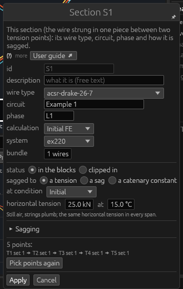
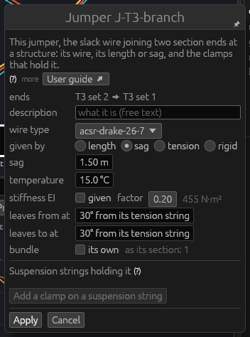
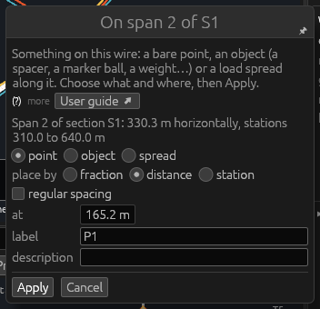

# Tools: Wires

*Built, in active development (not approved yet).* The three tools of
the **Wires** theme put the wires on the structures: **String wire**
strings a section through strings you click, **Add jumper** joins
section ends with a jumper, **Add on span** puts a point, an object or a
spread load on a wire. This page explains each tool, its windows and
every field. A section is a wire strung in one piece between two tension
points; a span is the wire between two consecutive structures of it; a
jumper joins two wire points with sets ([Glossary](glossary.md#sections-spans-and-jumpers)).
The tutorial strings a first line in [5. Stringing the
wires](../tutorial/05-stringing.md) and [6. Jumpers](../tutorial/06-jumpers.md).

## String wire

**What it is for.** String wire makes a new **section**: you click the
strings it runs through, in line order, and it is strung through their
wire points.

**How to use it**

1. Hold **String wire** (slot 8 of the default hotbar). While it is
   held, strings can be clicked whatever Edit › Snap says.
2. Click the strings in line order — the tension string at its start,
   the suspension strings, the tension string at its end. A draft line
   joins them; the status bar counts the points.
3. Press **Enter** (two strings at least): the **String wire: new
   section** window opens.
4. Check the wire type, circuit, phase and how it is sagged, then
   **Apply** (Enter): the section is strung and solved in every weather
   case.

**Keys.** **Enter** ends the points. **Backspace** takes the last point
back. **Escape** gives the wire up — from the window too (its Cancel);
String wire stays held, and in first person the mouse stays captured (a
second Escape frees it).

**The window** has the fields explained under [Edit on a
section](tools-general.md#edit-on-a-section-a-span). A new section starts:

- **like** the section of the span selected, else the section it
  continues (from the same wire point, or from one hanging from the same
  attachment point: the other side of a tension structure), else the
  line's first section — its wire type, circuit, system and bundle;
- with no section to copy: the library's first wire type, 20 kN at
  20 °C, one wire;
- **in the blocks**, always (a clipped section's lengths belong to its
  own spans);
- its **circuit and phase** those of the section it continues; else the
  circuit's **next phase** at its first structure — the first of the
  circuit's phase labels not yet strung there, or, all strung, the
  number after the last (`L2` → `L3`);
- its **id**: the next after the line's last section.

**Good to know**

- A string already in the section is refused (the status bar says so);
  clicking the last one again does nothing.
- Opening a menu gives up the wire being strung.
- **Pick points again** in a section's window holds String wire to pick
  that section's strings again; Enter opens its window with the new
  points.
- **Undo**: the new section is one step.

## Add jumper

**What it is for.** Add jumper joins section ends with a **jumper**: all
the jumpers missing at a structure at once, or one jumper between two
strings you click, through suspension strings if you wish, or from a
**tap** (a clamp on a span or on another jumper).

**How to use it — the jumpers missing at a structure**

1. Hold **Add jumper** (from the inventory or Edit › Tools › Wires; or
   right-click a structure: **Add jumper**).
2. Click the structure. The jumpers missing there are added: between two
   section ends (first or last points) of the same circuit and phase that
   no jumper joins yet, each given by a sag of 15 % of the distance
   between its ends (0.3 to 3 m) at 20 °C. Ends that cannot be paired are
   named in the status bar.

**How to use it — one jumper between two strings**

1. Click the string at its first end: one holding a section's wire (its
   wire point's set is used by a section).
2. If the jumper passes through **suspension strings** of the structure,
   click them in order (strings to a wire point **without** a set).
3. Click the string at its other end.
   - Without suspension strings: the **New jumper** window opens.
     Nothing is added before **Apply**; it offers a **length**, the least
     it can have (the straight distance between its ends, rounded up to
     the cm) — choose **length**, **sag**, **tension** or **rigid** there.
   - Through suspension strings: the jumper is added with a clamp on each
     of them, given by the **lengths between its clamps** (each first 3 %
     over the straight distance), and its window opens to type them.

**How to use it — from a tap**

1. Click a span point or a jumper point that holds a **clamp** (put one
   there with [Add on span](#add-on-span): object, a tap clamp
   template).
2. Click its other end: a string, or another tap's clamp. The jumper is
   added, given by its length (3 % over the distance between its ends),
   and its window opens.

The window's fields are explained under [Edit on a
jumper](tools-general.md#edit-on-a-jumper).

**Keys.** **Escape**, or the first end clicked again, cancels a jumper
being laid out.

**Good to know**

- A wire point whose set **no section uses** is refused as an end, with
  the reason: to pass the jumper through such a string, untick its wire
  point's set in the string window, then click it between the jumper's
  ends.
- **Joining two conductor paths.** A jumper between conductors of two
  different conductor paths (another circuit name, phase or system) is
  not added at once: a window asks first, then which path's name, phase
  and system stay. See [Editing](desktop-app.md#editing) (*Add a
  jumper*).
- An edit the line cannot solve (a sag no shape fits) is refused with
  the reason in the window, which stays open to choose another way.
- **Undo**: the jumpers added at a structure are one step; each jumper
  added otherwise is one step.

## Add on span

**What it is for.** Add on span puts something on a wire: a bare **span
point** (a spacer's or a spread's end), a point with its **object** (a
marker ball, a light, a weight, a clamp for a tap or a spacer), or, on a
span, a **spread** load along a stretch of the wire.

**How to use it**

1. Hold **Add on span** (from the inventory or Edit › Tools › Wires; or
   right-click a span: **Point or load on the span…**, a jumper: **Point
   on the jumper…**).
2. Click a **span** or a **jumper** where the point should go. The **On
   span *n* of *section*** (or **On jumper *id***) window opens, placed
   where you clicked.
3. Choose what to add and where, then **Apply** (Enter).

**The window**

At the top, the span (its horizontal length, and its structures'
stations when they stand on one alignment) or the jumper (its length,
its ends' distance apart).

| Field | What it does |
|---|---|
| **point** / **object** / **spread** | A bare point; a point with its object; or a spread load between two new points (spans only). A point first. |
| **place by** | How its place is written: **fraction** of the span's horizontal length (a jumper's length), **distance** from the back structure (a jumper's first clamp), **station** (a span whose structures stand on one alignment) or **length along it** (a jumper). Distance at first on a span, fraction on a jumper. |
| **regular spacing** | Points or objects repeated from a first place to a last, every **spacing** (50 m at first); the number of places is shown. |
| **at** / **first** / **start** | The place (where you clicked, to 0.1 m). |
| **last** / **end** | The last of regular points, or a spread's end (10 m on at first). |
| **spacing** | The distance between regular points, m. |
| **label** | The point's label (a spread: its first point's); the next free one is offered. |
| **description** | Free text. |

For a **spread**:

| Field | What it does |
|---|---|
| **template** | A spread template of the object library, or *own values*. |
| **load** | Downward, N per metre of conductor (10 N/m at first). |
| **load on** | **the whole bundle** (its subconductors share it) or **each subconductor** (the bundle carries the load × the bundle). On a bundle, the **whole bundle**'s load per metre is shown. |

For an **object**:

| Field | What it does |
|---|---|
| **template** | One of the object library's point templates (marker balls, a light, a bird diverter, a weight, a tap clamp, a spacer clamp; typical values, to check), or *own values*. The first body template is offered. |
| **weight** | The whole bundle's, N. |
| **advanced: kind, shape and sizes, drag** | Ticked: **kind** (**body**, hanging on the wire; or **clamp**, holding a jumper or a spacer — a hinge, forces only), **shape** (point, sphere, cylinder — along the wire, across the line or vertical —, box, or given wind and ice areas) with its sizes, **drag** (its coefficient; 1: none given) and, for a clamp, its **clamp length**. A value changed from the template makes it *own values*. |

**Good to know**

- The objects are drawn on the wires by their shape; a bare point as a
  small blue cross, a spread as an orange stretch. They are listed in
  Line › Sections › Span points and loads.
- The [Edit](tools-general.md#edit-on-a-span-point) tool on a point
  opens its own window; [Delete](tools-general.md#delete) on a spread
  asks whether its points go too.
- **Undo**: Apply is one step, however many points it adds.
