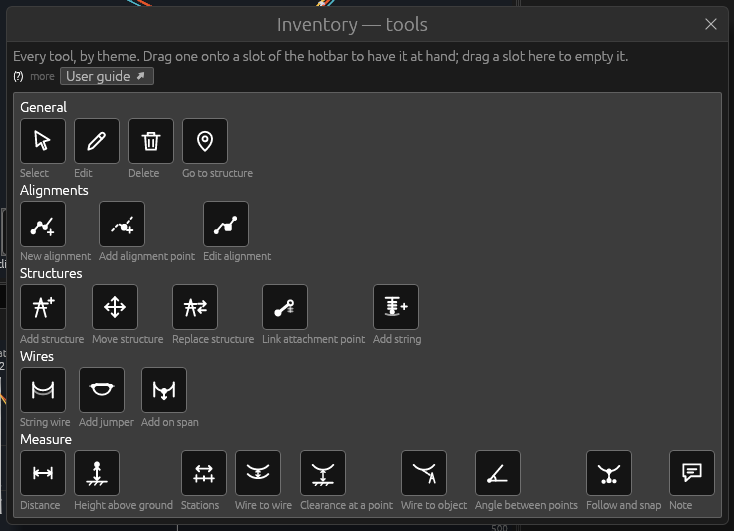
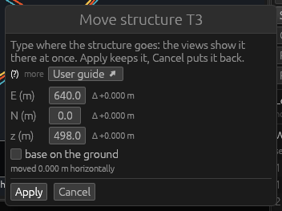
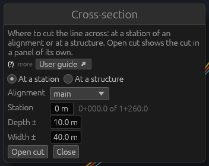

# Tools

*Built, in active development (not approved yet).* OHL-Design works with
**tools**: you hold one, then click in the 3D view to use it. This page
explains how tools are held and used, what every tool window has in
common, and lists every tool with a link to its own section. The tools
themselves are explained theme by theme on the pages below:
[General](tools-general.md), [Alignments](tools-alignments.md),
[Structures](tools-structures.md), [Wires](tools-wires.md) and
[Measure](tools-measure.md). The tools of the structure application are
on their own page: [OHL-Structure tools](structure-tools.md).

## The hotbar

The **hotbar** is the row of nine slots at the bottom of the 3D view
(with no 3D view shown, at the bottom of a cross-section panel). Each slot
holds one tool; the slot with the white frame is the tool you hold now.

- **Choose a slot**: press **1** to **9**, click the slot, or turn the
  mouse **wheel** while the mouse is captured in first person (one slot
  per notch; Ctrl + wheel stays the flying speed).
- **Hover a slot** for the tool's name, its key (if it has one) and what
  a click with it does.
- The line under the slots repeats this for the tool held, with the keys
  that always work: right-click for the object's menu, **Escape** for
  Select, **E** for the inventory.

Choosing a slot only *holds* the tool: nothing happens until you click
in the view. An empty slot holds Select.

Holding a tool that is not in the hotbar (from **Edit › Tools**, the
**M** key, a right-click menu) puts it into an empty slot — the slot you
are on if it is empty, else the first empty one — or, with no empty slot,
into the last slot. It never replaces the first slot (Select) or the
tool you hold.

The arrangement of the slots is remembered for the next start.

## The inventory

**E** opens the **inventory** (also **Edit › Tools › Tool inventory**):
every tool of OHL-Design, grouped by theme — General, Alignments,
Structures, Wires, Measure. **E** or **Escape** closes it.

Only while the inventory is open can the hotbar be arranged:

1. Drag a tool from the inventory onto a slot: it takes that slot.
2. Drag a slot onto another slot: the two swap.
3. Drag a slot back into the inventory, or right-click it: the slot is
   emptied.

Hover a tool in the inventory for what a click with it does. **Edit ›
Tools** lists the same tools in the same order, a line between the
themes; choosing one there holds it.

## Using a tool

1. Hold the tool (a slot, a key, Edit › Tools).
2. **Left-click** in the 3D view or a cross-section: the tool acts on
   what is under the pointer (in first person, under the crosshair). With
   **Select** held, a left-click selects. A red dot follows the pointer
   and marks what a click there would take.
3. Some tools take several clicks (String wire, the alignment tools, Add
   jumper, the measuring tools); the status bar says what to click next.
   **Enter** finishes where the tool says so, **Backspace** takes the
   last click back, **Escape** gives the clicks up.

Other clicks:

- **Right-click** selects the object under the pointer and opens its
  menu: Properties, Zoom to, the tools that apply to it (Edit…, Move…,
  Add string…), **Use *tool* on it** for the tool you hold, and
  Delete…. A tool chosen there acts once; the tool you held before is
  held again (a tool of several clicks stays held for them).
- In the **plan** and the **profile** a left-click always selects; use a
  tool there through the right-click menu.
- **Escape**, when there is nothing else to give up (a window, a step of
  a tool, a menu), holds **Select** again.
- A click on nothing the tool works on says so in the status bar, with
  what the tool takes.

While Delete, Edit, Add string, String wire or Add jumper is held,
strings can be clicked whatever **Edit › Snap: what can be clicked**
says; while an alignment tool is held, alignment points, structures and
the survey and LiDAR points shown can be clicked. See [Clicks and the
object's menu](desktop-app.md#clicks-and-the-objects-menu) for the mouse
in each control scheme.

**Editing rights.** Select, Go to structure and the measuring tools only
look: they work in a read-only project too. The other tools change the
project and need editing rights (a project opened by a user with the
designer or admin role). Held without them, a click says *read-only* in
the status bar, with the reason.

## The tool windows

Most tools open a window. Every tool window has the same shape:

- **At the top**, one plain sentence says what the window does. A
  **(?)** beside it holds a longer explanation; the **User guide ↗**
  button opens this manual at the tool's section.
- **The fields.** A field whose name has more help shows a **(?)** after
  its name; hovering the name or the field shows the same help.
- **At the bottom**, one row of buttons: the window's action first
  (Apply, Go, Add the point, Keep, Replace, Delete all…), **Cancel**
  last. A greyed action says on hover why it cannot be done yet.
- **Enter** applies, where the window takes it (the action's hover says
  "Enter"); a deletion's confirmation does not take Enter. **Escape**
  cancels where the window takes it (Cancel's hover says "Escape"):
  nothing changes. The Point coordinates window takes neither key: click
  its buttons.
- A window opened from the 3D view frees a captured mouse and opens next
  to the click (in first person, at the crosshair). It can be dragged
  anywhere.

**Every change is one undo step.** Apply makes one change of the
project, however many objects it touches; **Edit › Undo** (⌘Z, Ctrl+Z on
Windows and Linux) takes it back whole. When the project refuses a
change (an id taken, a line that would not be valid), the window stays
open and says why.

The Cross-section window (**C**, View › Cross-section…) has the same
shape, though it is not a tool: see [Cross-section
view](desktop-app.md#cross-section-view).

## The default hotbar

A new user's hotbar holds, from slot 1 to 9:

| Slot | Tool |
|---|---|
| 1 | Select |
| 2 | Move structure |
| 3 | Delete |
| 4 | Go to structure |
| 5 | Edit |
| 6 | Add structure |
| 7 | Add string |
| 8 | String wire |
| 9 | New alignment |

The other tools wait in the inventory. Two tools have a key of their
own: **M** holds Move structure, **G** opens the Go to structure window.

## Every tool

| Tool | Theme | What a click does |
|---|---|---|
| [Select](tools-general.md#select) | General | selects the object clicked |
| [Edit](tools-general.md#edit) | General | opens the object's window (a structure: its structure screen) |
| [Delete](tools-general.md#delete) | General | deletes the object, after a list of what goes with it |
| [Go to structure](tools-general.md#go-to-structure) | General | opens the Go to structure window (key G) |
| [New alignment](tools-alignments.md#new-alignment) | Alignments | adds the next point of a new alignment; Enter makes it |
| [Add alignment point](tools-alignments.md#add-alignment-point) | Alignments | a new alignment point where clicked (its window) |
| [Edit alignment](tools-alignments.md#edit-alignment) | Alignments | reroutes or extends an alignment through new points |
| [Add structure](tools-structures.md#add-structure) | Structures | a new structure on the alignment point or the ground clicked |
| [Move structure](tools-structures.md#move-structure) | Structures | opens the Move structure window (key M) |
| [Replace structure](tools-structures.md#replace-structure) | Structures | another structure type in the structure's place |
| [Link attachment point](tools-structures.md#link-attachment-point) | Structures | links an attachment point to a joint of its type |
| [Add string](tools-structures.md#add-string) | Structures | a new string hanging from the point clicked; or a spacer |
| [String wire](tools-wires.md#string-wire) | Wires | picks strings in line order; Enter makes a section |
| [Add jumper](tools-wires.md#add-jumper) | Wires | the missing jumpers at a structure, or a jumper between two strings |
| [Add on span](tools-wires.md#add-on-span) | Wires | a point, an object or a spread load on a span or jumper |
| [Distance](tools-measure.md#distance) | Measure | the distance between two points |
| [Height above ground](tools-measure.md#height-above-ground) | Measure | a point's height above the ground under it |
| [Stations](tools-measure.md#stations) | Measure | two points' stations and offsets along the alignment |
| [Wire to wire](tools-measure.md#wire-to-wire) | Measure | the shortest distance between two wires |
| [Clearance at a point](tools-measure.md#clearance-at-a-point) | Measure | a wire's clearance to the ground there and along its span |
| [Wire to object](tools-measure.md#wire-to-object) | Measure | the shortest distance from a wire to a structure or point |
| [Angle between points](tools-measure.md#angle-between-points) | Measure | the angle at the second of three points |
| [Follow and snap](tools-measure.md#follow-and-snap) | Measure | the nearest LiDAR point along an object, measured live |
| [Note](tools-measure.md#note) | Measure | a note kept on an object or a point |

**Edit › Tools** also holds **New structure from a template…** (at the
end of the Structures group): a command that opens its window, not a
tool — see [Structure templates](structure-library.md#structure-templates-ohlpt).
