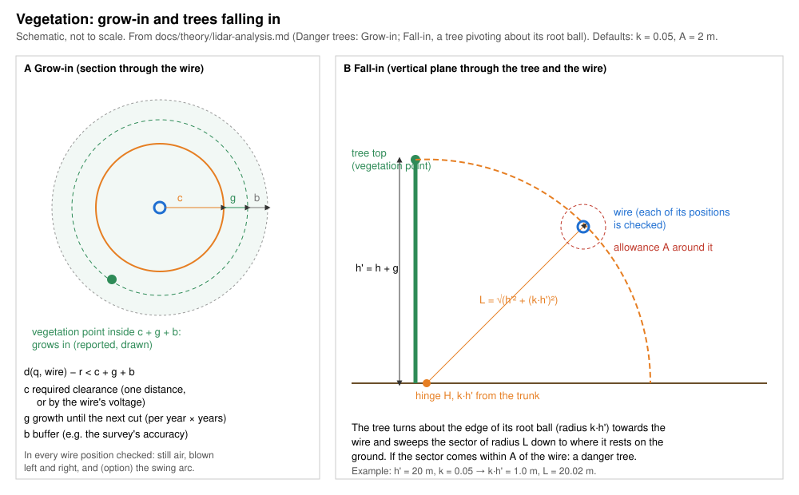
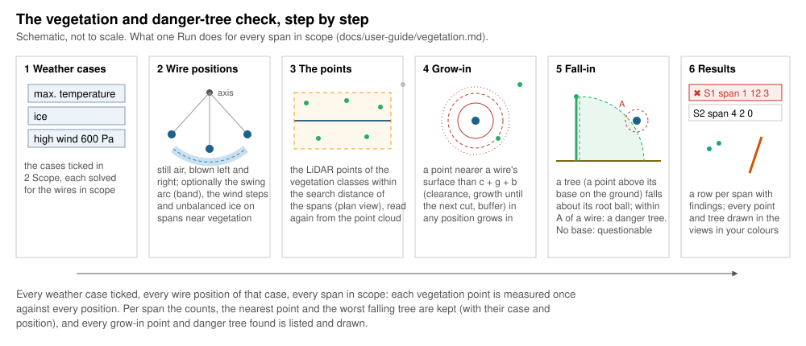

# Vegetation and danger trees

*Built, in active development (not approved yet).* **Checks › Vegetation…**
in OHL-Design. This page explains the window for a line designer: what it
answers, how it works, every setting and every value you can set. The
calculation in detail, with its sources: [theory › Danger
trees](../theory/lidar-analysis.md#danger-trees). The window needs a
point cloud in the project (File › Import › LiDAR points) and a ground
surface for the falling trees.

## What it answers

**Which trees and bushes come too close to the wires — now, or after they
have grown until the next cut — and which trees could hit a wire if they
fell?** Every point of the point cloud's vegetation classes near the line
is measured to every wire in every position of the weather cases you
tick. A span with vegetation too close, or with a tree that could fall
into it, is listed; every such point and tree is drawn in the views.

*Grow-in: a point within c + g + b of the wire. Fall-in: a tree falling
about its root ball comes within A of the wire.*

Two questions are answered, each for every span:

- **Grow-in**: a vegetation point nearer a wire's surface than the
  required clearance **c**, plus the growth **g** until the next cut, plus
  a buffer **b**.
- **Fall-in** (danger trees): a vegetation point taken as the top of a
  tree standing on the ground below it; the tree, grown by g, falls
  towards the wire turning about the edge of its root ball. If it comes
  within the allowance **A** of a wire, it is a danger tree.

A point where the tree's base cannot be found on the ground is a
**questionable tree**: its fall is not worked out, and it is listed so
that you look at it ([below](#what-is-conservative-and-what-is-not)).

## How it works, step by step

### 1. The weather cases

You tick the weather cases in *2 Scope* (none ticked: Run is greyed). A
case gives the temperature, the ice and the wind; the line is solved in
each, each section by its own calculation unless *Wires by* says
otherwise. Typically: the hottest case (the lowest sag) and a windy case
(the wires blown towards the trees).

### 2. The wire positions

In still air a wire hangs straight down from its attachments; with wind
it swings to the side. The window always checks a case without wind as
it is and a windy case **blown to the left and to the right** at its full
pressure. On request (in *4 Model › Wire positions*):

- the **swing arc** (off by default): every position between still air
  and the two blowouts, as a band from the smallest to the largest radius,
  widened by the **band margin** (0.15 m); three solves per windy case;
- the **wind steps** (off by default): still air and every pressure from
  0 up to the case's, in steps (50 Pa), each solved exactly;
- **unbalanced ice**: the span checked carries more ice than its
  neighbours, so it sags further — only on the spans with vegetation
  within reach.

*The swing band between the blowouts, widened by its margin.*

Which to choose, with measured times: [Arc or steps: speed and
quality](../theory/lidar-analysis.md#arc-or-steps-speed-and-quality).

### 3. The vegetation points

The points of the **vegetation classes** (by default those whose role is
vegetation in the project's class scheme) are read again from the point
cloud for each run, within the **search distance** of the spans (50 m,
measured in plan from each span's chord; widened by itself when a check
reaches further).

### 4. Grow-in: too close now or after growth

Each point is measured to the nearest **conductor surface** (each
subconductor of a bundle) in every position of every case. Nearer than
**c + g + b**, it grows in. c can be one distance or a distance by the
voltage of each wire's system (as the clearance rules write it); g is the
growth per year times the years until the next cut, in every direction.

### 5. Fall-in: the danger trees

A point at least the **smallest tree** height above the ground is taken
as the top of a tree whose trunk stands straight below it. Its height,
grown by g, is h. The tree turns about a hinge on the ground at the edge
of its **root ball**, k × h from the trunk, towards each wire point (the
worst direction), and sweeps a sector down to where the ground stops it.
If the sector comes within **A** of a wire's surface in any position, the
tree is a danger tree; the margin says by how much.

*A tree falling about its root ball (schematic, root ball enlarged).*

The tree's base is the ground (the surface of the checks) below the
point, taken only when a ground point lies within the set distance in
plan (5 m): where the ground is only interpolated across a large gap
(under dense trees, a steep slope) its height is not trusted. A point
without a base, near enough that a tree of the tallest height could reach
a span, is **questionable**.

### 6. The results

The **Results** tab opens by itself after a run. It starts with the
verdict: red, *✖ N spans with vegetation: grow-in … points, fall-in …
trees — nearest … m to c: …*, or green, *✔ No vegetation within reach*;
never green while there are questionable trees. Then the table, one row
per span with findings (*Only violations* on; untick it to see every span
near vegetation):

| Column | Meaning |
|---|---|
| Span | the span (a click goes to it) |
| c [m] | the clearance required at the span's voltage |
| Grow-in [points] | how many points grow in (each once, whatever its positions) |
| Fall-in [trees] | how many danger trees |
| Nearest [m] | the nearest vegetation point to a wire's surface |
| Case, position | the case and position it is nearest in (`case`, `left`, `right`, `arc`, a step, `ice …`) |
| Fall margin [m] | the worst falling tree's margin to A (negative: it reaches by that much) |
| Case, position (fall) | its case and position |

Below the table: the **notes** (what was not checked or is *not on the
safe side*, the scope, the unbalanced ice's solves), the **Questionable
trees** (open, in warning colour, when there are any: the span each is
near, its class, its coordinates, its distance in plan, why it has no
base) and the **Worst points** (folded: the worst of each span). Every
grow-in point (a dot) and every danger tree (its trunk from base to top)
is drawn in the 3D view, the plan and the profile while the window is
open, in the two colours of *5 Colours in the views*; the isoclearance
lines too, when asked for.

**Export points CSV…** writes every span's counts, its worst points and
every point found (with its case and position, and a row per questionable
tree); **Export CSV…** under the table writes its rows as shown;
**Export lines (CSV)…** the isoclearance lines. **Save in Performed
checks** keeps the run (settings, cases, results, every point found):
reopened from Checks › Performed checks, it says *out of date* when the
line, the LiDAR points or the ground changed since.

## The window, setting by setting

The Setup tab, top to bottom. The setup is kept in the project for each
project line (project setting `app.vegetation.<line>`), read again when
the project opens; a change after a run marks the results *out of date*
where it matters. Each section and field explains itself in its **(?)**
(on hover: a short line, then the longer text) and says on hover what it
changes; only the warnings (*NOT ON THE SAFE SIDE …*, a band margin
below 0.15 m), what blocks **Run** and the solves a windy case needs stay
written under the fields. The units are in the labels.

### 1 What it checks

The question in short, with **How it is computed** folded below it (the
method in a paragraph and the drawing of the falling tree). **user guide
↗** opens this page.

### 2 Scope

- **Circuits**, **routes** and their **alignments**, **sections**: those
  checked (all ticked: the whole line). The line is still solved whole
  (sections solved together stay together); the spans out of scope are
  left out of the check, and the scope is said in the notes.
- **Weather cases**: the cases solved (a tick menu that stays open:
  search, All / None / Invert), and the project's **case groups** to tick
  several at once. None ticked: Run is greyed.

Fewer circuits, sections or cases: fewer solves, a faster run.

### 3 Rules

**Preset ▾**: the vegetation presets of the design-code plugins turned
on. Chosen, it is previewed — every value it sets and, for each of its
weather cases, whether your case of the same weather is used or a new one
created ([A preset's weather cases](design-codes.md#a-presets-weather-cases)).
**Apply preset** puts its values in (edit them freely after), creates the
cases it needs (one change, undone by Undo) and ticks them. Only its
vegetation part is taken ([Presets per check](design-codes.md#presets-per-check)).

#### Grow-in

| Setting | Default | What changes in the result | Time |
|---|---|---|---|
| **required clearance c [m]** | 5 m (the program's; set yours from the regulation you work to) | a larger c: more grow-in points; by voltage, each wire with its own system's distance | a larger c reads more points |
| **growth per year g [m]** and **years** | 0 and 0 | the growth g × years is added to c in every direction, and to each tree's height | none |
| **buffer b [m]** | 0 m | added to c (e.g. the survey's accuracy) | none |

#### Fall-in

| Setting | Default | What changes in the result | Time |
|---|---|---|---|
| **trees falling in** | on | off: no danger tree is looked for (grow-in only) | off: faster |
| **root-ball fraction k** | 0.05 | the hinge k × h from the trunk: a larger k, the tree reaches further | none |
| **the trunk turns on through the ground** | off | off: a falling trunk rests on the ground. On: it turns on through it, as some programs count it — more trees found below a steep slope, none changed on level ground | none |
| **allowance A [m]** | 2 m | what a falling tree must keep from the wire (flashover, buffers); larger: more danger trees; one distance or by voltage like c | a larger A reads more points |
| **smallest tree [m]** | 2 m | lower points are not trees | none |
| **tallest tree [m]** | 40 m | points are searched as far as a tree this tall can reach; questionable trees within that reach | a taller tree reads more points |
| **tree base to a ground point within [m]** | ticked, 5 m | the base is taken from the ground only with a ground point this near in plan; else the point is questionable. Unticked: every interpolated ground trusted | none |

### 4 Model (folded)

#### Wire positions

| Setting | Default | What changes in the result | Time |
|---|---|---|---|
| **swing arc** | off | every position between still air and the blowouts is checked: more findings, never fewer. **Off, with no wind steps: the positions between still air and the full blowouts are not checked** ([below](#what-is-conservative-and-what-is-not)) | 3 solves per windy case; the window says the solves |
| **band margin [m]** | 0.15 m | every distance to the swing band taken this much smaller (conservative); below 0.15 m the window warns: less safe | none |
| **jumper band margin** | greyed | this check leaves the jumpers out | — |
| **wind stepped** | off | still air and every pressure up to the case's solved exactly, from the sides chosen (the full pressure from both sides in any case); between two steps nothing | one solve per step and side: the window says how many and suggests the arc above 40 |
| **step [Pa]** | 50 Pa | a smaller step finds the wire nearer its worst place between steps | more steps, more solves |
| **from** | both sides | the sides the stepped wind blows from | half the steps' solves |
| **Wires by** | each section's own calculation | every wire solved by the calculation chosen (initial, after creep, after load, max sag; ruling span or finite elements) | finite elements are slower |
| **unbalanced ice** | off | the span checked solved in a weather case of its own with more ice than its neighbours: *the case's ice on the span* (the neighbours without), *more radial ice [mm]*, *more ice load per wire [N/m]*, *a load at mid-span [N]* (the whole bundle's); it sags further | one solve per span near vegetation, per case and side; the notes say how many |

#### Search

| Setting | Default | What changes in the result | Time |
|---|---|---|---|
| **classes** | by role: vegetation | the LiDAR classes checked as vegetation (a tick menu of the project's class scheme; *By role* goes back) | more classes, more points |
| **search distance ± [m]** | 50 m | the half width of the corridor read around the spans' chords (and over which the isoclearance lines are drawn); widened by itself to what the checks reach | a wider corridor reads more points |
| **points kept per span** | 10 | how many worst points per span the *Worst points* list keeps; every point found is still counted, listed in the CSV and drawn | none |
| **isoclearance lines** | off | the ground's clearance to the nearest wire contoured **every [m]** (5) up to **hide above [m]** (40) on a **grid [m]** (1); a drawing only, the checks use the exact distances | a finer grid or a wider corridor: longer |

### 5 Colours in the views

The colours of the grow-in points and of the danger trees (click a
swatch), kept with the project's view settings. They are drawn while
the window is open (View › Layers: Vegetation); closing it takes them
off the views, reopening it (or a saved run) draws them again.

### The footer

- **Use local conditions**: the line with its structures' local wind,
  snow and ice factors on the spans; said in the notes.
- Before **Run**, one line says what a run will do (the sections and
  cases) and about how long it takes, from the last run on this computer.
  What blocks Run is said instead: no point cloud, no vegetation class,
  no weather case ticked, no circuit in scope.
- **Run** and **Stop**: the check runs in the background (an hour at
  most); Stop keeps the previous results.

## Every value you can set

The window keeps its setup in the project (`app.vegetation.<line>`, the
`settings` below with `scope` and `local`) and with every saved run. The
command line `ohl lidar vegetation` takes the same values as options.

| In the window | Kept as | Command line | Unit | Default | Meaning |
|---|---|---|---|---|---|
| Weather cases | `cases` | `--case`, `--weather` | names | the case shown | the cases solved |
| Circuits, routes, sections | `scope` | — | — | the whole line | the wires checked |
| classes | `classes` | `--classes`, `--role` | class numbers | by role `vegetation` | the points checked as vegetation |
| required clearance c | `clearance` | `--clearance` | m | 5 | one distance, `{ by_voltage = [[220, "7 m"], …] }` or `{ base = …, per_kv = …, above_kv = … }` |
| growth per year g | `growth_per_year` | `--growth` | m | 0 | growth each year |
| years | `years` | `--years` | years | 0 | until the next cut |
| buffer b | `buffer` | `--buffer` | m | 0 | added to c |
| trees falling in | `fall_in` | `--fall-in` | — | on (command line: off) | look for danger trees |
| root-ball fraction k | `root_ball` | `--root-ball` | share of h | 0.05 | the hinge's distance from the trunk |
| the trunk turns on through the ground | `fall_through_ground` | `--fall-through-ground` | — | off | the trunk not stopped by the ground |
| allowance A | `fall_allowance` | `--fall-allowance` | m | 2 | as c: one distance or by voltage |
| smallest tree | `min_tree_height` | — | m | 2 | lower points are not trees |
| tallest tree | `max_tree_height` | `--max-tree-height` | m | 40 | the reach searched |
| tree base to a ground point within | `max_base_ground_distance` | `--max-base-ground-distance` | m | 5 (none: no limit; `inf`) | a base only with a ground point this near |
| search distance | `search_distance` | `--corridor` | m | 50 | half width of the corridor read |
| swing arc | `swing_arc` | `--swing-arc` | — | off | the positions between the blowouts |
| band margin | `band_margin` | `--band-margin` | m | 0.15 | the band widened |
| wind stepped, step | `wind_steps`, `wind_step` | `--wind-step` | Pa | off, 50 | still air and every pressure by the step |
| from | `wind_sides` | `--wind-sides` | `both`, `left`, `right` | both | the stepped wind's sides |
| unbalanced ice | `unbalanced_ice`, `unbalanced_ice_value` | `--unbalanced-ice` | `case`; mm; N/m; N (command line: `thickness=` in m) | off, 5 | see [Wire positions](#wire-positions) |
| points kept per span | `keep` | — (10) | points | 10 | the worst points listed |
| isoclearance lines | `isoclearance`: `interval`, `max_level`, `spacing` | `--isoclearance FILE`, `--iso-interval`, `--iso-max`, `--iso-spacing` | m | off; 5, 40, 1 | the contours of the ground's clearance |
| Wires by | `calculation` | — | e.g. `"max-sag-fe"` | each section's own | how the wires are solved |
| Use local conditions | `local` | — | — | off | the local wind, snow and ice factors |
| — (kept, unused) | `jumper_band_margin` | — | m | 0 | the jumpers are not checked here |

A design-code preset sets any of: the classes, c, A, the falling trunk,
g, years, b, k, the smallest and tallest tree, the base's ground point,
the search distance, the swing arc and the wind (steps, sides, band
margin), and names its weather cases.

## What is conservative and what is not

On the safe side (theory, [Danger trees](../theory/lidar-analysis.md#danger-trees)):

- every distance is to the conductor's surface, each subconductor;
- the growth is added in every direction, and to each tree's height;
- a tree falls straight towards each wire point, the worst direction for
  every point;
- falling uphill, the ground's angle is seen from the base (a larger
  sector);
- on the swing band, every radius and angle between still air and the
  blowouts, widened by the band margin of 0.15 m (the measured worst
  excess 0.089 m plus an allowance); a tree's shelter by a ridge is not
  credited on the band;
- the questionable trees' list holds every point without a base that a
  tree of the tallest height could reach from (measured in plan, never
  farther than in space).

Not on the safe side, and said in the results each time it applies:

- **Questionable trees**: a point without a tree base is **not checked
  for fall-in**. The results say *NOT CHECKED, NOT ON THE SAFE SIDE: N
  vegetation points …*, the verdict is red, and they are listed (at most
  10 000, the nearest first; the number is of all). Look at them on site
  or in the point cloud, or give the ground there and run again. Their
  grow-in is checked as every point's.
- **A straight trunk and no crown**: a leaning tree falls further one
  way, a crown reaches beyond its trunk. Said whenever the fall-in is
  checked.
- **A voltage above a distance table's last row** takes the last row's
  distance: a warning names the spans — extend the table.
- **The structures rigid** in the wire solve: said in every result.
- **The ground stops the falling trunk** (the default): a rule that
  ignores the ground counts more trees below a steep slope; tick *the
  trunk turns on through the ground* to count them.
- **Without the swing arc and the wind steps** (the default) only still
  air and the full blowouts are checked: a point nearer a wire between
  them is not found. With a windy case ticked the window says so under
  the wind, and the results' notes: *NOT ON THE SAFE SIDE: without the
  swing arc or the wind steps only still air and the full blowouts are
  checked …*. Tick the swing arc (three solves per windy case).
- **The points the scan holds**: a part of a tree the scan did not see is
  not measured, the nearest point seen is.
- The swing arc is a rigid swing about the attachments (a simplification
  covered by the band and its margin on the example lines:
  [theory](../theory/lidar-analysis.md#arc-or-steps-speed-and-quality)).

## Without the window

`ohl lidar vegetation` runs the same check from the command line, with
the options in the table above, a table per span on the screen and
`--csv` for every span's counts and worst points (and the questionable
trees): [Vegetation and danger trees](analyses.md#vegetation-and-danger-trees).
