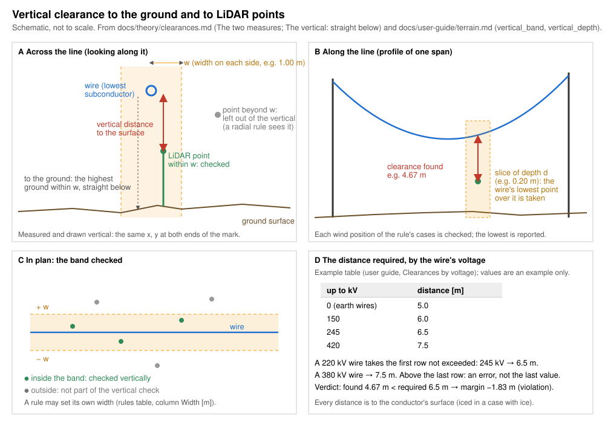
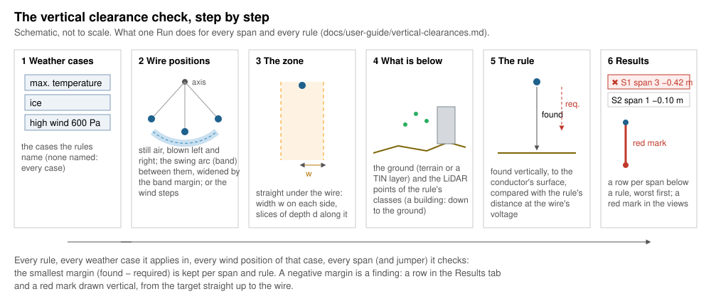
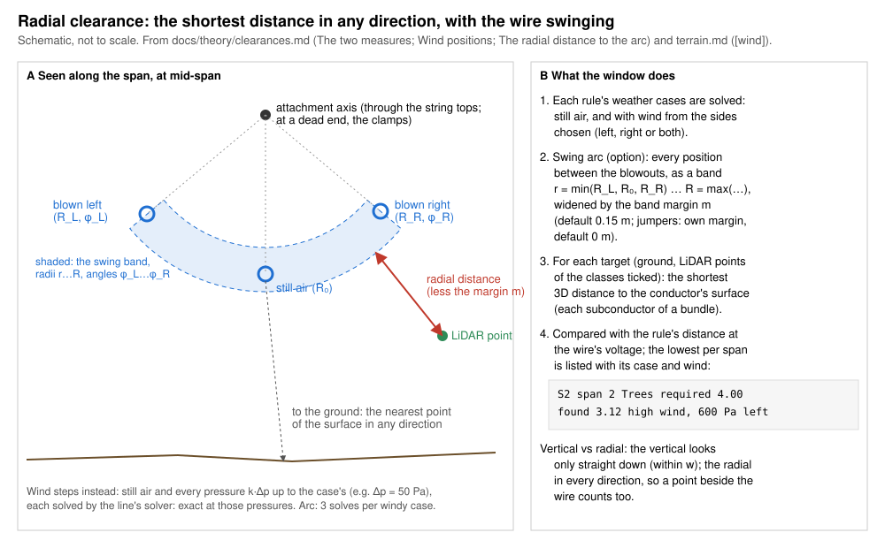
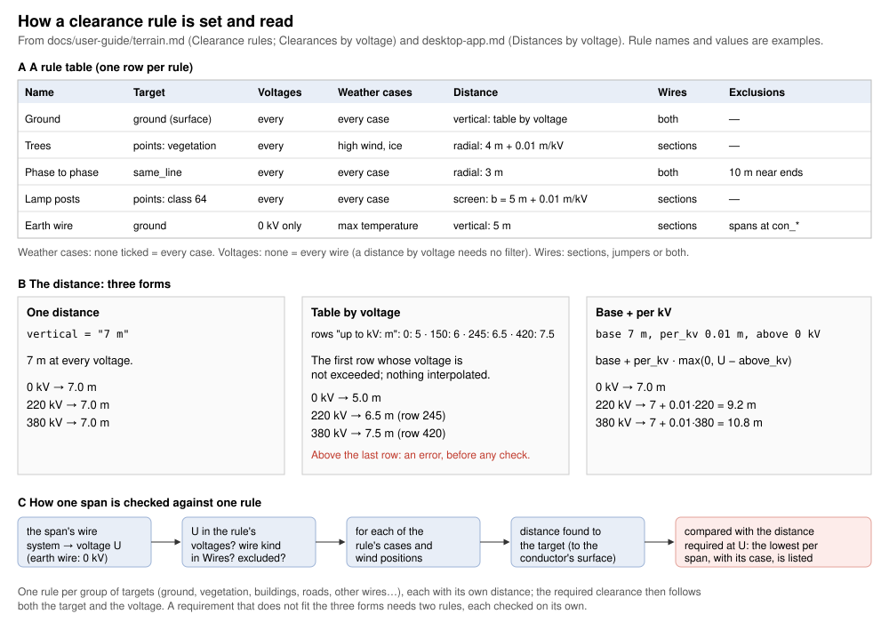
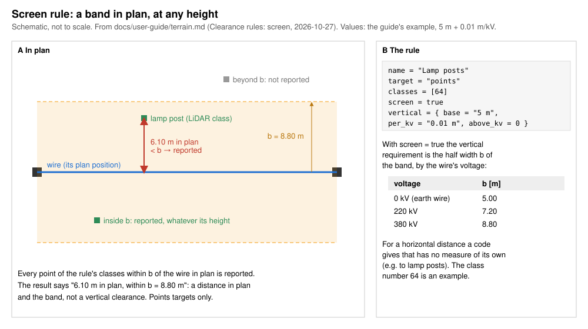

# Vertical clearances

*Built, in active development (not approved yet).* **Checks › Ground
clearances › Vertical clearances…** in OHL-Design. This page explains the
window for a line designer: what it answers, how it works, every setting
and every field of a rule. The calculation in detail, with its sources:
[theory › Vertical and radial clearances](../theory/clearances.md). The
radial window works the same way with a 3D distance instead of the
vertical one: [Vertical and radial clearances](desktop-app.md#vertical-and-radial-clearances).

## What it answers

**How high do the wires pass over the ground and over what stands below
them, in every wind position of the weather cases you name — and is that
enough for your rules?** Each span (and jumper) is compared with every rule
that applies to it; a span below a rule is listed and marked in red in the
views.

*The vertical clearance: straight below the wire, within the zone's width
on each side (A), over a slice of the depth along the line (B), along the
whole span in plan (C); the distance a rule asks for can depend on the
voltage (D).*

## How it works, step by step

### 1. The weather cases

Each rule names the weather cases it applies in (none named: every case of
the project). A case gives the temperature, the ice and the wind pressure;
the line is solved in it as in the rest of OHL-Design, each section by its
own calculation unless the rule or the window says otherwise. Only the
cases some rule names are solved.

### 2. The wire positions

In still air a wire hangs straight down from its attachments. With wind it
swings to the side. The window checks the wire in:

- **still air** and **blown to each side chosen** (left, right or both,
  looking ahead along the line) at the case's full pressure, always;
- the **swing arc** (on by default): every position between still air and
  the two blowouts. The span is swung as one about the line through its
  attachments, as a band from the smallest to the largest radius of the
  three solved positions, widened by the **band margin** (0.15 m). Three
  solves per windy case.
- the **wind steps** (off by default): still air and every pressure from
  0 up to the case's, in steps (50 Pa), each solved exactly. One solve per
  step and side.

*The swing band between the blowouts, widened by its margin.*

*The same positions seen along the span (the radial window measures in any
direction; the vertical window straight down).*

Which to choose, with measured times:
[Arc or steps: speed and quality](../theory/clearances.md#arc-or-steps-speed-and-quality).

### 3. The zone under the wire

The vertical window looks only **straight under (and over) the wire**: a
strip of the **width on each side** (1 m) across the line, in plan, along
the whole span. Along the line it takes the wire at its lowest over a
slice of the **depth** (0.2 m) around each target. A target farther than
the width beside the wire is left out entirely: no slanting distance is
taken for it (use the radial window or a screen rule for that). With the
swing arc the strip follows the swung wire.

*Inside the width the distance is measured straight up; outside it, nothing
is measured.*

*With the swing arc: the strip and the vertical under every position of
the band.*

### 4. What is below: the ground, a TIN, the LiDAR points

A rule names its **targets**: the ground (the terrain surface of the
checks, or a TIN layer of the project by name) and/or **LiDAR classes** of
the point cloud (buildings, vegetation, roads…). The LiDAR points are read
again from the point cloud for each run, only those of the rules' classes
near the wires. A point of a building or a mast stands, if you choose,
for the whole height **down to the ground** below it, so that a wire
passing beside a tall object below its top is found
([theory](../theory/clearances.md#down-to-the-ground-a-wire-beside-a-tall-object)).

### 5. The rule's distance

The distance found is measured vertically from the target to the
**conductor's surface** (the lowest subconductor of a bundle) and compared
with the rule's distance at the wire's voltage: one distance, a table "up
to kV: distance", or a base plus an amount per kV. No distance is given
for you: take it from the regulation you work to.

*A rule's distance in its three forms, and how one span is checked.*

A **screen** rule (rule file only) is different: its distance is the half
width of a band in plan, and every point of its classes inside the band is
reported, at any height.

### 6. The results and the red marks

The **Results** tab starts with the verdict: red, *✖ N spans below a rule —
worst margin …*, or green, *✔ Every span clear — worst margin …*. Below it,
one row per span below a rule, the worst first: the span, the rule, the
required and the found distance, the margin, the wind position (a pressure
and side, or *arc* and the angle on the swing arc), the target and how many
points are too close. A click on a row brings the views to the span, drawn
in its weather case and wind position. Each finding is drawn in **red** in
the 3D view, the cross-section, the profile and the plan while the window
is open: vertical, from the target straight up to the wire. The notes under
the results say what was not checked or **not on the safe side**.

## The window, setting by setting

The Setup tab, top to bottom. Every setting is kept in the project's rule
file of the window (`<model>.vertical-clearances.ohlr`) as soon as the
mouse is released, and a change marks the results *out of date*.

### 1 What it checks

The question in short, with **How it is computed** folded below it (the
method in a paragraph and the zone's drawing). **user guide ↗** opens this
page.

### 2 Rules

The rules, one row each. **Click a rule to edit it below**: the row is
highlighted and its fields appear under the list, titled
*Editing rule n: name*. A new rule (**Add rule**, **Duplicate**) is
opened there at once. Each field says on hover what it changes.

- **Preset ▾**: the rules of a design-code plugin or of the project; the
  chosen preset is shown first, then **Merge** (by name) or **Replace**
  (its rules, wind and what it solves). Its weather cases are matched to
  the project's ([Presets per check](design-codes.md#presets-per-check)).
- **Import…** / **Export…**: rule files (`.ohlr`).
- **Add rule**, **Duplicate**, **Remove** (asked first), **Move up**,
  **Move down**. The window always keeps one rule; a new window starts
  with **Ground**, its distance *to set*. **Run** is greyed out, with the
  reason, while a rule has no distance or no target.

The fields of a rule are in the [table below](#every-field-of-a-rule).

### 3 Wind and zone

| Setting | Default | What changes in the result | Time |
|---|---|---|---|
| **swing arc** | on | every position between still air and the blowouts is checked: more findings, never fewer, than the blowouts alone | 3 solves per windy case (2 with one side), plus the band's lines for the ground; the window says the solves |
| **band margin** | 0.15 m | every distance to a span's band taken this much smaller (conservative); below 0.15 m the window warns: less safe | none |
| **jumper band margin** | 0 m | every distance to a jumper's band taken this much smaller. **At 0 m not on the safe side** between the blowouts (see [below](#what-is-conservative-and-what-is-not)) | none |
| **wind stepped** | off | still air and every pressure up to the case's solved exactly; between two steps nothing | one solve per step and side: the window says how many ("121 solves for a windy case of 600 Pa") and suggests the arc above 40 |
| **step** | 50 Pa | a smaller step finds the wire nearer its worst place between steps | more steps, more solves |
| **from** | both sides | left or right alone: only that side's blowouts (and band) | half the windy solves |
| **width on each side** | 1 m | a wider strip takes more targets beside the wire: more findings, never fewer | more points compared |
| **depth** | 0.2 m | the wire taken at its lowest over a longer slice: smaller distances on a sloping wire (conservative); 0: exactly over the point | none |

With the swing arc alone, a jumper band margin of 0 m and a rule that
checks jumpers, a warning under the wind says *NOT ON THE SAFE SIDE for
the jumpers …* before you run. A rule may have its own width (its
**Width [m]** field: *the window's, 1.00 m* until you click **give it
its own**). The defaults come
from the program, unless the project's line file gives others (its
`[defaults]`: `clearance_zone_width`, `clearance_zone_depth`) or the rule
file states them (`vertical_band`, `vertical_depth`, the `[wind]` table).
A rule file whose `[wind]` table has no `arc` key keeps the arc off: that
is how files written with the arc off read.

### 4 Scope

- **Circuits**: those checked (all ticked: every circuit, also those
  added later; none: Run greyed).
- **Routes** and their **alignments**: only the sections with a structure
  on one ticked (none ticked: the whole line). *View › Work on route*
  narrows it further.

Fewer circuits or routes: fewer sections solved, a faster run.

### 5 Model: more options (folded)

| Setting | Default | What changes | Time |
|---|---|---|---|
| **Solved by** | each section's calculation | every section by finite elements or by ruling span for this check (each keeps its cable condition) | finite elements are slower than ruling span |
| **Ignore LiDAR points farther than … m from the wires** | off (as far as the rules reach) | points farther are not read nor compared; never a different clearance within the distance | fewer points read: faster |

### The footer

- **Use local conditions**: the line with its structures' local wind,
  snow and ice factors on the spans; said in the notes.
- Before **Run**, one line says what a run will do: the wind positions ×
  the sections, the rules, how far in plan the widest rule counts points,
  the LiDAR points of the rules' classes and the **time limit** (900 s
  and 20 s more per million LiDAR points of the rules' classes).
- **Run** and **Stop**: the check runs in the background, each step with
  its own bar and time left; Stop keeps the previous results.
- **Where the time went** (under the results, folded): the measured times
  and plain hints.

## Every field of a rule

The window's rule editor and the rule file
([Clearance rules](terrain.md#clearance-rules-ohlr)) hold the same rule.
A vertical rule in the file is a `[[rule]]` table with a `vertical`
distance; the window writes one table per target kind (the points, the
ground) and reads them back as one row.

| In the window | In the rule file | Unit | Default | Meaning |
|---|---|---|---|---|
| Name | `name` | — | "Rule n" (the first: "Ground") | the rule's name in the results |
| Targets: terrain surface | `target = "ground"`, `surface` | — | the surface of the checks | the ground under the wire: none, the project's surface of the checks, or a TIN layer by name |
| Targets: LiDAR classes | `target = "points"`, `classes`, `roles` | class numbers | none | the points of these classes; `roles` take the classes of the class scheme with that role |
| Voltages | `voltages` | kV | every voltage | only the wires of these nominal voltages (0: earthed wires) |
| Weather cases | `cases` | names (`*` `?`) | every case | the cases the rule applies in |
| Calculation | `calculation` | e.g. `"max-sag-fe"` | each section's own | how every wire is solved for this rule (initial, after creep, after load, max sag; RS or FE) |
| Distance | `vertical` | m | none (to set) | `"7 m"`, `{ by_voltage = [[110, "6 m"], …] }` or `{ base = …, per_kv = …, above_kv = … }` |
| Width [m] | `vertical_band` | m | the window's width | the rule's own half width of the zone across the line |
| — (the window's depth) | `vertical_depth` | m | the window's depth | the slice along the line; the window writes its depth into every rule |
| Points: down to the ground | `to_ground` | true / false | by the terrain's classes | each point stands for the whole height down to the ground (a building, a mast) |
| Wires | `wires` | `"sections"`, `"jumpers"`, `"both"` | both | the sections' spans, the jumpers, or both |
| — (shown in the distance) | `altitude = { from, per_1000_m }` | m, share | none | the distance grows by this share per 1000 m above `from` |
| — (shown as "screen") | `screen` | true / false | false | the distance is the half width of a band in plan, every point in it reported at any height |
| — (not used here) | `radial` | m | — | the radial window's distance |
| — (not kept) | `exclude_near_ends`, `exclude_spans_at` | — | — | exclusion zones: the window says it does not keep them |
| — (not used here) | `search_margin`, `pair_voltage`, `include_same_phase`, `case_pairs`, `circuits` | — | — | for `ohl line` and rules between wires; a rule between wires is left out, said |

Read by the window from the whole file:

| Table | Key | Default | Meaning |
|---|---|---|---|
| `[wind]` | `steps` | false | **wind stepped** |
| `[wind]` | `step` | `"50 Pa"` | **step** |
| `[wind]` | `sides` | `"both"` | **from**: `both`, `left`, `right` |
| `[wind]` | `arc` | false when the table omits it (a new window: on) | **swing arc** |
| `[wind]` | `band_margin` | `"0.15 m"` | **band margin** |
| `[wind]` | `jumper_band_margin` | `"0 m"` | **jumper band margin** |
| `[check]` | `circuits`, `routes`, `alignments` | every circuit, the whole line | **Scope** |
| `[check]` | `method` | each section's own | **Solved by**: `"fe"`, `"rs"` |
| `[check]` | `search_distance` | none | **Ignore LiDAR points farther than** |
| `[check]` | `local` | false | **Use local conditions** |

The `[check]` keys `cases`, `sections`, `wind_study_min` and
`wind_study_cases` belong to other check windows; this window does not use
them.

## What is conservative and what is not

On the safe side (theory, [Wind positions](../theory/clearances.md#wind-positions)):

- the swing band holds every radius and every angle between still air and
  the blowouts, widened by the band margin of 0.15 m (the measured worst
  excess 0.089 m plus an allowance);
- the depth takes the wire at its lowest over the slice;
- **down to the ground** (when on) finds a wire beside a tall object;
- every distance is to the conductor's surface.

Not on the safe side, and said in the results each time it applies:

- **Jumpers with the swing arc, without the wind steps, at a jumper band
  margin of 0 m** (the default): a jumper's band does not hold the jumper
  between its blowouts (up to 0.293 m outside on the example line). The
  results then say *NOT ON THE SAFE SIDE: jumpers checked on their swing
  band without a margin …*, and the window says it under the setting.
  Enter a jumper band margin for your jumpers or tick the wind steps.
- **Points not down to the ground**: a vertical point rule without it
  misses a wire passing beside a tall object below its top; the results
  say so per rule
  ([theory](../theory/clearances.md#down-to-the-ground-a-wire-beside-a-tall-object)).
- **The structures rigid** in the wire solve: said in every result.
- The swing arc is a rigid swing about the attachments (a
  simplification; the band and its margin cover it on the example lines:
  [theory](../theory/clearances.md#wind-positions)).

## Without the window

`ohl zones --rules FILE` runs the same check from the command line on the
window's rule file ([`ohl zones`](terrain.md#vertical-and-radial-clearances-without-the-window-ohl-zones)).
