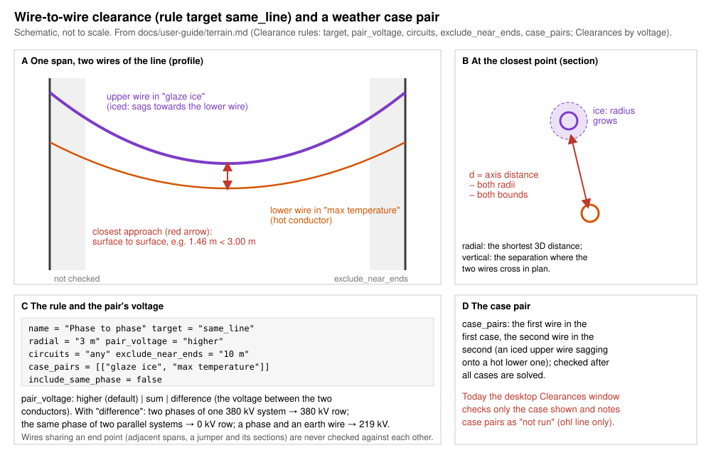
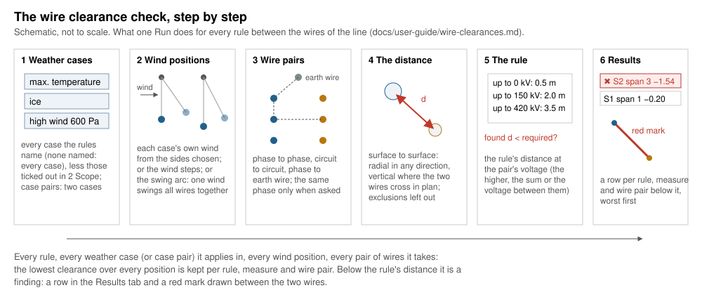
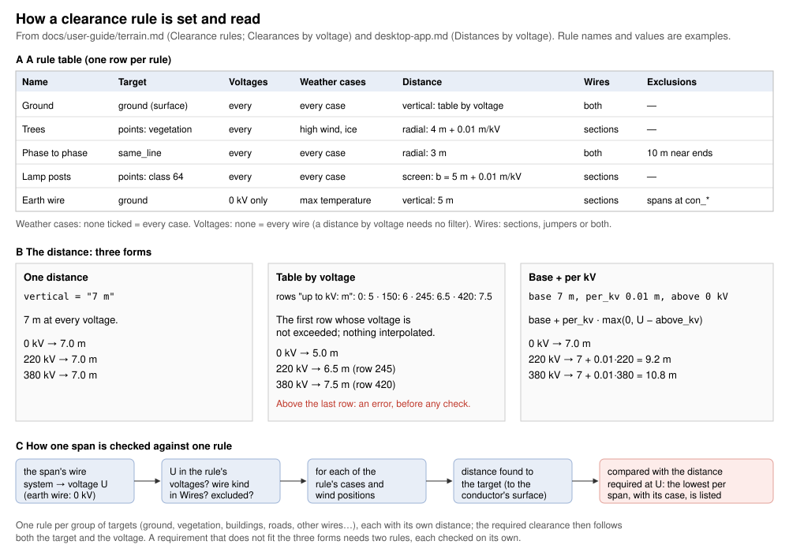

# Wire clearances

*Built, in active development (not approved yet).* **Checks › Wire
clearances** in OHL-Design, its results in the **Clearances** window.
This page explains the check for a line designer: what it answers, how it
works, every setting of the menu and the window, and every field a rule
and the rule file can hold. The calculation in detail, with its sources:
[theory › Wire to wire on the swing arc](../theory/clearances.md#wire-to-wire-on-the-swing-arc).
To the ground and to what stands around the line, the two ground
clearance windows do the same with rules typed in the window:
[Vertical clearances](vertical-clearances.md) and
[Radial clearances](radial-clearances.md).

## What it answers

**Do the wires of this line keep their distance from each other — phase
to phase, circuit to circuit, phase to earth wire, where wires cross
within the line — in every weather case and wind position your rules
name, and is that enough for the rules of your rule file?** The rules come
from a clearance rule file (`.ohlr`, the same file `ohl line --rules`
reads); each wire pair nearer than a rule allows is listed and marked in
red in the views.

The same rule file may also hold rules to the ground and to LiDAR points:
the window checks them too, at the wind positions it solves (the vertical
and radial windows check those on the swing arc as well). Rules to the
wires of **other lines** are not run here: the results list them as
skipped, and `ohl line --other-line` checks them
([Without the window](#without-the-window)).

*Two wires of one span: their closest approach, surface to surface; the
part near the ends left out; the pair's voltage; an iced upper wire over
a hot lower one (a case pair).*

## How it works, step by step

### 1. The weather cases

Each rule names the weather cases it applies in (none named: every case
of the project). **Every case some rule names is run** — not only the
case shown in the views — less those you tick out in *2 Scope*. Each case
gives the temperature, the ice and the wind pressure; the line is solved
in it as in the rest of OHL-Design, each section by its own calculation
unless the rule says otherwise (its *Calculation*).

### 2. The wind positions

With nothing ticked under *4 Model › Wind*, each case is checked at its
own wind pressure, blown to each side chosen (left, right or both,
looking ahead along the line); a case without wind once, in still air.
Two options add positions:

- the **wind steps**: still air and every pressure from 0 up to the
  case's, in steps (50 Pa), each solved exactly. One solve per step and
  side.
- the **swing arc**: in each windy case **one wind swings every wire
  together**, from still air to the full blowout, each span at its own
  angle about the line through its attachments (a heavy span swings less
  than a light one at the same pressure, as it does). The pressures are
  taken so close that no point of a wire moves more than 0.1 m between two
  of them, and the wires are checked against each other at each. Three
  solves per windy case (still air, left, right).

*One wire's swing between still air and its blowouts. Between the wires
the window swings them together, each wire taken thicker by the band
margin and half the step.*

Which to choose, with measured times:
[Arc or steps: speed and quality](../theory/clearances.md#arc-or-steps-speed-and-quality).

### 3. The wire pairs

A rule **between the wires of this line** (`target = "same_line"`) looks
at every pair of the line's wires — in the same span and in other spans,
the jumpers too — that the rule takes:

- **Circuits**: every pair, only pairs of the same circuit (phase to
  phase), or only pairs of different circuits (circuit to circuit, or a
  phase and an earth wire).
- **The same phase too**: wires of the same circuit and phase (the back
  and ahead spans, its jumpers) are left out unless ticked.
- **Voltages**: only the wires of these voltages (the first wire of a
  pair).
- **Wires**: the sections' spans, the jumpers, or both.

Wires that share an end point (two spans at one clamp, a jumper and the
spans it joins) are never checked against each other.

### 4. The distance between two wires

The distance is measured **surface to surface**: from axis to axis, less
both conductors' radii (iced in a case with ice) and the bounds of their
polylines; a bundle from each subconductor.

- **Radial**: the shortest distance in 3D between the two wires.
- **Vertical**: the separation where the two wires cross in plan.

*The two measures. Between two wires the vertical is taken where they
cross in plan; the radial in any direction.*

### 5. Case pairs and exclusion zones

- **Case pairs** (wire rules): the first wire in one weather case, the
  second in another — an iced upper wire over a lower one without ice,
  one circuit at its maximum sag and the other with its ice dropped. Each
  case at its own full wind (case pairs are not swung, not stepped). A
  pair naming a case that is not run is said in the notes.
- **Exclusion zones**, where wires come close by design: the wire within
  a horizontal distance of its ends (the clamps; *near the ends [m]*) and
  the spans ending at structures you name (*spans at*, `*` `?`
  wildcards; e.g. down-leads to cable terminations) are not checked.

### 6. The rule's distance at the pair's voltage

The distance found is compared with the rule's distance: one distance, a
table "up to kV: distance", or a base plus an amount per kV. For a pair
of wires the voltage is the **pair's**: the higher of the two (default),
the sum of both, or the voltage actually between the two conductors from
their phase angles (two phases of one system: the system's voltage; the
same phase of two parallel systems: 0 kV). Earth wires count as 0 kV. No
distance is given for you: take it from the regulation you work to.

*A rule's distance in its three forms, and how one span is checked.*

### 7. The results and the red marks

The **Results** tab starts with the verdict: red, *✖ N violations in 3
weather cases (12 wind positions) — worst radial 1.46 m of 4.00 m: …*, or
green, *✔ Every rule met in …*; a click on a red verdict goes to the worst.
Below it, the notes (folded): each rule's lowest clearance, what was
skipped and why, what is not on the safe side. Then one row per rule,
measure and wire pair below its rule, the worst first:

| Column | Meaning |
|---|---|
| Wire | the span or jumper |
| Other wire | the other wire of the pair (`-` for the ground or a point) |
| Rule | the rule's name |
| Measure | vertical or radial (a screen: the distance in plan) |
| Required [m] | the rule's distance at the wire's or pair's voltage |
| Found [m] | the lowest over every position, to the conductor's surface |
| Margin [m] | found less required |
| Case | the weather case and wind ("high wind, 300 of 600 Pa from the left"; on the arc "high wind, swing arc: 240 of 600 Pa from the left"), or the case pair, that governs |
| Count | how many wind positions and case pairs are below the rule |

Sort by any column, group by rule, wire, measure or case, *Export CSV…*.
A click on a row selects the wire, draws it in the case and wind that
governs and brings the views to it. The findings are drawn in **red** in
the 3D view, the plan and the profile while the window is open.

## The window, setting by setting

### The Checks menu

**Checks › Wire clearances** (a menu that stays open while you tick):

| Entry | What it does |
|---|---|
| **Run checks** | runs the check with the rule file chosen (also the quick bar's *Check wire clearances ✔*) |
| **also after every edit** | the check runs again after each edit and change of weather case; the window keeps the tab you are on |
| **Rule file ▸** | the rule file checked, when the project keeps several |
| **Add a rule file…** | a `.ohlr` chosen on the computer, checked, then kept in the project (next to the line file) and chosen |
| **Show results** | opens the Clearances window |

`examples/starter/rules` has a rule file with invented values to learn
with. Without any rule file the window says so and offers **Add a rule
file…** and the two ground clearance windows.

Every setting of the window is kept in the rule file chosen (its
`[check]` and `[wind]` tables) as soon as the mouse is released, and a
change marks the results *out of date* (**Run again** at the top). Each
section and field explains itself in its **(?)** or on hover; only
warnings, what blocks **Run** and the solves a windy case needs stay
written under the fields.

### 1 What it checks

The question in short, with **How it is computed** folded below it (the
method in a paragraph and the drawing of the 3D distance). **To the
ground and LiDAR points: Vertical… / Radial…** open the two ground
clearance windows. **user guide ↗** opens this page.

### 2 Scope

| Setting | Default | What changes in the result | Time |
|---|---|---|---|
| **Circuits** | all ticked (also those added later) | only the wires of the circuits ticked are checked; none ticked: Run is greyed | fewer sections solved |
| **Routes** and their **alignments** | none: the whole line | only the sections with a structure on one ticked; *View › Work on route* narrows it further | fewer sections solved |
| **Weather cases** | every case of the rules | a case ticked out is not run; none of the rules' cases left: Run is greyed | one solve per case and wind position fewer |

The line under the scope says what Run checks: *Run checks 3 weather
case(s) of the rules (…) at 12 wind position(s)*.

### 3 Rules

- **Rule file**: the file checked (a dropdown when several are kept), its
  number of rules, **Add…** another. A file that cannot be read says why.
- The rules, one row each (name, target, voltages, weather cases,
  distances in words, what is left out). **Click a rule to edit it
  below.**
- **Preset ▾**, **Import…** / **Export…**, **Add rule…** (to the ground,
  between the wires of this line, to the wires of other lines; rules to
  LiDAR classes come from the ground clearance windows or a preset),
  **Duplicate**, **Remove** (asked first), **Move up**, **Move down**.
- **Merge rules by voltage…** (only when there is something to merge):
  rules alike but for one voltage each become one rule with a table by
  voltage, previewed first ([A rule's voltages](desktop-app.md#a-rules-voltages)).
- **Remove all rules** (asked first; the file's `[wind]` and `[check]`
  stay).

A change is written when the mouse is released and every rule is
complete; for a project's rule file each change is one command (Edit ›
Undo takes it back). Comments, the fields the editor does not show and
the file's order stay as they are. The fields of a rule are in the
[table below](#every-field-of-a-rule).

### 4 Model: the wind (folded)

| Setting | Default | What changes in the result | Time |
|---|---|---|---|
| **swing arc** | off | the wires checked against each other while one wind swings them all together: every pressure between still air and the blowouts | 3 solves per windy case (2 with one side), then the wire pairs at many pressures |
| **band margin** | 0.15 m | with the arc: every wire taken this much thicker (conservative); below 0.15 m the window warns: less safe | none |
| **jumper band margin** | 0 m | with the arc: every jumper taken this much thicker. **At 0 m not on the safe side** between the blowouts (see [below](#what-is-conservative-and-what-is-not)) | none |
| **wind stepped** | off | still air and every pressure up to the case's solved exactly; between two steps nothing | one solve per step and side: the window says how many ("25 solves for a windy case of 600 Pa") and suggests the arc above 40 |
| **step** | 50 Pa (the project's `clearance_wind_step`) | a smaller step finds the wires nearer their worst place between steps | more steps, more solves |
| **from** | both sides | left or right alone: only that side's positions | half the windy solves |

The drawing beside the wind shows the positions checked.

### The footer

- **Run** and **Stop**: the check runs in the background; the progress
  shows the wind positions solved, then the LiDAR points read, and the
  time left. Stop keeps the previous results. Its time limit is the
  ground windows' (900 s and 20 s more per million LiDAR points of the
  rules' classes).
- **after every edit**: as in the menu.
- After a run, beside Run: the cases checked and the time it took.

## Every field of a rule

The window's rule editor and the rule file
([Clearance rules](terrain.md#clearance-rules-ohlr)) hold the same rule,
a `[[rule]]` table. A rule needs a `name`, a `target` and at least one of
`vertical` and `radial`.

| In the window | In the rule file | Unit | Default | Meaning |
|---|---|---|---|---|
| Name | `name` | — | "Rule n" | the rule's name in the results |
| Add rule… (its kind) | `target` | `"same_line"`, `"other_lines"`, `"ground"`, `"points"` | — | between the wires of this line; to other lines' wires (`ohl line --other-line` only); to the ground; to LiDAR points |
| Vertical | `vertical` | m | none | the separation where two wires cross in plan (to the ground or points: straight below or above); a distance `"4 m"`, `{ by_voltage = [[110, "3 m"], …] }` or `{ base = …, per_kv = …, above_kv = … }` |
| Radial | `radial` | m | none | the shortest 3D distance; the same three forms |
| Voltages | `voltages` | kV | every voltage | only the wires of these nominal voltages (0: earthed wires); for a pair, its first wire |
| Weather cases | `cases` | names (`*` `?`) | every case | the cases the rule applies in |
| Calculation | `calculation` | e.g. `"max-sag-fe"` | each section's own | how every wire is solved for this rule (initial, after creep, after load, max sag; RS or FE); a case pair's two cases both by it |
| Case pairs | `case_pairs` | pairs of case names | none | wire rules: the first wire in the first case, the second in the second |
| Pair voltage | `pair_voltage` | `"higher"`, `"sum"`, `"difference"` | `"higher"` | wire rules: the voltage a pair's distance is taken at |
| Circuits | `circuits` | `"any"`, `"same"`, `"different"` | `"any"` | `same_line`: every pair, phase to phase, or circuit to circuit |
| the same phase too | `include_same_phase` | true / false | false | `same_line`: wires of the same circuit and phase checked too |
| Left out: near the ends [m] | `exclude_near_ends` | m | 0 (none) | the wire within this horizontal distance of its ends is not checked |
| Left out: spans at | `exclude_spans_at` | structure names (`*` `?`) | none | spans ending at these structures are not checked |
| — (shown in the distance) | `altitude = { from, per_1000_m }` | m, share | none | the distances grow by this share per 1000 m above `from`, taken at the highest point of the wire (of the higher wire of a pair) |
| — (kept, not shown) | `wires` | `"sections"`, `"jumpers"`, `"both"` | `"both"` | the sections' spans, the jumpers, or both |
| — (kept, not shown) | `search_margin` | m | 5 m (the project's `clearance_search_margin`) | targets are reported within the required distance plus this; crossings of other wires always |
| — (kept, not shown) | `classes`, `roles` | class numbers, role names | none | `points` rules: the LiDAR classes, by number or by the class scheme's role |
| — (kept, not shown) | `surface` | a TIN layer's name | the surface of the checks | `ground` rules: the terrain surface checked |
| — (kept, not shown) | `vertical_band` | m | 0.5 m to points, 0 to the ground (the project's `clearance_vertical_band`) | ground and point rules: the half width across the line of the vertical zone |
| — (kept, not shown) | `vertical_depth` | m | 0 | ground and point rules: the depth along the line of the vertical zone |
| — (kept, not shown) | `screen` | true / false | false | point rules: the vertical distance is the half width of a band in plan ([screen rules](terrain.md#clearance-rules-ohlr)) |
| — (kept, not shown) | `to_ground` | true / false | by the terrain's classes | point rules: each point stands for the height from the ground up to it |

The window edits *Case pairs*, *Pair voltage* and *Left out* for rules
between wires (and to other lines; *Circuits* for `same_line` only); a
file may give the exclusions on any rule. The meaning of every field in
the file, with examples: [Clearance rules](terrain.md#clearance-rules-ohlr).

The rest of the file:

| Table | Key | Default | Meaning |
|---|---|---|---|
| (top) | `format`, `version`, `name` | `"ohl-clearance-rules"`, 1 or 2 | the file's kind, its version (2 when a rule gives `to_ground`) and name |
| `[wind]` | `arc` | false | **swing arc** |
| `[wind]` | `band_margin` | `"0.15 m"` | **band margin** |
| `[wind]` | `jumper_band_margin` | `"0 m"` | **jumper band margin** |
| `[wind]` | `steps` | false | **wind stepped** |
| `[wind]` | `step` | the project's `clearance_wind_step` (50 Pa) | **step** |
| `[wind]` | `sides` | `"both"` | **from**: `both`, `left`, `right` |
| `[check]` | `circuits`, `routes`, `alignments` | every circuit, the whole line | **2 Scope** |
| `[check]` | `cases` | every case of the rules | **2 Scope › Weather cases** |
| `[check]` | `method` | each section's own | not shown here: every section solved by `"fe"` or `"rs"` (the window applies it) |

The `[check]` keys `search_distance`, `local`, `sections`,
`wind_study_min` and `wind_study_cases`, and the tables
`[[tension_rule]]`, `[[string_rule]]`, `[[internal_rule]]`,
`[[lightning_rule]]`, `[[ice_shedding_rule]]`, `[vegetation]` and
`checks`, belong to other check windows: this window does not use them
and keeps them in the file. A file holding only tension or ice shedding
rules is not listed here.

## What is conservative and what is not

On the safe side (theory, [Wire to wire on the swing arc](../theory/clearances.md#wire-to-wire-on-the-swing-arc)):

- every distance is to the conductor's surface: both radii (iced in a case
  with ice) and the bounds of both polylines taken off;
- on the swing arc each wire is taken thicker by half the movement between
  two pressures and by the band margin (0.15 m: the measured worst excess
  0.089 m plus an allowance);
- a voltage between two rows of a table takes the upper row's distance
  (nothing is interpolated);
- with `altitude`, the distance is taken at the highest point of the wire
  (the higher wire of a pair).

Not on the safe side, or not checked:

- **Jumpers on the swing arc at a jumper band margin of 0 m** (the
  default), without the wind steps: between its blowouts a jumper can lie
  outside its swing (up to 0.293 m on the example line). Enter a jumper
  band margin for your jumpers or tick the wind steps.
- **Case pairs** are checked at each case's full wind only, not swung or
  stepped.
- **The ground and LiDAR points** are checked here only at the positions
  solved (still air, the full blowouts and the steps when ticked), not on
  the swing arc between: the Vertical and Radial clearance windows check
  them there.
- **Rules to other lines** are not run here (said in the notes).
- **The structures rigid** in the wire solve, as in every clearance check.
- The swing arc is a rigid swing about the attachments (a simplification;
  the margins cover it on the example lines:
  [theory](../theory/clearances.md#wind-positions)).
- Rules that the window skips (no ground, no point cloud, no class that
  matches, a case pair whose cases are not run) are said in the notes.

## Without the window

`ohl line FILE --rules RULES.ohlr` runs the same rules from the command
line, in the weather case given (`--temperature`, `--ice-thickness`,
`--wind-pressure`) or in several (`--weather FILE.ohlwc`, with an
envelope over them and the case pairs), and **`--other-line FILE`**
(repeatable) adds the wires of other lines for the `other_lines` rules
([Terrain and ground clearance](terrain.md),
[Envelopes over weather cases](terrain.md#envelopes-over-weather-cases)).
`ohl line` checks each case as it is: it ignores `[wind]` (no steps, no
swing arc) and `[check]`.
