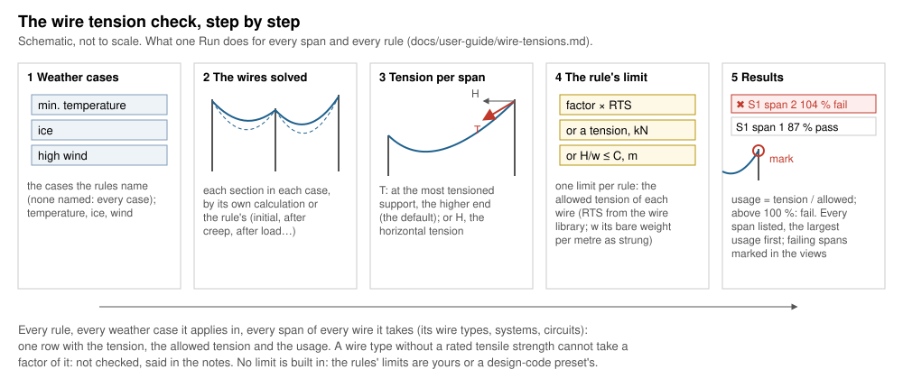

# Wire tensions

*Built, in active development (not approved yet).* **Checks › Wire
tensions…** in OHL-Design. This page explains the window for a line
designer: what it answers, how it works, every setting and every field of
a rule. The calculation in detail, with its sources:
[theory › Wire tensions](../theory/wire-tensions.md).

## What it answers

**Does any wire carry more tension than your rules allow, in any of the
weather cases you name?** Each rule gives a limit — a share of the wire
type's rated tensile strength (RTS), a tension, or a largest catenary
constant — for the wires and weather cases it names. Every span of every
wire it takes is checked in each of its cases: the tension, the allowed
tension, the **usage** (tension / allowed) and *pass* or *fail*. A span
above 100 % fails and is marked in the views.

*The tension of a span is largest at its higher support (T); its
horizontal part H is the same all along the span.*

No limit is built in: the rules' limits are yours, taken from the
regulation you work to, or a design-code plugin's preset.

## How it works, step by step

### 1. The weather cases

Each rule names the weather cases it applies in (none named: every case
of the project). A case gives the temperature, the ice and the wind
pressure. Only the cases some rule names are solved; if none of them is
in the project, Run says so and does nothing.

### 2. The wires solved

Each section is solved in each case as in the rest of OHL-Design: by its
own calculation (ruling span or finite elements, in its condition:
initial, after creep, after load), unless the rule gives its own
**Calculation**. A case is solved once per calculation the rules ask. A
section that cannot be solved is named in the notes and not checked.
With **Use local conditions** ticked, the structures' local wind for
strength and wire ice are put on their spans first
([Weather](weather.md)).

### 3. The tension of each span

Per span and per wire (one subconductor of a bundle), the rule compares
either:

- **maximum (most tensioned support)**, the default: the larger of the
  span's two end tensions, at its higher support; or
- **horizontal**: the horizontal tension of the span, the same all along
  it.

A catenary-constant rule always compares the horizontal tension.

### 4. The rule's limit

One limit per rule, the **allowed tension** of each wire:

| Limit | Allowed tension | Where it is set |
|---|---|---|
| a factor of the RTS | factor × the wire type's RTS (from the wire library) | the window or the rule file |
| a tension | that tension, e.g. 25 kN | the rule file (shown in the window) |
| a catenary constant C | C × the wire's **bare** weight per metre as strung, e.g. 1800 m | the rule file (shown in the window) |

A wire type without an RTS cannot take a factor of it: it is not checked,
and the notes name it.

### 5. The results and the marks

The **Results** tab starts with the verdict: red, *✖ N spans × case above
the allowed tension — worst …* (the span, its tension of its allowed, the
usage, the rule and the case), or green, *✔ Every span within its allowed
tension (… ; highest usage … %)*; red too when nothing was checked. A
click on the verdict brings the views to the worst span, drawn in its
weather case. Below it the notes (what was not checked, the model of
bimetallic wires, local conditions), then the table: one row per span ×
case × rule — span, rule, case (with the calculation when the rule gives
one), **Tension [kN]**, **Allowed [kN]**, **Usage [%]**, **Verdict** —
the largest usage first, failures in red. A click on a row selects its
span and draws it in the row's case. **Export CSV…** writes the rows
shown; **Full report (CSV)…** every row with every field (wire type, RTS,
factor, tensions in N, the marked point, the limit), as `ohl tensions`
writes it.

The spans above their allowed tension — none failing: the one of the
largest usage — are **marked** at their most tensioned support (the
higher end of the span, also for a horizontal rule) in the 3D view, the
cross-section, the plan and the profile while the window is open; closed,
the marks go. Results out of date after an edit say so, with **Run
again**.

## The window, setting by setting

The Setup tab, top to bottom. Every change is kept at once in the
project's rule file of the window (`<model>.tension-rules.ohlr`) and
marks the results *out of date*. Each section and field explains itself
in its **(?)** or on hover; what blocks **Run** and every warning stay
written in the window.

### 1 What it checks

The question in short, with **How it is computed** folded below it (the
method in a paragraph and a drawing of T and H on a span). **user
guide ↗** opens this page.

### 2 Rules

The rules, one row each: name, what is compared, cases, limit, wires.
**Click a rule to edit it below**: its fields appear under the list.

- **Preset ▾**: the rules of a design-code plugin or of the project; only
  their tension rules are taken, by **Merge** (by name) or **Replace**,
  and the weather cases they name are matched to the project's
  ([Presets per check](design-codes.md#presets-per-check)).
- **Import…** / **Export…**: rule files (`.ohlr`).
- **Add rule** (a rule for every wire in every case, its factor to set),
  **Duplicate**, **Remove** (asked first), **Move up**, **Move down**.
  A new window has no rule: **Run** is greyed out, with the reason, while
  there is no rule or a rule has no limit above 0 (*set the factor*
  beside it).

The fields of a rule, with their effect on the result:

| Field | Default | What changes in the result | Time |
|---|---|---|---|
| **Weather cases** | every case | the cases the rule is checked in; a case no rule names is not solved | one solve of the line per case (and per calculation) |
| **Calculation** | each section's own | every wire solved in that condition and by that method for this rule (initial, after creep, after load, max sag; ruling span or finite elements) | another calculation: the cases solved once more; finite elements slower than ruling span |
| **Limit** | — (shown only for a rule file's tension or catenary constant) | the allowed tension is that tension, or C × the bare weight per metre | none |
| **Factor of RTS** | 0 (to set) | allowed = factor × RTS: a smaller factor, more spans fail | none |
| **Tension compared** | maximum (most tensioned support) | horizontal: a lower tension compared, never higher | none |
| **Wires** | every wire | only the wire types, electrical systems and circuits ticked; a wire counts when it is in every list ticked | fewer wires checked |

The fields in the file: [table below](#every-field-of-a-rule).

### 3 Scope

- **Circuits**: those checked (all ticked: every circuit, also those
  added later; none: Run greyed).
- **Routes** and their **alignments**: only the sections with a structure
  on one ticked (none ticked: the whole line).

Fewer circuits or routes: fewer sections solved, a faster run. Each rule
narrows its wires further (its **Wires**).

### The footer

- **Use local conditions**: the line with its structures' local wind for
  strength and wire ice on their spans, each case solved again; said in
  the notes. Its hover says the effect and the time it took last.
- Before **Run**, one line says what a run will do: the sections and
  spans in the scope, in how many weather cases of the rules.
- **Run** and **Stop**: the check runs in the background; Stop keeps the
  previous results. Its time grows with the cases × the calculations of
  the rules × the sections: one solve of the line each.

## Every field of a rule

The window's rule editor and the rule file
([Wire tension rules](terrain.md#wire-tension-rules-tension_rule)) hold
the same rule, a `[[tension_rule]]` table.

| In the window | In the rule file | Unit | Default | Meaning |
|---|---|---|---|---|
| Name | `name` | — | "rule n" | the rule's name in the results |
| Weather cases | `cases` | names (`*` `?`) | every case | the cases the rule applies in |
| Calculation | `calculation` | e.g. `"max-sag-fe"` | each section's own | how every wire is solved for this rule |
| Factor of RTS | `factor` | share | none (to set) | allowed = factor × the wire type's RTS; above 0 |
| Limit (shown) | `tension` | N, kN (`"25 kN"`) | none | in place of `factor`: the allowed tension (rule file version 2) |
| Limit (shown) | `catenary_constant` | m (`"1800 m"`) | none | in place of `factor`: the largest H / w, w the bare weight per metre as strung; compares the horizontal tension (version 2) |
| Tension compared | `measure` | `"max"`, `"horizontal"` | `"max"` | the tension at the most tensioned support, or the horizontal tension; leave it out with `catenary_constant` |
| Wires: wire types | `targets.wire_types` | ids (`*` `?`) | every wire | only these wire types |
| Wires: electrical systems | `targets.systems` | ids, `none` | every wire | only these systems (`none`: the sections without one) |
| Wires: circuits | `targets.circuits` | names | every wire | only these circuits |

A rule gives **exactly one** limit: `factor`, `tension` or
`catenary_constant`; a file with none or more than one is refused, with
the rule's name. A rule with a tension or a catenary constant shows it as
its **Limit** in the window, and its factor greyed out: change it in the
rule file.

Read by the window from the whole file:

| Table | Key | Default | Meaning |
|---|---|---|---|
| `[check]` | `circuits`, `routes`, `alignments` | every circuit, the whole line | **Scope** |
| `[check]` | `local` | false | **Use local conditions** |

The window writes `checks = ["tension"]`. Clearance rules (`[[rule]]`),
string rules and the other tables of a file are not used here.

## What is conservative and what is not

On the safe side (theory, [Wire tensions](../theory/wire-tensions.md)):

- **maximum** (the default) compares the largest tension of the span, at
  its higher support; the horizontal tension is never larger;
- a **catenary constant** is taken with the **bare** weight per metre,
  also in an iced or windy case, where the ratio to the case's own load
  would be smaller: the stricter reading.

Not checked, and said in the notes each time:

- a **wire type without an RTS** with a factor rule;
- a **section not solved** in a case;
- a **rule none of whose cases is solved**, or a rule without a valid
  limit.

Not on the safe side, or not covered by this check:

- **Bimetallic wires above the knee point**: by default the outer strands
  take compression without limit — the largest hot sag, but of the three
  models the **lowest tension** (1.1 % lower on the benchmark span at
  150 °C). The notes name the model of each such wire type; a hot case
  rarely governs a tension rule, but where it does, compare
  ([theory](../theory/sagtension.md#bimetallic-wires-above-the-knee-point)).
- Only the **weather cases** the rules name are checked, as static
  cases: dynamic effects (ice shedding, galloping) are other windows
  ([Analyses](analyses.md)).
- **Sag to limits** (command line, below) gives the **tightest** line the
  rules allow: the least sag and the highest structure loads — check the
  clearances and the structures after it
  ([theory](../theory/sagtension.md#sag-to-limits-on-the-line)).

Separate from this check: every solve warns when a span's tension exceeds
the RTS itself ([Sag-tension](../theory/sagtension.md)).

## Without the window

`ohl tensions` runs the same check from the command line on the window's
rule file, on the whole line and without local conditions (it does not
read the `[check]` table), and writes the full report with `--csv`;
`--sag-to-limits` gives each section the largest stringing tension that
keeps every rule
([Wire tension rules](terrain.md#wire-tension-rules-tension_rule)).
