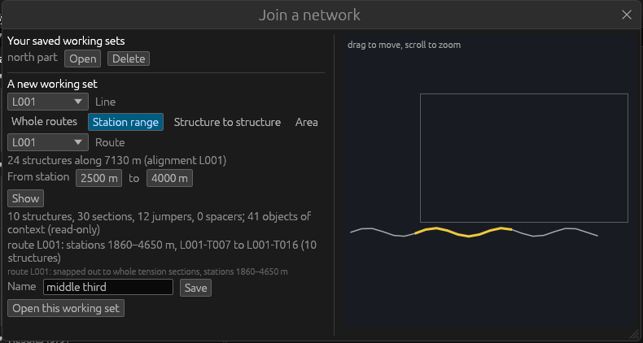

# Working sets on a network

*Built 2026-11-19 (country server, phase 6); in active development, not
approved yet.*

A country server keeps every line of a network in one database
([server mode](server.md#a-networks-server-in-active-development)). In
OHL-Design you do not open a whole network: you pick a **working set** —
what you work on — and the rest around it is drawn as **context**,
read-only. The desktop's project file stays as it is: your working set is
kept on your computer as an ordinary `.ohl` file holding a part of a line.

## Picking a working set

**File › Join a network…**: paste the invitation the network's
administrator gave you, give your user name, **Connect**. The window lists
your saved working sets (if any) and lets you pick a new one on one line
(model) of the network:

- **Whole routes** — tick routes in the list, or click them on the map.
- **Station range** — a route and two stations along its first alignment
  (the window says how long it is and how many structures it has).
- **Structure to structure** — a route and two of its structures.
- **Area** — click the corners of a polygon on the map (**Clear** to start
  again).

**Show** asks the server what the picks hold. A part of a route is
**always snapped out to whole tension sections**: every section with a
span in the range (or the area) comes whole, with the structures it hangs
on, because a section is solved whole. The window says how many
structures, sections, jumpers and spacers the working set holds, how many
objects come with it as context (read-only), and, for each route, the
stations it really covers ("snapped out … stations 1860–4650 m") — drawn
yellow on the map. Other sections hanging on those structures with no
span in the range (circuits straining elsewhere) are not in it but come
with it as context, read-only (the notes say how many): so each structure
of the working set carries all its wires, and its sections solve as they
do on the whole line.

**Save** keeps the picks on the server under a name (for you; the extent
is worked out again from them each time it is opened, on the line as it is
then). **Open this working set** (or **Open** beside a saved one) asks the
server for it.

## Working in it

The working set opens like a project: every table, check and drawing works
on it as on a project file. What came with it as context (the other
sections and jumpers on its structures, another route's section ending at
a jumper, the alignments within 500 m, the structures tied to its routes'
alignments) is in the line too but **cannot be edited** in it.

- **Edits go to the server**: your rights decide each object it changes
  (as it was and as it is; [rights](server.md#rights-on-a-network-phase-7-in-active-development)),
  the line validates them where they change, then the server sends back
  the rows that changed and your working set takes them, like any edit.
  Others' edits touching your working set arrive the same way, with who
  made them in the status bar. Deleting or renaming is decided by the
  server on the whole line.
- **The context** around the camera (about 5 km across, tiles of 1 024 m)
  is drawn grey in the 3D view and the plan (layer **Context (network, a
  drawing)**): other lines' structures as sticks, their wires, their
  routes and names. The wires are **a drawing, never a result**: each
  section solved alone in the network's context case (15 °C, no wind, a
  network setting) — no jumper loads, no coupled assemblies, no
  flexibility. They are never listed in a table and never used by a
  check. A tile is asked again when someone's edit touched it.
- **File › Working set…** shows what you work on, the routes of the same
  line you may add (those in view marked) — **Add this route**: it comes,
  caught up, and nothing else changes — and **Save as** a name. A route of
  another line cannot be added: a working set is on one line (open that
  line's own).

If the connection is lost, the working set stays readable; join again to
edit. Joining again with the same working set sends only what changed
meanwhile (your file says what it holds; the server compares).

## A branch over your working set

On a network you can keep your work apart from main in a branch over your
working set's routes, shared with a team if you like, and merge it back
when it is ready — see
[Branches over a working set](server.md#branches-over-a-working-set-phase-11-in-active-development)
(through the server's protocol for now; a window and a command
in OHL-Design are to come).

## What is not there yet

Checks on a working set use what it holds; pulling in the neighbours that
can change a check's answer comes with phase 10 (until then, what a check
did not see is said where it matters). What you may pick, see and edit
follows your rights (phase 7: a working set reaching something you may
not see is refused, saying nothing of it). On main, the rights decide
each edit; the rules of [towers shared by several routes](shared-towers.md)
(other routes refused, stale marks) apply on a branch over your working
set and when it is merged (phase 11), not yet to edits made directly on
main. Point clouds, terrain and backgrounds are not served by the network
yet; a working set is on one line.
